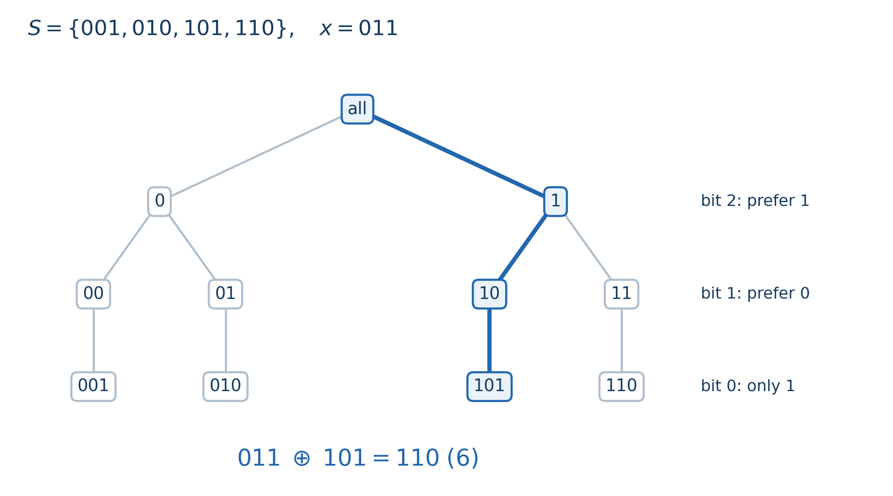

# Chapter 7 01 Trie 与二进制建模

遇到 XOR 题，先别急着决定用什么模板。先把候选答案说清楚：是从已有元素中选一个数，还是任选若干元素，把它们异或起来？

例如集合是 $\{1,2\}$。从中选一个数，最大只能选到 $2$；允许选一个子集，最大异或值却是 $1\oplus2=3$。01 Trie 主要维护前一种候选，下一章的线性基维护后一种候选。两者都处理二进制，但保留的信息不同。

本文默认你熟悉基本位运算和前缀和。统一把数看成 $W$ 位非负整数，位编号是 $0,1,\ldots,W-1$，比较大小时从高位往低位看。

## 1. 每走一层，都在缩小同一批候选

把每个数写成等长的二进制串，从最高位开始插入一棵树：当前位是 $0$ 就走 $0$ 儿子，是 $1$ 就走 $1$ 儿子。这样，一条完整路径对应一个数；走到中间某个结点，则只确定了这个数的高位前缀。

这就是 Trie 在查询时的含义：**当前结点下面，是目前仍然可能被选中的全部元素。** 它们的前缀相同，低位暂时没有决定。比如 $W=3$，插入 $001,010,101,110$，走到前缀 $1$ 后，只剩 $101$ 和 $110$ 两个候选。

每个结点保存两个儿子和一个计数 $cnt$，表示当前有多少个元素经过这个结点。这里把集合当作多重集：同一个值插入两次，路径相同，但沿途计数都要增加二。插入、删除各沿一条路径加一、减一，都是 $O(W)$。

删除前必须确认这个值存在。删除后即使儿子指针还在，分支里也可能已经没有元素，所以查询要检查 $cnt>0$，不能只检查指针。静态插入 $n$ 个数至多建立 $1+nW$ 个结点；如果动态删除时不回收结点，空间要按历史上建立过的路径计算。

### 最大异或为什么能一位一位选？

给定 $x$，现在要在集合 $S$ 中选一个真实元素 $y$，使 $x\oplus y$ 最大。最高位最有价值，因此处理第 $b$ 位时，希望结果这一位是 $1$，也就是希望选到 $y_b=1-x_b$ 的分支。如果这个分支非空，就走它；否则只能走另一支。

以 $x=011$ 为例：最高位希望 $y$ 取 $1$，留下 $101,110$；接着希望 $y$ 的第 $1$ 位取 $0$，只剩 $101$；最后没有选择，得到 $011\oplus101=110$。



图中蓝色路径保留下来的前缀依次是 $1,10,101$。每一步都在上一批候选中继续筛选，最终得到的 $101$ 确实是原集合中的元素。

证明只需要比较二进制的大小。若两个结果在第 $b$ 位以上相同，一个在第 $b$ 位为 $1$，另一个为 $0$，前者就在这一位多出 $2^b$；后面所有低位加起来最多是 $2^b-1$，无法反超。因此，只要能在当前前缀下得到 $1$，就不必再考虑得到 $0$ 的分支。沿着非空分支走到叶子，又保证了所有决策能由同一个元素实现。

最小异或同理，只需优先走与 $x$ 当前位相同的分支。最值查询要求当前集合非空，两种查询都是 $O(W)$。注意，正确性不是“每一位可以独立选择”，而是高位优先决定大小，同时 Trie 保证选择之间兼容。

> **最值应用**：[CF1658 D2 — 388535 (Hard Version)](https://codeforces.com/problemset/problem/1658/D2)（约 2200；已完成）。本题可以用最小、最大异或验证候选，分析保留在[配套第 1 题](binary-trie-exercises.md#1-cf1658-d2--388535-hard-version)。

## 2. 从最值走到计数、排名和整体异或

### $C(x,K)$ 到底在数什么？

先固定一个查询数 $x$。让集合 $S$ 中的每个元素 $y$ 分别与它异或，问：**有多少个元素得到的结果小于给定门槛 $K$？** 我们把这个数量记为

$$
\boxed{C(x,K)=\#\{y\in S:x\oplus y<K\}.}
$$

这里 $\#\{\cdots\}$ 表示满足大括号内条件的元素个数。$x$ 是对每个候选都一样的查询参数，$K$ 是比较结果大小的门槛，$y$ 才是遍历 $S$ 时变化的候选。$x$ 可以是任意 $W$ 位非负查询数，不要求它本身在 $S$ 中。$C(x,K)$ 的返回值是一个数量；定义它时还没有用到 Trie，逐个枚举 $y$ 也能算出这个数量。

当前的集合 $S$ 是这个记号的背景，公式没有再把它写成一个参数。插入、删除改变 $S$ 后，即使查询参数 $x,K$ 不变，$C(x,K)$ 也可能改变。

例如，仍取前面的 $S=\{001,010,101,110\}=\{1,2,5,6\}$，查询 $x=011=3$、$K=101=5$：

| 候选 $y$ | $x\oplus y$ | 十进制结果 | 是否严格小于 5？ |
| --- | --- | --- | --- |
| $001$ | $010$ | 2 | 是 |
| $010$ | $001$ | 1 | 是 |
| $101$ | $110$ | 6 | 否 |
| $110$ | $101$ | 5 | 否，等于门槛 |

所以 $C(3,5)=2$。如果再插入一个 2，就有两次出现的 2 都满足条件，答案变成 3。这里沿用多重集语义，按出现次数计数。

也可以把它看成一个熟悉的排名问题：固定 $x=3$ 后，将全部异或结果从小到大排列，得到

$$
T_3=(1,2,5,6).
$$

$C(3,5)$ 就是在这个序列中数有多少项小于 5。特别地，$x=0$ 时，$C(0,K)$ 就是数 $S$ 中小于 $K$ 的元素个数。$x\ne0$ 时也做同一件事，只是比较的值变成了 $x\oplus y$。

查询过程中不需要真的生成或排序 $T_x$。Trie 仍保存原来的 $y$；接下来要解释，它怎样跳过一整批已经确定满足条件的候选。

### 为什么计数时只需沿一条路径继续比较？

记异或结果为 $z=x\oplus y$。从高位比较 $z$ 和 $K$ 时，一个候选会处于三种情况之一：高位已经小于、高位暂时相等，或高位已经大于。最高不同位一旦确定大小，低位就无法改变这个结论。

因此，已经小于的候选可以全部计入答案，已经大于的候选可以全部舍去，只有高位仍相等的候选需要继续检查低位。查询中的当前结点 $u$，恰好保存第三类候选。注意，Trie 的路径写的是 $y$ 的前缀；固定 $x$ 后，这个前缀也唯一确定 $z$ 的前缀。

现在处理第 $b$ 位，假设更高位仍相等。令 $t=x_b$，先看清两个儿子的含义：

- 走 $y_b=t$ 的儿子时，$z_b=t\oplus t=0$。
- 走 $y_b=t\oplus1$ 的儿子时，$z_b=1$。

于是转移由 $K_b$ 决定：

| $K_b$ | 结果本位取 0 的候选 | 结果本位取 1 的候选 |
| --- | --- | --- |
| 0 | 前缀继续相等，进入这一支 | 首次不同位已经更大，舍去 |
| 1 | 首次不同位已经更小，整支计入 | 前缀继续相等，进入这一支 |

为什么“整支计入”就是加一个 $cnt$？同一儿子下面的所有数，在已经检查过的位上作出的是同一种选择。它们都已在当前位严格小于 $K$，后面低位不再有任何限制，所以这棵子树里有多少个元素，就贡献多少个答案。

用刚才 $x=011,K=101$ 的例子逐层看：

| 当前位 | 进入这一层时仍需比较的 $y$ | 本层处理 | 累计答案 |
| --- | --- | --- | --- |
| 第 2 位，$K_2=1$ | $001,010,101,110$ | $001,010$ 的结果最高位为 0，整支加入；继续比较 $101,110$ | 2 |
| 第 1 位，$K_1=0$ | $101,110$ | $101$ 的结果前缀为 $11$，已经大于 $K$ 的 $10$，舍去；只剩 $110$ | 2 |
| 第 0 位，$K_0=1$ | $110$ | 它的异或结果为 $101$，本位仍相等，没有进入严格更小的分支 | 2 |

走完以后，剩下的候选恰好满足 $x\oplus y=K$。由于我们统计的是严格小于，它们不应再加入答案。每个被计入的候选都在它与 $K$ 的最高不同位处被完整计入一次，之后不再沿它的分支下降，所以既不漏计，也不重计。

对应伪代码如下，不存在的儿子计数约定为零：

```text
count_less(x, K):
    若 K <= 0，返回 0
    若 K >= 2^W，返回 cnt[root]
    u = root, ans = 0
    从 b = W-1 到 0:
        若 u 不存在或 cnt[u] = 0，结束
        t = x 的第 b 位
        若 K 的第 b 位为 1:
            ans += cnt[child[u][t]]       // 本位异或为 0，整支已经更小
            u = child[u][t xor 1]        // 本位异或为 1，继续比较
        否则:
            u = child[u][t]              // 只有本位异或为 0 才可能合法
    返回 ans                            // 完全等于 K 的候选没有加入
```

每层只给答案加一次计数，并沿一个儿子下降，复杂度为 $O(W)$。若要求闭区间 $[A,B]$，就是

$$
\#\{y\in S:A\le x\oplus y\le B\}
=C(x,B+1)-C(x,A).
$$

这里固定 $x$ 和同一时刻的 $S$，两次查询分别统计结果不超过 $B$、结果小于 $A$ 的数量，相减后恰好留下目标区间。$B+1$、上界 $2^W$ 要用能够容纳它们的类型；先溢出再比较会破坏边界判定。

**例题 1：[CF817 E — Choosing The Commander](https://codeforces.com/problemset/problem/817/E)**（独立估算约 1900；Educational Codeforces Round 23，2017）。本题维护动态多重集，支持插入、删除，以及询问有多少个现有元素与给定的 $p$ 异或后小于 $l$。第三种操作直接对应 $C(p,l)$。

题面样例先插入 3、4，再查询 $p=6,l=3$。两次异或结果是 $6\oplus3=5$、$6\oplus4=2$，所以返回 1；删去 4 后，再做同一次查询，返回 0。集合的变化由插入、删除负责，计数查询始终回答刚才定义的同一个问题。每次操作 $O(W)$，完整分析见[配套第 6 题](binary-trie-exercises.md#6-cf817-e--choosing-the-commander)。

### 第 $k$ 小：利用分支计数决定要去哪里

这里的目标明确为：在所有 $x\oplus y$ 的结果中，取从小到大第 $k$ 项，且 $1\le k\le|S|$。继续用 $x=3$ 与 $T_3=(1,2,5,6)$，第 3 小结果就是 5。

在当前前缀相同的候选中，本位结果为 0 的全部值，都排在本位结果为 1 的值前面。设前一支有 $c$ 个元素：若 $k\le c$，目标在前一支；若 $k>c$，前面的 $c$ 个值可以跳过，进入后一支，并把排名改为 $k-c$。这里的两支仍分别是原 Trie 的 $child[u][x_b]$ 与 $child[u][x_b\oplus1]$。

例如求刚才的第 3 小：最高位结果为 0 的有两个，即 1、2，所以跳过它们，目标变成最高位为 1 的那组中的第 1 小；这组的结果为 $101,110$，下一位优先取 0，保留 $101$，最终得到 5。对应原集合元素是 $y=6$；查询返回的异或结果是 $3\oplus6=5$。

这和 $C$ 的关系可以准确写成：第 $k$ 小结果为 $v$ 当且仅当

$$
C(x,v)<k\le C(x,v+1).
$$

左边说严格小于 $v$ 的项还不足 $k$ 个，右边说加入所有等于 $v$ 的项后已经达到第 $k$ 项。重复值按出现次数占据名次。直接沿 Trie 选择分支只需 $O(W)$，不必先将全部异或结果排好序。

### 整体异或：树里的数与当前实际值怎样对应？

给所有元素同时异或一个数时，可以维护掩码 $L$，约定树里保存的 $s$ 当前代表实际值 $s\oplus L$。全体异或 $t$，只需更新 $L\gets L\oplus t$。

例如，树里仍保存 $1,2,5,6$，最初 $L=0$。整体异或 3 后，令 $L=3$，它们代表的实际值就变成 $2,1,6,5$。此时数实际值小于 5 的个数，就是对存储值查询 $C(3,5)=2$；求实际值第 3 小，就是查询“与 3 异或后的第 3 小”，结果为 5。

若外部还给定查询数 $x$，则使用参数 $x\oplus L$，因为

$$
x\oplus(s\oplus L)=(x\oplus L)\oplus s.
$$

所以实际集合上的阈值计数、最值、第 $k$ 小，都能归约为原 Trie 上对应的异或查询。新插入实际值 $z$ 时，存入 $z\oplus L$；删去实际值也使用同样转换。例如 $L=3$ 时插入实际值 4，要存入 $4\oplus3=7$，而 $7\oplus3=4$，恰好符合约定。

整体更新为 $O(1)$，其余操作仍为 $O(W)$。这里利用了异或的结合律和 $L\oplus L=0$；整体加法有进位，不能直接套用这个掩码方案。


## 3. 什么时候能把题目变成 Trie 查询？

Trie 解决的是“一个数与一批候选数”的问题。很多题的主要工作，是先把原来的对象变成这样的形式。

设数组为 $a_1,\ldots,a_n$，定义前缀异或 $P_0=0$、$P_i=a_1\oplus\cdots\oplus a_i$。由于相同部分异或两次会抵消，子段异或可以写成

$$a_l\oplus\cdots\oplus a_r=P_r\oplus P_{l-1}.$$

固定右端点 $r$，$P_r$ 就是查询数，左端点对应的 $P_{l-1}$ 就是候选。求最大非空子段异或时，先插入 $P_0$；随后依次处理 $r$，先查询 $P_r$，再把它插入。查询时树中恰有 $P_0,\ldots,P_{r-1}$，所以每个候选都对应一个合法的非空子段。这个先后顺序来自下标范围，不是模板习惯；先插入会额外允许空子段。

**例题 2：[CF665 E — Beautiful Subarrays](https://codeforces.com/problemset/problem/665/E)**（独立估算约 2100；Educational Codeforces Round 12，2016；额外前置：前缀异或）。求异或和至少为 $k$ 的非空子段个数。固定右端点 $r$，允许的前缀恰为 $P_0,\ldots,P_{r-1}$，共 $r$ 个；其中 $C(P_r,k)$ 个与 $P_r$ 异或后小于 $k$，所以本轮贡献为

$$
\boxed{r-C(P_r,k).}
$$

这里把 $C$ 的两个参数代成了当前前缀 $P_r$ 和题目门槛 $k$，候选集合则随着右端点变化。对样例 $a=(1,2,3),k=2$，前缀为 $P=(0,1,3,0)$：

| $r$ | 查询时树里的前缀 | $P_r$ | 与各候选异或的结果 | 本轮贡献 |
| --- | --- | --- | --- | --- |
| 1 | $\{0\}$ | 1 | $1$ | $1-C(1,2)=1-1=0$ |
| 2 | $\{0,1\}$ | 3 | $3,2$ | $2-C(3,2)=2-0=2$ |
| 3 | $\{0,1,3\}$ | 0 | $0,1,3$ | $3-C(0,2)=3-2=1$ |

总数为 3。每轮先查询，再插入当前前缀，保证只统计 $l\le r$ 的非空子段；不同位置的相同前缀也必须按出现次数保留。总时间 $O(nW)$，答案用 64 位，完整证明和边界见[配套第 7 题](binary-trie-exercises.md#7-cf665-e--beautiful-subarrays)。[官方题解](https://codeforces.com/blog/entry/44466) 直接统计至少为 $k$ 的数量；这里通过补集复用本节的 $C$ 查询。

如果长度必须在 $[A,B]$ 内，其中 $1\le A\le B$，先令 $j=l-1$，把长度限制写成

$$A\le r-j\le B
\quad\Longleftrightarrow\quad
\max(0,r-B)\le j\le r-A.$$

于是查询 $P_r$ 时，只需维护这个下标窗口中的前缀。右端点向右移动，就插入新进入的前缀、删除离开的前缀；候选范围为空时跳过查询。每个前缀进出至多一次，总时间 $O(nW)$。这类题先写允许哪些下标，通常比先想如何移动窗口更稳妥。

若候选是静态数组的任意区间 $[l,r]$，可以改用可持久化 Trie。令 $root_i$ 表示前 $i$ 个数，每次插入只复制新数路径上的 $O(W)$ 个结点。查询时同时拿着 $root_r$ 与 $root_{l-1}$：两棵树中对应同一个二进制前缀的结点，计数相减，就得到区间内该前缀的元素数。之后的贪心或计数照常进行，只是“分支非空”改为“计数之差大于零”。

这里相减的是同一分区的计数，不是根的编号，也不是把两棵树的结构相减。建树时间、空间均为 $O(nW)$，单次查询 $O(W)$。

> **练习（估算 CF 难度）**：[XOR Inverse](https://codeforces.com/problemset/problem/1416/C)（约 2200）。

## 4. 三道例题：先看变量之间的关系

以下保留原稿选定的三题，难度按 CF 800–3500 尺度独立估算。

| 题目 | 原始来源 / 平台 | 估算难度 | 主要训练点 |
|---|---|---:|---|
| [XOR Construction](https://codeforces.com/gym/104777/problem/N) | 2023–2024 ICPC NERC Southern and Volga Russian Regional，N；亦见 [CF 1895D](https://codeforces.com/problemset/problem/1895/D) | 1900 | 用一个首项决定整个排列，再判定值域 |
| [Xor Minimization](https://atcoder.jp/contests/abc281/tasks/abc281_f) | AtCoder ABC281 F，2022 | 2000 | 公共掩码下的极小极大递归 |
| [XOR Pairs](https://qoj.ac/problem/4579) | 2021 ICPC Asia Jakarta Regional，A；QOJ | 1700 | 固定异或值，直接建立计数对应 |

### XOR Construction：排列约束为什么只剩最大值？

已知 $a_i=b_i\oplus b_{i+1}$，要求构造一个由 $0,\ldots,n-1$ 组成的排列 $b$，题目保证有解，$n\le2\cdot10^5$。

相邻项的关系提示我们消去中间变量。定义 $p_0=0$、$p_i=a_1\oplus\cdots\oplus a_i$。一旦选定 $x=b_1$，就有

$$b_{i+1}=x\oplus p_i,\qquad 0\le i<n.$$

因此不是逐项构造 $b$，而是给固定的 $n$ 个前缀统一异或一个 $x$。有解意味着这些前缀互不相同，否则对应的两项无论怎样平移都会相等。异或平移是双射，又保证平移后仍然互不相同。

现在只剩一个条件：所有结果都小于 $n$。因为 $n$ 个互不相同的非负整数都落在 $[0,n-1]$ 中，必然把整个区间恰好占满。把所有 $p_i$ 插入 Trie，枚举 $0\le x<n$，用最大异或查询检查

$$\max_i(x\oplus p_i)<n.$$

找到一个通过的 $x$，即可按公式恢复排列。时间、空间均为 $O(nW)$。[比赛官方题解](https://codeforces.com/gym/104777/attachments/download/22887/tutorial.pdf) 给出了这一判定思路。这里真正减少约束的原因，是变换已经自动维护了互异性。

### Xor Minimization：这次选的是大家共用的 $x$

给定 $a_i<2^{30}$，选择一个公共 $x$，最小化 $\max_i(a_i\oplus x)$。和普通最大异或查询比较一下：普通查询固定 $x$，选一个 $a_i$；这里则要选 $x$，并承受所有 $a_i$ 中最差的结果。因此不能直接照搬单次查询的贪心。

仍从高位看。令 $f(u,b)$ 表示当前候选都位于 Trie 结点 $u$，只考虑第 $b$ 位到第 $0$ 位时，能够达到的最小最大值。若只有一个非空儿子，让 $x_b$ 与这一组相同，本位就全部变成零，递归该儿子即可。

若两个儿子都有元素，无论 $x_b$ 取什么，都会有一组结果本位为一，另一组为零。在这个子问题中，前一组的值至少为 $2^b$，后一组的值至多为 $2^b-1$，所以最大值必然来自前一组。我们可以选择让哪一组承担这一位的一，再替它挑选最好的公共低位：

$$f(u,b)=2^b+\min\{f(u_0,b-1),f(u_1,b-1)\}.$$

其中 $u_0,u_1$ 是两个儿子；处理完所有位时返回零。为何不用同时兼顾两组低位？因为不承担这一位的一的那组，无论低位多坏，都不可能超过另一组。递归求出两个备选方案，最终只使用较优的那一个公共掩码，并没有给不同元素分别选 $x$。

每个结点处理一次，时间、空间都是 $O(nW)$。可对照 [AtCoder 官方解说](https://atcoder.jp/contests/abc281/editorial/5377) 阅读这个递归。

### XOR Pairs：固定结果后，可以不用建树

统计有序对 $(A,B)$，满足 $1\le A,B\le A\oplus B\le N$，且 $A\oplus B$ 不在禁用集合 $S$ 中。原题 $N\le10^6$，禁用输入可能重复。

看到异或和范围，不一定需要 Trie。先固定 $X=A\oplus B>0$，问有多少对产生它。设 $H$ 是不超过 $X$ 的最大二的幂，写成 $X=H+q$，其中 $0\le q<H$。

由于 $A,B\le X<2H$，两者在 $H$ 以上都没有一；而 $X$ 的 $H$ 位为一，说明恰有一方包含这一位。先考虑 $A$ 包含它，写成 $A=H+a,B=b$。此时

$$A\le X\Longleftrightarrow 0\le a\le q,
\qquad A\oplus B=X\Longleftrightarrow b=a\oplus q.$$

一旦选定 $a$，$b$ 就唯一确定，而且 $b<H\le X$，上界自动满足。$a=0,\ldots,q$ 原本有 $q+1$ 种；其中只有 $a=q$ 会使 $B=0$，要删去，剩下 $q$ 种。交换 $A,B$ 又得到不重叠的 $q$ 种，因此固定 $X$ 的贡献是

$$2q=2(X-H).$$

用布尔数组标记禁用值并去重，枚举 $X=1,\ldots,N$，遇到允许的值就累加贡献，总时间 $O(N+|S|)$、空间 $O(N)$。答案使用 64 位整数。

如果 $N$ 更大，还可以按最高位分块。一个完整或末尾截断的块写成 $X=H,\ldots,H+L-1$，总贡献为

$$\sum_{q=0}^{L-1}2q=L(L-1).$$

先求所有块的总贡献，再减去每个不同禁用值的贡献；用排序去重时，时间是 $O(|S|\log|S|+\log N)$。[官方分析](https://training.qoj.ac/download.php?id=989&r=0&type=attachments) 也得到同一计数式；这里用“确定 $a$ 就确定 $b$”的对应关系解释它。

## 5. 最后确认：你的压缩留下了什么？

| 后续要回答的问题 | 必须保留的信息 | 常用工具 |
|---|---|---|
| 从已有元素选一个，与 $x$ 异或求最值 | 真实元素及其高位前缀 | 01 Trie |
| 计数或第 $k$ 小 | 每个前缀的出现次数 | 带计数的 Trie |
| 任意子集能否异或成 $k$、最大子集异或 | 全部组合生成的空间 | 线性基 |
| 固定最高位后已能直接计算贡献 | 高位约束与变量间的对应 | 位分析或数位 DP |

实现前再检查三个细节。第一，$W$ 要覆盖整个操作过程中可能出现的位，包括查询数和懒掩码，不能只看初始数组。第二，重复值、删除后的零计数分支，都属于数据结构的语义。第三，整数比较和移位要与“$W$ 位非负数”的模型一致：留意有符号最高位，以及对机器字宽做等宽左移的非法情况。

Trie 能让逐位决策不丢失真实候选。能否用它，取决于你是否已经把题目改写成了这样的候选选择。
