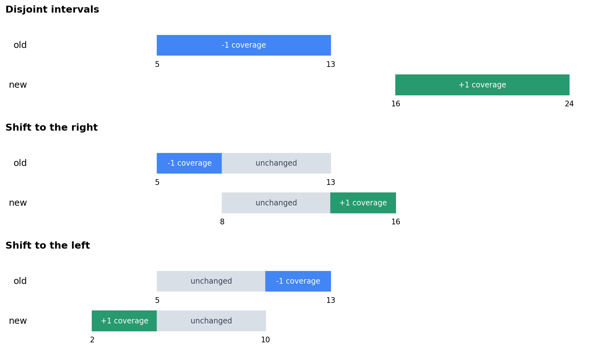
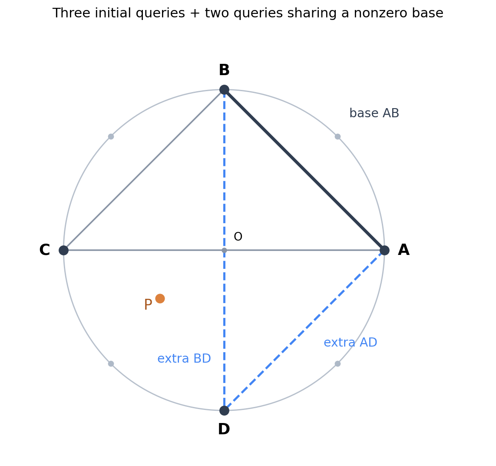

# 2025 ICPC 成都区域赛 / 第四届 Universal Cup 成都站：J、G、A、B、D、L、C、K、E 题解

[比赛入口：QOJ 2567](https://qoj.ac/contest/2567) · [电子科技大学出题组官方题解](https://assets.ucup.ac/tutorials/tutorials-4-04-zh.pdf)

前八题沿用此前赛后复盘中估算难度不超过 2500 的范围，E 为额外指定的提高题。以下分数均为原评估中的独立估算，不是 CF 官方 Rating。按原评估顺序讲解，重点是建模、正确性和实现边界，默认不附完整代码。

| 题号 | 原题 | 估算 CF 难度 | 核心内容 |
| --- | --- | --- | --- |
| J | [Judging Papers](https://qoj.ac/problem/14715) | 900 | 独立决策与单位收益 |
| G | [GCD of Subsets](https://qoj.ac/problem/14712) | 1400 | 单元素组、资源上界与达到上界的构造 |
| A | [A Lot of Paintings](https://qoj.ac/problem/14706) | 1900 | 舍入区间与整数构造 |
| B | [Blood Memories](https://qoj.ac/problem/14707) | 2100 | 一轮记忆、状压 DP 与 max-plus 矩阵 |
| D | [Deductive Snooker Scoring](https://qoj.ac/problem/14709) | 2100 | 规则状态图与路径还原 |
| L | [Label Matching](https://qoj.ac/problem/14717) | 2200 | 通配符多重集匹配与 sack |
| C | [Crossing River](https://qoj.ac/problem/14708) | 2400 | 倒序安排与最早完成时间 |
| K | [K-Coverage](https://qoj.ac/problem/14716) | 2500 | 重叠消去、区间增益与单调队列 |
| E | [Escaping from Trap](https://qoj.ac/problem/14710) | 3300 | 五次面积询问、尺度恢复与符号歧义 |

## J — Judging Papers：每次操作最多买到一个录用名额

每篇论文有 $m$ 个评分，总分至少为 $k$ 时录用。最多对 $b$ 篇不同论文 rebuttal；被选论文的每个正分减一，每个非正分加一。操作不会影响其他论文。

记第 $i$ 篇论文操作前后的分数为 $s_i,t_i$。不必模拟多种顺序：每篇至多操作一次，$t_i$ 在读入这篇论文时就能算出。

已经有 $s_i\ge k$ 的论文可以直接留下。对它操作最多维持录用，还可能丢掉录用名额；而题目允许少用次数，所以总存在一个最优方案不对这些论文操作。剩余论文中，只有 $s_i<k\le t_i$ 的操作能增加一个名额，其余操作没有收益。

因此，若初始录用数为 $A$，可挽救数为 $C$，答案为

$$
\boxed{A+\min(b,C).}
$$

上界是最多花 $b$ 次、最多挽救 $C$ 篇；任取其中 $\min(b,C)$ 篇操作即可达到。所有有效操作收益相同，不需要按分差排序。

每组时间 $O(nm)$，额外空间 $O(1)$。评分 0 属于增加的一侧，录用条件是大于等于 $k$。原题两组样例答案为 $2,1$。

## G — GCD of Subsets：先看一组最少消耗几个数

初始多重集为 $\{1,\ldots,n\}$。最多改 $m$ 个数，每个可改成 $[1,n]$ 内任意值；之后反复取出一个 gcd 恰为 $k$ 的非空组，求最多能取多少组。$1\le k\le n\le10^{18}$。

一个组中的数必须全是 $k$ 的倍数。原来可用的数有

$$
q=\left\lfloor\frac nk\right\rfloor.
$$

其中只有数值为 $k$ 的元素能独立成组，其他合法组至少使用两个元素。这就是上界的来源，不必研究所有子集的 gcd。

### 两个资源上界

修改后，可用元素总数至多为 $U=\min(n,q+m)$；数值为 $k$ 的元素至多有 $m+1$ 个，因为原来只有一个。若最终取出了 $g$ 组，其中 $s$ 组是单元素组，那么

$$
2g-s\le U,\qquad s\le m+1,\qquad g\le U.
$$

所以

$$
\boxed{g\le\min\left(U,\left\lfloor\frac{U+m+1}{2}\right\rfloor\right).}
$$

这还只是上界：必须证明能把剩下的数配成 gcd 为 $k$ 的二元组。

### 修改哪些数，才能达到上界？

先修改 $x=\min(m,n-q)$ 个原本不是 $k$ 倍数的元素，把它们变成 $k$。每个这样的修改既增加一个可用元素，也直接增加一个单元素组。

还有预算时，从原有倍数 $k,2k,\ldots,qk$ 中选最大的

$$
y=\min(q-1,m-x)
$$

个改成 $k$，保留原来的那个 $k$ 不动。剩下未修改的倍数恰好为 $k,2k,\ldots,(q-y)k$。把它们除以 $k$，可以组成

$$
\{1\},\{2,3\},\{4,5\},\ldots
$$

因为相邻整数互质，每一对乘回 $k$ 后 gcd 恰为 $k$。至多剩一个元素不用，得到 $\lceil(q-y)/2\rceil$ 组；再加上修改产生的 $x+y$ 个单元素组。

若 $m\le n-q$，$x=m,y=0$，组数为 $m+\lceil q/2\rceil$，恰好达到上面的界。若 $m>n-q$ 且 $m<n$，$U=n$、$x+y=m$，组数为 $\lfloor(n+m+1)/2\rfloor$；若 $m=n$，所有元素都可变成 $k$，答案为 $n$。因此统一答案就是框中的上界。

每组 $O(1)$ 时间、$O(1)$ 空间。使用 64 位；中间的 $U+m+1$ 不超过 $2\cdot10^{18}+1$。注意原题是多重集，多个元素都改成 $k$ 完全合法。样例答案为 $2,2$。

## A — A Lot of Paintings：严格上界不能用一个 epsilon 糊过去

输入整数 $d_i\in[0,100]$，表示一个比例四舍五入到两位小数后得到 $d_i/100$。要求构造非负整数 $b_i$，令 $B=\sum b_i>0$，使 $b_i/B$ 的舍入结果正确；每个 $b_i\le10^9$。

先暂时不要求整数。设真实百分数为 $z_i=100b_i/B$，那么 $\sum z_i=100$。当 $d_i>0$ 时，必须有

$$
z_i\ge d_i-\frac12;
$$

当 $d_i=0$ 时，下界改为 0。所有 $i$ 都必须满足严格上界

$$
z_i<d_i+\frac12.
$$

上界不能取等：例如真实百分数 $0.5$ 会舍入到 1，而不会舍入到 0。比例本身还有 $z_i\le100$ 的限制，但下面的构造会自动满足。

记 $T=\sum d_i$，$q=\#\{i:d_i>0\}$。把下界、严格上界分别相加，得到必要条件

$$
\boxed{2T-q\le200,\qquad 2T+n>200.}
$$

接下来直接构造，证明它们也充分。整个过程只用整数。

### $T>100$：在允许取等的下端点上减去超额

需要把百分数总和减少 $T-100$。令 $r=2(T-100)$，从 $q$ 个非零项中任选 $r$ 项，各减去 $1/2$。第一条条件保证 $r\le q$，所以有足够的非零项可减。

整体乘以 2，输出

$$
b_i=\begin{cases}2d_i-1,&i\text{ 被选中},\\2d_i,&\text{否则}.\end{cases}
$$

此时 $\sum b_i=200$。被选中的真实百分数恰为 $d_i-1/2$，会向上舍入为 $d_i$；其余恰为 $d_i$。非零项才会减一，故没有负数。

### $T\le100$：把差额均匀分给所有人

记 $D=100-T$。第二条条件就是 $D/n<1/2$。把每个人的真实百分数设为 $d_i+D/n$，舍入结果仍为 $d_i$。消去分母后输出

$$
\boxed{b_i=nd_i+D.}
$$

它们之和为 $100n$，因此真实百分数确实是 $d_i+D/n$。$D=0$ 时原样缩放即可，输入中出现 100 也自然成立。

每组时间 $O(n)$、空间 $O(n)$，构造值不超过 $100n+100\le2\cdot10^7+100$，满足输出限制。$T$、$q$、条件与构造都不需要浮点数。

一个能看出严格性的边界：200 个 0 无解，因为 200 个严格小于 $0.5\%$ 的比例不可能加到 $100\%$；201 个 0 有解，取所有 $b_i=1$ 即可。三个原题样例的可行性依次为 Yes、Yes、No；构造答案不要求与示例相同。

## B — Blood Memories：历史只影响下一轮的疲劳集合

$n\le6$ 个角色，第 $i$ 个角色行动造成 $a_i$ 伤害，通常花 $c_i$ 能量。上一轮行动过的角色，这一轮费用增加 $k$；连续行动不会继续累加疲劳。每轮预算 $m$，总轮数 $R\le10^9$。

因为疲劳只由上一轮是否行动决定，完整历史可以压成上一轮的行动集合 $p$。这一轮选择集合 $s$ 时，费用与伤害分别为

$$
C_s+k\,\operatorname{popcount}(p\cap s),\qquad
A_s=\sum_{i\in s}a_i,
$$

其中 $C_s=\sum_{i\in s}c_i$。角色若不在 $p$ 中就已恢复；只有同时在 $p,s$ 中的角色支付额外费用。这说明状态足以描述所有未来选择。

令 $f_t[s]$ 为前 $t$ 轮结束、最后一轮行动集合为 $s$ 的最大总伤害。不合法状态设为 $-\infty$，则

$$
f_{t+1}[s]=\max_{p:\ C_s+k\operatorname{popcount}(p\cap s)\le m}\{f_t[p]+A_s\}.
$$

第 0 轮只令 $f_0[\varnothing]=0$，其余为 $-\infty$。空集合必须保留：不行动会使所有角色恢复。例如只有一个角色，$c=m=1,k=1,a=10$，最佳序列为行动、休息、行动、休息……

### 需要快速合并的，是一段轮次的最优转移

把一个回合写成矩阵 $W$，行是旧集合 $p$，列是新集合 $s$：合法时 $W_{p,s}=A_s$，否则为 $-\infty$。

若 $U,V$ 分别表示两段连续轮次，拼起来从 $i$ 到 $j$ 的最优值为

$$
(U\otimes V)_{i,j}=\max_h(U_{i,h}+V_{h,j}).
$$

中间状态 $h$ 枚举了两段的连接方式。这就是 max-plus 乘法：用 max 代替普通矩阵乘法的求和，用加法代替乘法。它有结合律，因为两种括号顺序都在枚举全部中间状态并求路径权和最大值，所以可以二进制快速幂。

对行向量 $f_0$ 作用 $W^{\otimes R}$，取所有末状态的最大值，便是答案。快速幂中可只维护答案向量，遇到二进制位为 1 时做向量乘矩阵，矩阵自身继续平方。这里每次转移已经计算新一轮伤害，所以指数是 $R$。

状态数 $S=2^n\le64$，预处理费用与伤害 $O(nS)$、边合法性 $O(S^2)$，矩阵快速幂 $O(S^3\log R)=O(8^n\log R)$，空间 $O(S^2)$。实际可剔除 $C_s>m$ 的永远不可行集合来减小矩阵。

答案可能达到 $6\cdot10^{15}$，用 64 位；$-\infty$ 项先跳过再相加，不要让哨兵参与溢出。矩阵单位元为对角 0、其余 $-\infty$，也不取模。原题样例为 $490,939,741$。

## D — Deductive Snooker Scoring：规则有记忆，就把那一位记忆补进状态

从 A 先手、双方 0 分、桌上 15 红球和 6 彩球开始，恢复一段击球字符串，到达给出的双方比分、剩余球数和当前击球者。数字 1–7 表示进对应分数的球，`/` 表示未进并换人。无解输出 `NA`，有解字符串长度不超过 100。

这题要按题面简化规则建模。尤其是：红球后打的彩球会放回；打完最后一颗红球后，也还有一次这样的彩球机会；只有之后才开始按 2、3、4、5、6、7 的顺序清彩。

### 为什么球数和当前选手还不够？

桌上剩 6 颗球时，可能是刚打进最后一颗红球，下一球可任选彩球并放回；也可能已经进入清彩，下一球只能是黄球。只存剩余球数，会把两个不同的合法后续混在一起。

因此使用状态

$$
(a,b,r,p,h),
$$

其中 $a,b$ 是比分，$r$ 是剩余球数，$p=0/1$ 表示 A/B，$h=1$ 表示刚进红球、正在等待一次可放回的彩球；$h=0$ 表示正常阶段。初始为 $(0,0,21,0,0)$。

只要 $r>0$，按以下规则出边。每次进球都给当前选手加分，击球者不变。

| 条件 | 动作 | 球数与阶段变化 |
| --- | --- | --- |
| 任意未结束状态 | `/`，未进换人 | $p\gets p\oplus1,h\gets0$，$r$ 不变 |
| $h=0,r>6$ | `1`，进红球 | $r\gets r-1,h\gets1$ |
| $h=1$ | 任选数字 $c\in[2,7]$ | 加 $c$ 分，球放回，$r$ 不变，$h\gets0$ |
| $h=0,1\le r\le6$ | 进当前最小彩球 $c=8-r$ | $r\gets r-1,h\gets0$ |

$r=0$ 时对局结束，**没有任何出边**。不能继续输出 `/` 来改变最后的击球者；原题 $(147,0,0,1)$ 正是无解边界之一。

### 一次 BFS 处理所有询问

整局总分最多为 $15(1+7)+(2+3+4+5+6+7)=147$，因此比分只需存 $0\ldots147$，还可剪掉 $a+b>147$。把上述有限图从初始状态 BFS 一次，每个首次到达的状态记录前驱和动作字符。

给定 $(a,b,r,p)$，检查 $h=0,1$ 中是否有可达状态；有则逆着前驱还原并反转字符串。输入比分虽然允许到 200，但总分超过 147 可以立即判无解。目标恰为初始状态时，合法答案是空字符串，输出一个空行即可。

正确性有两个方向：每条出边都是题面允许的一次击球，所以还原路径合法；反过来，任意合法过程都能逐步对应表中某条边，因为 $r,h$ 已准确决定剩余红球和应打的彩球。BFS 遍历了全部可达状态，因此不会漏解。`/` 会形成环，必须在入队时标记，不能把它误当成天然 DAG。

长度限制也有保证。成功击球最多 36 次。一次连续失败中，第一次失败后阶段已为 $h=0$，再失败两次会回到完全相同状态，因此最短路径的一段连续失败至多两次。只有从 $h=1$ 开始的段落才可能需要第二次失败：它可能要保持原选手，却放弃红球后的彩球机会；这种段落最多 15 个。其他段落至多一次。

设成功次数为 $s\le36$，前后及中间的失败段落共至多 $s+1$ 个，额外的第二次失败至多 15 次，所以最短路径长度至多 $s+(s+1)+15\le88<100$。这里不能直接删除任意连续的 `//`：若开始时 $h=1$，它们虽然换回同一选手，却已经把阶段改为 0。

设可达状态数为 $V$，每个状态至多 7 条边，预处理时间与空间都是 $O(V)$，每次查询另花输出长度的时间。直接按 $148^2\cdot22\cdot2\cdot2$ 编号也只需约 193 万个表格位置，前驱可打包成整数；不必为每个询问重新开搜索。

## L — Label Matching：两个方向的通配符缺口其实是同一条件

根固定为 1。每个点有 $a_i,b_i\in[0,n]$，0 是通配符，可与任意值匹配。对每个子树独立判断：任意重排其中的 $a$ 后，能否与固定位置的 $b$ 全部匹配？$\sum n\le2\cdot10^5$。

任意两点可交换，等价于任意重排，因此位置可以消掉，只比较两份多重集。记 $c_a[v],c_b[v]$ 为当前子树的频次，$s$ 为子树大小。

同一个非零值优先匹配 $\min(c_a[v],c_b[v])$ 对。剩下 $a$ 一侧多出的非零项必须由 $b$ 的 0 接住，故需要

$$
\sum_{v=1}^n\max(c_a[v]-c_b[v],0)\le c_b[0].
$$

另一方向看似还要检查一次，但把 $c_b[0]=s-\sum_{v>0}c_b[v]$ 移到左边，上式等价于

$$
\boxed{H=\sum_{v=1}^n\max(c_a[v],c_b[v])\le s.}
$$

另一方向化简后也恰为此式。这证明两个缺口条件等价，而不是只说“左右对称，所以可以少查一个”。

充分性也可直接构造：先匹配所有同值非零项，剩余两侧非零项分别用对面的 0 匹配。条件保证两边 0 都够用，最后两边剩余的 0 数相等，互相匹配即可。

例如 $a=(1,1,0),b=(1,2,0)$ 时，$H=2+1=3$，可匹配；若把 $b$ 改为 $(1,2,2)$，则 $H=2+2=4>3$，一个 0 不够补齐两个 2。通配符的“相等”不是通常的传递关系，不能直接并查集化。

### 把判断式做成常数时间的单点维护

按 [sack 的轻子树清空、重子树保留顺序](small-to-large-and-dsu-on-tree.md#4-sack只用一份全局统计怎样让它恰好表示当前子树)维护两个频次数组与 $H$。某个非零值 $v$ 的一个频次改变前，先减去旧的 $\max(c_a[v],c_b[v])$；改变后再加上新的值。$a_x=0$ 或 $b_x=0$ 时，对应项不进入 $H$。

加入一个顶点最多改两个频次，每次 $O(1)$；删除完全逆向执行。当工作状态恰为子树 $S_u$ 时，保存 $H\le |S_u|$。若 $a_x=b_x\ne0$，顺序更新两边即可，中途不查询，最后的值仍然正确。清空时逐点删除，无需扫描整个颜色范围。

每个顶点只因轻边被重新处理 $O(\log n)$ 次，总时间 $O(n\log n)$，空间 $O(n)$。各子树只是读取原始数据的统计，没有实际改变别的询问的排列。原题三个样例输出为 `111011`、`01111`、`100`。

## C — Crossing River：从最后一趟出发，船的位置才不再需要猜

左右两岸分别有 $n,m$ 人，按各自到达时间才能上船。每次过河恰花 $k$，一次至多载一人，也可以空船；初始岸任选。求所有人过河的最早完成时间，并输出每个人的上船时刻、岸和原编号。

正向遇到“本岸无人、对岸稍后有人”时，是否空船过去、是否等待并不直观。改成先固定最后一趟从哪一岸出发，倒着看，船的方向便严格交替了。这里只需枚举最后一趟从左或从右这两个选择。

### 固定结束时间后，最晚的乘客应该放进最晚的同岸船位

先假设要在 $T$ 时完成。末趟出发最晚为 $T-k$；前一趟最晚为 $T-2k$，方向相反；以此类推。原方案中的等待可以从末尾向前压掉，把每趟尽量往后放，不会破坏乘客的到达限制，因为上船只会更晚。

在某一岸最晚可用的船位上，如果该岸还有未安排的人，就放到达最晚的那个人。若另一个可行安排把他放在更早的同岸位置，交换这两人的位置后：较早到达的人可以坐原来较早的位置，较晚的人搬到更晚的位置也合法。若最晚位置原本空船，则把他从较早位置搬过来、较早位置改空船即可。

因此，总存在可行方案采用这个选择。反复向前安排后，同一岸的人会按到达时间倒序被取出；该岸已经没人但另一岸还有人时，这个船位才留空。这给出一个与 $T$ 无关的固定船位序列。

若最新的同岸位置都早于某个人的到达时间，他更不可能被放进其余更早位置。所以这种倒序安排同时也是固定 $T$ 的完整可行性判定。

### 不必二分：直接合并每个人给出的下界

令 $j=1,2,\ldots$ 表示从最后一趟往前数的船位；空船也占一个 $j$。如果到达时间为 $r$ 的人被放在第 $j$ 个船位，他的出发时间为 $T-jk$，要求

$$
T-jk\ge r\quad\Longleftrightarrow\quad T\ge r+jk.
$$

所以对固定末趟方向，最小完成时间恰为

$$
\boxed{T=\max_{\text{所有乘客}}(r+jk).}
$$

必要性来自每个人的到达限制；充分性来自这个 $T$ 让所有船位都合法。整个船位序列相邻方向交替，间隔 $k$，自然是一条可执行的船行轨迹。倒推到两岸的人都安排完就停止，最早一趟必有乘客，初始岸也随之确定。

算法步骤是：两岸分别按 $(到达时间,原编号)$ 排序；选定末趟岸，用两个尾指针每次取当前岸最晚的人，记录 $(j,岸,编号)$，再切岸；没有人时只增加空船船位。计算 $T$ 后，反转记录，为每个人输出 $T-jk$。分别试两个末趟方向，取较小的 $T$。

一个小例子：左岸一人时刻 1 到，右岸一人时刻 100 到，$k=1$。若末趟从右出发，倒序船位是右 $j=1$、左 $j=2$，故 $T=\max(101,3)=101$；可以输出左岸 99 上船、右岸 100 上船。等待到较晚才出发并不影响最优完成时间。

同岸连续两条乘客记录之间至少隔着一次空船，所以出发间隔至少为 $2k$；异岸至少为 $k$。空船不用单独输出。船位数不超过 $2(n+m)$，排序后模拟与还原都是线性的，总时间 $O(n\log n+m\log m)$，空间 $O(n+m)$。时间与 $jk$ 使用 64 位，保留原编号；原题样例最优完成时间为 25。

## K — K-Coverage：重叠区没有变化，不能把删除和添加各算一遍

$n$ 条线段长均为 $L$，第 $i$ 条覆盖整数点 $l_i,\ldots,l_i+L-1$。最多移动一条，求覆盖次数恰为 $k$ 的整数点数最大值。原题约束是 $L\le n$、$l_i\le2n$、$\sum n\le2\cdot10^5$；新左端点可以是任意非负整数。

用半开区间 $I_a=[a,a+L)$ 代表这 $L$ 个整数点。初始覆盖次数记为 $d[t]$，原答案为 $base$。若点 $t$ 覆盖次数单独减少或增加一次，对答案的影响分别为

$$
x[t]=[d[t]=k+1]-[d[t]=k],\qquad
 y[t]=[d[t]=k-1]-[d[t]=k].
$$

但从 $I_a$ 移到 $I_b$ 时，只有 $I_a\setminus I_b$ 减一、$I_b\setminus I_a$ 加一。重叠部分净变化是零。例如其中原来 $d[t]=k$，若错加 $x[t]+y[t]$ 会减去两次，实际却完全不变。

图中蓝色部分使用 $x$ 的贡献，绿色部分使用 $y$，灰色交集不计。第一行是移到不相交处，后两行分别向右、向左移动。

### 无限的新位置，为什么能在有限数组里处理？

令 $U=\max_i l_i+L$，原线段在 $[U,\infty)$ 的覆盖次数全为 0。若新左端点 $b\ge U$，新线段完全落在空白处：$k=1$ 时贡献 $L$，否则贡献 0，与选 $b=U$ 一样。因此只需枚举 $0\le b\le U$。

处理坐标到 $U+L-1$ 就够了。由于 $U+L\le2n+2L\le4n$，数组长度是 $O(n)$。空白区也必须计算 $y$：当 $k=1$ 时，它等于 1，这正是远处新放线段的收益。

设半开前缀和

$$
X(t)=\sum_{0\le z<t}x[z],\qquad Y(t)=\sum_{0\le z<t}y[z].
$$

固定原线段左端点 $a$，分三类讨论。

### 完全不相交：删除收益固定，新区间取前后缀最优

若 $b\le a-L$ 或 $b\ge a+L$，增益为

$$
X(a+L)-X(a)+Y(b+L)-Y(b).
$$

预处理 $w(b)=Y(b+L)-Y(b)$ 及其前缀、后缀最大值。左侧取 $b\in[0,a-L]$ 的最大值，右侧取 $b\in[a+L,U]$ 的最大值。左侧区间可能为空；右侧总有 $b=U$。每条原线段 $O(1)$ 查询。

### 向右部分重叠：一次区间最大值

若 $a<b<a+L$，删掉的是 $[a,b)$，新加的是 $[a+L,b+L)$，所以

$$
\Delta=X(b)-X(a)+Y(b+L)-Y(a+L).
$$

令 $F(t)=X(t)+Y(t+L)$，则

$$
\boxed{\Delta=F(b)-F(a),\qquad b\in[a+1,a+L-1].}
$$

只需查询 $F$ 在这个固定长度窗口内的最大值。当 $a$ 从小到大扫描时，左右端点同步右移，单调队列可在线性时间预处理所有窗口最大值。

### 向左部分重叠：一次区间最小值

若 $a-L<b<a$，删掉的是 $[b+L,a+L)$，新加的是 $[b,a)$。令 $H(t)=X(t+L)+Y(t)$，得到

$$
\boxed{\Delta=H(a)-H(b),\qquad b\in[\max(0,a-L+1),a-1].}
$$

这次用单调队列预处理窗口最小值。$L=1$ 时两种部分重叠都不存在，直接跳过，不能访问空队列。

最后，枚举输入中的每条原线段，合并三类增益，并把不移动对应的增益 0 也纳入最大值。答案为 $base+\max(0,\text{最佳移动增益})$。

正确性来自位置关系的完整分类：不动、左右不相交、左右部分重叠覆盖全部可能；同长区间除完全相同外不会严格包含。每类公式准确统计两侧差集，窗口优化只是在合法位置中取最大值，没有额外放宽条件。

差分、前缀和、前后缀最值和两次单调队列均为 $O(U+L)=O(n)$，每条原线段常数查询，总时间 $O(n)$、空间 $O(n)$。原题三组样例答案为 $6,3,0$；同一位置可以有多条线段，覆盖次数必须按重数计算。

## E — Escaping from Trap：把未知尺度和位置一起放进线性方程

这是额外指定的交互提高题，沿用原估算 3300。已知正 $N$ 边形的顶点编号按逆时针排列，$4\le N\le200$；外接圆半径 $r\in[1,100]$ 未知，点 $P$ 可在内部、边界或外部。一次询问两个顶点，返回它们与 $P$ 所成三角形的**无向面积**。最多询问五次，求 $P$ 到中心的距离，绝对或相对误差不超过 $10^{-4}$。

主要困难有两个：面积不能区分直线两侧，且面积里同时混着位置和尺度。以下沿官方的“五条边确定位置”思路，把具体恢复过程写成至多八个三元线性方程组；不需要先实现两条几乎平行直线的求交。

### 先固定坐标约定，把旋转和平移消掉

中心设为原点，顶点 1 的方向设为正 $x$ 轴。题目只问距离，这样选择坐标不会改变答案。用从 0 开始的下标表示单位外接圆顶点

$$
u_i=\left(\cos\frac{2\pi i}{N},\sin\frac{2\pi i}{N}\right).
$$

真实顶点是 $r u_i$，记真实点坐标为 $P=(p_x,p_y)$。我们暂时不分别求 $r,p_x,p_y$，改设

$$
X=rp_x,\qquad Y=rp_y,\qquad W=r^2>0.
$$

给定两个单位顶点 $u_i=(x_i,y_i),u_j=(x_j,y_j)$，定义关于三个未知量的线性式

$$
f_{ij}(X,Y,W)=(y_i-y_j)X+(x_j-x_i)Y+(x_i y_j-y_i x_j)W.
$$

由叉积展开可得

$$
\begin{aligned}
2S_{ij}
&=\left|(ru_j-ru_i)\times(P-ru_i)\right|\\
&=|f_{ij}(X,Y,W)|.
\end{aligned}
$$

这一步把面积的非线性尺度关系变成了线性方程，只剩绝对值的正负号未知。一旦恢复 $(X,Y,W)$，所求距离就是

$$
\boxed{|OP|=\frac{\sqrt{X^2+Y^2}}{\sqrt W}.}
$$

不要直接输出 $\sqrt{X^2+Y^2}/W$：$X,Y$ 比真实坐标多乘的是 $r$。

### 前三次询问：先列出有限个候选

在圆周上尽量分散地选四点，例如 0-index 下取

$$
0,\quad\lfloor N/4\rfloor,\quad\lfloor N/2\rfloor,\quad\lfloor3N/4\rfloor.
$$

它们对所有 $N\ge4$ 都互异，且不会因 $N$ 较大而挤在一起。记为 $A,B,C,D$；实际询问时下标加一。

先询问 $S_{AB},S_{BC},S_{CA}$。对每一组 $\varepsilon_1,\varepsilon_2,\varepsilon_3\in\{-1,1\}$，解

$$
\begin{cases}
f_{AB}(X,Y,W)=2\varepsilon_1 S_{AB},\\
f_{BC}(X,Y,W)=2\varepsilon_2 S_{BC},\\
f_{CA}(X,Y,W)=2\varepsilon_3 S_{CA}.
\end{cases}
$$

一共只有八组。零面积的两个符号可能得到重复候选，保留重复也无妨；$W\le0$ 的候选不符合半径含义，应排除。

这三个方程确实独立。三行相加后，$X,Y$ 的系数抵消，$W$ 的系数是单位三角形 $ABC$ 的两倍有向面积，非零；再由两条不平行边的方程便能唯一恢复 $X,Y$。等价地，其 $3\times3$ 系数矩阵可逆，可用带主元的高斯消元求解。

然而，此时不能随便挑一个正半径候选输出。把三个有向面积的符号抹掉，确实可能产生几种不同几何位置；还需要两次询问消歧。

### 最后两次询问：共享一条非零面积的基边

前三个面积不可能全为零，否则 $P$ 同时在三条三角形边的支撑直线上，三点又不共线，这是不可能的。

从三个已知面积中选最大的一个，把对应两个顶点重新命名为 $A,B$，剩余一个为 $C$，第四点仍为 $D$。再询问

$$
S_{AD},\qquad S_{BD}.
$$

这样总共知道五条边 $AB,AC,BC,AD,BD$ 的面积，且 $S_{AB}>0$。用于解方程的前三条查询记录不必重新排列，只需额外记录新选基边的两个端点。

图中三个灰黑边是最初的三次询问，蓝色两边是补充询问；粗黑 $AB$ 是选中的最大面积基边。这里的 $A,B,C,D$ 是选出的四个顶点，不要求覆盖原正多边形全部顶点。图中的 $P$ 只是示例，算法也允许它在多边形外。

不仅“非零”有用，选最大还避免了把一个近乎共线的基边当作消歧依据。因为三个有向子面积之和是三角形 $ABC$ 的面积，所以

$$
\max(S_{AB},S_{BC},S_{CA})\ge\frac{\operatorname{area}(ABC)}3.
$$

### 为什么五个无向面积足以排除所有歧义？

先看一个二维小结论：未知向量 $v$，已知它与三个两两不平行方向的叉积绝对值，则 $v$ 至多有 $v_0,-v_0$ 两种可能。

证明是：若 $v,v'$ 的三个绝对值都相同，对每个方向可选择一个符号，使对应有向叉积相差这个符号。三个符号中至少两个相同，而两个独立的线性式已经足以确定二维向量，所以 $v'=v$ 或 $v'=-v$。某个叉积为零也不会破坏这个论证，给它任取一种符号即可。

现在令

$$
v_A=(X,Y)-Wu_A,\qquad v_B=(X,Y)-Wu_B.
$$

从 $A$ 出发的三条查询 $AB,AC,AD$，就是三个方向与 $v_A$ 的叉积绝对值。这些方向两两不平行，因为同一个圆上没有三个互异点共线。因此另一份满足全部查询的候选，必有 $v'_A=\sigma_Av_A$，其中 $\sigma_A\in\{-1,1\}$。同理，从 $B$ 出发的 $BA,BC,BD$ 给出 $v'_B=\sigma_Bv_B$。

设 $e=u_B-u_A$，则

$$
v_A-v_B=We.
$$

因此 $v_A\times e=v_B\times e$；又因 $S_{AB}>0$，这个共同值非零。对另一候选的关系 $v'_A-v'_B=W'e$ 两边叉乘 $e$，得到

$$
(\sigma_A-\sigma_B)(v_A\times e)=0,
$$

故 $\sigma_A=\sigma_B=\sigma$。再代回两向量之差，得到 $W'=\sigma W$。两份候选都要求 $W,W'>0$，只能取 $\sigma=1$。于是 $W'=W$，进而 $X'=X,Y'=Y$。

这证明了五次测量的唯一性，也解释了为什么不能任意固定一条面积可能为零的基边。若共同叉积为零，上面强制两份符号一致的那一步就失效了。

### 浮点实现与交互流程

计算所有候选在五次询问上的预测面积，选择残差最小者。比如以

$$
\operatorname{err}(v)=\frac{\max_{ij}\bigl||f_{ij}(v)|-2S_{ij}\bigr|}{\max(1,\max_{ij}2S_{ij})}
$$

作统一尺度的残差。精确模型中正半径候选唯一；真实读入有舍入误差，不要要求某一候选的残差恰好为 0，也不要遇到第一个“差不多”的候选就停止。

使用 `long double` 保存三角函数、面积、消元和最终距离；主元选绝对值较大的行。不要选相邻四点来省三角函数：当 $N$ 较大时，几何形状过扁，消元会放大输入误差。若用半径范围辅助过滤，也要给闭区间端点留数值容差，不能因为算出 $0.999999999\ldots$ 就丢弃半径为 1 的真解。

每组实际发送三次初始询问、两次补充询问，恰好五次。每次输出 `? i j` 后换行并 flush，再读取面积；读到错误信号 `-1` 应终止。输出 `! d` 后同样 flush，并读取题面规定的 `Correct` 或 `Wrong`，再进入下一组。恢复计算只涉及八个常数规模方程组，每组额外时间、空间均为 $O(1)$。

例如 $N=4$、半径 2、顶点为 $(2,0),(0,2),(-2,0),(0,-2)$，取 $P=(1,0)$。本文前三次测得 $1,3,0$；最大面积基边为原顶点 2、3，再测与顶点 4 的两条边得到 $2,3$，最终恢复距离 1。这里有一条初始查询面积恰为 0，仍然完全可恢复。

本题样例展示的是一种具体查询序列；若采用另一种合法序列，模拟器必须根据实际询问返回对应面积，不能把样例输入中的四个数机械喂给本文的五次查询。

## 来源与验证范围

题面以各题 QOJ 页面内的原始英文 PDF 为准，算法框架与出题组官方中文题解对应章节核对。官方幻灯片中个别标题与 OJ 标题不同，本文题名沿用 QOJ；D 的先手编码和对局结束条件以题面交互/输出规则为准。

本文展开的上界达到性、严格舍入边界、C 的船位公式与交换证明、K 的前缀和重写，以及 E 的三元线性恢复与唯一性证明，均在正文给出完整推导。

验证包括普通八题的 24 组官方样例（构造题检查合法性）、小规模暴力对照，以及 E 的 5910 组几何交互模拟；E 另检查了回复保留 10 位有效数字的误差。模拟器按实际询问产生面积，未把样例回复当作固定输入序列。
