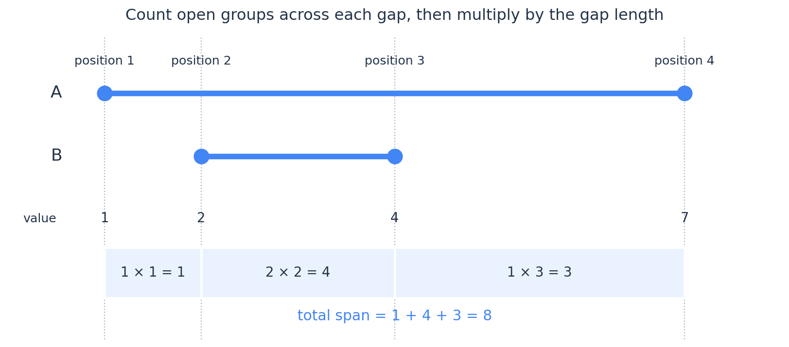
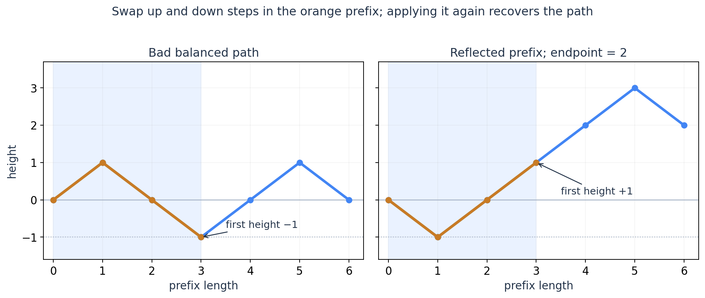
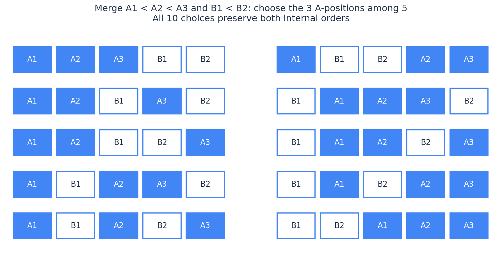
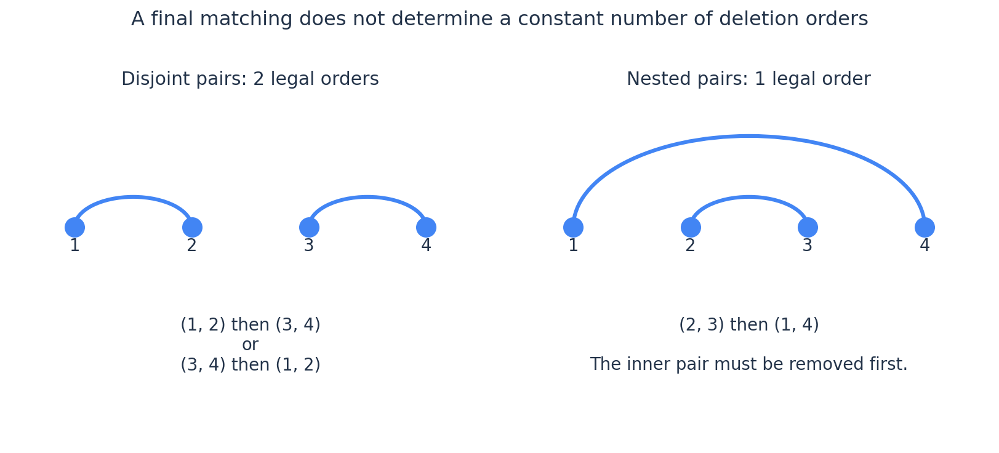

# ICPC 组合数学：从计数对象到唯一分解，再到动态规划

熟悉组合数恒等式以后，遇到复杂计数题，困难往往出现在公式之前：究竟该按什么顺序构造对象？哪些选择已经包含在子问题里？为什么只记录几个数量，就足以代替整个局部结构？

这篇围绕这些问题展开。前两节用你熟悉的基础计数建立共同语言；之后将主要篇幅放在组合结构与 DP 的衔接。我们会反复使用同一个证明方法：**给定一个最终对象，能否唯一恢复它来自哪一项、哪一个子问题、哪些局部选择？**

能恢复，通常就能说明没有重复；每个合法对象都能恢复，则同时说明没有遗漏。这里的“对象”也可能本来就是操作顺序，必须以题目定义为准。

| 遇到的困难 | 值得尝试的表达 | 随后要证明什么 |
| --- | --- | --- |
| 同一对象有很多构造过程 | 固定构造顺序或规范表示 | 每个对象恰好对应一个过程 |
| 条件横跨许多位置 | 改为按数值、类型或特殊元素处理 | 新顺序下，哪些历史信息仍影响后续 |
| 若干子问题都已经算完 | 内部方案与交错方式分开计算 | 任意交错是否合法，交错能否唯一恢复 |
| 集合无序，递推却有处理顺序 | 固定最小元素所属的部分 | 每个无序结构只在一个分支出现 |
| 要求所有对象的统计量之和 | 给对象中的一部分加标记 | 每个对象被计入的总次数是否等于其权重 |

本文不涉及生成函数，不重新讲解[容斥原理](inclusion-exclusion.md)，也不展开群作用或组合反演。默认不附完整代码。练习难度均为独立估算的 CF 尺度；正文已经分析的题会明确标为例题，不再作为未给提示的练习。

## 1. 最终对象、构造过程与标签：先确定哪些东西算同一个答案

计数题中的乘法与除法，都对应一个映射。先看一个很简单但经常被忽略的区别。

排列三个不同编号的元素 $A_1,A_2,B$，有 $3!=6$ 种；若题目只关心字符序列，则只剩 $AAB,ABA,BAA$ 三种。忘掉 $A$ 的编号后，每个字符序列都恰好有 $2!$ 个带编号版本，所以可以除以 $2!$。

一般地，若共有 $n$ 个元素，各类型的数量为 $c_1,\ldots,c_r$，同类型元素不可区分，则排列数为

$$
\frac{n!}{c_1!\cdots c_r!}.
$$

分母的依据不是“出现了重复元素”，而是：**每个被计数的最终序列，都恰好对应 $\prod c_i!$ 个带编号排列。** 如果合法性条件还区分原始下标，忘掉标签就可能改变合法性，不能这样除。

### 分组无序，不等于可以随便除以一个阶乘

将 $n$ 个不同元素划成 $k$ 个非空组。如果先给这 $k$ 个组编号，每个无编号划分恰好有 $k!$ 个编号版本，因此二者相差 $k!$。即使两个组大小相同，作为非空且不交的元素集合，它们仍然是不同的组。

但若允许空组，并将所有组编号后再忘掉编号，同一个结果的编号版本数就未必是 $k!$：空组之间交换不会产生新的编号分配。例如将一个元素放进三个有编号盒子，只有三种结果；忘掉编号后只有一种，比例是三，不是 $3!$。

还有一种更常见的陷阱：组的大小或属性不同，对调以后可能已经不合法。例如两个盒子分别要求装一个和两个元素，盒子本来就承担不同角色，不能先当作可互换的组再除以 $2!$。

因此，遇到“无序”时，先寻找固定倍数的对应；找不到，就考虑直接构造无序对象。

### 为什么不能把所有生成顺序都算进去，再统一除以操作次数的阶乘？

四个位置依次排成一行，每次删除一对相邻位置，直至删空。最终配对 $\{(1,2),(3,4)\}$ 有两个合法删除顺序；配对 $\{(1,4),(2,3)\}$ 却只有一个，因为必须先删 $(2,3)$。

若题目数配对结构，这两个答案各算一次；若题目数删除顺序，答案分别贡献二和一。每个结构对应的顺序数量不同，没有一个统一的阶乘可以除。

第 7 节会再回到这个例子。现在只需记住：**递推天然数的是你让它构造的过程；要数最终结构，就必须控制过程与结构之间的对应关系。**

## 2. 双射与双重计数：把限制转移到容易处理的对象上

你已经知道许多二项式恒等式，这里不再逐条证明。更值得保留的是使用方式：先确定两边各在数什么，再判断它是否能消去原题里最难处理的限制。

### 严格递增、最小间隔与非负间隙

考虑

$$
L\le x_1\le x_2\le\cdots\le x_k\le R,
$$

其中 $L\le R,k\ge1$。令

$$
y_i=x_i+i-1.
$$

则

$$
L\le y_1<y_2<\cdots<y_k\le R+k-1.
$$

反过来，任意这样的严格递增序列减去 $i-1$，都恢复原来的弱递增序列。于是答案是

$$
\boxed{\binom{R-L+k}{k}.}
$$

这次变换没有给原对象增加选择，而是把“允许相等”转成了“可选范围扩大”。若原来要求 $x_{i+1}-x_i\ge d$、$d\ge1$，则改令

$$
y_i=x_i-(i-1)(d-1),
$$

就得到范围为 $[L,R-(k-1)(d-1)]$ 的严格递增序列，答案为

$$
\binom{R-L+1-(k-1)(d-1)}{k}.
$$

当上参数小于 $k$ 时答案为零。对于 $k=0$，空序列单独计为一种。

同样的思想也可以用间隙表达。若 $1\le x_1<\cdots<x_k\le N$，定义首尾空隙及相邻元素之间未选择的位置数：

$$
g_0=x_1-1,\quad g_i=x_{i+1}-x_i-1\ (1\le i<k),\quad g_k=N-x_k.
$$

它们满足 $g_i\ge0$、$\sum_{i=0}^k g_i=N-k$，而且可以唯一恢复 $x_i$。最小间距限制常常等价于某几个 $g_i$ 有下界；先减去下界，剩下的就是非负整数分配。

### 隔板法真正保留了哪些条件？

将 $S$ 个不可区分单位分给 $k\ge1$ 个有编号位置，允许零个，方案数为

$$
\binom{S+k-1}{k-1}\qquad(S\ge0).
$$

若各变量有下界 $x_i\ge b_i$，先令 $y_i=x_i-b_i$。但上界 $x_i\le u_i$ 不会被同一个平移消掉；变量之间的额外关系也不会自动消失。

“先处理最小要求，再分配剩余量”是一种双射。它成功的条件是：减去固定部分以后，所有剩余选择都合法，且每个剩余选择都能唯一放回原对象。

### 在一个对象里固定一个位置，再数其余部分

恒等式

$$
k\binom nk=n\binom{n-1}{k-1}
$$

可以理解为：选一个 $k$ 元子集，并在其中标记一个元素。左侧先选集合再选标记，右侧先选标记再补集合。

这比把两边展开成阶乘更有算法意义：当题目要求“所有子集里某种局部贡献的总和”，可以先固定贡献发生的位置，再数其余部分。第 8 节会把这一步推广为贡献法与带权 DP。

另一个常用连接是

$$
\sum_j\binom aj\binom b{k-j}=\binom{a+b}{k}.
$$

左侧保留“从第一部分选了多少”这个中间信息，右侧忘掉它。它能提醒我们：有些 DP 维度确实可以通过完整求和消去；但一旦后续合法性依赖这个数量，就不能只保留总和。这里及下文约定非负上参数的组合数在下参数越界时为零。

### 大上参数不意味着必须预处理到它

模素数 $p$，若要计算 $\binom Nk$ 且 $N\ge k$、$0\le k<p$，可以直接使用

$$
\binom Nk=
\frac{N(N-1)\cdots(N-k+1)}{k!}.
$$

只需 $k$ 个分子因子和可逆的 $k!$。即使 $N\ge p$，该写法在上述条件下仍成立，因为整数恒等式中的分母与 $p$ 互质；不要把 $N\ge p$ 与“任何求法都不能用”混淆。

另一方面，常见的阶乘／逆阶乘表需要其所有下标小于 $p$；任意合数模数也不能直接求这些分母的逆元。只用加法的 Pascal 递推不依赖逆元，但预处理时间、空间通常是二次的。这里的选择取决于查询数量、上参数规模和分母是否可逆，模除法的依据见[数论篇](number-theory.md)。

> **练习**：[CF1929 F — Sasha and the Wedding Binary Search Tree](https://codeforces.com/contest/1929/problem/F)（估算约 2300；2024；额外前置：二叉树遍历）。适合练习将结构约束变成顺序约束，并处理很大的取值范围。

## 3. 从唯一分解到计数 DP：状态为什么足够，转移系数又从哪里来？

设某一阶段有许多局部对象。如果它们对未来的影响可以由同一个状态描述，我们就希望把它们的数量加起来。

这里需要的不是“这些局部对象看起来差不多”，而是：**每个局部对象，通向各个后继状态的合法选择数都由当前状态决定。** 更一般时也可以建立统一的加权对应；本篇的例子都能直接从选择数解释。

此外，还要检查最终对象是否有唯一的前驱。一个状态足够描述后续，并不自动意味着构造过程没有重复：第 1 节已经给出了反例。

### 一个完整例子：数量受限的字符，怎样组成任意长度的字符串？

有 $r$ 种字符，第 $i$ 种最多使用 $c_i$ 次，求长度不超过 $K$ 的不同字符串数。同一种字符的各次出现不可区分。

若从左到右选字符，需要知道每一种字符已经用了多少次，状态很大。换成**依次处理字符种类**：先构造只含前 $i$ 种字符的字符串，再插入第 $i+1$ 种。

定义

$$
f_i(j)=\text{只使用前 }i\text{ 种字符，得到长度 }j\text{ 的合法字符串数}.
$$

对一个已经构造好的长度为 $j$ 的字符串，加入 $t$ 个新字符，其中 $0\le t\le c_{i+1}$、$j+t\le K$。只需从最终的 $j+t$ 个位置中，选择 $t$ 个放新字符；其他位置按原顺序填入旧字符串，所以

$$
\boxed{
f_{i+1}(j+t)\mathrel{+}=f_i(j)\binom{j+t}{t}.
}
$$

为什么这里不需要知道旧字符串的具体排列？因为新字符与所有旧字符都不同，无论旧字符串长什么样，选择新字符位置的方法始终是 $\binom{j+t}{t}$。

为什么不会重复？给定最终字符串，删掉全部第 $i+1$ 种字符，就唯一得到旧字符串；被删字符的位置也唯一确定。因此每个最终字符串只来自一个 $j,t$ 和一次位置选择。

这里特意选择最终位置，而不是让 $t$ 个新字符逐个寻找空隙。后一种写法如果不加限制，可能用多个插入顺序产生同一串相同字符。

例如已有字符串 $AB$，加入两个 $C$，有 $\binom42=6$ 种。$CCAB$ 中两个 $C$ 没有先后标签，不应再乘 $2!$。

初始化 $f_0(0)=1$，其余为零。若不允许空串，答案为 $\sum_{j=1}^K f_r(j)$。直接枚举 $j,t$ 的时间为 $O(rK^2)$，滚动数组空间 $O(K)$，另加组合数的预处理代价；若使用完整 Pascal 表，额外空间为 $O(K^2)$。

[ABC358 E — Alphabet Tiles](https://atcoder.jp/contests/abc358/tasks/abc358_e)（2024；估算约 1900）就是这个模型，$r=26,K\le1000$。这里已经给出解法，将它作为实现与推导核对用的例题。

### “先确定组成，再安排位置”与 DP 是同一件事

固定各类使用数量 $t_1,\ldots,t_r$、总长 $s$ 时，排列数为

$$
\frac{s!}{t_1!\cdots t_r!}.
$$

上面的 DP 是在逐类确定 $t_i$，同时安排它们的位置。设 $s_i=t_1+\cdots+t_i$，沿一条转移路径乘起来的系数为

$$
\prod_{i=1}^r\binom{s_i}{t_i}
=\frac{s!}{\prod_i t_i!}.
$$

中间阶乘会消掉。这解释了递推与多重集合排列公式的一致性，也提供了另一种状态归一化的可能。

如果所有相关阶乘都可逆，令 $g_i(j)=f_i(j)/j!$，则转移可改成

$$
g_{i+1}(j+t)\mathrel{+}=\frac{g_i(j)}{t!}.
$$

不需要为了这一步引入新的理论：只是把一个已知阶乘因子从状态中提出。最终再乘回长度的阶乘。**这种变形只改变权值的记法，不会自动改善上述二重枚举的复杂度。** 如果后续条件与字符顺序强烈相关，也未必还能只记长度。

> **练习**：[CF1794 D — Counting Factorizations](https://codeforces.com/problemset/problem/1794/D)（估算约 2100；2023；额外前置：质数判定或基础筛、唯一分解）。适合练习把“选择哪些元素承担某种角色”和“重复值带来的排列系数”一起放入 DP。

## 4. 按大小加入元素：从 Stirling 递推走到未结束的组

第 3 节按字符种类处理，是为了提前固定已使用的类型。现在进一步看：如果约束涉及大小关系，按数值处理能否使新增元素的角色变得简单？

### 两类 Stirling 数，差别在于一个组内部保留了什么结构

记 $S(n,k)$ 为将 $n$ 个不同元素划成 $k$ 个非空、无编号集合的方案数。观察最大元素 $n$：

若它独自成组，删掉它后有 $S(n-1,k-1)$ 种；否则删掉它后仍有 $k$ 个非空组，可以把它放回其中任意一组，所以

$$
\boxed{S(n,k)=S(n-1,k-1)+kS(n-1,k).}
$$

系数 $k$ 不要求给组永久编号。对于一个具体划分，其中有 $k$ 个不同的非空元素集合，选择加入哪个集合就是 $k$ 种。

再记 $c(n,k)$ 为 $n$ 个元素的排列恰好含 $k$ 个循环的数量，采用**无符号**第一类 Stirling 数。排列的循环之间无顺序，每个循环内部却保留循环方向。元素 $n$ 可以单独成为一个循环；否则删掉它后，可以把它插在已有 $n-1$ 个元素中任意一个的后面。因此

$$
\boxed{c(n,k)=c(n-1,k-1)+(n-1)c(n-1,k).}
$$

删除 $n$ 都能唯一恢复前驱，故两条递推都不重不漏。初值统一为 $S(0,0)=c(0,0)=1$，其余越界状态为零。计算到 $n\le N$ 的三角表耗时 $O(N^2)$；只保留相邻两行时空间 $O(N)$。

例如 $S(4,2)=7$，而 $c(4,2)=11$：集合划分不区分三元素组内部的循环方向，循环分解则区分。这里的作用是建立“删除特殊元素后，数它能怎样放回来”的方法，不要求背下更多显式公式。

### 邻接条件也可以按数值处理

设 $A(n,k)$ 为 $1,\ldots,n$ 的排列中，恰好有 $k$ 个下降位置的数量；下降是相邻两项满足前者大于后者。将新最大值 $n+1$ 插入一个已有排列，共有 $n+1$ 个空隙。

原来有 $k$ 个下降空隙，插入后每处仍产生一个下降；放在末尾也不增加下降。因此有 $k+1$ 个位置保持下降数，有 $n-k$ 个位置令下降数增加一。于是

$$
A(n+1,k)=(k+1)A(n,k)+(n-k+1)A(n,k-1).
$$

它称为 Eulerian 数递推，$A(1,0)=1$，越界状态取零。重点在于：从左到右选数时，下降条件依赖最后一个值；按大小插入时，只需要知道各类空隙有多少个。直接计算全部 $n\le N$ 的状态为 $O(N^2)$ 时间，可滚动为 $O(N)$ 空间。

若有重复值，就不能直接套用上述空隙数量，因为“相等”既不是上升也不是下降。下面这道提高题保留了这种差别。

> **可选提高**：[ABC267 G — Increasing K Times](https://atcoder.jp/contests/abc267/tasks/abc267_g)（估算约 2500；2022）。数的是下标排列，相等值仍有不同身份；适合检验按大小插入以后，能否重新计算各类位置的数量。

### 更重要的完整模型：分组费用是最大值减最小值

有 $n$ 个不同身份的元素，权值为 $a_i$；将它们划成若干非空、无编号组，一组的费用为最大权值减最小权值，要求总费用不超过 $K$。这对应 [CF626 F — Group Projects](https://codeforces.com/problemset/problem/626/F)（2016；估算约 2400）。

这是一道较早的题，保留为例题，是因为它能完整解释一个很有迁移价值的状态压缩。下面不将它另列为练习。

先按 $(a_i,\text{原下标})$ 排序，得到固定顺序 $a_1\le\cdots\le a_n$。相同权值仍是不同元素，排序只是在规定构造顺序。

若某个最终组最早、最晚出现的位置为 $l,r$，它的费用可以拆成

$$
a_r-a_l=\sum_{i=l+1}^r(a_i-a_{i-1}).
$$

所以一组只要还未结束，每越过一个相邻值间隙，就贡献一次间隙长度。令 $j_i$ 为切口 $i$ 与 $i+1$ 之间仍有元素待加入的组数，则

$$
\boxed{\text{总费用}=\sum_{i=1}^{n-1}j_i(a_{i+1}-a_i).}
$$

图中位置 $1,2,3,4$ 的权值为 $1,2,4,7$。组 $A=\{1,4\}$ 跨过长度为 $1,2,3$ 的三个间隙，费用为六；组 $B=\{2,3\}$ 跨过中间长度为二的间隙。中间切口有两组未结束，因此这段间隙贡献四，总费用为八。

现在定义 $f_i(j,s)$：处理完前 $i$ 个元素后，有 $j$ 个组已开始但被声明为尚未结束，已累计间隙费用为 $s$ 的局部方案数。开始处理第 $i$ 个元素时，先从前一层状态 $(j,s)$ 把费用改为

$$
s'=s+j(a_i-a_{i-1})\qquad(i\ge2);
$$

处理第一个元素时没有间隙费用。随后新元素只有四种互斥角色：

| 新元素的角色 | 组数变化 | 从一个具体局部方案出发的选择数 |
| --- | --- | --- |
| 单独成组，立即结束 | $j\to j$ | $1$ |
| 开始一个以后还要加入元素的新组 | $j\to j+1$ | $1$ |
| 加入一个未结束组，且该组以后还要继续 | $j\to j$ | $j$ |
| 加入一个未结束组，并令它在此结束 | $j\to j-1$ | $j$ |

因此，对每个 $f_{i-1}(j,s)$，先算 $s'$，再更新

$$
\begin{aligned}
f_i(j,s')&\mathrel{+}=(j+1)f_{i-1}(j,s),\\
f_i(j+1,s')&\mathrel{+}=f_{i-1}(j,s),\\
f_i(j-1,s')&\mathrel{+}=j f_{i-1}(j,s).
\end{aligned}
$$

最后一项仅在 $j>0$ 时使用。初始 $f_0(0,0)=1$，答案为 $\sum_{s=0}^K f_n(0,s)$。未结束的组不能留到最后；单元素组必须走第一类，不能在同一步既开组又闭组另算一次。

### 为什么不记录每个组最早的值、大小和具体成员？

费用已经按间隙累计，未来每跨过一段距离，每个未结束组都只再贡献一次距离；组起点对未来费用的影响已被吸收到 $s$。加入哪一个未结束组，有 $j$ 种选择，不依赖组大小。

这里是把**不同局部方案的数量**合并到一个状态，不是把它们当成同一个对象。具体局部方案里的各个组仍由成员区分，因此选择不同组必须乘 $j$。

还需要证明构造过程唯一。给定一个最终划分，按固定排序扫描：每个非单元素组的首元素只能开组，末元素只能闭组，其他成员只能加入但不结束；单元素组只能独立完成。每一步加入哪个已有组，也由最终划分唯一确定。反过来，任意最终所有组都结束的转移路径，都产生一个合法划分。

即使权值相同，这个证明仍成立，因为身份与扫描顺序固定，零长度间隙只是不增加费用。没有必要因为相等权值再除以某个阶乘。

状态数与转移给出时间 $O(n^2(K+1))$，滚动空间 $O(n(K+1))$，这里将 $K=0$ 也包含在内。费用非负，可以丢弃超过 $K$ 的状态。原题 $n\le200,K\le1000$，适合这种算法。

这个状态有明确边界：若还限制组大小、组内成员关系，或费用换成非线性的跨度函数，单记 $j,s$ 通常不够。状态压缩依赖于这里证明过的两件事：未来费用按组数统一增加，加入选择数也只由组数决定。

## 5. 前缀限制：什么时候用反射，什么时候保留高度做 DP？

把左括号视为 $+1$，右括号视为 $-1$。合法括号序列等价于：总和为零，且所有前缀和非负。此时前缀和称为高度。

暂时固定有 $n$ 个上升步、$n$ 个下降步。忘掉前缀限制，共有 $\binom{2n}{n}$ 条路径。要数不合法路径，选择它第一次到达高度 $-1$ 的时刻，将从起点到该点的所有步子上下互换，包含导致这次越界的那一步。

被翻转的前缀原来下降步比上升步多一个；翻转后，整个路径有 $n+1$ 个上升步、$n-1$ 个下降步，终点高度变成二。

反过来，任意从零走到二、共 $2n$ 步的路径，必有第一次到达高度一的时刻。翻转此前的步子，就得到一条第一次到达 $-1$ 的不合法平衡路径。这两个操作互为逆映射。

因此不合法路径有 $\binom{2n}{n-1}$ 条，合法路径数即 Catalan 数

$$
\boxed{C_n=\binom{2n}{n}-\binom{2n}{n-1}
=\frac1{n+1}\binom{2n}{n}.}
$$

对 $n=0$，空路径计一种，并约定组合数下参数越界时为零。计算模意义的结果时，差式不需要额外除以 $n+1$；商式则要检查分母可逆，不能因为整数公式成立就直接求逆。

更一般地，有 $a$ 个上升步、$b$ 个下降步，$a\ge b\ge0$，要求前缀高度始终非负。完全相同的前缀翻转，将不合法路径对应到 $a+1$ 个上升步、$b-1$ 个下降步，所以答案为

$$
\binom{a+b}{b}-\binom{a+b}{b-1}.
$$

若要求严格领先，不能把“非负”直接换个措辞继续用原式。比如非空路径若要求每个非空前缀高度都正，必须先固定第一步上升，删去它后重新表达边界条件。

### 为什么有些括号问题不能直接代 Catalan 公式？

如果某些位置的括号已经固定，反射某个前缀会改变这些位置的字符，映射后的对象不再是“任意选上升位置”的完整集合。简单二项式计数的前提已经消失。

但前缀合法性仍然只依赖当前高度。于是可以定义 $f_i(h)$ 为前 $i$ 个位置合法且高度为 $h$ 的方案数，根据该位置允许的字符，向 $h+1$ 或 $h-1$ 转移，禁止负高度，最终取 $f_N(0)$。

同一状态中的不同前缀，面对相同的后缀位置限制，合法延伸条件完全相同；每个字符串又有唯一的前一个字符前缀，所以状态与无重复性都有依据。直接时间 $O(N^2)$、滚动空间 $O(N)$；奇数长度不可能平衡。

> **短练习**：[ABC312 D — Count Bracket Sequences](https://atcoder.jp/contests/abc312/tasks/abc312_d)（估算约 1700；2023）。本节已解释所需状态，适合快速核对“固定位置破坏了什么对称性”；若已熟悉可跳过。

### 递推与闭式，分别保存了不同的信息

一条非空合法括号序列，可唯一写成

$$
(\ P\ )\ Q,
$$

其中第一个左括号的匹配位置唯一确定，$P,Q$ 都合法。如果 $P$ 含 $i$ 对括号，则

$$
\boxed{C_n=\sum_{i=0}^{n-1}C_iC_{n-1-i},\qquad C_0=1.}
$$

这次唯一性来自“第一个左括号的匹配位置”，不是任意找一个平衡切口。比如串 $()()()$ 有多个平衡切口；如果每个切口都拿来拼接，再递归计数，便可能把同一串的不同分解树算成不同答案。

闭式适合完全对称的计数，递推则明确保留内部与后缀两个子结构。下一节和第 7 节会在这个分解上加上更复杂的合并信息。

## 6. 合并子结构：内部方案与交错方式是两种选择

已有两条顺序固定的序列

$$
A_1,\ldots,A_a,\qquad B_1,\ldots,B_b,
$$

元素的身份均可区分。将它们合成一条序列，要求各自内部相对次序不变。

只需选择最终的哪些 $a$ 个位置属于第一条序列，其他位置放第二条，方案数为 $\binom{a+b}{a}$。最终序列又能唯一恢复两条子序列和这些位置，因此这是双射。

图中第一条链含三个元素，第二条链含两个元素，共有 $\binom53=10$ 种交错。交换同一条链内部的元素不属于额外选择。

如果第一、第二个子问题分别有 $F_A,F_B$ 种内部顺序，而且任意交错都合法，则总数为

$$
F_AF_B\binom{a+b}{a}.
$$

推广到 $r$ 个子结构，大小为 $s_1,\ldots,s_r$，交错系数是多项式系数

$$
\frac{(s_1+\cdots+s_r)!}{s_1!\cdots s_r!}.
$$

但“任意交错合法”必须证明。若两条序列之间另有先后约束，或某种操作会改变另一部分的可行性，单纯乘这个系数就不对。例如除了 $A_1<A_2$ 外还要求 $A_2<B_1$，三个元素就只有一个顺序，不是 $\binom32=3$ 种。

### 树上的父先于子：为什么子树之间恰好可以独立交错？

在一棵有根树中，每个节点是一项不同任务，要求父任务先于子任务完成。记 $s_u$ 为 $u$ 的子树大小，$F_u$ 为这棵子树内部的合法执行顺序数。

节点 $u$ 必须最先执行。之后不同孩子的子树之间没有先后约束，只有各自内部的父子约束。设孩子为 $v_1,\ldots,v_r$，因此

$$
\boxed{
F_u=
\frac{(s_u-1)!}{\prod_{i=1}^r s_{v_i}!}
\prod_{i=1}^r F_{v_i}.
}
$$

从最终顺序中删去 $u$，按每个节点所属的孩子子树取子序列，就能恢复每个子问题的内部顺序；各位置属于哪棵子树，也能唯一恢复。这个反向过程同时证明没有重复与遗漏。

也可以逐个合并孩子：已有 $a$ 个任务的顺序数为 $F$，新孩子大小为 $b$、顺序数为 $G$，更新为

$$
F\gets FG\binom{a+b}{b},\qquad a\gets a+b.
$$

这里每次只维护“大小与一个方案数”，并没有枚举分配给孩子的任务数；每棵子树的大小已经固定。组合数可 $O(1)$ 查询时，遍历各边一次，总时间为 $O(n)$，另加组合数预处理与模逆元代价，空间 $O(n)$。

### 一个能从递推直接推出的全局公式

将所有节点的递推展开：

$$
F_{\mathrm{root}}
=\frac{\prod_u(s_u-1)!}{\prod_{u\ne\mathrm{root}}s_u!}
=\boxed{\frac{n!}{\prod_u s_u}}.
$$

根的大小是 $n$，其余每个节点贡献 $(s_u-1)!/s_u!=1/s_u$。这个整数等式由组合递推保证成立；模计算时仍需检查除法条件。

这条公式也有助于检查方向：一条从根到叶的链只有一种顺序；根连接 $n-1$ 个叶子的星形树有 $(n-1)!$ 种。

它只用于树所定义的父先于子约束，不能直接推广到一般 DAG。一般 DAG 中两个分支可能共享后继，子结构不再独立，重复计算也随之出现。

> **练习**：[ABC160 F — Distributing Integers](https://atcoder.jp/contests/abc160/tasks/abc160_f)（估算约 2400；2020；额外前置：换根或相邻根之间的关系）。正文只处理固定根，本题要求所有起点；练习保留在怎样复用不同根的答案。

## 7. 区间与集合上的递推：让最终对象决定唯一的分支

区间 DP 经常失败在切分的选择上：一个对象可能有许多合法切分，而递推将每种切分都算了一遍。集合 DP 也有同样的问题：一个无序划分有许多取组顺序。

修复方向并不是算完以后凭直觉除掉重复，而是让最终对象本身决定这一步应该选哪个部分。

### 相邻配对删除：结构计数与顺序计数必须分开

有 $2n$ 个不同位置排成一行，部分位置对允许配对。每次选一对当前相邻且允许的元素删除，剩下的元素靠拢。先考虑只数最终配对结构。

若最左元素 $l$ 与 $p$ 配对，在它们删除以前，内部 $(l,p)$ 必须全部删空。因此 $p-l$ 为奇数；内部元素必须彼此配对，不能与 $p$ 右侧交叉配对。

为什么不能交叉？若有 $l<x<p<y$，且计划配对 $(l,p),(x,y)$，删除前一对要求 $x$ 已被删掉；删除后一对又要求 $p$ 已被删掉，形成互相等待。这正是非交叉结构出现的原因。

记 $M(l,r)$ 为区间 $[l,r]$ 的可行配对结构数，空区间为一，奇数长度为零，则

$$
M(l,r)=
\sum_{\substack{l<p\le r\\p-l\text{ 为奇数}\\(l,p)\text{ 允许}}}
M(l+1,p-1)M(p+1,r).
$$

每个可行结构里，$l$ 的配对对象唯一，所以分支唯一；反过来，任意内部结构、右侧结构与允许的 $(l,p)$，都能通过先清空内部再删 $(l,p)$ 的方式实现。

如果题目数的是删除顺序，就还没有算完。

### 多出来的组合数，在数哪几步的交错？

令 $D(l,r)$ 为删除顺序数，区间长度为 $2n$，仍固定 $p=l+2k-1$。

内部有 $k-1$ 次删除，之后删 $(l,p)$。这部分共 $k$ 次操作，且 $(l,p)$ 必须是这部分的最后一次。右侧另有 $n-k$ 次删除。

给定内部顺序与右侧顺序，这两部分的操作可以任意交错；右侧操作不影响内部是否相邻。只需从全部 $n$ 个操作位置中选择 $k$ 个给“内部加外层配对”这部分，故

$$
\boxed{
D(l,r)=
\sum_{\substack{1\le k\le n\\p=l+2k-1\\(l,p)\text{ 允许}}}
D(l+1,p-1)D(p+1,r)\binom nk.
}
$$

空区间仍为一。注意组合数是 $\binom nk$，不是 $\binom{n-1}{k-1}$：$(l,p)$ 只要求在自己这一部分最后，不要求在整个序列最后。右侧仍可能在它以后继续删除。

图左的两对各自独立，有两个删除顺序；图右只能先删内层，因此只有一个。四个位置全部允许时，结构数为二，顺序数为三。

给定一个最终删除顺序，先找到 $l$ 与谁配对，再提取内部和右侧的操作子序列，以及它们在总顺序中的位置，恰好恢复递推中的所有选择。这是整个式子不重不漏的依据。

[ABC217 F — Make Pair](https://atcoder.jp/contests/abc217/tasks/abc217_f)（2021；估算约 2300；$n\le200$）要求的就是顺序数。它是本节已经完整分析的例题。按区间长度递增计算，两个版本都是 $O(n^3)$ 时间、$O(n^2)$ 空间，组合数另行预处理。

### 无序集合划分：固定最小元素所属的组

现在不要求元素排在一条线上。设 $S$ 是当前待划分的元素集合，$w(T)$ 表示非空子集 $T$ 作为一组的内部方案数；非法组令 $w(T)=0$。组间无编号，也不附带处理顺序。

如果直接枚举任意 $T\subseteq S$ 作为第一组，最终含 $k$ 个组的划分就会因取组顺序被计算 $k!$ 次。组数不固定时，这个倍数还随对象变化。

选择 $v=\min S$，只枚举包含 $v$ 的组：

$$
\boxed{
F(S)=\sum_{\substack{\varnothing\ne T\subseteq S\\v\in T}}
w(T)F(S\setminus T),\qquad F(\varnothing)=1.
}
$$

给定最终划分，含 $v$ 的组唯一；删掉它，剩余划分再递归处理。因此每个无序划分只出现一次。若还限制组数，可以增加维度 $F(S,k)$，每取一组就令 $k$ 减一，规范选择的理由不变。

这个式子要求组间除了互不相交、覆盖全部元素之外没有额外约束；跨组条件不能凭空消失。若 $w(T)$ 包含内部结构，最终对象也必须保留这些内部结构，否则可能再次引入重复。

对所有子集枚举其子集，总次数为 $O(3^n)$；固定最小元素减少常数，不改变指数级。具体地，合法二元组 $(S,T)$ 的数量为

$$
\sum_{s=1}^n\binom ns2^{s-1}=\frac{3^n-1}{2}.
$$

以上复杂度假设 $w(T)$ 已可 $O(1)$ 查询，不包含其预处理代价；DP 空间为 $O(2^n)$。

### 元素完全对称时，还能从集合状态压成数量状态

若任何大小为 $t$ 的元素集合都有相同的组内方案数 $w_t$，且没有依赖具体标签的限制，只记剩余元素数 $n$ 即可。固定最小元素所在组大小为 $t$，其余成员从另外 $n-1$ 个元素中选：

$$
\boxed{
F_n=\sum_{t=1}^n\binom{n-1}{t-1}w_tF_{n-t},\qquad F_0=1.
}
$$

每次递归固定的是当前剩余集合的最小元素；并不是声称选完一组后，剩余元素一定是编号连续的某个前缀。能压成数量，是因为重新标号不改变合法性与方案数。

取 $w_t=1$ 就得到集合划分总数的递推。组合数可常数时间查询时，求出全部 $F_0,\ldots,F_n$ 的 DP 耗时 $O(n^2)$、空间 $O(n)$，另加预处理代价。若还记录边数、总费用等可加统计量，可相应增加维度；若不同标签之间有指定的允许关系，这种对称性通常不再成立，不能只记大小。

> **综合练习**：[ABC180 F — Unbranched](https://atcoder.jp/contests/abc180/tasks/abc180_f)（估算约 2400；2020；额外前置：无向图连通分量、路径与环）。适合练习从连通分量结构确定局部计数，再选择能去掉无序重复的处理顺序。题面允许重边且边无编号，需认真核对小规模边界。

## 8. 带标记计数与贡献法：求总权值，不一定要记录完整分布

设 $\Omega$ 是一类对象，$T(\omega)$ 是对象 $\omega$ 中满足某种条件的局部部分集合。要求

$$
\sum_{\omega\in\Omega}|T(\omega)|.
$$

这恰好是在数二元组 $(\omega,t)$，其中 $t\in T(\omega)$。先选对象再标记，或先固定标记再数能包含它的对象，结果相同：

$$
\boxed{
\sum_{\omega\in\Omega}|T(\omega)|
=\sum_t\#\{\omega\in\Omega:t\in T(\omega)\}.
}
$$

它与第 2 节“选集合并标记一个元素”是同一个原理。权值不是整数次数时，也可以让每个标记携带相应权重，使用有限求和的交换次序。

### 先确定谁承担贡献，再数其他位置

例如对数组 $a_1\le\cdots\le a_n$，求所有 $k$ 元下标子集的最大值之和，$1\le k\le n$。规定最大值由所选下标中最大的那个承担；即使数值相等，也用下标打破平局。

固定最大下标 $i$，还需从前 $i-1$ 个下标中选择 $k-1$ 个，因此

$$
\sum_{\substack{S\subseteq[n]\\|S|=k}}\max_{i\in S}a_i
=\sum_{i=1}^n a_i\binom{i-1}{k-1}.
$$

如果没有固定平局规则，而让所有取到最大值的元素都贡献一次，含多个相同最大值的子集就会被多算。贡献法仍然需要唯一性，只不过唯一性发生在“谁承担这份权重”上。

这类分解适合统计量能拆成局部贡献、固定贡献以后又容易数补全方案的情况。如果贡献是否发生依赖于整个对象的复杂结构，拆完以后未必更容易。

### 只维护方案数与权值和，为什么有时就够了？

设一个 DP 状态中，方案数为 $C$，各方案累计权值之和为 $W$。若当前某类转移对每个旧方案都有 $q$ 种选择，而且每个选择都统一新增权值 $\Delta$，则新状态增加

$$
\boxed{
C'\mathrel{+}=qC,\qquad
W'\mathrel{+}=qW+qC\Delta.
}
$$

原因是每个旧方案原来的权值复制了 $q$ 次，新增加的 $q$ 份权值也都要计算。若各选择的增量分别为 $\Delta_1,\ldots,\Delta_q$，并且其总和只由状态决定，则第二式改成

$$
W'\mathrel{+}=qW+C\sum_{r=1}^q\Delta_r.
$$

关键条件是每个旧方案面对的选择数、增量总和都相同，或至少已经由状态充分描述。若它们还依赖被丢弃的历史，只记 $C,W$ 就不够。

两个独立子结构合并时，也能同时维护这两个量。若权值可加，任意内部方案都兼容，交错方式数为统一的 $q$，则

$$
C=qC_AC_B,\qquad
W=q(W_AC_B+C_AW_B).
$$

这里默认交错本身不额外改变权值；若它会影响权值，就必须进一步统计交错贡献，而不能沿用原式。

### 回到第 4 节：不限制总费用时，整个费用维度可以消掉

仍然计算所有元素分组的“组内最大值减最小值”之和，但这次不要求费用至多 $K$。

可以只记处理阶段 $i$ 与未结束组数 $j$，每个状态维护方案数 $C$、费用和 $W$。跨过间隙 $\delta=a_i-a_{i-1}$ 后，每个局部方案都统一增加 $j\delta$：

$$
W^*=W+Cj\delta.
$$

再按原来的三类合并转移，系数分别为 $j+1,1,j$，将 $C$ 与 $W^*$ 同时按这些系数累加。最后取所有组结束的 $j=0$ 状态中的费用和。

这个算法只需 $O(n^2)$ 时间、$O(n)$ 滚动空间，另加排序。它并不需要知道每个费用值出现多少次。

但如果恢复“费用不超过 $K$”的条件，就不能只保留总和。例如费用分别为 $\{0,4\}$ 与 $\{2,2\}$ 的两批方案，数量相同、费用和也相同，费用至多一的方案数却不同。**只求总和可以利用线性性；带阈值筛选通常需要更多分布信息。**

### 与期望的连接

若从 $\Omega$ 中等概率选一个对象，统计量期望就是总权值除以 $|\Omega|$。贡献法给出总权值后，便不必恢复统计量完整分布；不同局部事件不需要独立。

如果对象不是等概率，就要带上实际概率权重，不能直接用方案数相除。相关证明与更多例子见[数学期望篇](expected-value.md)。

> **练习**：[CF1525 E — Assimilation IV](https://codeforces.com/problemset/problem/1525/E)（估算约 2200；2021；额外前置：期望线性性与模意义概率）。适合练习先固定一个贡献目标，再计算满足局部条件的排列数量。

## 阅读一道新计数题时，怎样决定下一步？

先给最终答案中的一个对象画出具体样子，标明哪些身份与顺序需要保留。如果递推构造的是过程，就反问：最终对象是否能唯一恢复这个过程？不能恢复时，应当固定规范顺序，或者确实将操作顺序视为答案的一部分。

然后比较处理顺序。按位置处理留下的历史太多，可以试按数值、类型、最小元素所属部分，或最左元素的配对对象处理。好的顺序会让新增元素的角色减少，也会让相同状态中的不同对象拥有相同数量的后续选择。

最后再解释每个系数。它是在选组、选位置、选内部结构，还是选子结构的交错？这些选择能否从最终对象中逐一恢复？前面已经安排过的位置，后面是否又乘了一次排列数？

如果题目只求某个统计量的总和，再尝试标记一个局部部分或同时维护方案数与权值和；如果还有限额、排名或精确分布要求，则检查总和是否丢掉了必要信息。这些检查比一开始搜索“应该套哪条组合数恒等式”更接近复杂组合 DP 的实际推导过程。

## 参考与进一步阅读

本文按计数对象自行组织证明；以下资料用于核对标准结构与竞赛应用。涉及例题的解法已经在相应章节说明；练习可先独立尝试，再查官方解说。

- [MIT 18.212，Lecture 2](https://ocw.mit.edu/courses/18-212-algebraic-combinatorics-spring-2019/fb007b3a68f3519c1c4d7bbb5c27723a_MIT18_212S19_lec2.pdf)：其中的反射证明可与第 5 节对照。讲义翻转首次越界后的后缀，本文翻转此前的前缀，两种双射得到相同的差式。只需阅读反射部分，其余内容不作为本文前置。
- [MIT 18.212，Lecture 11](https://ocw.mit.edu/courses/18-212-algebraic-combinatorics-spring-2019/c65777fbaa1e5af6aaa3e6ab8cbdf255_MIT18_212S19_lec11.pdf) 与 [Lecture 12](https://ocw.mit.edu/courses/18-212-algebraic-combinatorics-spring-2019/ed299749f0b9263dd8fd10caea717add_MIT18_212S19_lec12.pdf)：两类 Stirling 数的对象区别，以及 Eulerian 数递推。注意不同资料的符号、是否带符号和下标约定。
- [ABC358 E 官方解说](https://atcoder.jp/contests/abc358/editorial/10275)：按字符种类构造字符串与位置选择的对应。
- [CF626 F 官方题解](https://codeforces.com/blog/entry/23522)：按排序后的间隙累计分组费用。第 4 节额外展开了局部方案身份、最终划分反推构造过程，以及相等权值的处理。
- [ABC160 官方解说 PDF，F 题](https://img.atcoder.jp/abc160/editorial.pdf)：树形计数及换根；第 6 节只展开固定根下交错系数的证明。
- [ABC217 F 官方解说](https://atcoder.jp/contests/abc217/editorial/2618)：区间配对中的删除顺序计数，可以核对第 7 节组合数选择的范围。
- [ABC180 F 官方解说](https://atcoder.jp/contests/abc180/editorial/250)、[ABC267 G 官方解说](https://atcoder.jp/contests/abc267/editorial/4750?lang=en)：分别对应规范分量选择与按大小插入的练习。
- [CF1929 F 官方题解](https://codeforces.com/blog/entry/125943)、[CF1794 D 官方题解](https://codeforces.com/blog/entry/113500)、[CF1525 E 官方题解](https://codeforces.com/blog/entry/90793)：其余练习的核对入口。
