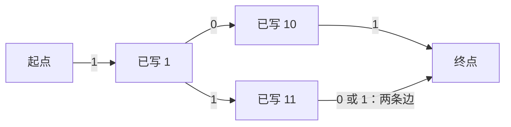
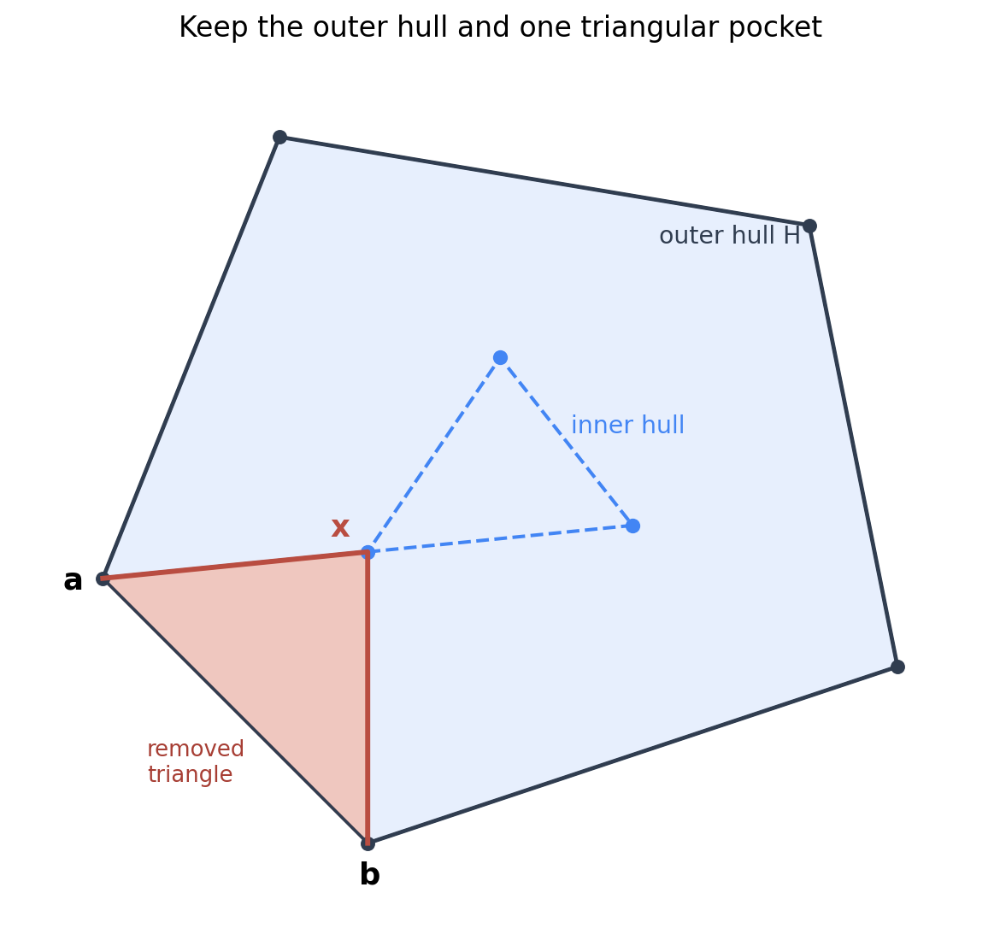

# 2024 CCPC 哈尔滨站 / 第三届 Universal Cup 哈尔滨站：难度不超过 2500 的八题复盘

[QOJ 1817](https://qoj.ac/contest/1817) · [可公开读取的比赛目录](https://contest.ucup.ac/contest/1817) · [英文原题](https://qoj.ac/files/ucup/statements/statements-3-14.pdf) · [电子科技大学出题组官方题解](https://contest.ucup.ac/download.php?id=1817&r=2&type=attachments)

按完整解法的建模、证明与实现负担独立估算，选入 C、M、G、K、J、A、B、L。分数使用 CF 800–3500 尺度，不是 CF 官方 Rating，也不直接用现场通过数换算。估算通常可按约 ±200 理解，2500 的两题也纳入本篇。

| 题号 | 原题 | 独立估算 CF 难度 | 主要训练内容 |
| --- | --- | --- | --- |
| C | [Giving Directions in Harbin](https://qoj.ac/problem/9521) | 900 | 方向编码与输出条件 |
| M | [Weird Ceiling](https://qoj.ac/problem/9531) | 1400 | 按因子分段计算 |
| G | [Welcome to Join the Online Meeting!](https://qoj.ac/problem/9525) | 1500 | 受限传播与方案构造 |
| K | [Farm Management](https://qoj.ac/problem/9529) | 2200 | 最优基准解与单个约束放宽 |
| J | [New Energy Vehicle](https://qoj.ac/problem/9528) | 2300 | 最早失效资源优先与堆模拟 |
| A | [Build a Computer](https://qoj.ac/problem/9519) | 2400 | 数位状态直接构成 DAG |
| B | [Concave Hull](https://qoj.ac/problem/9520) | 2500 | 最大凹多边形结构、两层凸包与旋转卡壳 |
| L | [A Game On Tree](https://qoj.ac/problem/9530) | 2500 | 二阶矩、边对贡献与树形合并 |

其余题暂估为 D 3100、E 2800、F 3500、H 3500、I 3000，本篇不展开。它们分别涉及平方串的周期枚举、动态概率多项式、碰撞事件模拟、类欧几里得矩阵 DP，以及乘积分解与 DP 搜索的组合。正文不附完整代码，篇幅主要留给关键推导。

## C — Giving Directions in Harbin：把转弯变成模 4 的差

题目把绝对方向的指令转成“初始朝向 + 直走/左转/右转”。相邻输入指令保证既不同向，也不反向，因此每次必然只需转 90 度。

按顺时针把 N、E、S、W 编为 $0,1,2,3$。第一条指令的方向就是初始朝向，先输出一次直走；之后旧方向为 $u$、新方向为 $v$ 时，计算 $(v-u)\bmod4$：差为 1 就右转，差为 3 就左转，然后按输入长度直走。

每段开始时，当前朝向等于该段输入方向，所以它走过的位移与原指令完全相同。逐段归纳，最终目的地也相同。输出交替出现直走与转弯，不会出现相邻两个转弯或同类型指令；条数为 $2n-1\le19$，满足上限 20。

例如面朝 S 后要改为 E：方向编码从 2 到 1，差为 3，所以应左转。不要用纸上“东在右边”的直觉代替相对于当前朝向的判断。时间与输出空间都是 $O(n)$；$n=1$ 时只有一条直走指令。

## M — Weird Ceiling：循环停止的位置，是左侧最近的因子

程序从 $b$ 往下找能整除 $a$ 的最大整数，若没找到不小于 2 的因子就返回 $a$。对固定 $n$，这等价于：找不超过 $b$ 的最大因子 $d$，返回 $n/d$；找不到时用因子 1 正好表达默认返回值。

把 $n$ 的全部正因子排序为

$$
1=d_1<d_2<\cdots<d_t=n.
$$

当 $d_i\le b<d_{i+1}$ 时，循环一定停在 $d_i$，返回值一直为 $n/d_i$。这一整段有 $d_{i+1}-d_i$ 个不同的 $b$，不必逐一模拟。最后 $b=n$ 单独贡献 1，因此

$$
\boxed{\sum_{b=1}^n f(n,b)=1+\sum_{i=1}^{t-1}(d_{i+1}-d_i)\frac n{d_i}.}
$$

每个 $b<n$ 恰落入一个这样的区间，$b=n$ 也已包含，故既不重也不漏。$n=1$ 时求和为空，答案自然为 1。

枚举 $d\le\sqrt n$ 的因子，同时收集较小因子和对应较大因子；前者递增，后者递减，将后者反转接上便有序。完全平方数的平方根只收一次。时间 $O(\sqrt n)$，空间 $O(\tau(n))$，其中 $\tau(n)$ 是因子数；若直接排序因子，则另有 $O(\tau(n)\log\tau(n))$。

$n\le10^9$，答案不超过 $n^2$，用 64 位保存乘积与求和。原题三组样例为 $21,10251,7075858$。

## G — Welcome to Join the Online Meeting!：忙碌的人能成为叶子，不能成为传播中间点

无向图表示相识关系。一名不忙的人创建会议，已加入的不忙者可以邀请邻居；忙碌者可以被邀请，但既不能创建也不能邀请。需要构造让所有人加入的过程。

普通“整图连通”不够。例如两个不忙的人只通过一个忙碌者相连，忙碌者可以被前者邀请，却不能再邀请后者，传播会停住。

令 $U$ 为不忙的顶点集合。可行的充要条件是：

1. $U$ 非空，且它的诱导子图连通。
2. 每个忙碌顶点至少有一个不忙邻居。

必要性来自邀请链：从创建者到任何不忙者的邀请链，内部都必须由能邀请的人组成，因此不忙者之间必须仅靠不忙者连通；忙碌者的直接邀请者也必须不忙。

充分性则直接给出构造。任取 $U$ 中一点为根，只把不忙顶点加入 BFS 队列。弹出 $u$ 时，将所有尚未加入的邻居一次邀请进来、立即标记；其中不忙者入队，忙碌者只标记，不继续扩散。第一条条件保证全部不忙者都会入队，第二条保证全部忙碌者最终会被某个弹出的点邀请。

每次弹出时保存一条“$u$ 邀请这些新邻居”的记录，但若列表为空就不输出，因为题面每步的邀请人数要求至少为 1。根的第一步一定能邀请人：$n\ge2$，且若答案可行，其他人必须能从它开始被邀请。其他输出者早已在前面的步骤加入，所有邀请者互异，每个人也只被首次发现时邀请一次。

也可以不单独检查两个条件：按上述 BFS 构造，最后若还有未加入的人就输出 No。这与充要条件等价。全忙时没有合法创建者，应直接输出 No。总时间、空间均为 $O(n+m)$。

## K — Farm Management：先固定最优基准，再问放宽后从哪里搬时间

$n$ 种作物，每单位时间收益为 $w_i$，原本必须分配整数时间 $t_i\in[l_i,r_i]$，且总时间恰为 $m$。保证原问题可行。现在至多放宽一种作物的区间为 $[0,m]$，最大化总收益。

先按收益递减排序。没有放宽时，先给每种作物 $l_i$，再把剩余时间依次填给高收益作物，直到达到各自上限。记这样得到的分配为 $t_i$，收益为 $V$。

它的正确性是单位交换：若高收益作物还没到上限，低收益作物却超过下限，把后者的一单位时间挪给前者不会变差。不断交换后恰得到上述分配。后面要用的关键性质也是这句话：**高收益的空余容量与低收益的额外分配，不会同时存在。**

### 固定放宽第 $i$ 种，只需比较增加和减少它的时间

先把它的分配固定为某个 $z$。其他作物的最优分配仍按收益从高到低填；当 $z$ 相对基准改变，其他作物需要的总时间也相反地改变。因此可以从基准解出发分析。

若 $z>t_i$，需要从其他作物拿时间。应先拿收益最低、且超过下限的部分。只有 $w_j<w_i$ 的转移会产生正收益；比 $i$ 收益高的时间不值得拿。因此可以把排序后后缀 $j>i$ 的全部额外时间交给 $i$，增益为

$$
G_i^{+}=w_i\sum_{j>i}(t_j-l_j)-\sum_{j>i}w_j(t_j-l_j).
$$

同收益作物的转移收益为零，任意固定它们的排序都不影响答案。两个后缀和即可常数时间求出每个 $G_i^{+}$。

若 $z<t_i$，释放的时间应先填给收益最高且没到上限的其他作物。最多值得向前缀 $j<i$ 搬运

$$
x_i=\min\left(t_i,\sum_{j<i}(r_j-t_j)\right)
$$

单位。容量不足时只减少这 $x_i$ 单位，不必强行把 $i$ 清零后再把时间分给低收益作物。

令 $C(k)=\sum_{j\le k}(r_j-t_j)$、$P(k)=\sum_{j\le k}w_j(r_j-t_j)$。若 $x_i>0$，二分最小的 $k<i$ 使 $C(k)\ge x_i$，前缀接收这些时间的收益为

$$
P(k-1)+(x_i-C(k-1))w_k.
$$

减去原本在 $i$ 上产生的 $w_ix_i$，得到 $G_i^{-}$。$x_i=0$ 时增益为 0。

### 为什么没有遗漏“几种作物来回调整”的方案？

固定 $i$ 的新时间以后，其他作物仍是同一个线性分配问题。若它们之间存在“低收益超过下限、高收益未满”的情况，就继续交换，直到成为该总量下的贪心最优分配。因此增加 $i$ 时，其他人减少的是最便宜的已分配时间；减少 $i$ 时，其他人增加的是最贵的可用容量。这正好是上面两种计算。

在同一方向上，一单位的边际增益按顺序只会下降；一旦不再优于留给 $i$，继续搬运就没有帮助。所以无需枚举 $z$ 的所有整数取值，更不需要做以 $m$ 为维度的背包。

最终答案为

$$
\boxed{V+\max\left(0,\max_iG_i^{+},\max_iG_i^{-}\right).}
$$

排序、基准分配与前后缀和之外，每个 $i$ 二分一次，总时间 $O(n\log n)$、空间 $O(n)$。$m\le10^{11}$、收益系数至多 $10^6$，乘积与总收益都用 64 位。原题样例答案为 109。

## J — New Energy Vehicle：优先消耗下一次最早能补回的电

第 $i$ 块电池容量为 $a_i$，开始全部充满。每前进一公里可消耗任意一块电池的一单位电量。路上充电站只能给指定电池充电，站点位置严格递增，求最远能走到哪里。

在可达站点把指定电池充满不会损害其他电池，故可以总是充满。但“优先用剩余最多的电池”没有依据：真正影响损失的是，哪块电池即将被重新充满，使旧电量失去价值。

### 把每批电量看成有失效位置的资源

一块电池的初始电量，在它第一次充电时失效；某站充进去的电量，在同一电池下一次充电时失效。没有下一站时，把失效位置视为无穷大。

贪心是每次优先用失效位置最早的电量。为证明它，考虑某个过程在同一时刻用了一单位较晚失效的电 $B$，却留着可用、较早失效的电 $A$。

若过程之后在 $A$ 失效前用到了它，就交换这两次消费：现在用 $A$，以后用 $B$。$B$ 现在已经可用，且失效不早于 $A$，所以以后那次使用仍合法。若之后根本没用到 $A$，现在改用 $A$ 还额外留下了 $B$。两种情况都不会减少未来可行性。

反复交换，就能把任意可达过程改成贪心过程。因此贪心不会让原本能到达的站点变得不可达，也不会损失最终距离。

### 一个最小堆模拟全程

倒序扫充电站，预处理每个站点之后，同一电池下一次充电的站点编号；同时得到各电池的首次充电站。站点编号与实际位置顺序相同，可以直接作为堆的优先级。

堆中每个条目保存“一批剩余电量、失效站点”。起初为每块电池放入一批初始电量。依次处理站点 $j$：

1. 设到下一站的距离为 $d$，当前总电量为 $E$。若 $E<d$，再也无法到达该站，答案是当前位置加 $E$。
2. 否则，从堆顶的最早失效批次消耗 $d$ 单位。整批用完就弹出，最后一批可能只用掉一部分。
3. 到站后，丢弃失效站点等于 $j$ 的旧电量，再加入被充电电池的满容量，失效时间设为它的下一站。

第 3 步中，旧电量若还存在，一定就在堆顶，因为其他尚未失效的批次的优先级都更晚；它若提前用完，就没有条目需要丢弃。因此不必在堆中搜索某块电池，也不需要在每公里上循环。

经过最后一站后，剩余所有电量都能直接用来继续前进。恰好把电耗尽时到站也能充电，所以不可达条件是 $E<d$，不是 $E\le d$。

每块初始电和每次充电只创建一批资源，每批最多完整弹出一次；每段行驶最多另有一个部分消耗。堆内最多保留 $n$ 批，总时间 $O((n+m)\log(n+1))$、空间 $O(n+m)$。总电量、距离与答案使用 64 位。原题两个样例为 $12,9$。

## A — Build a Computer：把数位 DP 的状态直接当作图上的结点

要构造一张 DAG，每条边标 0 或 1，起点到终点的每条路径代表一个不含前导零的二进制数。路径与区间 $[L,R]$ 内整数必须一一对应，不能多、不能漏、不能重复。$1\le L\le R\le10^6$，结点数不超过 100。

逐个数建链会太大；把所有数建 Trie 也可能有线性于区间大小的结点数。能否合并，不应按“已经写出的前缀是否相同”判断，而应按“以后允许写什么后缀”判断。

### 未来只依赖位数和两个边界标记

令 $w$ 为 $R$ 的二进制位数，$w\le20$。在判断范围时，暂时把所有数左补零到 $w$ 位。已经处理前 $p$ 位后，用两个标记记录：当前前缀是否仍与 $L$、$R$ 的前缀相等，记为 $tight_L,tight_R$。

相等时下一位受相应边界限制；已经严格大于 $L$ 或小于 $R$ 的前缀，则不再受那一侧约束。于是下一位是否允许、后继标记如何变化，只依赖

$$
(p,tight_L,tight_R),
$$

不依赖前缀的具体数值。这就是可直接合并成同一个结点的状态。

从这样一个结点尝试接边 $c\in\{0,1\}$：若仍贴着下界而 $c$ 小于 $L$ 的下一位，不能接；若仍贴着上界而 $c$ 大于 $R$ 的下一位，也不能接。合法时位置加一，相等标记分别与“新位等于对应边界位”取逻辑与。位置达到 $w$ 时，所有状态统一进入同一个终点。

### 比较时的补零，不是输出路径上的前导零

上面的左补零只用于范围判断，不能真的输出这些 0。单独设起点 $S$，枚举二进制表示的第一个 1 位于固定宽度下的第 $p$ 位，其中 $1\le p\le w$。这时概念上读入的前缀是 $0^{p-1}1$，数值为 1。

令 $L_p=\lfloor L/2^{w-p}\rfloor$、$R_p=\lfloor R/2^{w-p}\rfloor$，即两个边界的前 $p$ 位。只有

$$
L_p\le1\le R_p
$$

时，这个开头才可能合法。满足条件就从 $S$ 接一条**标号为 1** 的边，到

$$
(p,[L_p=1],[R_p=1]).
$$

$p=w$ 时直接连终点。随后按照前面的状态转移继续接边。这样比较逻辑知道前面略过了多少个零，实际路径却始终以 1 开头。

例如 $[5,7]$ 允许的字符串是 101、110、111，可以由下面的五点图表达：

### 为什么合并状态不会凭空制造路径？

任何一个区间内整数，其首个 1 的位置唯一，故在 $S$ 处应选的分支唯一；之后每个数字位又唯一决定下一条边，所以它恰对应一条路径。反过来，每条路径的边界标记都由实际已写前缀决定，转移从未越界，到终点时就落在 $[L,R]$ 内。

两个不同长度虽然都从起点走一条 1 边，但它们进入的层数不同，后续剩余位数也不同，不会生成同一个二进制字符串。合并后继只是在共享相同的后缀语言，没有增加新的前缀或改变后缀约束。

至多有 $4w$ 个状态结点，加起点与终点不超过 82；普通状态出度至多 2，起点出度至多 $w\le20$，满足 200 的限制。所有状态边都增加位置，因此没有环。只创建从起点可达的状态，或最后删去不可达状态，可保证只有一个入度为零的起点；合法状态也总能补上某个边界内后缀，不会产生额外的无出边结点。

总构造时间、空间均为 $O(w)=O(\log R)$。这是一条用数位状态压缩的独立展开路线；官方题解使用区间二进制块、前缀树与共享自由后缀链，二者都利用了“相同的后缀选择可以共享”。

## B — Concave Hull：最大面积等于外凸包减去最小的一块凹口

给定 $n$ 个互异点，保证没有三点共线。选部分点，以某个顺序连成面积严格为正的简单凹多边形，最大化面积，输出两倍面积。$n\le10^5$，坐标绝对值不超过 $10^9$。

凸包面积是上界，但直接输出凸包不合法：它是凸多边形。应问的是，要保留一个凹角，最少必须牺牲多少面积？

### 支撑算法的结构结论

记外层凸包为 $H$。官方解法使用如下结构：最优解可以取成外凸包的全部顶点，再加一个严格内部点 $x$，把某条外边 $ab$ 改成 $a\to x\to b$。面积损失恰为三角形 $abx$ 的面积。

这个结构分两步理解。首先，外凸点不必舍弃：可以把未选外凸点插入朝外可见的边界，扩大多边形；已有向内凹口可以保留。插入的外凸点只用于向外扩张，不能把所有凹口同时补平后就当作合法答案。

全部外凸点加入后，它们在简单多边形边界上的顺序必须与凸包顺序一致，否则边会相交。于是相邻外凸点之间，可能直接连边，也可能绕经一串内部点；后一种链与外凸包边一起围出被舍弃的“凹口”。不同凹口分居各自边界之间，损失面积相加，保留一个凹口就足以满足非凸条件，其他凹口都可填平。

还要解释为何剩下的一条链只需保留一个内部点。以它的凸包基边 $ab$ 为水平线，选这条内部链上离基线最近的点 $x$，高度为 $h>0$。在高度 $0$ 到 $h$ 之间，链上其他顶点都尚未出现，凹口的左右边界只可能来自连接 $a,b$ 的首尾两条边。这两条边在到达高度 $h$ 前不能相交，因此这段区域的面积至少为 $|ab|h/2$，即三角形 $abx$ 的面积。用这一个三角形作凹口，损失不会更大。

另一方面，对任意外凸包边 $ab$ 和严格内部点 $x$，插入 $x$ 得到的多边形确实简单，且在 $x$ 处向内凹，因而是合法构造。上下两个方向合起来，得出

$$
\boxed{\text{最大两倍面积}=\text{凸包两倍面积}-\min_{ab\text{ 为外凸包边},\ x\text{ 为内部点}}(b-a)\times(x-a).}
$$

外凸包按逆时针排列，内部点都在每条有向边左侧，叉积为正，不需额外取绝对值。原题无三点共线，所以除外凸包顶点外的点全部严格在内部。

图中外层黑边是 $H$，蓝色虚线是内部点再取出的凸包；选定红色三角形作凹口，相当于把 $ab$ 改为 $a\to x\to b$。

### 从枚举所有点，降到两层凸包的旋转卡壳

固定外边 $ab$，长度固定，最小化叉积等价于找内部点到它的支撑直线的最小距离。这个目标是点坐标的线性函数，最小值一定能在内部点的凸包上取得。因此先取一次外凸包，删去外层顶点，再对剩余点取内凸包。

外边沿逆时针遍历时，它的法向量也沿同一方向旋转；内凸包对这个方向的最小支撑点随之沿边界单向前进。这就是旋转卡壳：第一条外边先扫描内凸包找最小点，之后比较当前点与下一个点的叉积，不变大时继续推进；对并列最小点保持一致的推进方向即可。

为什么指针不会来回走？一个凸多边形顶点在哪些方向取得线性函数最小值，对应一段连续的法向角区间；这些区间沿顶点顺序排列。外边法向只绕一圈，因此支撑点也只需绕一圈，而不是每条外边重新扫描一次。

内部没有点时无解，输出 $-1$；内部仅有一个或两个点时，对每条外边直接比较这些点，仍为线性时间。它们不是无解情形。计算凸包 $O(n\log n)$，卡壳 $O(n)$，总空间 $O(n)$。

建议用 `__int128` 保存叉积、鞋带求和及面积差的中间结果，最后输出整数，不使用浮点数找最近点。样例答案为 $40,-1$。

## L — A Game On Tree：平方展开后，难点变成一条路径同时经过两条边

两人独立、均匀地从全部 $C=\binom n2$ 条无向简单路径中各选一条，允许选到同一条。两条路径共有 $X$ 条边，要求 $\mathbb E[X^2]$，模 $998244353$。

不要先枚举两条完整路径。对每条边 $e$，令 $I_e$ 表示它是否同时出现在两条随机路径中，则

$$
X^2=\sum_e I_e+2\sum_{e<f}I_eI_f.
$$

这里是对无序不同边对求和，所以有系数 2。若改用有序边对，就不能再乘这个 2。

固定根 1，将非根结点 $u$ 与父边 $e_u$ 对应，子树大小记为 $s_u$。下面先计算所有有序路径对的得分总和 $T$，最后除以 $C^2$。

### 单条边：两侧任选端点

经过 $e_u$ 的一条路径，必须在边的两侧各选一个端点，数量为 $s_u(n-s_u)$。两人独立选择，因此这一条公共边对总和的贡献是

$$
T_1=\sum_{u\ne1}s_u^2(n-s_u)^2.
$$

注意这里平方的是“单条路径经过这条边的方案数”，不是把子树顶点或路径数误当成概率。

### 两条不同边：祖先关系决定外侧的两个端点集合

设 $u$ 是 $v$ 的严格祖先，则 $e_u$ 位于 $e_v$ 上方。一条路径同时经过两边，当且仅当一个端点在 $S_v$，另一个端点在 $S_u$ 外。方案数为

$$
s_v(n-s_u).
$$

两条随机路径都经过它们，对总和的边对系数就是 $s_v^2(n-s_u)^2$。

若 $S_u,S_v$ 不相交，一条路径同时经过两边，必须在这两个子树中各取一个端点，方案数为 $s_us_v$，平方后为 $s_u^2s_v^2$。

这两类穷尽不同父边的关系。令非根结点的 $A_u=s_u^2$，根的 $A_1=0$，并定义

$$
D_u=\sum_{v\in S_u}A_v.
$$

祖先边对的无序贡献总和直接为

$$
T_{anc}=\sum_{u\ne1}(n-s_u)^2(D_u-A_u).
$$

括号中的 $D_u-A_u$ 正好枚举所有严格后代的下方边，不含自身。

### 不相交的子树，按 LCA 在父亲处合并

若两个边对应的下端点位于不同孩子分支，它们的 LCA 唯一确定。处理某点 $w$ 的孩子时，每个孩子 $c$ 的 $D_c$ 就是该分支内所有候选边的 $s^2$ 总和。不同孩子分支的贡献是 $D_{c_1}D_{c_2}$。

用一个累计量 $acc$，每读到新孩子 $c$，先给 $T_{dis}$ 加 $acc\cdot D_c$，再令 $acc\gets acc+D_c$。这使每对孩子分支恰好配对一次，也避免枚举某点的平方个孩子对。

由此

$$
\boxed{T=T_1+2(T_{anc}+T_{dis}),\qquad
\mathbb E[X^2]=T\,(C^2)^{-1}\pmod{998244353}.}
$$

一次后序遍历即可依次得到子树大小、$D$ 和各贡献，总时间、空间都是 $O(n)$；长链可采用迭代后序遍历，避免递归栈不足。所有平方、乘积和累计应及时取模，中间总贡献会远超 64 位；不能先在普通整数里求完整 $T$ 再取模。

$n<998244353$，$n,n-1,2$ 在模数下均可逆，因此 $C\not\equiv0$，分母逆元存在。$n=2$ 时只有一条路径，答案应为 1。三点链的九种有序路径对总分为 10，得到 $10/9$；原题两个样例的模值为 $443664158,918384806$。

## 核查与来源

八题的原题、约束和官方解法方向均已读取。A 在正文中单独展开数位状态构造；其余题在官方思路基础上补充了充要条件、交换证明、边对计数和关键边界。

已检查全部 14 组官方样例，构造题检查路径、邀请或方向是否合法。另对 K、J 分别进行 2000 组小规模全方案对照，L 枚举 1500 棵小树的全部路径对，B 对小点集枚举简单凹多边形并核对旋转卡壳；A 还检查了全部 $R\le64$ 的区间及 1000 组较大区间的路径数与端点范围。验证用于辅助排错，正确性依据是正文中的推导。
