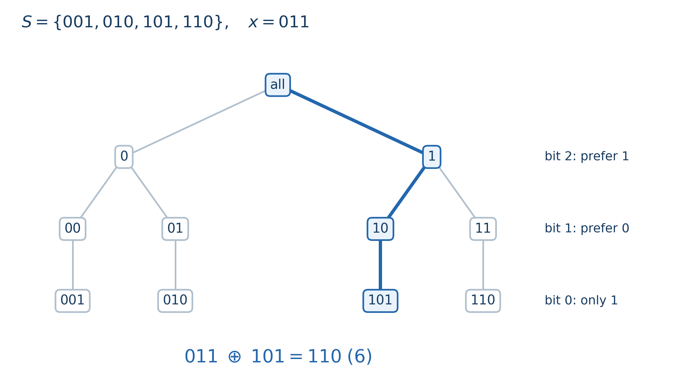

# Chapter 7 01 Trie 与二进制建模

先确定 XOR 题的候选：从已有元素选一个，还是选若干元素求异或？

例如 $\{1,2\}$ 中单选最大为 $2$，子集异或最大为 $1\oplus2=3$。01 Trie 维护真实元素候选，线性基维护子集生成的异或空间。

本文默认你熟悉基本位运算和前缀和。统一把数看成 $W$ 位非负整数，位编号是 $0,1,\ldots,W-1$，比较大小时从高位往低位看。

## 1. 每走一层，都在缩小同一批候选

将数写成等长二进制串，从最高位插入：本位为 $0$ 走 $0$ 儿子，为 $1$ 走 $1$ 儿子。完整路径对应一个数，中间结点对应高位前缀。

**当前结点下方，就是仍可选择的全部元素。** 它们高位相同。若 $W=3$，插入 $001,010,101,110$，走到前缀 $1$ 后只剩 $101,110$。

结点保存两个儿子与经过它的元素数 $cnt$。按多重集计数：同值插入两次，沿途计数加二。单次插入、删除沿一条路径加一、减一，耗时 $O(W)$。

删除须保证值存在；查询检查 $cnt>0$，因为残留指针可能指向空分支。静态插入 $n$ 个数至多建 $1+nW$ 个结点；动态删除不回收时，空间按历史建过的路径计算。

### 最大异或为什么能一位一位选？

给定 $x$，选择 $y\in S$ 最大化 $x\oplus y$。处理第 $b$ 位时，优先走 $y_b=1-x_b$ 的非空分支，使结果本位为 $1$；不存在时走另一支。

以 $x=011$ 为例：最高位希望 $y$ 取 $1$，留下 $101,110$；接着希望 $y$ 的第 $1$ 位取 $0$，只剩 $101$；最后没有选择，得到 $011\oplus101=110$。



蓝色路径依次保留前缀 $1,10,101$，最终的 $101$ 确为原集合元素。

若结果高于第 $b$ 位的部分相同，本位为 $1$ 就比为 $0$ 多 $2^b$；全部低位至多贡献 $2^b-1$，无法反超。因此高位贪心成立。沿非空分支下降又保证所有决策由同一元素实现。

最小异或优先走与 $x$ 本位相同的分支。两种最值查询均要求集合非空，耗时 $O(W)$。高位决定大小，Trie 保证各位选择兼容。

> **最值应用**：[CF1658 D2 — 388535 (Hard Version)](https://codeforces.com/problemset/problem/1658/D2)（约 2200；已完成）。本题可以用最小、最大异或验证候选，分析保留在[配套第 1 题](binary-trie-exercises.md#1-cf1658-d2--388535-hard-version)。

## 2. 从最值走到计数、排名和整体异或

### $C(x,K)$ 到底在数什么？

固定查询数 $x$，统计 $S$ 中有多少个元素 $y$ 满足异或结果小于门槛 $K$，记为

$$
\boxed{C(x,K)=\#\{y\in S:x\oplus y<K\}.}
$$

$\#\{\cdots\}$ 表示满足条件的元素数。$x$ 是固定查询参数，$K$ 是门槛，$y$ 是变化的候选。$x$ 可为任意 $W$ 位非负数，不必属于 $S$。$C(x,K)$ 返回数量；逐个枚举也能计算，Trie 负责加速。

$S$ 隐含在记号中。插入、删除改变它后，相同 $x,K$ 的查询结果也可能改变。

例如，仍取前面的 $S=\{001,010,101,110\}=\{1,2,5,6\}$，查询 $x=011=3$、$K=101=5$：

| 候选 $y$ | $x\oplus y$ | 十进制结果 | 是否严格小于 5？ |
| --- | --- | --- | --- |
| $001$ | $010$ | 2 | 是 |
| $010$ | $001$ | 1 | 是 |
| $101$ | $110$ | 6 | 否 |
| $110$ | $101$ | 5 | 否，等于门槛 |

因此 $C(3,5)=2$。再插入一个 2，答案变为 3：重复值按出现次数计数。

也可以把它看成一个熟悉的排名问题：固定 $x=3$ 后，将全部异或结果从小到大排列，得到

$$
T_3=(1,2,5,6).
$$

$C(3,5)$ 即序列中小于 5 的项数。$x=0$ 时，$C(0,K)$ 统计 $S$ 中小于 $K$ 的元素；一般情形比较的是 $x\oplus y$。

无须生成或排序 $T_x$。Trie 保存原值 $y$，查询时跳过整批已确定合法的候选。

### 为什么计数时只需沿一条路径继续比较？

令 $z=x\oplus y$。从高位比较 $z,K$，候选分为已经小于、仍相等、已经大于三类。最高不同位一旦确定大小，低位无法改变。

已经小于的整批计入，已经大于的舍去，只沿仍相等的候选继续。当前结点 $u$ 恰保存后一类；其路径是 $y$ 的前缀，固定 $x$ 后也唯一确定 $z$ 的前缀。

现在处理第 $b$ 位，假设更高位仍相等。令 $t=x_b$，先看清两个儿子的含义：

- 走 $y_b=t$ 的儿子时，$z_b=t\oplus t=0$。
- 走 $y_b=t\oplus1$ 的儿子时，$z_b=1$。

于是转移由 $K_b$ 决定：

| $K_b$ | 结果本位取 0 的候选 | 结果本位取 1 的候选 |
| --- | --- | --- |
| 0 | 前缀继续相等，进入这一支 | 首次不同位已经更大，舍去 |
| 1 | 首次不同位已经更小，整支计入 | 前缀继续相等，进入这一支 |

同一儿子下的候选已在当前位严格小于 $K$，低位不再受限。因此整支贡献就是其元素数 $cnt$。

用刚才 $x=011,K=101$ 的例子逐层看：

| 当前位 | 进入这一层时仍需比较的 $y$ | 本层处理 | 累计答案 |
| --- | --- | --- | --- |
| 第 2 位，$K_2=1$ | $001,010,101,110$ | $001,010$ 的结果最高位为 0，整支加入；继续比较 $101,110$ | 2 |
| 第 1 位，$K_1=0$ | $101,110$ | $101$ 的结果前缀为 $11$，已经大于 $K$ 的 $10$，舍去；只剩 $110$ | 2 |
| 第 0 位，$K_0=1$ | $110$ | 它的异或结果为 $101$，本位仍相等，没有进入严格更小的分支 | 2 |

走完后剩下的候选满足 $x\oplus y=K$，严格小于查询不计入它们。其余合法候选均在与 $K$ 的最高不同位被计入一次，之后不再下降，故不重不漏。

对应伪代码如下，不存在的儿子计数约定为零：

```text
count_less(x, K):
    若 K <= 0，返回 0
    若 K >= 2^W，返回 cnt[root]
    u = root, ans = 0
    从 b = W-1 到 0:
        若 u 不存在或 cnt[u] = 0，结束
        t = x 的第 b 位
        若 K 的第 b 位为 1:
            ans += cnt[child[u][t]]       // 本位异或为 0，整支已经更小
            u = child[u][t xor 1]        // 本位异或为 1，继续比较
        否则:
            u = child[u][t]              // 只有本位异或为 0 才可能合法
    返回 ans                            // 完全等于 K 的候选没有加入
```

每层只给答案加一次计数，并沿一个儿子下降，复杂度为 $O(W)$。若要求闭区间 $[A,B]$，就是

$$
\#\{y\in S:A\le x\oplus y\le B\}
=C(x,B+1)-C(x,A).
$$

固定同一时刻的 $S$ 与 $x$，两次计数相减留下闭区间。$B+1$、$2^W$ 须用足够宽的类型，不能先溢出再判边界。

**例题 1：[CF817 E — Choosing The Commander](https://codeforces.com/problemset/problem/817/E)**（独立估算约 1900；Educational Codeforces Round 23，2017）。本题维护动态多重集，支持插入、删除，以及询问有多少个现有元素与给定的 $p$ 异或后小于 $l$。第三种操作直接对应 $C(p,l)$。

题面样例先插入 3、4，再查询 $p=6,l=3$。两次异或结果是 $6\oplus3=5$、$6\oplus4=2$，所以返回 1；删去 4 后，再做同一次查询，返回 0。集合的变化由插入、删除负责，计数查询始终回答刚才定义的同一个问题。每次操作 $O(W)$，完整分析见[配套第 6 题](binary-trie-exercises.md#6-cf817-e--choosing-the-commander)。

### 第 $k$ 小：利用分支计数决定要去哪里

这里的目标明确为：在所有 $x\oplus y$ 的结果中，取从小到大第 $k$ 项，且 $1\le k\le|S|$。继续用 $x=3$ 与 $T_3=(1,2,5,6)$，第 3 小结果就是 5。

同前缀下，本位异或为 0 的值全部排在为 1 的值之前。设前一支计数为 $c$：$k\le c$ 时进入它，否则进入后一支并令排名为 $k-c$。两支分别为 $child[u][x_b]$、$child[u][x_b\oplus1]$。

求第 3 小时，最高位为 0 的结果为 1、2，跳过后求另一组的第 1 小；$101,110$ 中下一位选 0，得到 5。原元素为 $y=6$，返回异或结果 $3\oplus6=5$。

这和 $C$ 的关系可以准确写成：第 $k$ 小结果为 $v$ 当且仅当

$$
C(x,v)<k\le C(x,v+1).
$$

小于 $v$ 的项不足 $k$，加入等于 $v$ 的项后达到 $k$，正好刻画第 $k$ 小。重复值占多个名次。沿分支直接选择只需 $O(W)$。

**第 $k$ 小例题：[ABC241 D — Sequence Query](https://atcoder.jp/contests/abc241/tasks/abc241_d)**（独立估算约 1600；AtCoder ABC241，2022）。动态插入元素，查询“不小于 $x$ 的元素中第 $k$ 小”，以及“不大于 $x$ 的元素中第 $k$ 大”。先用 $C(0,x)$ 或 $C(0,x+1)$ 确定被跳过的元素数量，再转成整个多重集上的第几小，正好把阈值计数与分支选排名连起来。原题 $k\le5$，也可用 `multiset`；这里建议用带计数的 01 Trie 练习一般排名查询。完整分析见[配套第 8 题](binary-trie-exercises.md#8-abc241-d--sequence-query)。

### 整体异或：树里的数与当前实际值怎样对应？

维护掩码 $L$，约定存储值 $s$ 代表实际值 $s\oplus L$。全体异或 $t$ 时，只需令 $L\gets L\oplus t$。

树存 $1,2,5,6$，初始 $L=0$。整体异或 3 后，$L=3$，实际值为 $2,1,6,5$。小于 5 的数量为 $C(3,5)=2$；实际第 3 小即与 3 异或后的第 3 小，结果为 5。

若外部还给定查询数 $x$，则使用参数 $x\oplus L$，因为

$$
x\oplus(s\oplus L)=(x\oplus L)\oplus s.
$$

实际集合的阈值计数、最值与第 $k$ 小均可归约到原 Trie。插入或删除实际值 $z$，使用存储值 $z\oplus L$。例如 $L=3$ 时插入 4，存入 $4\oplus3=7$，其实际值为 $7\oplus3=4$。

整体更新为 $O(1)$，其余操作仍为 $O(W)$。这里利用了异或的结合律和 $L\oplus L=0$；整体加法有进位，不能直接套用这个掩码方案。

**整体异或例题一：[CF842 D — Vitya and Strange Lesson](https://codeforces.com/problemset/problem/842/D)**（独立估算约 2000；Codeforces Round 430，2017）。每次把整个数组异或 $t$，输出当前 mex，即最小未出现的非负整数。更新直接维护 $L$；查询时按实际值从小到大寻找缺失分支。额外要判断一棵子树是否已经占满全部可能值，因此本题计数必须按不同值去重，不能沿用多重集出现次数。完整分析见[配套第 9 题](binary-trie-exercises.md#9-cf842-d--vitya-and-strange-lesson)。

**整体异或例题二（迁移）：[CF1980 G — Yasya and the Mysterious Tree](https://codeforces.com/problemset/problem/1980/G)**（独立估算约 2300；Codeforces Round 950，2024；额外前置：树上根路径异或、深度奇偶）。所有边权同时异或 $t$；给定 $v,x$，选择 $u\ne v$，最大化 $x$ 与 $u,v$ 路径边权的异或和。先判断整体修改如何影响根路径值，再按深度奇偶分成两棵 Trie，即可把树上更新归约为分组后的整体异或。适合在上一题后练建模，完整分析见[配套第 10 题](binary-trie-exercises.md#10-cf1980-g--yasya-and-the-mysterious-tree)。


## 3. 什么时候能把题目变成 Trie 查询？

Trie 解决的是“一个数与一批候选数”的问题。很多题的主要工作，是先把原来的对象变成这样的形式。

设数组为 $a_1,\ldots,a_n$，定义前缀异或 $P_0=0$、$P_i=a_1\oplus\cdots\oplus a_i$。由于相同部分异或两次会抵消，子段异或可以写成

$$a_l\oplus\cdots\oplus a_r=P_r\oplus P_{l-1}.$$

固定右端点 $r$，以 $P_r$ 查询候选 $P_{l-1}$。求最大非空子段异或时，先插入 $P_0$；每轮先查询 $P_r$，再插入它。查询时恰有 $P_0,\ldots,P_{r-1}$，每个候选对应合法非空子段；提前插入会允许空子段。

**例题 2：[CF665 E — Beautiful Subarrays](https://codeforces.com/problemset/problem/665/E)**（独立估算约 2100；Educational Codeforces Round 12，2016；额外前置：前缀异或）。求异或和至少为 $k$ 的非空子段个数。固定右端点 $r$，允许的前缀恰为 $P_0,\ldots,P_{r-1}$，共 $r$ 个；其中 $C(P_r,k)$ 个与 $P_r$ 异或后小于 $k$，所以本轮贡献为

$$
\boxed{r-C(P_r,k).}
$$

这里把 $C$ 的两个参数代成了当前前缀 $P_r$ 和题目门槛 $k$，候选集合则随着右端点变化。对样例 $a=(1,2,3),k=2$，前缀为 $P=(0,1,3,0)$：

| $r$ | 查询时树里的前缀 | $P_r$ | 与各候选异或的结果 | 本轮贡献 |
| --- | --- | --- | --- | --- |
| 1 | $\{0\}$ | 1 | $1$ | $1-C(1,2)=1-1=0$ |
| 2 | $\{0,1\}$ | 3 | $3,2$ | $2-C(3,2)=2-0=2$ |
| 3 | $\{0,1,3\}$ | 0 | $0,1,3$ | $3-C(0,2)=3-2=1$ |

总数为 3。每轮先查询，再插入当前前缀，保证只统计 $l\le r$ 的非空子段；不同位置的相同前缀也必须按出现次数保留。总时间 $O(nW)$，答案用 64 位，完整证明和边界见[配套第 7 题](binary-trie-exercises.md#7-cf665-e--beautiful-subarrays)。[官方题解](https://codeforces.com/blog/entry/44466) 直接统计至少为 $k$ 的数量；这里通过补集复用本节的 $C$ 查询。

如果长度必须在 $[A,B]$ 内，其中 $1\le A\le B$，先令 $j=l-1$，把长度限制写成

$$A\le r-j\le B
\quad\Longleftrightarrow\quad
\max(0,r-B)\le j\le r-A.$$

查询 $P_r$ 时维护该下标窗口：插入进入的前缀，删除离开的前缀；窗口为空则跳过查询。每个前缀进出至多一次，总时间 $O(nW)$。先推允许的下标，再设计窗口移动。

> **练习（估算 CF 难度）**：[XOR Inverse](https://codeforces.com/problemset/problem/1416/C)（约 2200）。

## 4. 三道例题：先看变量之间的关系

以下保留原稿选定的三题，难度按 CF 800–3500 尺度独立估算。

| 题目 | 原始来源 / 平台 | 估算难度 | 主要训练点 |
|---|---|---:|---|
| [XOR Construction](https://codeforces.com/gym/104777/problem/N) | 2023–2024 ICPC NERC Southern and Volga Russian Regional，N；亦见 [CF 1895D](https://codeforces.com/problemset/problem/1895/D) | 1900 | 用一个首项决定整个排列，再判定值域 |
| [Xor Minimization](https://atcoder.jp/contests/abc281/tasks/abc281_f) | AtCoder ABC281 F，2022 | 2000 | 公共掩码下的极小极大递归 |
| [XOR Pairs](https://qoj.ac/problem/4579) | 2021 ICPC Asia Jakarta Regional，A；QOJ | 1700 | 固定异或值，直接建立计数对应 |

### XOR Construction：排列约束为什么只剩最大值？

已知 $a_i=b_i\oplus b_{i+1}$，要求构造一个由 $0,\ldots,n-1$ 组成的排列 $b$，题目保证有解，$n\le2\cdot10^5$。

相邻项的关系提示我们消去中间变量。定义 $p_0=0$、$p_i=a_1\oplus\cdots\oplus a_i$。一旦选定 $x=b_1$，就有

$$b_{i+1}=x\oplus p_i,\qquad 0\le i<n.$$

选定 $x$ 就是给固定的 $n$ 个前缀整体异或。有解保证前缀互异，否则对应项永远相等；异或是双射，变换后仍互异。

只需再保证全部结果小于 $n$：$n$ 个互异非负整数落入 $[0,n-1]$，必恰为该排列。将 $p_i$ 建 Trie，枚举 $0\le x<n$，检查

$$\max_i(x\oplus p_i)<n.$$

找到一个通过的 $x$，即可按公式恢复排列。时间、空间均为 $O(nW)$。[比赛官方题解](https://codeforces.com/gym/104777/attachments/download/22887/tutorial.pdf) 给出了这一判定思路。这里真正减少约束的原因，是变换已经自动维护了互异性。

### Xor Minimization：这次选的是大家共用的 $x$

给定 $a_i<2^{30}$，选公共 $x$ 最小化 $\max_i(a_i\oplus x)$。普通查询固定 $x$ 选择一个 $a_i$；此题选择 $x$ 并承担所有元素中的最坏结果，须做极小极大递归。

令 $f(u,b)$ 为候选位于结点 $u$、只考虑第 $b$ 至第 $0$ 位的最小最大值。仅一个非空儿子时，让 $x_b$ 与该组相同，本位全部为零，递归该儿子。

两支都非空时，无论 $x_b$ 如何选，一组本位为一、值至少 $2^b$，另一组本位为零、值至多 $2^b-1$。最大值由前一组决定；可选由哪组承担这一位，再优化该组低位：

$$f(u,b)=2^b+\min\{f(u_0,b-1),f(u_1,b-1)\}.$$

$u_0,u_1$ 为两个儿子，位处理完返回零。另一组低位再大也无法反超，因此只需优化承担本位一的组。递归比较两个方案，最终仍只选一个公共 $x$。

每个结点处理一次，时间、空间都是 $O(nW)$。可对照 [AtCoder 官方解说](https://atcoder.jp/contests/abc281/editorial/5377) 阅读这个递归。

### XOR Pairs：固定结果后，可以不用建树

统计有序对 $(A,B)$，满足 $1\le A,B\le A\oplus B\le N$，且 $A\oplus B$ 不在禁用集合 $S$ 中。原题 $N\le10^6$，禁用输入可能重复。

看到异或和范围，不一定需要 Trie。先固定 $X=A\oplus B>0$，问有多少对产生它。设 $H$ 是不超过 $X$ 的最大二的幂，写成 $X=H+q$，其中 $0\le q<H$。

由于 $A,B\le X<2H$，两者在 $H$ 以上都没有一；而 $X$ 的 $H$ 位为一，说明恰有一方包含这一位。先考虑 $A$ 包含它，写成 $A=H+a,B=b$。此时

$$A\le X\Longleftrightarrow 0\le a\le q,
\qquad A\oplus B=X\Longleftrightarrow b=a\oplus q.$$

一旦选定 $a$，$b$ 就唯一确定，而且 $b<H\le X$，上界自动满足。$a=0,\ldots,q$ 原本有 $q+1$ 种；其中只有 $a=q$ 会使 $B=0$，要删去，剩下 $q$ 种。交换 $A,B$ 又得到不重叠的 $q$ 种，因此固定 $X$ 的贡献是

$$2q=2(X-H).$$

用布尔数组标记禁用值并去重，枚举 $X=1,\ldots,N$，遇到允许的值就累加贡献，总时间 $O(N+|S|)$、空间 $O(N)$。答案使用 64 位整数。

如果 $N$ 更大，还可以按最高位分块。一个完整或末尾截断的块写成 $X=H,\ldots,H+L-1$，总贡献为

$$\sum_{q=0}^{L-1}2q=L(L-1).$$

先求所有块的总贡献，再减去每个不同禁用值的贡献；用排序去重时，时间是 $O(|S|\log|S|+\log N)$。[官方分析](https://training.qoj.ac/download.php?id=989&r=0&type=attachments) 也得到同一计数式；这里用“确定 $a$ 就确定 $b$”的对应关系解释它。

## 5. 最后确认：你的压缩留下了什么？

| 后续要回答的问题 | 必须保留的信息 | 常用工具 |
|---|---|---|
| 从已有元素选一个，与 $x$ 异或求最值 | 真实元素及其高位前缀 | 01 Trie |
| 计数或第 $k$ 小 | 每个前缀的出现次数 | 带计数的 Trie |
| 任意子集能否异或成 $k$、最大子集异或 | 全部组合生成的空间 | 线性基 |
| 固定最高位后已能直接计算贡献 | 高位约束与变量间的对应 | 位分析或数位 DP |

实现检查：$W$ 覆盖全部初值、查询数及掩码；重复值按语义计数，删除后的零计数分支不可选；比较、移位遵守 $W$ 位非负数模型，留意符号位和等宽左移。

先把题目化成“一个数与一批真实候选”，再用 Trie 保证逐位选择始终兼容。
