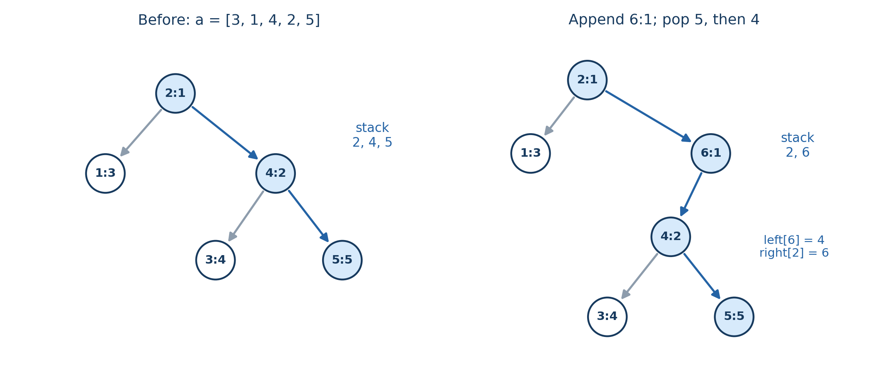

# Chapter 2 笛卡尔树与单调栈

假设你要计算一个数组所有子数组的最小值之和。最直接的做法是固定左端点，向右扫描，不断更新最小值；一共有 $\Theta(n^2)$ 个子数组，这样做也就需要平方级时间。

先别急着找一个更快的查询结构。即使用稀疏表把每次求最小值降到常数时间，仍然要枚举平方个区间。真正需要改变的是计算方式：**能不能把最小值相同、或者由同一个位置决定最小值的区间，放在一起处理？**

沿着这个问题，会得到两种有联系的结构。一种用单调栈维护一组最小值相同的区间；另一种把“找最小值，再递归处理左右两边”的过程建成一棵树，也就是笛卡尔树。本章先讲清楚栈为什么能删掉元素，再把它接到区间归属、建树和树上分治上。

默认你熟悉数组、栈和基本树遍历。例子均为教学示例；不需要先掌握笛卡尔树或复杂的 RMQ 技术。

## 1. 一个元素什么时候可以从栈里永久删除

先看一个小问题：从左向右扫描数组，处理位置 $j$ 时，求它左边最近的、满足 $a_i\le a_j$ 的位置 $i$。

假设以前保留了一个位置 $i<j$，现在发现 $a_i>a_j$。可以把 $i$ 从候选里永久删除。理由不只是“要让栈单调”，而是新位置 $j$ 已经能够代替它应对所有未来查询。

考虑任意未来位置 $k>j$。如果 $i$ 能作为它的答案候选，就有 $a_i\le a_k$。这时

$$
a_j<a_i\le a_k,
$$

所以 $j$ 也合法，而且比 $i$ 更靠近 $k$。如果 $i$ 不合法，它当然也不可能成为答案。无论未来的 $a_k$ 是多少，$i$ 都用不上了。

于是扫描到 $j$ 时，可以不断删除栈顶那些值大于 $a_j$ 的位置。删完后，栈顶就是左边最近的不大于 $a_j$ 的位置，再把 $j$ 放入栈中。栈内下标从小到大，数值从小到大或相等。

这里还差一步：会不会真正最近的合法位置早已被删掉了？不会。一个位置被删掉时，总有一个更靠右、值更小的替代者。只要旧位置对当前查询合法，替代者也合法；替代者若后来又被删，就继续看它的替代者。这条链不断向右，最终会停在当前仍在栈中的某个位置。因此，被删掉的历史位置不会让我们漏掉更近的答案。

如果把问题改成“左边最近的严格小于 $a_j$ 的位置”，相等的旧值也不该保留在当前栈顶。此时应删除所有 $a_i\ge a_j$ 的栈顶。等号要根据查询要求推出来，而不是先背一个比较符号。

一次操作可能弹出很多元素，但每个下标只入栈一次、出栈至多一次。整个扫描的入栈与出栈次数都是 $O(n)$，总时间为 $O(n)$，空间为 $O(n)$。所谓均摊常数时间，说的是整个过程平均下来每个元素的代价，不是保证每次插入实际只做常数次操作。

也可以用势能理解这一点。把栈大小作为势能，一次插入弹出 $k$ 个元素，操作次数为 $k+1$，栈大小变化为 $1-k$。两者相加为 $2$，所以长时间序列中的昂贵操作，都由此前积累在栈里的元素支付。

删除候选的证明还依赖有效范围。固定长度的滑动窗口会让最左侧候选过期，栈只能方便地删除末尾，不能直接完成这种维护。这时通常要换成单调队列，不能只因为数值仍然单调就继续套栈。

## 2. 让每个区间有且只有一个最小值代表

回到子数组问题。区间 $[l,r]$ 的最小值可能出现在多个位置。例如 $[2,2]$ 的整个区间，两个位置都是最小值。要按位置统计贡献，必须先决定整段归给谁，否则可能重复计数，也可能漏计。

本章统一规定：**有多个最小值时，取最左边的位置。** 为了让后面所有比较遵循同一个规则，给位置 $i$ 定义优先级

$$
K_i=(a_i,i).
$$

按字典序比较这两个量：先比较数值，数值相等时比较下标。于是所有位置的优先级互不相同，区间的代表就是优先级最小的位置

$$
p=\operatorname*{arg\,min}_{l\le i\le r}K_i.
$$

这里 $\operatorname*{arg\,min}$ 返回的是位置 $p$，最小值本身则是 $a_p$。

这不是改变原问题的最小值，只是在相等时确定唯一负责人。若题目更适合最右侧优先，可以改用 $(a_i,-i)$；求最大值时则反转数值比较，再单独指定相等时选哪一侧。实现里不一定真要构造二元组，更不必对可能溢出的极小整数直接取负，但比较语义要保持一致。

这一条规则会同时决定建树时弹不弹相等元素，以及左右边界中的哪一侧带等号。先把归属讲清楚，后面的比较符号就不再零散。

## 3. 把“以最小值为分界”画成一棵树

考虑数组

$$
[3,1,4,2,5].
$$

如果整个区间都围绕最小值来处理，第一步会选位置 $2$，因为这里的数值为 $1$。然后左右两段独立递归：左边只有位置 $1$，右边 $[3,5]$ 的最小值在位置 $4$；位置 $4$ 再把位置 $3$ 和 $5$ 分开。

把每次选择的最小值位置作为当前区间的根，左右递归结果作为左右子树，得到的就是最小笛卡尔树。它的节点是数组下标，具有两个性质：

- 中序遍历依次为 $1,2,\ldots,n$，因此左子树下标都小于根，右子树下标都大于根。
- 每个父节点 $u$ 的优先级小于儿子 $v$，即 $K_u<K_v$。因此从根向下，优先级严格增加。

第一条保留数组顺序，第二条保留最小值的层次。只有这两条性质，就足以唯一确定整棵树。

为什么唯一？根通过父子边一路小于所有后代，所以必须是全局优先级最小的位置 $p$。中序顺序又强制它的左子树包含 $1,\ldots,p-1$，右子树包含 $p+1,\ldots,n$。在这两个区间里重复相同推理，各个子树的根也都被确定了。

为什么一定存在？按刚才的过程构造即可：空区间返回空树，非空区间取唯一最小位置为根，再递归构造两侧。左右下标顺序正确，根也小于两侧所有节点，所以满足这两个性质。

这里固定重复值规则很重要。如果只要求父亲数值不大于儿子，却不比较下标，那么全相等数组可以产生许多不同的树。用 $K_i$ 比较以后，树才是唯一的。

笛卡尔树并不保证平衡。递增数组是一条右链，递减数组是一条左链；在本章的最左侧优先规则下，全相等数组也是右链。它的树高可以达到 $n$。

## 4. 为什么单调栈正好能在线性时间建树

按照定义递归找区间最小值，容易在退化数组上花掉 $O(n^2)$ 时间。我们换成从左向右插入节点，看每次究竟需要改哪里。

假设前缀 $[1,i-1]$ 的笛卡尔树已经建好。新下标 $i$ 比所有旧下标都大，所以它必须出现在中序遍历的最后。它不会被插进某棵左子树内部；它能影响的，是旧树从根不断走右儿子得到的那条链。下面称它为右链。

右链上的优先级严格增加。现在带着 $K_i$ 从右链末尾往前看：大于 $K_i$ 的一段必须放到新节点下面，小于 $K_i$ 的前段可以继续位于新节点上方。需要从右链上移走的，恰好是一段连续后缀。这正是栈擅长维护的变化。

图中原数组是 $[3,1,4,2,5]$，栈从底到顶为 $2,4,5$。追加 $a_6=1$ 后，位置 $5$ 的值为 $5$，位置 $4$ 的值为 $2$，都应弹出；位置 $2$ 与新节点同值，但它下标更小，优先级更小，所以保留。

弹出后，不能把位置 $4$ 和 $5$ 分别接到 $6$ 下面。它们原本就在同一棵子树里：位置 $4$ 是根，位置 $5$ 是它的右儿子。正确做法是把整棵以 $4$ 为根的子树接成 $6$ 的左子树，再把 $6$ 接成 $2$ 的右儿子。

一般情况下，令 $x$ 表示最后弹出的节点，令 $p$ 表示弹栈结束后留下的栈顶。一次插入只需要做以下连接：

1. 不断弹出优先级大于 $K_i$ 的栈顶，并记住最后弹出的 $x$。没有弹出时，$x$ 为空。
2. 把 $x$ 设为 $i$ 的左儿子。若 $x$ 非空，它的父节点改为 $i$。
3. 若还有栈顶 $p$，把 $p$ 的右儿子改为 $i$；否则让 $i$ 成为新根。
4. 把 $i$ 压入栈中。

这里“最后弹出的节点”很容易记反。栈从右链最深处往上弹，最后弹出的恰好是整段被接管子树的根，其他弹出节点早已包含在它的子树里。

### 这几次改边为什么足够

我们在每轮开始前保持两个事实：旧树是已处理前缀的笛卡尔树，栈恰好记录旧树的右链。空前缀满足这两个事实。只要一次插入以后它们仍成立，就完成了归纳证明。

先看中序顺序。有弹出节点时，它们构成的整棵子树原来位于旧中序序列末尾。把新节点放在这棵子树之后，相当于在所有旧下标之后追加 $i$，旧节点之间的顺序没有变化。没有弹出节点时，直接把 $i$ 接在旧右链末尾，也是同样的结果。

再看堆序。若 $p$ 存在，停止弹栈说明 $K_p<K_i$，所以新边 $p\to i$ 合法。若 $x$ 存在，它被弹出说明 $K_i<K_x$，所以新边 $i\to x$ 合法。其他边都没变，仍然满足堆序。

最后看栈。被接管子树已经进入 $i$ 的左侧，不再属于右链；未弹出的旧前段加上新节点 $i$，恰好就是新右链。因此两个事实都被保持，得到的新树正是唯一的笛卡尔树。

按最左侧优先规则，从左往右插入时，旧节点下标总比新节点小。因此比较 $K_{\text{top}}>K_i$ 等价于比较 $a_{\text{top}}>a_i$，相等时不弹；最右侧优先则应弹掉相等旧值。

每个节点只入栈一次、出栈至多一次，改边次数也是线性的，所以建树时间为 $O(n)$，空间为 $O(n)$。但线性建树不代表递归遍历安全：退化树的递归深度可能为 $n$，规模大时应使用迭代遍历或另行保证栈空间。

## 5. 区间最小值为什么等于两个端点的 LCA

笛卡尔树建好后，一个数组区间会对应树上的什么对象？最关键的结论是：对 $l\le r$，

$$
\boxed{\operatorname{LCA}(l,r)
=\operatorname*{arg\,min}_{l\le i\le r}K_i.}
$$

左边是树上节点 $l,r$ 的最近公共祖先，右边是区间 $[l,r]$ 的唯一最小值代表。注意等式两边都是节点下标。

设最近公共祖先为 $p$。先证明 $p$ 的下标落在 $[l,r]$ 里。若 $p<l$，两个端点都只能位于它的右子树，于是它们还有一个更低的公共祖先，和“最近”矛盾。若 $p>r$，同理两个端点都在左子树，也矛盾。

接着，中序顺序说明每棵子树的下标集合都是连续区间。$p$ 的子树包含端点 $l,r$，就也包含中间的每个位置。而堆序说明 $p$ 小于所有其他后代，所以 $p$ 就是 $[l,r]$ 的唯一最小位置。

在刚才的五个元素例子中，位置 $3$ 与 $5$ 的 LCA 是 $4$，对应区间 $[3,5]$ 的最小值 $2$；位置 $1$ 与 $5$ 的 LCA 是 $2$，对应整个数组的最小值 $1$。

这给出 RMQ 到 LCA 的转换，但查询复杂度还取决于 LCA 的实现，不能只因为建树是 $O(n)$ 就宣称整个查询结构也是线性的。

| 方法 | 预处理时间 | 单次查询 | 空间 |
| --- | --- | --- | --- |
| 笛卡尔树后做倍增 LCA | $O(n\log n)$ | $O(\log n)$ | $O(n\log n)$ |
| 笛卡尔树后做 Euler 序列、深度 RMQ 稀疏表 | $O(n\log n)$ | $O(1)$ | $O(n\log n)$ |
| 直接给原数组建最小值稀疏表 | $O(n\log n)$ | $O(1)$ | $O(n\log n)$ |

Euler 序列做法记录 DFS 过程中访问到的节点与深度；两个节点首次出现位置之间，深度最小的节点就是 LCA。还有线性预处理、常数查询的静态 RMQ 算法，但需要另外的技术，本章不把它混同于线性建树。

如果只查普通静态区间最小值，直接稀疏表通常更省事。笛卡尔树更有用的场景，是你还想使用“以最小值分治”的子树结构。它保留的是区间极值位置的关系，不能凭树形恢复区间和等数值信息。

## 6. 左右边界，原来就是节点的子树范围

现在来回答开头的问题：一个位置到底负责哪些区间？

对每个位置 $i$，找左侧最近的优先级更小位置 $L_i$，以及右侧最近的优先级更小位置 $R_i$。不存在时，分别用 $0$ 和 $n+1$ 作为边界。也就是说，

$$
L_i=\max\{j<i:K_j<K_i\},\qquad
R_i=\min\{j>i:K_j<K_i\}.
$$

在 $L_i$ 与 $R_i$ 之间，除了 $i$ 自己，没有其他位置能够击败 $i$。一个区间要由 $i$ 负责，就必须包含 $i$，同时不能碰到两侧阻挡位置。因此条件恰好是

$$
L_i<l\le i\le r<R_i.
$$

左端点有 $i-L_i$ 种选择，右端点有 $R_i-i$ 种选择，而且两者可以独立组合。于是 $i$ 负责的区间数为

$$
\boxed{(i-L_i)(R_i-i).}
$$

### 为什么左右比较中只有一侧带等号

把优先级比较翻译回数值，需要注意下标方向。在左侧，同值位置的下标更小，会击败 $i$；在右侧，同值位置的下标更大，不会击败 $i$。所以本章规则对应的是：

| 边界 | 要找的位置 |
| --- | --- |
| $L_i$ | 左侧最近的 $a_j\le a_i$ |
| $R_i$ | 右侧最近的 $a_j<a_i$ |

两侧比较不对称，正是为了给相等最小值确定唯一归属。

用 $[2,2]$ 检查最直接：位置 $1$ 负责 $[1,1]$ 和 $[1,2]$，位置 $2$ 只负责 $[2,2]$，总数为 $3$。如果两侧都找严格小于，整个区间会被两个位置同时计算；如果两侧都找不大于，整个区间又不会被任何位置计算。换成最右侧优先时，交换带等号的一侧即可。

### 子树范围为什么是 $[L_i+1,R_i-1]$

取这个范围内的任意位置 $j$。连接 $i,j$ 的数组区间里，没有优先级小于 $K_i$ 的位置，所以按照上一节的结论，$\operatorname{LCA}(i,j)=i$。这就说明 $j$ 是 $i$ 的后代，整个范围都在 $i$ 的子树中。

另一方面，若 $L_i$ 存在，区间 $[L_i,i]$ 的最小值代表不可能是 $i$，所以 $L_i$ 不是它的后代；右边界同理。子树的下标区间又必须连续，既然不能包含这两个阻挡位置，也就不能越过它们。

两边合起来，节点 $i$ 的子树范围恰好为

$$
[L_i+1,R_i-1].
$$

它的左子树大小是 $i-L_i-1$，右子树大小是 $R_i-i-1$。因此同一个区间计数，还可以写成

$$
\bigl(\operatorname{size}(\operatorname{left}(i))+1\bigr)
\bigl(\operatorname{size}(\operatorname{right}(i))+1\bigr).
$$

这里空子树大小记为 $0$。两个加一分别允许把左端点或右端点直接选在根 $i$ 上。到这里，单调栈求边界和笛卡尔树求子树大小就连起来了：它们在描述同一批区间。

## 7. 两个可以直接从区间归属推出的应用

### 所有子数组最小值之和

记答案为

$$
S=\sum_{1\le l\le r\le n}\min(a_l,\ldots,a_r).
$$

位置 $i$ 负责的每个区间最小值都是 $a_i$，它负责 $(i-L_i)(R_i-i)$ 个区间。每个区间又恰好有一个负责人，所以

$$
\boxed{S=\sum_{i=1}^n a_i(i-L_i)(R_i-i).}
$$

可以用两次单调栈扫描求两侧边界，也可以线性建笛卡尔树后求左右子树大小。两种方法的时间、空间都是 $O(n)$。

例如 $[3,1,2]$ 中，三个位置分别负责 $1,4,1$ 个区间，答案是

$$
3\times1+1\times4+2\times1=9.
$$

区间个数 $1+4+1=6$，正好等于 $n(n+1)/2$，可以顺便用来检查有没有重复或遗漏。这个贡献证明不要求 $a_i$ 非负，因为我们只是把同一项贡献换一种顺序求和。

求最大值之和同理，反转数值比较即可。所有子数组的“最大值减最小值”之和，也可以分别求两部分再相减。

### 直方图最大矩形

设柱宽都是 $1$，高度 $a_i\ge0$。一个连续区间能够撑起的最大矩形高度，就是该区间的最小柱高。

假设某个候选区间由位置 $i$ 负责，高度可以取 $a_i$。这个区间一定包含在 $i$ 的子树范围内，而整棵子树范围里的高度都不低于 $a_i$。因此可以把矩形扩大到整个子树范围，高度不变，宽度增加，面积不会变小。

于是只需考察每个节点的整个子树：

$$
\boxed{\text{最大面积}=\max_i a_i\operatorname{size}(i).}
$$

要注意这个等式有两个方向。任意候选矩形都能扩成某个整子树候选，所以最大答案不会超过右边；每个整子树范围本来就是合法矩形，所以右边也不会超过真实答案。

例如 $[2,1,2]$ 的根高度为 $1$、子树宽为 $3$，面积为 $3$；两个叶子的单柱面积都是 $2$，答案就是 $3$。总时间是线性建树加线性遍历。

这里使用了非负高度。如果抽象成允许负数的“区间最小值乘长度”，扩大区间可能让目标变小：$[-1,-1]$ 的单点值是 $-1$，整段值是 $-2$，不能再原样套证明。若柱宽不全为 $1$，应把子树大小换为子树总宽度，并要求宽度非负。

> **练习（估算 CF 难度）**：[Water Tank](https://atcoder.jp/contests/abc359/tasks/abc359_e)（约 1900）。

## 8. 不建树也能合并：固定右端点的分组栈

贡献法按照“最小值由哪个位置负责”给区间分组。还有另一种分组方式：先固定右端点 $r$，把所有结尾在 $r$ 的区间一起维护。

定义

$$
F_r=\sum_{l=1}^r\min(a_l,\ldots,a_r).
$$

那么总答案就是 $F_1+\cdots+F_n$。随着左端点 $l$ 从左向右移动，区间不断缩小，最小值只能不变或变大。因此，所有左端点可以按照相同最小值分成连续几组，各组最小值依次严格增加。

栈里保存 $(v,c)$：这一组有 $c$ 个左端点，它们对应区间的最小值都为 $v$。栈底对应靠左的组，栈顶对应靠右的组，同时维护所有组贡献之和 $F=\sum vc$。

加入新元素 $x=a_r$ 时，旧区间最小值 $v$ 统一变成 $\min(v,x)$。于是，值小于 $x$ 的组不用动；所有值不小于 $x$ 的组都会变成同一个最小值 $x$，而它们恰好构成栈顶后缀。

更新时，先为新单点区间 $[r,r]$ 准备计数 $c=1$。逐个弹出 $v\ge x$ 的组，把它们的旧贡献 $v\cdot\text{组大小}$ 从 $F$ 中扣掉，并把组大小累加进 $c$。最后压入新组 $(x,c)$，给 $F$ 加上 $xc$。更新后的 $F$ 就是 $F_r$。

为什么没有丢信息？未弹出的组最小值不变；被弹出的组最小值全部改为 $x$，以后受到的更新也完全相同，可以合并。各组始终覆盖所有左端点且互不重叠，所以每个区间的贡献都被维护了一次。

例如 $[3,1,2]$，三个右端点的组依次为：

| 已处理前缀 | 栈中的 $(\text{最小值},\text{左端点个数})$ | 当前 $F_r$ |
| --- | --- | --- |
| $[3]$ | $(3,1)$ | $3$ |
| $[3,1]$ | $(1,2)$ | $2$ |
| $[3,1,2]$ | $(1,2),(2,1)$ | $4$ |

总和仍为 $3+2+4=9$。每步只新增一个组，每个组后来至多被弹出一次，故总时间、空间均为 $O(n)$。

这一节用 $v\ge x$ 弹出相等组，而建树时使用 $a_{\text{top}}>a_i$。它们并不矛盾：建树要保留相等位置的先后优先级；这里不记录哪个位置获胜，只关心最小值与左端点个数，相等的组完全可以合并。比较符号由栈里保存的含义决定。

### 把组大小换成权重和，就能维护一类 DP 转移

如果每个左端点 $l$ 带有一个固定权重 $b_l$，要维护

$$
G_r=\sum_{l=1}^r b_l\min(a_l,\ldots,a_r),
$$

只需把组中的计数 $c$ 换成权重和 $W=\sum b_l$。同组的极值总是一起变化，而权重固定，所以这一组的贡献就是 $vW$。加入新左端点时从 $W=b_r$ 开始，合并旧组时累加权重，再统一加入 $a_rW$。

权重可以为负，也可以在模意义下计算。分组依据是区间最小值，和权重正负无关；某组权重和为零时，保留它也完全正确。

例如有递推

$$
f_r=\sum_{l=1}^r f_{l-1}\min(a_l,\ldots,a_r),\qquad f_0=1.
$$

计算 $f_r$ 时，$f_{r-1}$ 已经求出，刚好可以作为新左端点 $r$ 的权重 $b_r$。所有旧左端点的权重也都已经固定，所以更新后的 $G_r$ 就是 $f_r$，整个递推可以在线性时间完成。

这个模型是自构示例。文末 AtCoder 官方解说中有把最大值、最小值分别分组维护的实际用法；如果转移包含二者的差，就分别维护两个栈再相减。

适用条件是：合并以后，只知道共同极值和权重和，就足以处理未来更新。若未来还会修改旧权重，或者区间代价还依赖组内无法恢复的信息，就不能直接沿用这一状态。

> **练习（估算 CF 难度）**：[Divide a Sequence](https://atcoder.jp/contests/abc234/tasks/abc234_g)（约 2300）；[Array Collapse](https://codeforces.com/problemset/problem/1913/D)（约 2300）。

## 9. 什么时候值得真的建出这棵树

如果一个区间问题总是“找最小值位置 $p$，处理跨过 $p$ 的区间，再分别处理左右两段”，那么它的完整递归过程就是笛卡尔树。

在节点 $p$ 对应的区间中，每个非空子区间恰好属于三类之一：完全在左边、完全在右边、包含 $p$。没有第四种情况，因为一个连续区间若同时伸向两边，就一定包含中间的 $p$。

因此，若答案是可加的，可以组织为

$$
\operatorname{ans}(p)=
\operatorname{ans}(\operatorname{left}(p))+
\operatorname{ans}(\operatorname{right}(p))+
\operatorname{cross}(p).
$$

其中 $\operatorname{cross}(p)$ 表示包含 $p$ 的那些区间的总贡献。例如子数组最小值之和中，它就是

$$
a_p\bigl(\operatorname{size}(\operatorname{left}(p))+1\bigr)
\bigl(\operatorname{size}(\operatorname{right}(p))+1\bigr).
$$

笛卡尔树帮我们把所有递归区间压成 $n$ 个节点，却没有自动解决每个节点上的合并。如果一个节点还要枚举左右子树的所有配对，光根节点一次就可能花掉 $\Theta(n^2)$。最终复杂度必须把各节点的实际工作量相加；即使用“小并大”，也要说明迁移的对象是什么、每次迁移后所属集合为什么会增长。

所以判断是否建树，应看你是否真的需要极值分治的结构。只求边界贡献时，两个单调栈就够了；要围绕极值做树上 DP 或处理子树范围时，建树更自然。

最后，几个实现边界要和前面的证明一起记住。新节点接管旧右儿子时，要把最后弹出节点的父亲改成新节点，不能留下旧父关系；空树的根为空，空子树大小为零。树可能退化成链，更新一个数组值也可能导致大量父子关系变化，静态构造不自动支持修改。

数值方面，若 $|a_i|\le A$，所有子数组极值之和的绝对值不超过 $A\,n(n+1)/2$。单项贡献、乘法中间结果与累计答案都要按这个范围选择类型，不能只在最终赋值时才转换成大整数类型。取模时也要正确处理负贡献。

单调栈的共同出发点，是看清哪些旧对象在加入新元素以后可以一起处理：找最近位置时，它们被新候选永久替代；维护右端点时，它们的极值统一变成同一个数；建笛卡尔树时，它们组成一棵可以整体搬走的子树。先说清这件事，栈里的单调性和操作顺序就都能推出来。

> **练习（估算 CF 难度）**：[Yet Another Array Counting Problem](https://codeforces.com/problemset/problem/1748/E)（约 2200）。

## 参考资料

正文的例子、贡献公式及边界证明均已在本章展开。以下资料用于进一步对照相应技术，不要求先读资料才能理解正文。

1. [Stanford CS166 — Range Minimum Queries, Part II](https://web.stanford.edu/class/cs166/lectures/01/)，以及[完整课件](https://web.stanford.edu/class/cs166/lectures/01/Lecture%20Slides.pdf)。可对照笛卡尔树与区间最小值的关系、右链维护和线性构造。课件后续的最优静态 RMQ 还需要分块等额外技术。
2. [AtCoder ABC234 G — Divide a Sequence，官方解说](https://atcoder.jp/contests/ABC234/editorial/3236)。可对照按相同极值合并转移、把组内 DP 权重求和，并分别维护最大值与最小值贡献的做法。本章的单最小值递推只用于解释该技术，并非复述此题完整模型。
