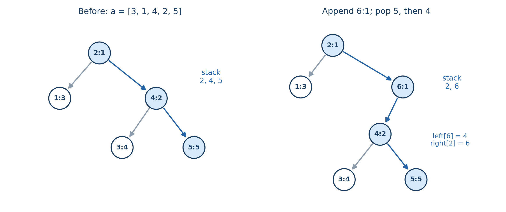

# Chapter 2 笛卡尔树与单调栈

求所有子数组的最小值之和，逐段枚举需要 $\Theta(n^2)$ 时间。

即使单次 RMQ 降到常数，仍有平方个区间。应改为按贡献分组：**哪些区间由同一个位置决定最小值？**

单调栈能合并最小值相同的区间；笛卡尔树把“选最小值、递归左右两段”建成树。先证明栈为何能删除候选，再推导区间归属与建树。

前置：数组、栈、基本树遍历。

## 1. 一个元素什么时候可以从栈里永久删除

先看一个小问题：从左向右扫描数组，处理位置 $j$ 时，求它左边最近的、满足 $a_i\le a_j$ 的位置 $i$。

若 $i<j$ 且 $a_i>a_j$，可永久删除候选 $i$：$j$ 能替代它回答所有未来查询。

考虑任意未来位置 $k>j$。如果 $i$ 能作为它的答案候选，就有 $a_i\le a_k$。这时

$$
a_j<a_i\le a_k,
$$

所以 $j$ 也合法，且更靠近 $k$；若 $i$ 不合法，它本就不能成为答案。因此 $i$ 不再有用。

于是扫描到 $j$ 时，可以不断删除栈顶那些值大于 $a_j$ 的位置。删完后，栈顶就是左边最近的不大于 $a_j$ 的位置，再把 $j$ 放入栈中。栈内下标从小到大，数值从小到大或相等。

被删除的位置不会造成漏解：删除时总有一个更靠右、值更小的替代者。旧位置合法时，替代者也合法；若替代者又被删除，沿替代链继续。下标严格增大，最终停在仍在栈中的合法位置。

若求左侧最近的严格小于 $a_j$ 的位置，应弹出所有 $a_i\ge a_j$ 的栈顶。等号由查询条件决定。

每个下标入栈一次、出栈至多一次，总时间、空间均为 $O(n)$。单次插入仍可能弹出很多元素；常数代价是均摊界。

也可用栈大小作势能。弹出 $k$ 个元素再插入，实际代价为 $k+1$，势能变化为 $1-k$，摊还代价为 $2$。

固定长度滑动窗口还会让最左候选过期。栈只能方便地删除末尾，通常应改用单调队列。

## 2. 让每个区间有且只有一个最小值代表

最小值重复时，贡献必须有唯一归属。例如 $[2,2]$ 的整段不能同时归给两个位置，也不能都不归。

本章统一规定：**有多个最小值时，取最左边的位置。** 为了让后面所有比较遵循同一个规则，给位置 $i$ 定义优先级

$$
K_i=(a_i,i).
$$

按字典序比较这两个量：先比较数值，数值相等时比较下标。于是所有位置的优先级互不相同，区间的代表就是优先级最小的位置

$$
p=\operatorname*{arg\,min}_{l\le i\le r}K_i.
$$

这里 $\operatorname*{arg\,min}$ 返回的是位置 $p$，最小值本身则是 $a_p$。

该规则只为重复值指定负责人。最右侧优先可用 $(a_i,-i)$；求最大值则反转数值比较，并指定同值顺序。实现可直接比较，无须构造二元组，也应避免对极小整数取负溢出。

同值归属同时决定建树时是否弹出相等元素，以及哪侧边界带等号。

## 3. 把“以最小值为分界”画成一棵树

考虑数组

$$
[3,1,4,2,5].
$$

如果整个区间都围绕最小值来处理，第一步会选位置 $2$，因为这里的数值为 $1$。然后左右两段独立递归：左边只有位置 $1$，右边 $[3,5]$ 的最小值在位置 $4$；位置 $4$ 再把位置 $3$ 和 $5$ 分开。

把每次选择的最小值位置作为当前区间的根，左右递归结果作为左右子树，得到的就是最小笛卡尔树。它的节点是数组下标，具有两个性质：

- 中序遍历依次为 $1,2,\ldots,n$，因此左子树下标都小于根，右子树下标都大于根。
- 每个父节点 $u$ 的优先级小于儿子 $v$，即 $K_u<K_v$。因此从根向下，优先级严格增加。

第一条保留数组顺序，第二条保留最小值的层次。只有这两条性质，就足以唯一确定整棵树。

唯一性：根小于所有后代，必为全局最小优先级位置 $p$。中序顺序强制左右子树分别包含 $1,\ldots,p-1$、$p+1,\ldots,n$；递归后所有根均唯一。

存在性：空区间返回空树；非空区间取唯一最小位置为根，递归两侧。该构造同时满足中序顺序和堆序。

只比较数值时，全相等数组可对应多棵树；用 $K_i$ 指定同值顺序后才唯一。

笛卡尔树并不保证平衡。递增数组是一条右链，递减数组是一条左链；在本章的最左侧优先规则下，全相等数组也是右链。它的树高可以达到 $n$。

## 4. 为什么单调栈正好能在线性时间建树

按照定义递归找区间最小值，容易在退化数组上花掉 $O(n^2)$ 时间。我们换成从左向右插入节点，看每次究竟需要改哪里。

前缀 $[1,i-1]$ 建好后，新下标 $i$ 必须位于中序最后，只会改变旧树从根沿右儿子下降的路径，称为右链。

右链优先级严格增加。其中大于 $K_i$ 的连续后缀应移到新节点下方，小于它的前段保留在上方，可用栈维护。

图中原数组是 $[3,1,4,2,5]$，栈从底到顶为 $2,4,5$。追加 $a_6=1$ 后，位置 $5$ 的值为 $5$，位置 $4$ 的值为 $2$，都应弹出；位置 $2$ 与新节点同值，但它下标更小，优先级更小，所以保留。

弹出的节点原属同一子树，不能分别挂到 $6$ 下。应把以 $4$ 为根的整棵子树接成 $6$ 的左子树，再把 $6$ 接成 $2$ 的右儿子。

一般情况下，令 $x$ 表示最后弹出的节点，令 $p$ 表示弹栈结束后留下的栈顶。一次插入只需要做以下连接：

1. 不断弹出优先级大于 $K_i$ 的栈顶，并记住最后弹出的 $x$。没有弹出时，$x$ 为空。
2. 把 $x$ 设为 $i$ 的左儿子。若 $x$ 非空，它的父节点改为 $i$。
3. 若还有栈顶 $p$，把 $p$ 的右儿子改为 $i$；否则让 $i$ 成为新根。
4. 把 $i$ 压入栈中。

栈从右链底部向上弹，最后弹出的节点才是被接管子树的根，其余弹出节点已在这棵子树内。

### 这几次改边为什么足够

归纳不变量：旧树是已处理前缀的笛卡尔树，栈恰为其右链。空前缀成立，只需证明插入后仍成立。

中序顺序：弹出子树原在旧序列末尾，新节点接在其后；没有弹出时，直接接在右链末尾。两者都只在旧序列后追加 $i$。

再看堆序。若 $p$ 存在，停止弹栈说明 $K_p<K_i$，所以新边 $p\to i$ 合法。若 $x$ 存在，它被弹出说明 $K_i<K_x$，所以新边 $i\to x$ 合法。其他边都没变，仍然满足堆序。

右链：被接管子树进入 $i$ 左侧；未弹出的旧前段加上 $i$，恰为新右链。因此不变量保持，新树即唯一的笛卡尔树。

按最左侧优先规则，从左往右插入时，旧节点下标总比新节点小。因此比较 $K_{\text{top}}>K_i$ 等价于比较 $a_{\text{top}}>a_i$，相等时不弹；最右侧优先则应弹掉相等旧值。

每个节点入栈一次、出栈至多一次，改边总数线性，建树时间、空间均为 $O(n)$。树高仍可能为 $n$，大规模遍历宜用迭代或保证递归栈空间。

## 5. 区间最小值为什么等于两个端点的 LCA

笛卡尔树建好后，一个数组区间会对应树上的什么对象？最关键的结论是：对 $l\le r$，

$$
\boxed{\operatorname{LCA}(l,r)
=\operatorname*{arg\,min}_{l\le i\le r}K_i.}
$$

左边是树上节点 $l,r$ 的最近公共祖先，右边是区间 $[l,r]$ 的唯一最小值代表。注意等式两边都是节点下标。

设 LCA 为 $p$。若 $p<l$，两端点都在其右子树中，存在更低公共祖先，矛盾；$p>r$ 同理。因此 $p\in[l,r]$。

每棵子树的下标连续。$p$ 的子树包含 $l,r$，便包含区间所有位置；堆序又使 $p$ 小于其余后代，因此它是区间唯一最小位置。

在刚才的五个元素例子中，位置 $3$ 与 $5$ 的 LCA 是 $4$，对应区间 $[3,5]$ 的最小值 $2$；位置 $1$ 与 $5$ 的 LCA 是 $2$，对应整个数组的最小值 $1$。

这给出 RMQ 到 LCA 的转换，但查询复杂度还取决于 LCA 的实现，不能只因为建树是 $O(n)$ 就宣称整个查询结构也是线性的。

| 方法 | 预处理时间 | 单次查询 | 空间 |
| --- | --- | --- | --- |
| 笛卡尔树后做倍增 LCA | $O(n\log n)$ | $O(\log n)$ | $O(n\log n)$ |
| 笛卡尔树后做 Euler 序列、深度 RMQ 稀疏表 | $O(n\log n)$ | $O(1)$ | $O(n\log n)$ |
| 直接给原数组建最小值稀疏表 | $O(n\log n)$ | $O(1)$ | $O(n\log n)$ |

Euler 序列记录 DFS 访问的节点与深度，两点首次出现位置之间的最小深度对应 LCA。线性预处理、常数查询的静态 RMQ 还需其他技术，不能由线性建树直接推出。

普通静态 RMQ 通常直接用稀疏表。需要极值分治的子树结构时再建笛卡尔树；树形只保留极值位置关系，不能恢复区间和。

## 6. 左右边界，原来就是节点的子树范围

现在来回答开头的问题：一个位置到底负责哪些区间？

对每个位置 $i$，找左侧最近的优先级更小位置 $L_i$，以及右侧最近的优先级更小位置 $R_i$。不存在时，分别用 $0$ 和 $n+1$ 作为边界。也就是说，

$$
L_i=\max\{j<i:K_j<K_i\},\qquad
R_i=\min\{j>i:K_j<K_i\}.
$$

在 $L_i$ 与 $R_i$ 之间，除了 $i$ 自己，没有其他位置能够击败 $i$。一个区间要由 $i$ 负责，就必须包含 $i$，同时不能碰到两侧阻挡位置。因此条件恰好是

$$
L_i<l\le i\le r<R_i.
$$

左端点有 $i-L_i$ 种选择，右端点有 $R_i-i$ 种选择，而且两者可以独立组合。于是 $i$ 负责的区间数为

$$
\boxed{(i-L_i)(R_i-i).}
$$

### 为什么左右比较中只有一侧带等号

把优先级比较翻译回数值，需要注意下标方向。在左侧，同值位置的下标更小，会击败 $i$；在右侧，同值位置的下标更大，不会击败 $i$。所以本章规则对应的是：

| 边界 | 要找的位置 |
| --- | --- |
| $L_i$ | 左侧最近的 $a_j\le a_i$ |
| $R_i$ | 右侧最近的 $a_j<a_i$ |

两侧比较不对称，正是为了给相等最小值确定唯一归属。

检查 $[2,2]$：位置 $1$ 负责 $[1,1]$、$[1,2]$，位置 $2$ 负责 $[2,2]$，共 $3$ 段。两侧都严格会重复整段，两侧都不严格会漏掉整段。最右侧优先时交换等号所在侧。

### 子树范围为什么是 $[L_i+1,R_i-1]$

对范围内任意 $j$，连接 $i,j$ 的区间没有比 $K_i$ 更小的优先级，故 $\operatorname{LCA}(i,j)=i$。因此整个范围都属于 $i$ 的子树。

若 $L_i$ 存在，$[L_i,i]$ 的最小值代表不是 $i$，故 $L_i$ 不是后代；右边同理。子树下标连续，因此不能越过这两个边界。

两边合起来，节点 $i$ 的子树范围恰好为

$$
[L_i+1,R_i-1].
$$

它的左子树大小是 $i-L_i-1$，右子树大小是 $R_i-i-1$。因此同一个区间计数，还可以写成

$$
\bigl(\operatorname{size}(\operatorname{left}(i))+1\bigr)
\bigl(\operatorname{size}(\operatorname{right}(i))+1\bigr).
$$

空子树大小为 $0$。两个加一允许端点选在根 $i$；边界法与子树大小法描述的是同一批区间。

## 7. 两个可以直接从区间归属推出的应用

### 所有子数组最小值之和

记答案为

$$
S=\sum_{1\le l\le r\le n}\min(a_l,\ldots,a_r).
$$

位置 $i$ 负责的每个区间最小值都是 $a_i$，它负责 $(i-L_i)(R_i-i)$ 个区间。每个区间又恰好有一个负责人，所以

$$
\boxed{S=\sum_{i=1}^n a_i(i-L_i)(R_i-i).}
$$

可以用两次单调栈扫描求两侧边界，也可以线性建笛卡尔树后求左右子树大小。两种方法的时间、空间都是 $O(n)$。

例如 $[3,1,2]$ 中，三个位置分别负责 $1,4,1$ 个区间，答案是

$$
3\times1+1\times4+2\times1=9.
$$

区间数 $1+4+1=6=n(n+1)/2$，可检查重漏。贡献法只交换求和顺序，不要求 $a_i$ 非负。

求最大值之和同理，反转数值比较即可。所有子数组的“最大值减最小值”之和，也可以分别求两部分再相减。

### 直方图最大矩形

设柱宽都是 $1$，高度 $a_i\ge0$。一个连续区间能够撑起的最大矩形高度，就是该区间的最小柱高。

由位置 $i$ 负责的区间，高度可取 $a_i$，且包含于 $i$ 的子树范围。整棵子树的高度均不低于 $a_i$，因此可扩大到整个范围；高度非负，面积不会减小。

于是只需考察每个节点的整个子树：

$$
\boxed{\text{最大面积}=\max_i a_i\operatorname{size}(i).}
$$

任意矩形都能扩成某个整子树候选；每个整子树候选也都是合法矩形。两向比较，等式成立。

例如 $[2,1,2]$ 的根高度为 $1$、子树宽为 $3$，面积为 $3$；两个叶子的单柱面积都是 $2$，答案就是 $3$。总时间是线性建树加线性遍历。

证明依赖非负高度。允许负数时，$[-1,-1]$ 的单点目标为 $-1$，整段为 $-2$，扩大可能变差。柱宽不全为 $1$ 时，用子树总宽代替大小，并要求宽度非负。

> **练习（估算 CF 难度）**：[Water Tank](https://atcoder.jp/contests/abc359/tasks/abc359_e)（约 1900）。

## 8. 不建树也能合并：固定右端点的分组栈

贡献法按照“最小值由哪个位置负责”给区间分组。还有另一种分组方式：先固定右端点 $r$，把所有结尾在 $r$ 的区间一起维护。

定义

$$
F_r=\sum_{l=1}^r\min(a_l,\ldots,a_r).
$$

那么总答案就是 $F_1+\cdots+F_n$。随着左端点 $l$ 从左向右移动，区间不断缩小，最小值只能不变或变大。因此，所有左端点可以按照相同最小值分成连续几组，各组最小值依次严格增加。

栈里保存 $(v,c)$：这一组有 $c$ 个左端点，它们对应区间的最小值都为 $v$。栈底对应靠左的组，栈顶对应靠右的组，同时维护所有组贡献之和 $F=\sum vc$。

加入新元素 $x=a_r$ 时，旧区间最小值 $v$ 统一变成 $\min(v,x)$。于是，值小于 $x$ 的组不用动；所有值不小于 $x$ 的组都会变成同一个最小值 $x$，而它们恰好构成栈顶后缀。

更新时，先为新单点区间 $[r,r]$ 准备计数 $c=1$。逐个弹出 $v\ge x$ 的组，把它们的旧贡献 $v\cdot\text{组大小}$ 从 $F$ 中扣掉，并把组大小累加进 $c$。最后压入新组 $(x,c)$，给 $F$ 加上 $xc$。更新后的 $F$ 就是 $F_r$。

未弹出组的最小值不变；弹出组的最小值都变为 $x$，未来更新也一致，可合并。各组不重不漏地覆盖全部左端点。

例如 $[3,1,2]$，三个右端点的组依次为：

| 已处理前缀 | 栈中的 $(\text{最小值},\text{左端点个数})$ | 当前 $F_r$ |
| --- | --- | --- |
| $[3]$ | $(3,1)$ | $3$ |
| $[3,1]$ | $(1,2)$ | $2$ |
| $[3,1,2]$ | $(1,2),(2,1)$ | $4$ |

总和仍为 $3+2+4=9$。每步只新增一个组，每个组后来至多被弹出一次，故总时间、空间均为 $O(n)$。

这里按 $v\ge x$ 合并同值组，建树按 $a_{\text{top}}>a_i$ 保留同值顺序。前者只关心值和数量，后者还关心位置归属，因此等号不同。

### 把组大小换成权重和，就能维护一类 DP 转移

如果每个左端点 $l$ 带有一个固定权重 $b_l$，要维护

$$
G_r=\sum_{l=1}^r b_l\min(a_l,\ldots,a_r),
$$

只需把组中的计数 $c$ 换成权重和 $W=\sum b_l$。同组的极值总是一起变化，而权重固定，所以这一组的贡献就是 $vW$。加入新左端点时从 $W=b_r$ 开始，合并旧组时累加权重，再统一加入 $a_rW$。

权重可以为负，也可以在模意义下计算。分组依据是区间最小值，和权重正负无关；某组权重和为零时，保留它也完全正确。

例如有递推

$$
f_r=\sum_{l=1}^r f_{l-1}\min(a_l,\ldots,a_r),\qquad f_0=1.
$$

计算 $f_r$ 时，$f_{r-1}$ 已经求出，刚好可以作为新左端点 $r$ 的权重 $b_r$。所有旧左端点的权重也都已经固定，所以更新后的 $G_r$ 就是 $f_r$，整个递推可以在线性时间完成。

这个模型是自构示例。文末 AtCoder 官方解说中有把最大值、最小值分别分组维护的实际用法；如果转移包含二者的差，就分别维护两个栈再相减。

适用条件：共同极值与权重和足以处理未来更新。若旧权重还会改变，或代价依赖无法恢复的组内信息，就需增加状态。

> **练习（估算 CF 难度）**：[Divide a Sequence](https://atcoder.jp/contests/abc234/tasks/abc234_g)（约 2300）；[Array Collapse](https://codeforces.com/problemset/problem/1913/D)（约 2300）。

## 9. 什么时候值得真的建出这棵树

如果一个区间问题总是“找最小值位置 $p$，处理跨过 $p$ 的区间，再分别处理左右两段”，那么它的完整递归过程就是笛卡尔树。

节点 $p$ 的每个非空子区间恰属一类：完全在左、完全在右、包含 $p$。连续区间若同时跨到两侧，必包含 $p$。

因此，若答案是可加的，可以组织为

$$
\operatorname{ans}(p)=
\operatorname{ans}(\operatorname{left}(p))+
\operatorname{ans}(\operatorname{right}(p))+
\operatorname{cross}(p).
$$

其中 $\operatorname{cross}(p)$ 表示包含 $p$ 的那些区间的总贡献。例如子数组最小值之和中，它就是

$$
a_p\bigl(\operatorname{size}(\operatorname{left}(p))+1\bigr)
\bigl(\operatorname{size}(\operatorname{right}(p))+1\bigr).
$$

笛卡尔树将递归区间压成 $n$ 个节点，但节点内的工作仍须单独计数。若枚举左右子树全部配对，根处就可能耗时 $\Theta(n^2)$；用小并大也须说明迁移对象与规模增长。

所以判断是否建树，应看你是否真的需要极值分治的结构。只求边界贡献时，两个单调栈就够了；要围绕极值做树上 DP 或处理子树范围时，建树更自然。

最后，几个实现边界要和前面的证明一起记住。新节点接管旧右儿子时，要把最后弹出节点的父亲改成新节点，不能留下旧父关系；空树的根为空，空子树大小为零。树可能退化成链，更新一个数组值也可能导致大量父子关系变化，静态构造不自动支持修改。

数值方面，若 $|a_i|\le A$，所有子数组极值之和的绝对值不超过 $A\,n(n+1)/2$。单项贡献、乘法中间结果与累计答案都要按这个范围选择类型，不能只在最终赋值时才转换成大整数类型。取模时也要正确处理负贡献。

单调栈先判断旧对象为何可一起处理：最近位置查询中被新候选替代；右端点维护中极值统一变化；笛卡尔树中整棵子树移交。由这些语义推导单调性与操作顺序。

> **练习（估算 CF 难度）**：[Yet Another Array Counting Problem](https://codeforces.com/problemset/problem/1748/E)（约 2200）。

## 参考资料

正文已给出例子、贡献公式与边界证明；以下资料供对照。

1. [Stanford CS166 — Range Minimum Queries, Part II](https://web.stanford.edu/class/cs166/lectures/01/)，以及[完整课件](https://web.stanford.edu/class/cs166/lectures/01/Lecture%20Slides.pdf)。可对照笛卡尔树与区间最小值的关系、右链维护和线性构造。课件后续的最优静态 RMQ 还需要分块等额外技术。
2. [AtCoder ABC234 G — Divide a Sequence，官方解说](https://atcoder.jp/contests/ABC234/editorial/3236)。可对照按相同极值合并转移、把组内 DP 权重求和，并分别维护最大值与最小值贡献的做法。本章的单最小值递推只用于解释该技术，并非复述此题完整模型。
