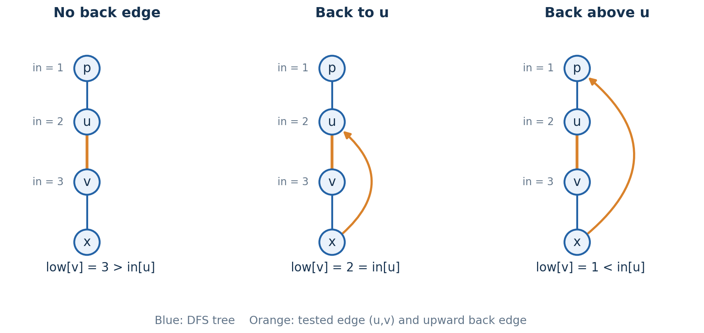
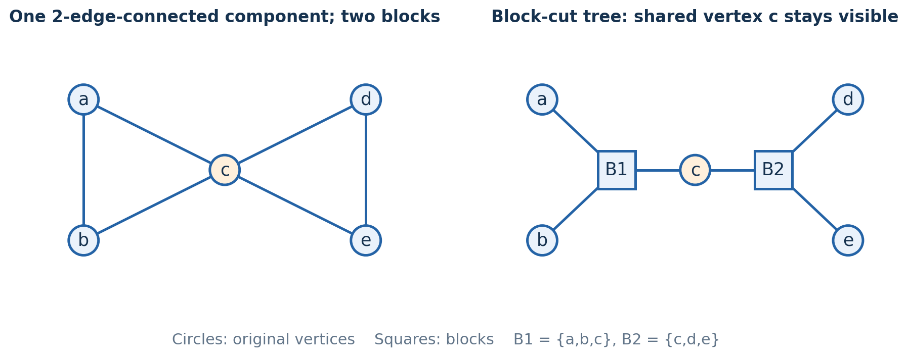
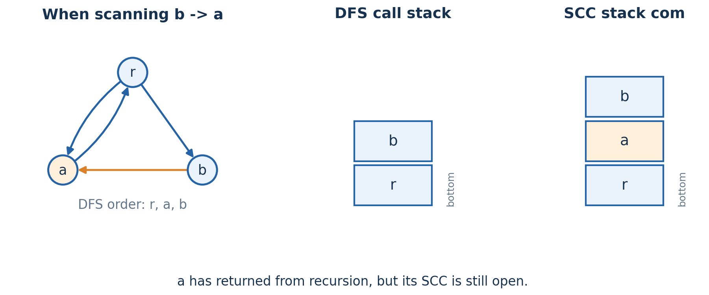

# Chapter 4 DFS 树、Tarjan 与圆方树

你已经会写桥、割点、边双和 SCC 的模板了。这一章换个出发点：先不盯着 `low` 的更新式，而是看 DFS 把图整理成了什么形状，再问一块结构什么时候可以从剩下的图中分出来。

无向图里，我们关心的是：一个子树能否绕过父边，或者绕过父节点。有向图里，我们关心的是：一个尚未确定归属的部分，是否还需要和更早发现的节点放进同一个 SCC。几种算法都有“向上传信息、满足条件就分块”的外形，但这些信息回答的问题不同，不能只凭代码长得像就混用。

下面统一用 $\operatorname{in}[u]$ 表示进入 DFS 的时间，也就是资料里常写的 `dfn`。无向图允许重边，每条原边有独立编号；一条无向边对应的两条邻接记录共享这个编号。自环不改变桥、割点以及不同顶点间的连通性，本章无向部分先把它们移除。若题目要求输出自环所属的边块，需要额外规定归属。图可以不连通，此时 DFS 树、桥树和圆方树都应理解为森林。

## 1. 先看 DFS 树，为什么返祖边这么有用

首次访问一个点时，进入它所用的边称为树边。所有树边组成 DFS 树；没有被选为树边的边称为非树边。

无向 DFS 有一个决定性的性质：**非树边的两个端点，一定是祖先和后代。它不会连接两棵互不包含的子树。**

可以这样想。假设两个点 $u,v$ 有边相连，且 $u$ 先被访问。在 $u$ 的递归返回以前，它一定会扫描这条边。如果那时 $v$ 还没访问，就从这条边进入 $v$；如果 $v$ 已经访问了，它也是在 $u$ 尚未返回的这段时间里被某条递归分支访问到的。两种情况下，$v$ 都是 $u$ 的后代。若 $v$ 在访问 $u$ 之前就出现了，则交换两者讨论，结论相同。

因此，分析一张无向图时，可以把它看成一棵树，再补上若干条连接祖先和后代的边。为了方便描述，把这些非树边从后代 $x$ 指向祖先 $a$，称为向上的返祖边。原图仍然是无向图，这个箭头只是分析时的约定。

一条返祖边 $x\to a$，加上树路径 $a\leadsto x$，恰好形成一个环。也就是说，这条返祖边给树路径上的每一条边都提供了一条绕路。

这就是 DFS 树在桥问题中的作用。删掉树边 $(u,v)$ 后，树被分成 $v$ 子树和外部。它是不是桥，只取决于有没有返祖边从子树跨到外部。我们不用研究图中所有可能的路线，只要研究哪些返祖边跨过了这条边。

[The DFS tree and its applications](https://codeforces.com/blog/entry/68138) 的这条思路很值得保留：先认清树边两侧的割，再决定用什么数组描述它。`low` 是记录这个结构的一种方式，并不是结构本身。

## 2. 同一个 low，为什么桥用 >，割点用 ≥

无向图中的 $\operatorname{low}[u]$，可以先用一句话理解：

> 从 $u$ 的子树出发，向下走若干条树边，再用至多一条返祖边，最早能回到哪个进入时间？

这里允许不走返祖边，所以至少有自己的进入时间作为初值。更准确地写，是

$$
\operatorname{low}[u]=\min\left(
\operatorname{in}[u],
\min_{\substack{x\text{ 在 }u\text{ 子树内}\\x\to a\text{ 是返祖边}}}
\operatorname{in}[a]
\right).
$$

树边的反向记录不算返祖边，必须排除进入当前点所用的那条原边。

这个定义已经包含了递推方式：孩子子树提供的最早位置是 $\operatorname{low}[v]$；自己直接看到祖先 $a$ 时，提供的位置是 $\operatorname{in}[a]$。所以树孩子传 `low`，直接遇到的返祖边传 `in`。

注意其中的限制：向下走树边，然后至多用一条返祖边。它不是“在原图里任意绕路能到达的最小进入时间”。在一个连通的无向图里，任意绕路当然能回到根；如果把这个值当成 low，就根本分不出割点。



图中三张小图的 DFS 树都是 $p-u-v-x$，橙色树边是待检查的 $(u,v)$。从左到右，$v$ 子树分别没有绕路、只能绕回 $u$、能绕到 $u$ 上方。中间这一种情况，是区分桥和割点的关键。

### 删的是边：回到 u 就够了

删除 $(u,v)$，但保留 $u$。只要 $v$ 的子树里有返祖边回到 $u$ 或 $u$ 的祖先，子树就能沿另一条路接回外部。因此

$$
\boxed{(u,v)\text{ 是桥}\iff
\operatorname{low}[v]>\operatorname{in}[u].}
$$

这个结论的两个方向都来自树割：有跨割边，就能绕过 $(u,v)$；没有跨割边，删除后两侧就分开。由于无向 DFS 没有横叉边，跨割的非树边只能通向 $u$ 或它的祖先，正好被 low 检测到。

等号为什么不算桥？图中间的 $x\to u$ 和树路径 $u-v-x$ 构成环，即使删掉 $(u,v)$，仍能通过 $u-x-v$ 连接两端。非树边本身也在这样的环上，所以桥一定是树边。

### 删的是点：回到 u 已经没有用了

现在删除整个 $u$。图中间虽然有 $x\to u$，但这条边也随着 $u$ 一起消失，$v$ 子树仍然被隔开。

对非根点 $u$，父亲所在的那一侧始终存在。一个孩子 $v$ 的子树，必须有返祖边绕到 $u$ 的**严格祖先**，才能在删除 $u$ 后接回父亲那一侧。于是

$$
\boxed{u\text{ 是非根割点}\iff
\exists\text{ 树孩子 }v:
\operatorname{low}[v]\ge\operatorname{in}[u].}
$$

如果存在这样的孩子，删除 $u$ 就把该子树与父亲一侧分开。反过来，如果每个孩子都有返祖边到严格祖先，那么各个孩子子树都能绕过 $u$ 接回父亲一侧，剩下的点仍连通。这就是充要性。

DFS 根要单独处理，因为它没有父亲一侧。根有至少两个树孩子时，不同孩子子树之间没有横叉边，删除根后它们就分开；根只有一个树孩子时，剩下的点全在同一棵子树里，仍通过树边连通。所以根是割点，当且仅当它有至少两个**树孩子**。数的是递归进入了几个孩子，不是原图的度数。

可以把这三个边界牢牢记成实际路线，而不是符号口诀：

| $v$ 子树能回到哪里 | 删 $(u,v)$ | 删非根点 $u$ 时，该孩子侧能否接回父亲侧 |
| --- | --- | --- |
| 回不到 $u$，即 $\operatorname{low}[v]>\operatorname{in}[u]$ | 断开，是桥 | 不能 |
| 恰好只能回到 $u$，即等号 | 不断，有环绕过树边 | 不能，路线仍依赖 $u$ |
| 能回到 $u$ 上方，即严格小于 | 不断 | 能 |

### 重边会直接影响这个边界

两个点之间有两条平行边，DFS 用其中一条进入孩子，另一条就是合法的返祖边。它会让孩子的 low 降到父亲的进入时间，说明原树边不是桥。

所以只能按边编号跳过进入当前点的那一条原边。若按父节点跳过所有 `v == parent[u]`，就把另一条平行边也丢了，凭空制造出一座桥。你现在使用的“边编号跳父边”，保留的正是这个信息。

## 3. 换一份信息，也能找到桥

low 记录跨割边能到达的最高位置。若题目更关心跨过某条树边的返祖边有多少条，也可以直接计数。

对每条向上的返祖边 $x\to a$，做树上差分

$$
\Delta[x]++,\qquad \Delta[a]--.
$$

再以后序合并子树和：

$$
c[u]=\Delta[u]+\sum_{v\text{ 为树孩子}}c[v].
$$

那么非根点 $u$ 的 $c[u]$，就是跨过父边的返祖边数。

为什么？固定一条返祖边，看它在 $u$ 子树和里的贡献。两个端点都在子树内时，$+1$ 和 $-1$ 抵消；只有下端 $x$ 在内时，留下 $+1$，说明它确实跨出子树；都在外时贡献为零。不会出现“祖先端 $a$ 在内、后代端 $x$ 在外”，因为子树包含自己的所有后代。逐条相加，就得到了跨割边数。

因此父边是桥，当且仅当 $c[u]=0$。每条非树边只计一次，每条树边只合并一次，仍是 $O(n+m)$ 时间、$O(n+m)$ 空间。

这和 low 的区别在于保留了什么信息：一个记录“最早到哪里”，一个记录“有多少条绕路”。桥只要求判断有没有绕路，所以二者都够用。割点却要求绕过一个点，不能直接把这个零条件照搬过去；仅仅回到被删除点的边，对删点连通性没有帮助。

### 两个顺手得到的应用

一座桥下方有 $s$ 个点，它所在的原连通分量共有 $N$ 个点。删桥后被分开的无序点对数是

$$
s(N-s).
$$

每个点对从两侧各选一个点，恰好计一次。图不连通时这里必须用原连通分量大小 $N$，而不是全图点数 $n$。

另一个应用是给无向图定向，使它成为强连通图。对连通无向图，**没有桥恰好就是可以这样定向的条件**：树边向下定向，返祖边向上定向即可。

根沿树边能到每个点。反过来，考虑非根点 $v$。因为它的父边不是桥，$v$ 子树内一定有某条返祖边跨过父边。先从 $v$ 沿向下树边到这条返祖边的下端，再沿返祖边向上，就到了 $v$ 的严格祖先。不断重复，深度每次严格下降，最终到根。任意点都能先到根，再到另一个点，因此强连通。

有桥时，桥无论朝哪边定向，另一方向都无法跨过这个割，所以也不可能强连通。单点图没有边，按通常约定本来就是强连通的。

> **练习（估算 CF 难度）**：[Non-academic Problem](https://codeforces.com/problemset/problem/1986/F)（约 1800）；[Tourist Reform](https://codeforces.com/problemset/problem/732/F)（约 2400）。

## 4. 边双与点双，拆开的到底是什么

这两个名字都包含“双连通”，但分块方式有本质区别。先看一个最小而有用的例子：两个三角形共用点 $c$。



左图每条边都在三角形上，所以没有桥。删掉任意一条边，整图仍连通：五个点属于同一个边双。但删掉 $c$，左右两边就分开，因此有两个点双块，$c$ 同时属于这两个块。

本章使用下面的约定：

| 结构 | 怎样定义 | 原顶点是否唯一归属 |
| --- | --- | --- |
| 边双连通分量 | 删除全部桥后留下的连通分量 | 是，每个点恰好属于一个边双 |
| 非退化点双块 | 至少三个点，删除任意一个点后仍连通的极大块 | 否，割点可以属于多个块 |
| 二点块 | 只有两个顶点的块，包括单桥块或一组平行边构成的块 | 端点可以同时属于其他块 |
| 单点块 | 孤立点的处理约定 | 单独处理 |

这里“块”取极大，意思是不能再加入外部边和顶点，仍满足相应的点双性质。每条无向边恰好归属一个点双块，顶点却可能重复出现。两个不同块至多共有一个顶点：如果共有至少两个点，删除其中任意一个仍有另一个公共点把两块接起来；删除别的点时也仍有公共点连接它们。这样两块可以合并，与极大性矛盾。

### 边双：删桥后再搜一次

最直接的算法是先标记桥，再忽略桥做 DFS 或 BFS，每次搜索得到一个边双。

跨过桥的两侧不可能属于同一个边双，因为删掉那座桥就会把它们分开。另一方面，一条非桥边位于某个环上，而环上不可能包含桥。因此删除全部桥，不会破坏任何非桥边原有的环；剩下的连通分量里仍没有桥。这说明得到的分量内部没有单边割，恰好就是边双。

把每个边双缩成一个点，每座原桥连接两个分量，得到桥森林。它不会有环，否则环上的所谓桥都能沿环绕过去。原图的每个连通分量对应其中一棵树。

于是，哪些桥能分开 $a,b$，就变成了两个边双编号之间的树路径。预处理 LCA 后，可以用 $O(\log n)$ 时间判断一条桥是否位于这条路径上。

### 边双的顶点栈：为什么也能用 low[u] == in[u]

你现在使用的写法，是进入 $u$ 时把它放入顶点栈 `com`，孩子返回后按无向 low 更新；当

$$
\operatorname{low}[u]=\operatorname{in}[u]
$$

时，从栈顶弹到 $u$，形成一个边双。这不是借用了 SCC 的结论，它在无向图里有自己的解释。

对非根点 $u$，记父亲为 $p$。因为无向图的返祖边只连接祖先和后代，$u$ 子树若有边通向外部，就只能到 $p$ 或更早祖先，其进入时间至多为 $\operatorname{in}[p]$。否则，low 的最小值就是初值 $\operatorname{in}[u]$。因此

$$
\operatorname{low}[u]=\operatorname{in}[u]
\iff \operatorname{low}[u]>\operatorname{in}[p]
\iff (p,u)\text{ 是桥}.
$$

也就是说，非根触发等号时，恰好到达一个“由上方桥隔开的新边双”的最高点。它更深处若还有桥，那些桥下的边双已经在递归返回时先弹出了；此刻栈上从 $u$ 开始留下的顶点，就是与 $u$ 之间不再隔着桥的部分。弹出这一后缀，等价于删桥后搜索所得的分量。

DFS 根没有父边，但最终一定满足等号，它负责弹出该原连通分量里最后剩下的边双。孤立点也自然单独弹出。每个点压入、弹出各一次，仍是线性复杂度。

这里和点双的区别要先记清：**边双的顶点一旦弹出，就完成唯一归属；点双里的入口割点还要继续参加其他块。**

> **练习（估算 CF 难度）**：[Pursuit For Artifacts](https://codeforces.com/problemset/problem/652/E)（约 2200）。

## 5. 点双的栈，为什么在 ≥ 时分块

点双使用边栈最容易把归属说清楚。栈里放已经经过、但还没有归属到完整块的原边：树边在递归进入孩子前入栈；返祖边只从后代端向祖先端处理时入栈，避免同一无向边压两次。

树孩子 $v$ 返回到 $u$ 时，如果

$$
\operatorname{low}[v]\ge\operatorname{in}[u],
$$

就从栈顶弹边，直到把树边 $(u,v)$ 也弹出。这一段边及其端点组成一个点双块。

这次还是非严格不等号，因为我们正在找点的边界。它表示：这一侧不能绕过 $u$ 到达更早的部分。等号虽然说明有环回到 $u$，但这不妨碍 $u$ 成为两个块之间的公共接口。

为什么恰好弹这一段？可以同时看外部边界和内部结构。

首先，树边 $(u,v)$ 是进入这部分的入口。DFS 连续处理整个 $v$ 子树，更深处已经封闭的块会先弹出。等 $v$ 返回时，栈中位于这条入口边之后的边，就是尚未分配、还需要通过 $u$ 决定归属的部分。low 条件说明它们与栈中更早的部分至多通过 $u$ 相接，所以不能越过 $u$ 再合成一个更大的点双块。

其次，为什么内部不需要继续拆？假如其中还有某个点 $x$，删除它就能把某个孩子侧与其余部分分开，那么这个孩子侧一定不能绕过 $x$，也会满足相同的 low 边界。它应当在更深的递归返回时就已输出，不能完整地留在当前这一段里。删除入口点 $u$ 也不会把当前块再分裂：其余部分都来自同一个入口孩子侧，之前被拆出的深层块已经移除，留下的树边仍将这些顶点接在一起。

因此，这一段既不能继续向外合并，内部也不应再拆，正是一个极大点双块。桥同样满足条件，只会弹出它自己一条边，形成二点桥块。

这个条件对 DFS 根也照常用于**输出块**。根有一个孩子，仍然要输出这一个孩子侧的块；只是它有没有成为割点，依然要看树孩子数量。不要把“根不按普通公式判割点”误写成“根不按这个条件出块”。

把整个过程压成几个关键时刻即可，不必重新背一份完整代码：

1. 进入点时初始化 `in`、`low`；按原边编号跳过父边。
2. 树边先入边栈，递归后用孩子的 low 更新；向祖先的非树边入栈，并用祖先的 in 更新。
3. 孩子返回时，`low[v] > in[u]` 标记桥，`low[v] >= in[u]` 输出一个点双块，并按根与非根规则判断割点。
4. 对所有未访问点启动 DFS；孤立点没有边入栈，需要额外输出单点块。

每条边入栈、出栈各一次。输出块的端点时，可以用时间戳去重，不必每次清空长度为 $n$ 的数组。总端点出现次数也是 $O(n+m)$：每个出现至少由块中的某条边端点提供，孤立点另算。因此时间、空间均为 $O(n+m)$。

### 点栈为什么要把入口点留下

点双也有顶点栈写法：进入一个点时入栈；当孩子 $v$ 满足边界条件，就弹到 $v$，再把 $u$ 加入这个块，但**不弹出 $u$**。

它和边栈做的是同一件事。弹出的点完成了它们在当前方向上的归属，$u$ 却是当前块与更早部分的接口，还可能属于下一个块。所以 $u$ 的重复归属通过“额外加入入口点”实现，不需要重复压栈。

回到两个三角形的例子：先输出一侧三角形时，公共点 $c$ 必须留下，才能继续加入另一侧。若像边双或 SCC 那样把它一次弹掉并彻底归属，就丢失了点双允许重叠的性质。每个 DFS 根处理完后还要清理留下的根；孤立点仍单独处理。

边栈能同时给出块内原边，点栈主要给出顶点集合。需要统计边数、区分平行边、保留边编号时，边栈往往更直接。

## 6. 圆方树，把割点保留为接口

现在回看上一张图的右半边。每个原顶点建一个圆点，每个点双块建一个方点；原顶点属于哪个块，就向那个方点连边。这是本章采用的圆方树版本，保留所有原顶点。

两个三角形分别变成方点 $B_1,B_2$，公共点 $c$ 只保留一个圆点，同时连接它们。割点没有被缩掉，而是明确保留成两个块之间的接口。非割点只属于一个块，因此成为叶子。

桥也作为二点块，建一个方点连接两个端点。孤立点可以只留一个独立圆点；如果已经输出单点块，也可以再挂一个方叶子。两种约定对不同原顶点之间的连通查询没有影响，但实现中要统一。有的资料只保留“割点圆点＋块方点”，再把非割点映射到所属块；那是另一种常见 block-cut tree 约定，查询端点的映射方式会不同。

### 为什么关联图一定是一棵树

先看连通性。原图每条边的两个端点都属于同一个块，因此可以把每一步原图移动替换成“圆点—方点—圆点”。原连通分量内的所有圆点就都接起来了。

再看为什么不能有环。假设多个块通过不同公共顶点首尾接成关联环。删掉环上的一个公共顶点，还能沿环的另一侧从一个块绕到另一个块；删掉某块内的其他点，该块内部的点双性质又保证它剩余接口间仍连通。于是环上这些块的并集，删掉任何一个点都不会断开，应当合并为更大的块，与原先各块极大矛盾。

因此，一个原连通分量对应一棵圆方树，整图对应圆方森林。节点数和关联边数都是 $O(n+m)$。

### 删点查询为什么变成树上路径

设 $a,b,c$ 是同一原连通分量里的三个不同顶点，则

$$
\boxed{\text{删 }c\text{ 后 }a,b\text{ 不连通}
\iff c\text{ 的圆点在圆方树的 }a\leadsto b\text{ 路径上}.}
$$

如果 $c$ 位于树路径上，删掉这个接口就把两端分开。原图也不可能在其他块之间找到替代接口，否则关联图就不该是树。

如果 $c$ 不在树路径上，就沿这条路径逐块连接。在一个非退化点双块里，即使删去 $c$，路径所需的两个接口仍能互达。若经过的是桥块，它的两个端点都在树路径上，路径外的 $c$ 不会删除它们。因此每个块都能通过，拼起来便得到一条避开 $c$ 的原图路线。

用树距离判定点在路径上，就是

$$
\operatorname{dist}_T(a,c)+\operatorname{dist}_T(c,b)
=\operatorname{dist}_T(a,b).
$$

这里算的是圆方树的边数距离，不是原图最短距离。倍增 LCA 的预处理时间和空间为 $O((n+m)\log(n+m))$，每次查询为 $O(\log(n+m))$。若原图中 $a,b$ 本来就不连通，或者 $c$ 恰好等于端点，需要先按题目对删点的定义处理。

若要统计 $a,b$ 之间除端点外有多少个必经割点，可以给割点圆点权 $1$，其他节点权 $0$，求路径点权和，再扣掉端点可能贡献的权值。方点代表块，不能作为原图割点计数。

圆方树保存的是“必须经过哪些接口”。它没有自动保存块内距离、边权和路径数量，所以不能把树上的距离直接当成原图距离。

### 仙人掌为什么可以逐块乘二

对简单无向仙人掌图，每个块不是桥，就是简单环。圆方树的 $a\leadsto b$ 路径若经过 $k$ 个环块，原图中 $a,b$ 之间的简单路径数恰好是 $2^k$。

因为经过一个环块时，两个接口之间有两条环弧可选；桥块只有一种方式。各块依次通过公共接口连接，选择互不影响。不同选择得到不同路径，任意简单路径又必须按这条树路径经过各块，所以既没有漏计，也没有多计。

这里利用了“块是简单环”，并不是方点本身具有二选一的性质。一般点双块里，两个接口之间可能有更多条简单路径，必须额外分析块内结构。

> **练习（估算 CF 难度）**：[Typical Path Problem](https://atcoder.jp/contests/abc318/tasks/abc318_g)（约 2300）。

## 7. 想知道割开多少，不一定要建圆方树

若只需统计删除一个点后的影响，DFS 的子树大小已经足够。

对点 $u$，每个满足

$$
\operatorname{low}[v]\ge\operatorname{in}[u]
$$

的孩子 $v$，都会在删除 $u$ 后单独形成一个分量，其大小就是该孩子子树大小。没有触发这个条件的孩子侧能绕回 $u$ 上方，与父亲一侧合并。

因此对非根 $u$，若这些独立孩子侧的大小为 $s_1,\ldots,s_t$，父亲所在的剩余部分大小为

$$
N-1-\sum_{i=1}^{t}s_i,
$$

其中 $N$ 仍是原连通分量大小。对根，所有树孩子侧就是删除后的全部分量，没有父亲一侧；孤立根删掉后，一个分量也不剩。

去掉大小为零的部分，统一记删除后有 $k$ 个分量，大小为 $s_1,\ldots,s_k$。其他顶点中被分开的无序点对数为

$$
\sum_{i<j}s_is_j
=\frac{(N-1)^2-\sum_i s_i^2}{2}.
$$

如果全图原本有 $C$ 个连通分量，删掉 $u$ 后变成 $C-1+k$ 个。这个式子也正确处理孤立点：此时 $k=0$，连通分量数反而减少一个。要判“是不是割点”，检查总分量数是否增加即可；要算影响大小，再保留这些分支大小。

> **练习（估算 CF 难度）**：[Christmas Color Grid 2](https://atcoder.jp/contests/abc334/tasks/abc334_g)（约 2200）。

## 8. 到有向图以后，先分清两种栈

有向 DFS 可以出现连接不同分支的横叉边。无向图里“外部一定是祖先”的结构不再成立，这也是 SCC 的 low 不能直接照搬无向 low 语义的原因。

SCC 是互相可达的极大顶点集合。它们划分所有顶点。缩点后一定是 DAG：若若干分量还能组成有向环，它们就可以沿环互达，原本应该属于同一个 SCC。

先保留两个关于 DFS 树的事实。一个 SCC 中最早被访问的点 $r$，是这个 SCC 所有点的祖先。因为 $r$ 能沿 SCC 内部的路线到达每个点，DFS 不会在访问这些点之前就从 $r$ 返回。若祖先 $x$ 和后代 $y$ 属于同一个 SCC，那么它们之间的整条树路径也属于这个 SCC：中间点从 $x$ 可达，沿树边到 $y$ 后又能返回 $x$。

但一个 SCC 通常不是完整的 DFS 子树。子树里还可能有只能单向到达、不能返回的其他 SCC。这些分量应该先被分出去，剩下的点继续等待归属。

因此 SCC Tarjan 需要的栈 `com`，存的是：**已经发现，但还没有归属到已输出 SCC 的点。** 它和递归调用栈不是同一个东西。



图中有边 $r\to a,a\to r,r\to b,b\to a$，先访问 $a$ 再访问 $b$。扫描 $b\to a$ 时，`DFS(a)` 已经返回，所以调用栈里只有 $r,b$；但 $a$ 能回到 $r$，还不能独立封闭，因此分量栈里仍有 $r,a,b$。

这条 $b\to a$ 不能忽略。它让 $b$ 通过 $a$ 返回 $r$，而 $r$ 又能到 $b$，三个点确实互相可达。若只认“仍在递归调用栈里的点”，就会漏掉这个关系。

| 状态 | 表示什么 | 函数返回后是否还可能为真 |
| --- | --- | --- |
| 在 DFS 调用栈里 | 当前递归链上的点，函数尚未返回 | 否 |
| 在 SCC 分量栈里 | 已发现，尚未输出所属 SCC | 是 |

所以 `in_stack` 在 SCC 模板里应表示第二种状态。已访问和已归属，也必须分开：指向已经封闭 SCC 的边不会带来互达关系，不能再降低当前分量的信号。

## 9. 标准 SCC low-link，怎样保证弹出的恰好是一整个 SCC

标准写法初始化 $\operatorname{low}[u]=\operatorname{in}[u]$，然后把 $u$ 压入分量栈。树孩子返回时传 low；遇到已访问、仍在分量栈里的点 $v$，传 $\operatorname{in}[v]$。

```text
DFS(u):
    in[u] = low[u] = ++timer
    com.push(u)
    mark u as unassigned

    for v in outgoing[u]:
        if v is unvisited:
            DFS(v)
            low[u] = min(low[u], low[v])
        else if v is still in com:
            low[u] = min(low[u], in[v])

    if low[u] == in[u]:
        pop com through u, forming one SCC
        mark every popped vertex as assigned
```

这里的 low 仍然是一个受限信号：沿 DFS 树向下，在某处用一条边指向尚未归属的旧点，把那个旧点的进入时间传回来。它不是任意有向可达点的最小进入时间，也不保证每个点的 low 都等于所属 SCC 最早点的 in。

这份伪代码无条件接收树孩子的 low。若孩子已经独立弹出，它触发封闭时必有 $\operatorname{low}[v]=\operatorname{in}[v]>\operatorname{in}[u]$，所以不会影响父亲。也可以显式只接收仍未归属的孩子，两种写法在这里等价。

现在需要解释的不是更新式，而是这句判断：为什么 `low[u] == in[u]` 就可以弹出从 $u$ 开始的整个栈后缀？

### 同一个 SCC 为什么不会被提前拆开

固定一个真实 SCC，记最早访问的点为 $r$。考虑其中另一个点 $u$。由于 $u$ 能沿 SCC 内的路线回到 $r$，这条路线必定从 $u$ 的 DFS 子树走出去。

看第一次离开子树的那条边 $x\to y$。当 $x$ 扫描它时，$y$ 必须已经访问，否则 DFS 会把 $y$ 也拉进 $u$ 子树；而 $y$ 不是子树后代，所以访问时间早于 $u$。在正确输出了此前 SCC 的前提下，$y$ 也不可能已经独立归属，因为它和仍未完成的 $r$ 互相可达。

这条边给出一个小于 $\operatorname{in}[u]$ 的信号，并沿树孩子一路传到 $u$。因此

$$
\operatorname{low}[u]<\operatorname{in}[u],
$$

$u$ 不会先于 $r$ 弹出。这个论证可以按已经输出的 SCC 数归纳使用，并没有预先假定待证明的那一次弹栈正确。

### 栈后缀为什么也不会混入其他 SCC

接下来考虑一个真正触发等号的点 $u$。从 $u$ 开始的栈后缀，都是它的尚未归属后代，所以 $u$ 能沿树边到达它们。只差反方向：它们为什么都能回到 $u$？

这里用一个有用的不变量：**已经递归返回、却仍在分量栈里的点，能够到达当前调用链上的某个点。**

它为什么成立？一个点返回时若没弹出，就存在通往更早栈内点的 low 信号。信号对应真实路线，因此可以沿它继续找更早点。若到达的旧点也已经返回，就继续使用那个旧点未封闭时保留的路线。进入时间严格下降，不会无限继续；最后会碰到一个函数还没有返回的点，也就是当前调用链上的祖先。早期节点一旦弹出，会连同后面的栈后缀一起弹出，所以一个点还留在栈里时，它所依赖的更早未封闭节点不会被单独拿走。

当 $u$ 即将返回时，调用链上只剩 $u$ 及其祖先。于是后缀中的任意点，都能回到 $u$ 或 $u$ 的某个严格祖先。

如果它能回到严格祖先，就得到一条从 $u$ 子树走到更早未归属节点的路线。取第一次离开 $u$ 子树的边，同样会产生小于 $\operatorname{in}[u]$ 的信号，与等号矛盾。因此这些点实际都能回到 $u$，与 $u$ 互相可达。

最后，同属 $u$ 的 SCC 的点不会提前弹走，也都会在 $u$ 子树里被访问到；后缀之外的更早节点又不可能同属这一 SCC，否则 $u$ 应收到更早信号。这样，既没有混入别的分量，也没有漏掉自己的点，弹出的后缀恰好是一个 SCC。

每个点压栈、弹栈一次，每条有向边扫描一次，时间、空间均为 $O(n+m)$。

> **练习（估算 CF 难度）**：[Endless Walk](https://atcoder.jp/contests/abc245/tasks/abc245_f)（约 1800）。

## 10. 为什么另一种 SCC 写法可以统一传 rep

你给过的 [Directed DFS trees and Tarjan SCC](https://codeforces.com/blog/entry/131187) 最后采用的并不是标准 low-link 的逐字版本。它对所有尚未归属的邻点，统一传播已有代表信号。

为了不把两种含义搅在一起，这里把它叫作 $\operatorname{rep}$：

```text
DFS(u):
    in[u] = rep[u] = ++timer
    com.push(u)

    for v in outgoing[u]:
        if v is unvisited:
            DFS(v)
        if v has not been assigned to an SCC:
            rep[u] = min(rep[u], rep[v])

    if rep[u] == in[u]:
        pop com through u, forming one SCC
```

它允许把邻点已经知道的更早候选继续传过来，而不是只传那个邻点自己的进入时间。所以不能用“旧点只能传 in”这一句口诀直接否定它。要检查的是：这种额外传播会不会跨到另一个真实 SCC？

先看已访问、尚未归属的邻点 $v$。如果 $v$ 在调用链上，它是 $u$ 的祖先，$v$ 沿树边到达 $u$，再加上 $u\to v$，二者互达。

如果 $v$ 已经返回但仍未归属，根据上一节的不变量，它能到达当前调用链上的某个祖先 $w$。这个祖先沿树边能到 $u$，而 $u\to v$，所以仍有 $v\leadsto w\leadsto u\to v$，二者也在同一 SCC。

若 $v$ 是刚刚递归完成的树孩子，并且还没归属，它保留的更早信号最终也会通向 $u$ 或 $u$ 的祖先；否则它应该已经在自己的子树内封闭。因此 $u,v$ 同样互达。

这说明每次真正进行代表信号传播时，两端都已经属于同一个真实 SCC。已有候选可以沿这些已证明的互达关系继续传递，不会把别的分量的代表混进来。候选进入时间也就不会小于该 SCC 最早点的进入时间。

另一方面，SCC 中除了最早点之外的每个点，都有一条路线离开自己的子树、到达更早的同分量节点。按前面的边界论证，它会收到一个更早候选，不能触发等号；最早点没有更早的同分量候选，最终触发等号。配合同一栈后缀规则，就仍得到正确分区。

标准 low-link 与代表传播版的中间数组可能不同，但输出 SCC 相同。使用哪种都可以，前提是连同状态语义和封闭证明一起使用，而不是只截取一条更新语句。

### 为什么无向 low 不能照着改

还是两个三角形共用 $u$ 的图。让 DFS 从左侧三角形中的点 $p$ 开始，经左侧到达 $u$，于是 $\operatorname{low}[u]$ 已经能指向 $p$。再从 $u$ 搜右侧三角形。

右侧返祖边的上端是 $u$。标准无向 low 使用 $\operatorname{in}[u]$，如实表示“能回到 $u$”。若换成 $\operatorname{low}[u]$，右侧就会继承指向 $p$ 的值，仿佛自己也能绕过 $u$ 回到左侧。但实际路线必须经过 $u$；删掉 $u$ 后，这条路线就不存在。结果是漏判割点，甚至错误地合并两个点双块。

SCC 代表传播允许继续经过邻点，因为已经证明它们互相可达。无向割点问题恰好要判断能不能**不经过这个点**，所以不能借用同一个解释。

## 11. 看见不同模板时，先检查状态语义

不同资料的代码常常只差一行，但有些是合法的状态编码，有些会改变算法含义。

| 写法 | 能否使用 | 真正需要检查的条件 |
| --- | --- | --- |
| 无向树孩子传 low，返祖边传 in | 可以 | 按边编号排除父边，根的割点另判 |
| 无向用 depth 代替 in | 可以 | 返祖边只通向祖先，深度足够比较高度 |
| 边双顶点栈，low[u] == in[u] 时弹到 u | 可以 | 用无向 low，已经分出的桥下分量先弹出 |
| 点双边栈或点栈 | 都可以 | 点栈形成块时保留入口点，允许它归属多个块 |
| SCC 树孩子传 low，栈内旧点传 in | 可以 | 栈内指尚未归属，不是仅指递归未返回 |
| SCC 未归属邻点统一传 rep | 可以 | 使用代表传播语义，不再把数组当成标准受限 low-link |
| SCC 弹出后把 ord 改成大哨兵 | 可以 | 哨兵大于所有合法访问序，原进入时间需要时另存 |
| SCC 把已访问一律当作仍未归属 | 不可以 | 指向已封闭 SCC 的边会错误阻止当前 SCC 封闭 |
| 无向按父节点跳过全部重边 | 不可以 | 会丢掉合法的平行返祖边 |
| 有向标准更新里直接用 depth 替换 in | 一般不可以 | 横叉边可以连接相同深度的不同分支 |

最后两种 SCC 错误，都有很小的反例。

先独立访问并弹出 $a$，随后访问只有一条出边 $b\to a$ 的 $b$。它们并不互达。如果不检查 $a$ 已经归属，就会用旧进入时间降低 $b$ 的 low，使本应独立输出的 $b$ 无法正常封闭。

深度替换的反例则是图中的 $r,a,b$。$a,b$ 深度相同，处理横叉边 $b\to a$ 时，用 $\operatorname{depth}[a]$ 不能降低 $b$ 的值，可能错误地把 $b$ 弹出。进入时间却有 $\operatorname{in}[a]<\operatorname{in}[b]$，能正确表达“更早的、仍未封闭的结构”。无向图没有这种横叉边，所以用深度比较祖先高度没有同样的问题。

[AtCoder Library 的 SCC 实现](https://github.com/atcoder/ac-library/blob/master/atcoder/internal_scc.hpp) 将弹出节点的 `ord` 改为 $n$，而合法进入时间是 $0$ 到 $n-1$。这样指向已归属点的边即使参与取最小值，也不会产生更早信号。它只是把“已经归属”编码进了数值，并没有取消这个状态。也因此，弹出后的 `ord` 不能再当原始访问序使用。

### 后序时刻与编号顺序也属于模板的一部分

桥、割点、点双封闭、SCC 封闭，都依赖“孩子已经搜索完并返回”的时刻。若改成迭代 DFS，不能只把邻居全部放进普通栈，就以为等价于递归。

显式帧至少要记住当前点正在扫描哪条边，并在孩子帧结束后回传 low，再做边界判断。孩子刚入栈时，low 还没有算完，不能提前使用。最坏递归深度为 $n$，深链图可能需要显式帧；无论递归还是正确的迭代实现，总空间仍是 $O(n+m)$。

Tarjan 原始弹出顺序，是缩点 DAG 的逆拓扑顺序。若不同 SCC 间有边 $A\to B$，那么 $B$ 会先封闭：若它最初没访问，会沿边递归完成；若它已经访问但还未封闭，并与当前部分保持未决关系，就会与 $A$ 形成互达而不应是不同 SCC。因此跨分量出边总是指向更早弹出的分量。

库可能再把编号反转。例如 AtCoder Library 最终返回的分量编号符合正拓扑方向。写缩点 DP 时，应检查编号对应的是哪种顺序，不要仅凭算法名称推断。

## 12. 遇到题目时，需要保留哪一种边界

| 题目要回答什么 | 合适的结构或信息 |
| --- | --- |
| 删一条边是否断开 | 桥，或返祖边跨割计数 |
| 删桥后分开多少点对 | 桥下子树大小、原连通分量大小 |
| 删一个点后分成哪些部分 | 割点边界、相应孩子子树大小 |
| 哪些原边属于同一个点双块 | 点双边栈 |
| 多次询问某个点是否必经 | 圆方森林、LCA、路径判定 |
| 多次询问某座桥是否必经 | 边双缩点后的桥森林 |
| 有向图中哪些点互达，怎样把环压成 DAG | SCC 及缩点图 |

边双缩点保留桥造成的分离，圆方树保留点双之间的公共接口，SCC 缩点保留有向分量之间的可达关系。选结构时，先说清自己想保留的是哪一种信息，再决定哪些内部细节可以舍去。

## 参考资料

本章的示例、边界公式和证明按当前讲解重新组织；下面保留原稿的四份参考资料，便于继续对照不同视角与实际实现。

1. [-is-this-fft-：The DFS tree and its applications](https://codeforces.com/blog/entry/68138)。重点看无向 DFS 的祖先—后代结构，以及返祖边如何跨过树边对应的割。
2. [de_sousa：Directed DFS trees and Tarjan SCC](https://codeforces.com/blog/entry/131187)。重点看有向横叉边、未归属节点与代表信号传播；最终写法应与标准 low-link 区分语义。
3. [CMU 15-451：Graphs II（PDF）](https://www.cs.cmu.edu/~15451-s15/LectureNotes/lecture08.pdf)。可对照无向 DFS、割点条件和边栈输出点双块的课堂推导。本章另行写明了重边与退化块约定。
4. [AtCoder Library：internal_scc.hpp](https://github.com/atcoder/ac-library/blob/master/atcoder/internal_scc.hpp)。可对照已归属节点的大哨兵处理，以及最终 SCC 编号的反转。
