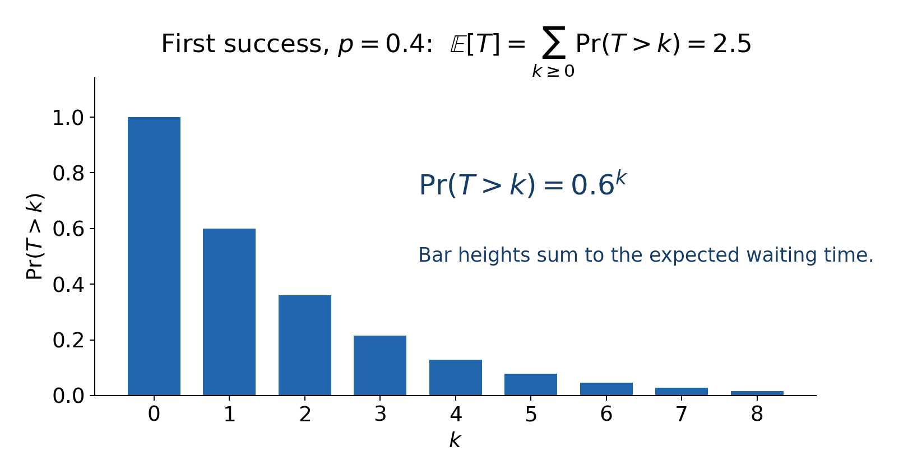
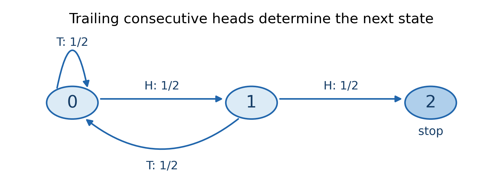

# Chapter 1 数学期望

把一个排列随机打乱，平均会有多少个相邻位置满足左边小于右边？如果直接想“有多少种排列，每种排列有几个上升”，很快就会遇到 $n!$ 种情况。可我们只求一个平均数，似乎没必要知道每种结果。

再换一个问题：不断抛硬币，直到连续出现两个正面，平均要抛多少次？这次连过程长度都没有上限，枚举所有过程更不现实。但如果只关心接下来还要多久，过去的完整抛掷记录也许可以压成很少的信息。

期望题里常见的两条路线，就藏在这两个问题中：把答案拆成容易计算的贡献，或者把过程拆成当前一步和剩余过程。下面从它们为什么成立讲起，再看有环、无穷等待、策略选择和模意义答案会带来什么变化。所有未注明来源的例子都是教学示例，不需要额外题面。

## 1. 先看清自己在求哪个平均数

设随机变量 $X$ 表示一次实验得到的数值，例如操作次数、得分或者总费用。如果它只有有限种取值，期望定义为

$$
\mathbb E[X]=\sum_x x\Pr(X=x).
$$

每种取值乘上它出现的概率，再把这些贡献相加，就是按概率加权的平均数。只有各个结果等概率时，才可以直接“数值总和除以结果数”。公平骰子的点数期望为 $7/2$，但它从来不会掷出 $7/2$；期望既不要求是一个可能结果，也不表示最可能的结果。

一个平均数毕竟装不下整个分布。例如 $X$ 等概率取 $0,2$ 时，

$$
\mathbb E[X]=1,\qquad \mathbb E[X^2]=2.
$$

如果先把 $X$ 换成平均数，再平方，得到的却是 $1$。因此不能觉得“题目求期望”，就把里面所有随机量都换成它们的期望。我们需要先知道哪些运算允许这样做。

本章只讨论离散随机变量。取值无上界时，上面的求和可能是无穷级数：非负变量的期望允许为 $+\infty$；有正有负的变量，在使用有限期望的公式时默认满足 $\mathbb E[|X|]<\infty$。这个条件是为了排除把 $+\infty-\infty$ 当作普通减法的情况。

## 2. 随机排列：为什么可以一个位置一个位置地算

回到开头的问题。设随机排列为 $\pi_1,\ldots,\pi_n$，令 $X$ 表示其中相邻上升的位置数。与其枚举排列，不如盯住一个位置 $i$：这个位置如果上升，就给答案贡献 $1$；否则贡献 $0$。

于是定义

$$
I_i=\begin{cases}
1,&\pi_i<\pi_{i+1},\\
0,&\pi_i>\pi_{i+1}.
\end{cases}
$$

对每一个具体排列，都有 $X=I_1+\cdots+I_{n-1}$。这一步很关键：我们先证明了一个逐结果成立的等式，还没对随机量做任何平均。

接下来才用期望的线性性：

$$
\mathbb E[X]=\sum_{i=1}^{n-1}\mathbb E[I_i].
$$

为什么能把平均拆开？把所有完整实验结果记为 $\omega$，它的概率记为 $p_\omega$，在有限样本空间中直接展开：

$$
\begin{aligned}
\mathbb E\left[\sum_i a_iX_i\right]
&=\sum_\omega p_\omega\sum_i a_iX_i(\omega)\\
&=\sum_i a_i\sum_\omega p_\omega X_i(\omega)\\
&=\sum_i a_i\mathbb E[X_i].
\end{aligned}
$$

中间只交换了求和顺序，没有要求各个 $X_i$ 独立。加上常数项也一样，所以一般形式是

$$
\mathbb E\left[b+\sum_i a_iX_i\right]
=b+\sum_i a_i\mathbb E[X_i].
$$

有限个绝对可积随机变量也满足这个式子，即使它们的取值范围无穷。

现在只需计算一个位置上升的概率。把排列中位置 $i,i+1$ 的两个数交换，会把上升变成下降，下降变成上升，而且这个操作可逆。两个数不相等，所以所有排列恰好两两配对，得到

$$
\Pr(\pi_i<\pi_{i+1})=\frac12.
$$

$0/1$ 变量的期望就是取 $1$ 的概率，因此

$$
\mathbb E[X]=\frac{n-1}{2}.
$$

原本像是要处理 $n!$ 个结果的问题，最后只用了对称性和 $O(1)$ 次算术运算。

这里的相邻事件并不独立。三个相邻数连续上升的概率是 $1/6$，两个上升事件的概率乘积却是 $1/4$。所以不要为了使用线性性，额外尝试证明一个并不成立的独立性。

### “是否发生”与“发生几次”要分清

上面的 $I_i$ 称为指示变量。对任意事件 $A$，令 $\mathbf1_A$ 在事件发生时为 $1$，否则为 $0$，则

$$
\mathbb E[\mathbf1_A]=\Pr(A).
$$

因此只要能逐结果写出 $X=\sum_i\mathbf1_{A_i}$，就有

$$
\boxed{\mathbb E[X]=\sum_i\Pr(A_i).}
$$

用它时先问：到底是每次出现都加一，还是一个对象只要出现过就加一？这会决定指示变量应该按“次”还是按“对象”来设。

例如将 $n$ 个球独立、等概率放入 $m\ge1$ 个盒子，求非空盒子数 $K$ 的期望。一个盒子放了十个球，也只给 $K$ 贡献一次。因此应对每个盒子设“是否非空”的指示变量。一个指定盒子为空，需要每个球都避开它，概率为 $(1-1/m)^n$，于是

$$
\mathbb E[K]=m\left[1-\left(1-\frac1m\right)^n\right].
$$

这里球的独立性用于把“全部避开”的概率乘起来；之后对盒子求和不要求各盒子是否非空相互独立。若 $n=0$，所有零次幂按 $1$ 处理，结果也是 $0$。

同一个指定盒子的球数期望是 $n/m$，是否非空的期望却是 $1-(1-1/m)^n$。重复抽取、访问过的点、被覆盖过的位置，常常都要先作这一区分。

### 乘法和除法没有同样的便利

如果 $X,Y$ 独立，联合概率可以分解为 $\Pr(X=x)\Pr(Y=y)$，展开双重求和便有

$$
\mathbb E[XY]=\sum_{x,y}xy\Pr(X=x)\Pr(Y=y)
=\mathbb E[X]\mathbb E[Y].
$$

独立性在这里确实用到了。若 $X=Y$ 且等概率取 $0,1$，左边是 $1/2$，右边却是 $1/4$。反过来，乘积期望恰好能拆也不能证明独立。

即使独立，商仍然不能直接拆成期望之商。令 $X$ 恒为 $1$，$Y$ 等概率取 $1,3$，则

$$
\mathbb E[X/Y]=\frac12\left(1+\frac13\right)=\frac23,
\qquad \frac{\mathbb E[X]}{\mathbb E[Y]}=\frac12.
$$

错的是把“倒数的平均”换成“平均的倒数”。它们做运算的顺序不同，独立性无法修补这一步。

## 3. 等待首次成功：先用尾概率把无限过程看清楚

每次尝试独立成功，成功概率固定为 $p$，成功和失败都算一次。设 $T$ 为第一次成功需要的尝试次数。想算 $\Pr(T=k)$ 当然可以，但更容易的问题是：尝试了 $k$ 次还没成功，概率是多少？

答案是

$$
\Pr(T>k)=(1-p)^k.
$$

这些“还没结束”的概率怎么变成期望？先把一次确定的等待时间画开。若这次 $T=4$，它会满足 $T\ge1,T\ge2,T\ge3,T\ge4$，一共四个条件。因此对任意非负整数变量 $X$，都有

$$
X=\sum_{k\ge1}\mathbf1_{\{X\ge k\}}.
$$

也就是把一个长度为 $X$ 的等待，拆成“是否等到了第 $k$ 步”的贡献。为避免直接交换无穷求和，先截断到 $L$：

$$
\mathbb E[\min(X,L)]=\sum_{k=1}^{L}\Pr(X\ge k).
$$

两边随 $L$ 单调增加，取极限就得到尾和公式，允许结果为无穷：

$$
\boxed{\mathbb E[X]=\sum_{k\ge1}\Pr(X\ge k)
=\sum_{k\ge0}\Pr(X>k).}
$$

用于首次成功，当 $p>0$ 时，

$$
\mathbb E[T]=\sum_{k\ge0}(1-p)^k=\frac1p.
$$

图中的柱子不是 $\Pr(T=k)$，而是 $\Pr(T>k)$。例如第 $0$ 根柱子高为 $1$，因为无论如何都至少需要尝试一次。只画了前九项，后面的柱高继续按相同比例下降。

这也给出一个常见递推的合法依据。第一次尝试花去 $1$ 次；失败后，剩余问题又和最开始一样，所以

$$
\mathbb E[T]=1+(1-p)\mathbb E[T].
$$

我们已经从尾和证明期望有限，才可以放心移项得到 $1/p$。如果 $p=0$，永远不会成功；不能对一个无穷期望执行普通的移项消去。

### 最大值也常常适合从尾部算

独立抽取 $r\ge1$ 个数，每个数均匀来自 $1,\ldots,m$，设最大值为 $M$。与其数“最大值恰好是 $k$”，不如数“所有数都小于 $k$”：

$$
\Pr(M\ge k)=1-\left(\frac{k-1}{m}\right)^r.
$$

所以

$$
\mathbb E[M]=\sum_{k=1}^{m}\left[1-\left(\frac{k-1}{m}\right)^r\right].
$$

每项若用整数指数快速幂，需要 $O(m\log r)$ 次算术运算，额外空间 $O(1)$。取 $r=1$，结果应退回 $(m+1)/2$，这也是检查公式下标的好办法。

尾和还有一个提醒：随机变量每次都有限，不代表它的平均数有限。令

$$
\Pr(X=k)=\frac1{k(k+1)},\qquad k\ge1.
$$

由于 $1/[k(k+1)]=1/k-1/(k+1)$，概率总和为 $1$，$X$ 以概率 $1$ 取有限整数。但 $\Pr(X\ge k)=1/k$，所以它的期望是发散的调和级数。后面讨论期望 DP 时，“会结束”与“平均多久结束”必须分别检查。

> **练习（估算 CF 难度）**：[Double Chance](https://atcoder.jp/contests/abc276/tasks/abc276_f)（约 2100；另需树状数组）。

## 4. 连续两个正面：怎样把历史压成状态

现在独立抛公平硬币，直到连续出现两个正面。失败后是否回到最初的问题？要看末尾发生了什么：如果当前最后一枚已经是正面，只差一次正面就能结束；如果末尾是反面，就要重新开始凑。

这说明完整历史虽然很长，未来所需的信息只有“末尾连续正面的长度”。定义状态 $0,1,2$ 分别表示末尾连续正面数为 $0,1,2$，其中 $2$ 为终点。令 $f_i$ 表示从状态 $i$ 出发的剩余抛掷次数期望。

图中 H 表示正面，T 表示反面。从状态 $0$ 出发，先抛一次；一半概率仍在 $0$，一半概率进入 $1$。从状态 $1$ 出发，同样先花一次；反面回到 $0$，正面则结束。因此

$$
\begin{aligned}
f_0&=1+\tfrac12f_0+\tfrac12f_1,\\
f_1&=1+\tfrac12f_0+\tfrac12f_2,\\
f_2&=0.
\end{aligned}
$$

先确认这些期望有限：每两次抛掷分成一组，一组全是正面的概率为 $1/4$。等待第一组全正面，平均要 $4$ 组，即 $8$ 次抛掷；真正第一次出现连续两个正面只会更早，所以期望不超过 $8$。

现在解方程，第一式给出 $f_0=2+f_1$，代入第二式得到

$$
f_0=6,\qquad f_1=4.
$$

这里能合并历史，不是因为“它们抛过的次数相同”，而是因为到达同一状态后，后续转移和终止规则相同。比如只记录“到现在一共出现几个正面”，就不能知道是否连续，信息是不够的。

### 第一步递推到底用了什么

把上面的做法写成一般形式。状态为 $s$，下一步以概率 $p(s,t)$ 到达 $t$，这一步支付费用 $c(s,t)$。若当前状态已经足以决定后续分布，且相关期望有限，则

$$
\boxed{f(s)=\sum_t p(s,t)\bigl(c(s,t)+f(t)\bigr).}
$$

它就是先按“下一步到哪里”分类，再对每类的平均费用加权。这里用到的全期望公式是：若事件 $A_1,\ldots,A_k$ 互斥且覆盖全部结果，

$$
\mathbb E[X]=\sum_i\Pr(A_i)\mathbb E[X\mid A_i].
$$

其中 $\mathbb E[X\mid A_i]$ 表示已知 $A_i$ 发生时，按条件概率重新计算的平均数；零概率类别可以省去。展开一个类别，有

$$
\Pr(A_i)\mathbb E[X\mid A_i]
=\sum_x x\Pr(X=x,A_i).
$$

再对 $i$ 求和，每个完整结果恰好被算一次，就回到 $\mathbb E[X]$。所以列递推时，分类是否互斥、是否完整，都是正确性的一部分。

如果每步费用为 $1$，递推可以简化成 $f(s)=1+\sum_t p(s,t)f(t)$。若费用跟下一步结果有关，则应保留在求和里，或者先算出当步平均费用 $\bar c(s)=\sum_t p(s,t)c(s,t)$，再写成

$$
f(s)=\bar c(s)+\sum_t p(s,t)f(t).
$$

终点的剩余费用通常是 $0$。如果题目要求到终点结算奖励，就要把该奖励放入边界或入边费用中，不能两边都记一遍。

### 阶段划分有时比逐步递推更省事

等概率收集 $n\ge1$ 种物品，每次独立抽取一种，每种概率为 $1/n$。已经拥有 $k$ 种时，无论具体是哪 $k$ 种，下一次抽到新种类的概率都为 $(n-k)/n$。

因此从 $k$ 种增加到 $k+1$ 种的等待时间 $T_k$，平均为 $n/(n-k)$。条件于阶段开始时的任何历史，这个结论都相同；再去掉条件，期望仍是这个数。完整收集时间逐结果满足 $T=T_0+\cdots+T_{n-1}$，所以

$$
\mathbb E[T]=\sum_{k=0}^{n-1}\frac{n}{n-k}
=n\sum_{j=1}^{n}\frac1j=nH_n.
$$

$H_n$ 是调和数，直接求和需要 $O(n)$ 时间、$O(1)$ 额外空间。这一步仍然只需要线性性，不必证明各阶段长度独立。

但如果各物品概率不等，仅记录种类数一般就不行。两种物品概率为 $0.9,0.1$ 时，同样是“已有一种”，若手上是常见物品，剩余等待期望为 $10$；若手上是稀有物品，则为 $10/9$。这两个历史不能合并。

> **练习（估算 CF 难度）**：[Random Swaps of Balls](https://atcoder.jp/contests/abc360/tasks/abc360_e)（约 1800）。

## 5. 递推写好了，按什么顺序计算

第一步分析给出的是等式，不一定已经给出 DP 算法。接下来要看等式之间怎样依赖。

如果只保留正概率转移后，非终止状态之间构成 DAG，就按逆拓扑序算：先算后继，再算当前状态。终点边界正确；当所有后继期望都正确时，全期望公式就保证当前值正确。这是沿逆拓扑序归纳的完整依据。$S$ 个状态、$M$ 条转移时，显式存图并拓扑计算需要 $O(S+M)$ 时间和空间。

例如 $A$ 以各 $1/2$ 的概率到终点或 $B$，$B$ 下一步一定到终点，每步费用为 $1$。先有 $f(B)=1$，再有 $f(A)=1+f(B)/2=3/2$。顺序取决于依赖关系，和状态编号无关。

### 只有自环时，把等待的代价一起消去

若状态 $s$ 以概率 $q_s<1$ 回到自己，其余后继都已经算好，则

$$
f(s)=\bar c(s)+q_sf(s)+\sum_{t\ne s}p(s,t)f(t).
$$

移项得到

$$
\boxed{f(s)=\frac{\bar c(s)+\sum_{t\ne s}p(s,t)f(t)}{1-q_s}.}
$$

分母是离开当前状态的概率。以单位费用为例，平均等待 $1/(1-q_s)$ 步才离开；离开时去往 $t$ 的条件概率为 $p(s,t)/(1-q_s)$。这两部分都体现在公式里。

所以不能只把自环删掉，然后重新归一化剩余概率：那样虽然记录了离开后去哪里，却漏了为了离开已经尝试多少次。若 $q_s=1$，状态又不终止，单位费用下等待时间就是无穷。

### 多个状态互相依赖时，联立求解

若 $A$ 去 $B$、$B$ 又回 $A$，单独消去自环也不能排出计算顺序。设有 $r$ 个相关非终止状态，令 $Q_{ij}$ 为从 $i$ 一步到非终止状态 $j$ 的概率，$b_i$ 为该步期望费用，则

$$
f_i=b_i+\sum_jQ_{ij}f_j,
\qquad (I-Q)f=b.
$$

$Q$ 没有计入到终点的概率，所以一行之和可以小于 $1$。若矩阵可逆，可对增广矩阵做高斯消元，无须显式求逆；稠密实现需要 $O(r^3)$ 时间、$O(r^2)$ 空间。

例如每步费用为 $1$，$A$ 以概率 $1/2$ 到终点、$1/2$ 到 $B$；$B$ 以概率 $1/4$ 到终点、$3/4$ 到 $A$。方程为

$$
f_A-\tfrac12f_B=1,\qquad f_B-\tfrac34f_A=1,
$$

解得 $f_A=12/5,f_B=14/5$。但“消元得到了数”还不是全部证明：我们还要知道真实期望有限，并且这个方程只有一个解。

> **练习（估算 CF 难度）**：[Dice Product 3](https://atcoder.jp/contests/abc300/tasks/abc300_e)（约 1900；概率 DP 与自环）。

## 6. 有限状态下，怎样确认平均结束时间有限

下面只讨论固定转移概率、时间齐次的有限状态过程，到达终点立即停止，每步计时 $1$。先删去从指定起点沿正概率边不可达的状态。

一个可直接在图上检查的条件是：**每个剩下的非终止状态，都有一条正概率路径通向终点。** 注意是每个可达状态都能出去；仅仅起点有一条成功路线还不够，因为过程可能走进另一个永远出不来的区域。

为什么这个图条件能保证有限期望？设有 $r\ge1$ 个可达非终止状态。从每个状态选一条不重复经过非终止状态的终止路径，长度最多 $r$。每条路径概率乘积为正，有限条路径中最小的乘积记为 $\varepsilon>0$。

这样，无论过程已经走了多久，只要还没结束，未来 $r$ 步内结束的条件概率都至少为 $\varepsilon$。设结束时间为 $T$，每经过一块 $r$ 步，仍未结束的概率最多再乘 $1-\varepsilon$，所以

$$
\Pr(T>kr)\le(1-\varepsilon)^k.
$$

将尾和按每 $r$ 项分组，得到

$$
\mathbb E[T]\le r\sum_{k\ge0}(1-\varepsilon)^k
=\frac r\varepsilon<\infty.
$$

反过来，如果某个正概率可达状态没有通向终点的路径，那么有正概率进入它后再也不结束，期望结束时间便不可能有限。于是，在这里的有限状态条件下，以下三件事等价：所有可达状态能到终点；以概率 $1$ 结束；结束时间的期望有限。

这和前面那个每次都取有限整数、期望却无穷的随机变量不矛盾。这里额外利用了有限状态和固定转移，才找到了统一的 $r,\varepsilon$，把尾部压成几何下降。

实现检查也很直接：从起点正向搜索，再从所有终点沿反向边搜索。如果某个正向可达状态不在反向搜索结果中，单位费用下答案为无穷。两次搜索总共 $O(S+M)$。

这个结论说的是结束时间。若每步费用绝对值不超过 $C$，就进一步有总费用绝对期望不超过 $C\mathbb E[T]$。反之，永不终止不一定意味着总费用无穷：如果后续每一步费用都是零，总费用仍可有限。

### 为什么此时线性方程只有一个解

满足上述条件时，从任意相关状态出发，经过 $k$ 步仍未结束的概率趋于零。它恰好是 $Q^k$ 对应行的元素和。

假设方程有两个有限向量解 $u,v$，令 $d=u-v$，则 $d=Qd$，反复代入有 $d=Q^kd$。所以

$$
|d_i|\le\left(\sum_j(Q^k)_{ij}\right)\max_j|d_j|\longrightarrow0.
$$

于是 $d_i=0$，解唯一。真实期望已经证明存在且有限，也满足第一步方程；消元得到的唯一解因此就是它。对于固定、绝对有界的单步费用，这套论证同样适用。

若终止条件不成立，可能出现 $f=1+f$，也可能因为不相关的闭合区域让矩阵奇异。先限制可达状态、再审查终止性，比遇到消元异常就调浮点精度可靠。

大图中可以先求强连通分量，在缩点 DAG 上逆序处理。每个分量内部联立求解，把已算好的外部后继贡献放入常数项。若分量大小为 $r_1,\ldots,r_k$，稠密局部消元总时间为 $O(S+M+\sum_i r_i^3)$；逐个分量构造矩阵，空间可控制为 $O(S+M+\max_i r_i^2)$。它是否更快，取决于环是否集中在较小的分量中。

## 7. 固定走若干步时，可以向前传概率和费用

前面求的是“从当前状态到结束还要多少”，所以自然向后计算。如果问题规定恰好运行 $L$ 步，向前推反而更顺手。

设第 $k$ 步后的状态为 $S_k$，累计费用为 $C_k$。概率数组很好理解：$q_k(s)=\Pr(S_k=s)$。费用数组却不能直接记录各条路径的条件平均后相加，因为不同来源路径的概率可能不同。

我们改记

$$
g_k(s)=\mathbb E[C_k\mathbf1_{\{S_k=s\}}].
$$

它的意思是：只取那些第 $k$ 步处于 $s$ 的路径，但费用仍按这些路径在完整实验中的概率加权。因此当 $q_k(s)>0$ 时，

$$
g_k(s)=q_k(s)\mathbb E[C_k\mid S_k=s].
$$

若下一步的概率和费用仅由当前状态及后继决定，则

$$
\begin{aligned}
q_{k+1}(t)&=\sum_s q_k(s)p(s,t),\\
g_{k+1}(t)&=\sum_s p(s,t)\bigl(g_k(s)+q_k(s)c(s,t)\bigr).
\end{aligned}
$$

第二式分成两项看就很清楚：原有费用贡献乘上本次转移概率；新增费用则乘上真正经过这条转移的概率 $q_k(s)p(s,t)$。给定状态后，下一步不能再按未记录的历史费用筛选路径，否则状态还不完整。

最终把所有终态的贡献相加，有 $\mathbb E[C_L]=\sum_tg_L(t)$。起点概率设为 $1$，其余为 $0$，初始费用贡献通常全为 $0$。每层 $M$ 条转移时，运行时间 $O(LM)$，用滚动数组只需 $O(S)$ 额外空间。提前终止的状态可以增加零费用自环，统一推到第 $L$ 层。

这里向前传的是“带概率的累计费用”，前面向后传的是“从该状态出发的剩余期望”。两者都和期望有关，但含义不同，合并公式不能混用。

> **练习（估算 CF 难度）**：[Playlist](https://atcoder.jp/contests/abc323/tasks/abc323_e)（约 1900；概率向前传播）。

## 8. 有些步骤由你选择，有些结果由随机决定

假设在状态 $s$ 可以先选动作 $a$，然后按该动作对应的分布转移。若求最小期望费用，在有限时域或无环依赖、状态信息完整且动作集合有限的条件下，有

$$
f(s)=\min_a\sum_t p_a(s,t)\bigl(c_a(s,t)+f(t)\bigr).
$$

这里先对每个动作算平均，再在动作之间取最小。为什么？任意策略在 $s$ 都得先选某个动作，到达后继 $t$ 后的费用至少为最优值 $f(t)$，所以不会优于右边。反过来，选右边最好的动作，再在后继使用已算好的最优策略，就能达到这个值。无环或有限时域保证这些后继策略已经能构造出来。

即使允许随机选动作，也只是把各动作的期望再加权平均，不会小于其中最小者。若动作集合无限，则要另查最小值能否取到，不能直接套“选择取得最小值的动作”这一步。

选择时机尤其重要。公平硬币正面时两项费用为 $(X,Y)=(0,1)$，反面时为 $(1,0)$。抛之前必须选一项，最好期望是 $1/2$；看完结果再选，每次都能取到 $0$。它们分别对应

$$
\min(\mathbb E[X],\mathbb E[Y])=\frac12,
\qquad \mathbb E[\min(X,Y)]=0.
$$

所以转移中的 $\min$ 放在求和外还是里面，要由题目的观察、选择顺序决定。

一般环和无限时域下，带最优选择的方程仍有建模价值，但还要检查策略是否终止、最优值是否有限、采用什么求解方法。未知的动作不是固定概率，不能把带 $\min$ 的式子直接当作线性方程消元，也不能无条件记忆化递归。

> **练习（估算 CF 难度）**：[Toward 0](https://atcoder.jp/contests/abc350/tasks/abc350_e)（约 2000；动作选择与自环）。

## 9. “期望对模数取模”究竟是在算什么

竞赛中，这通常表示：有理数答案约分后为 $a/b$，若 $\gcd(b,P)=1$，输出

$$
a\,b^{-1}\pmod P.
$$

它不是浮点平均数再取模，而是把有理数运算中的合法除法替换成模逆元。$P$ 为素数时，非零模元素的逆元可用 $b^{P-2}$ 求；一般模数则仍要互素，并使用适当的求逆方法。

有三个层次不能混在一起：输入概率的分母是否可逆；消去自环产生的 $1-q_s$ 是否可逆；整个系数矩阵在模意义下是否可逆。实数域里期望有限、矩阵可逆，不会自动保证模域里也如此。

例如每次以概率 $1/2$ 成功，平均尝试次数为 $2$。模 $2$ 时最终整数答案能表示为 $0$，但中间的概率 $1/2$ 无法表示。反过来，每次成功概率若为 $P/(P+1)$，概率分母 $P+1$ 在模 $P$ 下可逆，真实期望却是 $(P+1)/P$，约分后分母不可逆，最终模答案没有定义。

因此题目承诺最终答案可表示，也不代表任何推导中出现的除法都合法。算法需要使用满足条件的中间表示。

浮点实现也有自己的边界。自环概率接近 $1$ 时，离开概率很小，答案和误差都会被放大；可以直接累加离开概率，避免用两个非常接近的数相减。消元一般需要选主元，系统接近奇异时，多输出几位小数不能修复已经产生的误差。概率为零的转移应省略，不能让它引入 $0\cdot\infty$ 之类无定义运算。

## 10. 做题时先决定保留哪些信息

拿到题面，可以先把答案明确写成一个随机变量，再判断哪一种表示让它更容易计算。

| 题目中的结构 | 可以尝试的做法 | 必须说清的理由 |
| --- | --- | --- |
| 数量、收益、贡献总和 | 拆成指示变量或局部贡献 | 每次具体结果都恰好对应原答案 |
| 最大值、等待时间 | 求尾概率再相加 | 变量非负且为整数，尾概率可计算 |
| 到结束的费用 | 第一步条件期望 | 状态决定后续，费用计入位置正确 |
| 依赖无环或仅有自环 | 逆序 DP 或自环移项 | 后继已知，离开概率为正 |
| 多状态成环 | 联立方程、SCC 内消元 | 真实期望有限，解唯一 |
| 固定步数累计费用 | 向前传概率和带权贡献 | 合并时保留路径概率 |
| 可以主动选动作 | 按观察顺序取最优与平均 | 选择时机正确，后继策略有效 |

我会优先检查两个地方：拆贡献时，是否真的逐结果相等；压状态时，同一状态中的所有历史，是否真的面对同一个剩余问题。这两处想清楚以后，线性性和全期望公式才是在帮我们压缩计算，而不是把缺失的信息藏进公式里。

## 参考资料

以下保留原稿的主要参考及阅读范围。本章的教学示例、尾和推导、终止性与唯一性证明已在正文展开，可以独立阅读。

1. [MIT 6.042J — Chapter 18: Expectation（PDF）](https://ocw.mit.edu/courses/6-042j-mathematics-for-computer-science-fall-2010/b61628dbe4b2e1d264f12c8ada491766_MIT6_042JF10_chap18.pdf)。可对照线性性以及乘积、商的条件，重点看独立性在哪一步使用。
2. [Jonathan Goodman, NYU — Discrete Markov Chains（PDF）](https://math.nyu.edu/~goodman/teaching/StochCalc2012/notes/Week2.pdf)。可对照状态的 Markov 性质、概率向前传播和条件期望向后传播；讲义的概率语言比本章更正式。
3. [AtCoder ABC350 E — Toward 0，官方解说](https://atcoder.jp/contests/abc350/editorial/9812)。可在理解自环消去和动作选择后阅读，观察两种思路如何放在同一个转移中；此处不展开题面和完整解法。
