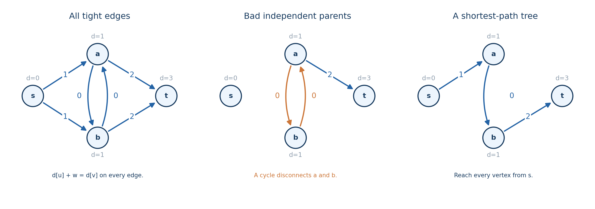

# Chapter 3 Dijkstra 进阶与最短路树

你已经会在非负权图上跑 Dijkstra。现在把题目改一下：从 $s$ 到 $t$，途中可以免费通过一条边，问最小费用。

这时直接把原图某条边改为零，再跑一次，当然能做，但枚举哪条边免费需要重复求解。更关键的问题是：走到同一个顶点以后，“免费机会还在”和“已经用过”是两种不同情况。只记录这个点的一个最小距离，会把影响后续选择的信息丢掉。

这正是 Dijkstra 进阶题经常出现的变化。算法的堆未必需要改，真正需要重新考虑的是：一个节点表示什么，哪些转移合法，以及距离求完以后还想保留什么信息。

本章先重新看一遍定型证明，再讨论多源、反图、状态图和区间建图，最后重点解释紧边图与最短路树。除重标权一节外，边权都假设非负。默认路线允许重复经过点或边，这种路线称为游走；如果不能重复顶点，会明确说简单路径。例子均为教学示例，不附实现模板或训练题单。

## 1. 扩展算法以前，先抓住定型证明

设有向图有 $n$ 个顶点、$m$ 条边，源点为 $s$，边权为 $w(u,v)\ge0$。无向边可以看成两个方向的转移。

用 $\delta(s,v)$ 表示真实最短距离，$d[v]$ 表示算法当前找到的距离标签。两者含义不同：$\delta$ 是要证明的答案，$d$ 会随着松弛变化。初始化 $d[s]=0$，其他点为无穷；每次选尚未定型、标签最小的点 $u$，确定它的距离，再松弛出边。

核心结论只有一句：**$u$ 被定型时，$d[u]$ 已经等于真实最短距离，后面不会再出现更短的路线。**

每个有限标签都来自一条真实路线，因此始终有

$$
d[v]\ge\delta(s,v).
$$

这意味着算法可能暂时找得不够短，却不可能凭空找到一条比最短路还短的合法路线。

接下来证明当前最小标签已经足够短。假设此前定型的点都正确，取一条从 $s$ 到当前点 $u$ 的最短路径，在上面找第一个尚未定型的点 $x$。若 $x\ne s$，它的前驱 $p$ 已经定型，处理 $p$ 时已松弛 $p\to x$。最短路径的前缀也是最短的，所以这次松弛已经给出 $d[x]=\delta(s,x)$。若 $x=s$，初值同样正确。

从 $x$ 继续走到 $u$，费用不会减少，因为后缀边权非负。于是

$$
\delta(s,x)\le\delta(s,u).
$$

而 $u$ 是当前最小标签，因此

$$
d[u]\le d[x]=\delta(s,x)\le\delta(s,u).
$$

结合开头的 $d[u]\ge\delta(s,u)$，只能全部取等号。这个归纳过程就证明了定型正确。

注意证明只要求非负，没有要求严格为正，所以零权边不影响距离正确性。负边破坏的是“后缀不会使费用更低”这一步。例如 $s\to u$ 权为 $2$，$s\to v$ 权为 $5$，$v\to u$ 权为 $-4$，算法会先把 $u$ 以 $2$ 定型，但真实距离是 $1$。

如果某份实现不标记定型，允许以后再把 $u$ 更新并处理一遍，也不能据此说标准 Dijkstra 可以处理负边；它已经失去了这里的单次定型保证，复杂度也需要重新证明。

### 堆里有旧条目时，什么才算定型

竞赛实现通常不修改堆中已有条目，而是在 $d[v]$ 严格变小时加入一个新条目 $(d[v],v)$。旧条目留在堆里，弹出时再判断。

弹出 $(D,u)$ 后，若 $D\ne d[u]$，说明这个条目记录的是已经被改善掉的旧距离，应直接跳过。只有与当前标签相等的有效条目，才对应上面的定型过程。只在严格改善时入堆，非负权下每个顶点的出边至多被有效处理一次。

有 $m$ 条边就至多有 $m$ 次成功松弛，懒删除堆可能有 $O(m)$ 个条目。允许平行边的一般图，单源时间可写为

$$
O\bigl(n+m+m\log(m+2)\bigr),
$$

图、距离和堆的总空间为 $O(n+m)$。为方便后面给扩展图写复杂度，统一使用稍宽的记号

$$
\mathcal D(N,M)=O\bigl((N+M)\log(N+M+2)\bigr),
$$

其中 $N,M$ 是实际运行图的点数与边数，而不一定是原题给的 $n,m$。

如果只求 $s$ 到 $t$ 的距离，$t$ 的有效条目弹出时就能结束；第一次松弛到 $t$ 时不能结束，那只是找到一条路线。若还要收集所有等长前驱、统计最短路条数，距离定型也不代表这些附加信息已经全部到达，这一点在零权边下尤其重要。

## 2. 先试着把问题拆成几次普通最短路

并非所有附加条件都需要扩状态。有时只要换一个起点、反向走图，或者固定一个特殊步骤，就能把问题拆开。

### 多源：把“选择从哪里出发”放在第一步

给定若干起点 $s_i$，从起点 $s_i$ 出发先付费用 $b_i\ge0$，之后按原图边权通行。目标是求

$$
d[v]=\min_i\{b_i+\delta(s_i,v)\}.
$$

可以建立一个虚拟源 $S$，向每个 $s_i$ 连一条权为 $b_i$ 的边。每条从 $S$ 出发的路线，第一步都对应选择一个起点并支付一次初始费用，剩下的部分就是原图路线。反过来，原问题的每个方案也能补上这条虚拟边，所以费用与可行性都对应。

实现时无需真的建立 $S$。把各起点的标签初始化为 $b_i$，一起放入堆即可；同一顶点有多个初始费用时取最小值。全部 $b_i=0$ 时，就是求每个点到源集合的最近费用，仍只运行一次 Dijkstra。

如果初始费用允许为负，而原图边仍非负，一种方便的解释是给所有 $b_i$ 加同一个常数 $C$，使它们非负。每条候选路线恰好多付一次 $C$，最后统一减去即可。这里加的是一次性的初始费用，不能推广成给每条原边都加常数。

多源数量不超过顶点数时，时间仍可用 $\mathcal D(n,m)$ 表示，空间为 $O(n+m)$。

### 反图：把“所有点到终点”改成“终点到所有点”

如果想知道每个点到固定终点 $t$ 的距离，不必从所有点分别出发。将每条边 $u\to v$ 改成 $v\to u$，权值不变，得到反图。

原图中的一条 $v\leadsto t$ 路线，倒过来就是反图中的 $t\leadsto v$ 路线，而且每条边费用都不变，因此

$$
\delta_G(v,t)=\delta_{G^{\mathrm{rev}}}(t,v).
$$

在反图从 $t$ 跑一次，就得到了所有点到 $t$ 的距离。有向图必须真的反转边的方向；无向图本来就能双向走，不需要另建方向。

### 一次特殊转移：固定中间这一步，前后分别最优

回到开头的免费边问题。先算从 $s$ 出发的距离 $d_s[u]$，再在反图从 $t$ 出发，得到所有点到 $t$ 的距离 $d_t[v]$。

假设特殊操作恰好用在边 $u\to v$ 上，并把这一次通过的费用改为 $g(u,v)\ge0$。如果固定了这一步，最优总费用就是

$$
\boxed{d_s[u]+g(u,v)+d_t[v].}
$$

为什么前后可以直接取各自最短路？任意合法方案在特殊步骤之前都必须从 $s$ 走到 $u$，费用至少是 $d_s[u]$；之后必须从 $v$ 走到 $t$，费用至少是 $d_t[v]$，所以这个式子是下界。反过来，把最短前缀、这一次特殊通过、最短后缀拼起来，就达到这个费用，而且操作只使用了一次。

因此枚举特殊边取最小即可。免费通过对应 $g=0$；如果允许至多一次，再和完全不使用操作的 $d_s[t]$ 比较。无向边要分别考虑两个方向；前缀或后缀不可达的候选直接跳过。

总共两次 Dijkstra，再扫一遍边，时间为 $\mathcal D(n,m)+O(m)$，空间为 $O(n+m)$。

这一步拼接使用的是允许重复顶点的路线模型。最短前缀和最短后缀可能经过同一个原顶点，甚至在普通费用下经过同一条原边；只要特殊操作只在指定的那次通过上使用，仍然是合法游走。如果题目额外要求整个路线为简单路径，就必须重新检查拼接，不能直接沿用上述充分性证明。

这种拆分适合“选定一个分界步骤后，前后互不干扰”的模型。若多个特殊操作共享资源、规定使用顺序，前后普通最短路就可能已经不够了。

## 3. 无法独立拆开时，把影响未来的信息放进状态

还是一次免费通行。到达同一顶点 $v$ 的两条路线，一条更便宜但已用掉机会，另一条稍贵却保留机会，后者有可能在下一条昂贵边上反超。因此它们不能只按当前费用比较后保留一条。

最自然的办法是把节点改成 $(v,b)$，其中 $b=0$ 表示机会未用，$b=1$ 表示机会已用。原边 $u\to v$、权为 $w$，对应三类状态转移：

$$
(u,0)\to(v,0)\text{，费用 }w;
$$

$$
(u,1)\to(v,1)\text{，费用 }w;
$$

$$
(u,0)\to(v,1)\text{，费用 }0.
$$

前两类是正常付费，第三类是这一步使用机会。没有从已用状态回到未用状态的转移，所以不能把机会恢复后再次使用。

从 $(s,0)$ 出发，恰好使用一次就取 $(t,1)$ 的距离，至多一次就取两种终点状态距离的最小值。

这里的正确性要检查两个方向。原问题中的方案可以按照操作发生前后标上 $0/1$，变成状态图路线；状态图路线投影回原图时，只可能从 $0$ 层跨到 $1$ 层一次，每一步也都有原边对应，因此不会产生非法方案。各步费用相同，最短距离自然相同。

状态数为 $2n$，转移数为 $3m$，时间为 $\mathcal D(2n,3m)$，空间为 $O(n+m)$。它与上一节枚举特殊边的方法解决的是同一模型；枚举法利用了只有一个分界的特点，分层法则更容易扩展到多次机会。

### 怎么判断还缺哪个状态维度

可以对自己提出一个具体问题：两条路线到达同一状态以后，接下来可选的动作和这些动作的费用，是否完全一样？若不一样，就还不能把它们合并。

| 会影响后续选择的信息 | 常见状态 | 为什么不能省掉 |
| --- | --- | --- |
| 已用或剩余次数 | $(v,k)$ | 后续操作是否还能使用不同 |
| 走过步数模 $q$ | $(v,r)$ | 同一顶点在不同余数下的合法终点或动作不同 |
| 当前交通方式、模式 | $(v,\text{mode})$ | 能走的边和切换费用不同 |
| 上一步方向 | $(v,\text{dir})$ | 下一步是否转弯、转弯费多少不同 |
| 已匹配的有限自动机状态 | $(v,\text{state})$ | 后续边标签能否组成合法序列不同 |

比如转弯收费时，从南边到达 $v$ 和从西边到达 $v$，即使当前费用相同，下一步向北走的费用也可能不同。缺少入方向，就无法仅由当前节点决定下一步费用。

额外维度有 $K$ 种时，常见规模是 $O(nK)$ 个点、$O(mK)$ 条边，但还要数清楚切换状态等额外转移。算法复杂度使用状态图的实际规模，不能仍套原图的 $n,m$。

### 有些不同状态能否继续合并

可以，但需要更强的比较依据。例如在同一顶点，一个方案费用不高于另一个、资源也不少，而且资源更多不会增加未来费用或带来限制。那么后者的任意后续方案，都能由前者照做且不更贵，后者就可以删除。

这称为支配，但名称不等于证明。真正要说明的是：保留状态能模拟被删状态的所有未来选择。若一种到达更便宜却资源更少，另一种更贵却资源更多，通常就互不支配，需要同时保留。只给每个原顶点一个距离，正是漏掉了这层区别。

> **练习（估算 CF 难度）**：[Paired Payment](https://codeforces.com/problemset/problem/1486/E)（约 2100）；[Minimum Path](https://codeforces.com/problemset/problem/1473/E)（约 2300）。

## 4. 边太多时，先压缩转移，再运行 Dijkstra

另一类问题的状态已经很清楚，瓶颈却在边数。例如顶点编号为 $1,\ldots,n$，一次操作允许从点 $v$ 以费用 $w\ge0$ 到达区间 $[l,r]$ 中任意点。

直接把 $v$ 向区间内每个点连边，一次操作可能生成 $\Theta(n)$ 条边，$q$ 次就是 $\Theta(nq)$。这些边的费用、起点和目标范围有大量重复，可以让它们共享一段通行结构。

建立两套线段树辅助节点，叶子对应原顶点，两套内部节点彼此独立：

- 出树的结构边从父区间指向子区间，权为零。进入某个区间节点后，只能向下到达该区间的原顶点。
- 入树的结构边从子区间指向父区间，权为零。原顶点可以向上到达包含它的区间节点。

如果叶子直接共用原顶点，方向已经足够；若使用独立叶子副本，连接原顶点时也必须分别遵循出树向原顶点、原顶点向入树的方向。

把 $[l,r]$ 拆成 $O(\log n)$ 个标准线段树区间。点到区间操作只需从 $v$ 向这些出树节点各连一条权为 $w$ 的边；区间到点操作则从这些入树节点各向目标点连一条权为 $w$ 的边。

为什么非要两套方向？如果把一棵树的父子结构边都设成双向，原顶点就可以免费向上走到公共祖先，再免费向下到其他原顶点，凭空得到题目没有允许的转移。

### 辅助图不能多给路线，也不能少给路线

对原来允许的一次点到区间转移 $v\to x$，覆盖区间中恰好有一个标准节点包含 $x$。先付 $w$ 到这个出树节点，再沿零边下降到 $x$，总费用不变。区间到点同理，先从 $x$ 沿入树上升，再付 $w$ 到目标。

反过来，考察新图路线里两个连续出现的原顶点，中间只经过辅助节点。这一段若进入出树，只能向下走到操作所指定区间中的某个原顶点；若先进入入树，只能向上到达包含出发点的区间，再通过某个操作边离开到目标原顶点。内部节点没有混接，因此不会绕到未授权的目标。

把每段辅助路线压回一次原转移，就得到原题中的合法路线，费用也逐段相同。两方向都成立，才能保证最短路没有被辅助节点改变。普通点到点边直接保留即可。

每套树有 $O(n)$ 个节点与结构边，$q$ 次操作一共增加 $O(q\log n)$ 条边。如果还保留 $m$ 条普通边，新图规模为

$$
N=O(n),\qquad M=O(n+m+q\log n).
$$

建图的时间、空间为 $O(n+m+q\log n)$，然后运行 $\mathcal D(N,M)$ 的最短路。

区间到区间操作也能类似处理：给这次操作建立一个专属中转点，源区间的入树覆盖节点用零边进入它，再从它以费用 $w$ 进入目标区间的出树覆盖节点。这样统一费用只支付一次，每次操作增加 $O(\log n)$ 条边和一个节点，节点数也要计入新增的 $O(q)$。

线段树在这里负责共享邻接关系，并不是拿它查询当前最短距离。是否能优化，取决于转移集合有没有这种可共享的结构。

> **练习（估算 CF 难度）**：[Legacy](https://codeforces.com/problemset/problem/786/B)（约 2300；2017；区间结构练习）。

## 5. 距离求出来以后，把所有“仍可最优地走”的边留下

从这里开始，$d[v]$ 都表示已经求完的最短距离。固定源点 $s$，只考虑从它可达的顶点。一条边 $u\to v$ 若满足

$$
\boxed{d[u]+w(u,v)=d[v],}
$$

就称为紧边。它的含义很直接：先最优地到达 $u$，再经过这条边，仍然是最优地到达 $v$。所有可达点与紧边构成紧边图 $H$。

最短路线上的每条边都是紧边。因为若某个中间点之前的前缀不最短，就可以替换成更短前缀，使整条路线更短，和最优性矛盾。

反过来，从 $s$ 出发，沿紧边走到某个终点，即使重复经过零权环，总费用也会逐项相消：

$$
\sum_{(u,v)\text{ 沿路线}}w(u,v)
=\sum(d[v]-d[u])
=d[\text{终点}]-d[s]
=d[\text{终点}].
$$

因此，从源点出发的紧边游走全部是最短游走。紧边图保存了所有最短选择；稍后要讲的最短路树，只从中挑出足够保留源点距离的一部分。

### 如果只关心到某个目标的最短路线

再求每个点到 $t$ 的距离 $d_t$。边 $u\to v$ 位于某条最短 $s\leadsto t$ 游走上，当且仅当前后距离有限，且

$$
d_s[u]+w(u,v)+d_t[v]=d_s[t].
$$

必要性来自最短路线的前后缀都必须最短；充分性来自把最短前缀、该边和最短后缀拼起来，恰好达到 $d_s[t]$。

零权边下要保留“游走”这个词。例如 $s\to t$ 权为 $1$，$s\to u$、$u\to s$ 权为 $0$。边 $s\to u$ 满足这个等式，它属于最短游走 $s\to u\to s\to t$，但不属于任何简单的 $s\leadsto t$ 路径。

严格正权时，最短游走不可能包含环，因为删环会严格降低费用，所以这时等式也就刻画了最短简单路径上的边。允许零权以后，这两个结论不能混用。

### 紧边图什么时候是 DAG

若所有边权严格为正，紧边总满足 $d[u]<d[v]$。沿每条边距离都严格增加，不可能形成有向环，按距离递增就是一个拓扑序。

若只要求非负，紧边环上的权值之和等于沿环的距离差之和，也就是零。每条边又非负，所以环上的每条边都只能为零，环内顶点距离也相同。距离只能排好不同距离层，却排不出同层内部的先后依赖。

对紧边图求强连通分量后，分量内部的边都是零权，缩点图是 DAG。这个结构可以帮助处理分量之间的依赖，但不能不加分析就把每个分量的全部内部信息压成一个数。

### 为什么零权边会让最短路计数出错

正权下，可以按距离顺序传播计数。设 $\operatorname{cnt}[v]$ 为从 $s$ 到 $v$ 的最短路线条数，令 $\operatorname{cnt}[s]=1$，沿紧边做

$$
\operatorname{cnt}[v]
=\sum_{u\to v\text{ 为紧边}}\operatorname{cnt}[u].
$$

每条路线都有唯一的最后一条边，因此按最后一条边分类不会漏算；拓扑顺序保证所有前驱计数都已完成。平行边若算不同路线，要逐条计数；若只按节点序列区分，就还要处理重复边。

零权下，即使没有环，Dijkstra 的弹出顺序也不一定满足依赖。例如

$$
s\to a:0,\quad s\to b:0,\quad b\to a:0,\quad a\to t:1.
$$

从 $s$ 出发后，$a,b$ 距离都为零。如果先处理 $a$，它以当前计数 $1$ 向 $t$ 传播；之后处理 $b$，又给 $a$ 增加一种到达方式，但 $a$ 不会因为计数变化自动重新处理。$t$ 就漏掉了路线 $s\to b\to a\to t$。

可行的修复是先把距离求完，建立紧边图。若这个图无环，就按真正的拓扑序计数。若相关紧边图有环，而且该环能从 $s$ 到达、又能通向目标，那么可以绕零权环任意多次，最短游走数就是无穷。

如果题目要求简单最短路径，数量仍然有限，但零权分量内部会涉及一般的简单路径选择，不能缩成一个点后就默认它只有一种穿过方式。距离可定型，不等于计数和所有附加信息都能按同一顺序传播。

## 6. 最短路树：边都紧还不够，必须真的连成树

设 $R$ 是从源点 $s$ 可达的顶点集合。我们希望从原图挑出 $|R|-1$ 条有向边，组成以 $s$ 为根、向外可达所有 $R$ 中顶点的树，并且树上从 $s$ 到每个 $v$ 的费用仍为 $d[v]$。这就是最短路树；不可达点不放进这棵树，所以边数不一定是 $n-1$。

如果一棵根向树的每条边都紧，根到某个节点的费用就能像上一节那样逐项相消，自动等于最短距离。反过来，最短路树的每条父边也必须紧。因此可以把问题改写成：在紧边图中，选一棵覆盖所有可达点的根向树。

这里“选一棵树”不是可省略的条件。看下面的例子，所有六条边都满足紧边等式，但如果让 $a,b$ 互相当父亲，仍然无法从 $s$ 到达它们。

图中 $d[a]=d[b]=1$，两条相反方向的零边都紧。局部检查每个点“有一条紧入边”没有问题，但它们一起构成了环。这就是正权与非负权在选父边时的重要差别：正权紧前驱一定距离更小，零权紧前驱可能与自己同距。

### 方法一：松弛严格改善时，记录是从谁来的

运行 Dijkstra 时，若已经有效弹出的点 $u$ 通过边 $e=(u,v)$ 严格降低了 $d[v]$，就把 $u$ 记为 $v$ 的父亲，把 $e$ 记为它的父边。最终保留每个点最后一次严格改善时的记录。

为什么这些父边不成环？最后一次改善 $v$ 时，父节点 $u$ 已经定型，而 $v$ 还没有定型；否则已经确定正确的 $d[v]$ 不可能再被严格降低。所以最终父亲的定型顺序一定早于儿子。反向沿父边走，定型顺序严格减小，不可能回到原点。

每个可达非源点第一次从无穷变成有限时都会获得父边，之后只会更新父边；源点不会被非负路线严格改善，因此它是唯一没有父亲的可达点。父边关系无环，沿父亲向上最终只能到达源点。

最后一次改善时有 $d[v]=d[u]+w(u,v)$，父亲的距离已经固定，儿子此后也没有再改善，所以最终父边仍紧。无环、根可达、边紧三点合起来，证明它是最短路树。

这个方法允许零权边，因为防环依据是定型先后，而不是距离严格增加。不要在相等距离时随意把一个已定型点的父亲改成后来的同距点，否则刚才的顺序保证就消失了。需要输出原边时，应记录边编号，不能只记录父节点，因为平行边可能不同。

### 方法二：距离求完，在紧边图里搜一遍

如果不想让父边记录与 Dijkstra 的平局处理纠缠，可以先求距离，再从 $s$ 在紧边图中做 DFS 或 BFS。第一次发现一个顶点时，把发现它的边设为父边。

每个可达点都有一条最短路径，路径上的边全都紧，所以搜索能够到达所有可达点。首次发现边构成搜索树，而树边全紧，所以得到的就是最短路树。额外时间为 $O(n+m)$，标记空间为 $O(n)$；紧边也可以在扫描原边时直接判断，不必另存一份完整图。

若希望在费用最短的前提下，到每个点还尽可能少走边，直接在紧边图上 BFS 即可：把每条紧边都看成单位长度，得到最少跳数 $h[v]$。BFS 父边满足 $h[v]=h[u]+1$，既保证无环，又同时保留最短费用和最少边数。

也可以一次运行按 $(\text{费用},\text{跳数})$ 字典序比较的 Dijkstra，每次扩展增加 $(w,1)$。但先算费用、再在紧边图 BFS，把两个优化目标分开，通常更容易检查。

### 最短路树和最小生成树到底差在哪

看无向三角形：$s-a$、$s-b$ 的权都为 $2$，$a-b$ 的权为 $1$。源点到 $a,b$ 的最短距离都为 $2$，所以最短路树必须保留从 $s$ 出发的两条边，总权为 $4$。

最小生成树则会保留一条权 $2$ 的边和权 $1$ 的边，总权为 $3$；但这时到另一个点的树上距离变成 $3$，没有保留源点最短距离。

前者要求从指定根到每个点都尽量短，后者要求整棵连通树的边权和尽量小。树形外观相似，不代表优化目标相同。

### 如果在所有最短路树中，还要最小化边权和

先看严格正权。每个非源点必须选一条紧入边，选权值最小的那条，就给出了该点不可避免的最小支出。独立选择以后也一定成树，因为每次沿父亲走，距离都严格减小，不能成环，最终只能停在源点。所以各点的局部最小支出可以同时达到。

非负权下，图中 $a,b$ 都选零权入边就会成环，不能继续逐顶点独立选。不过，这个问题还有一个具体的修复，不必立即转向一般最小树形图算法。

在源点可达的紧边图中求强连通分量。前面已经证明，同一分量内部的边全为零；缩点后得到 DAG。除源点所在分量外，每个分量至少要由一条外部入边进入，否则根不可能到达它。由于权值非负，任何最短路树在这个分量的外部入边上，至少要花掉“进入此分量的最便宜紧边”的权值。

对每个非源分量各选一条最便宜的外部紧入边。缩点图无环，反向追踪所选入边不可能兜圈；每个非源分量又都有入边，最终只能到达源分量，因此这些选择在分量间形成根向树。进入一个分量后，从入边终点出发，在分量内部搜索，选一棵零权的根向搜索树；源分量则以 $s$ 为内部根。强连通保证内部所有点都能到达。

这样各分量只花一次最小进入费用，内部不增加费用，所有顶点连成树且所有边紧，恰好达到上述下界。求完距离后，这部分只需线性的 SCC、扫边和内部搜索。

这个简化依赖两个前提：原权非负，优化的也是这些原权之和。如果另给每条边一套独立的选边成本，零权强连通分量内部的成本未必为零，就不能直接使用这条结论。

### 选定一棵树以后，能读出哪些信息

如果题目固定采用你选的这棵树路由，一条树边下方的所有目的地都会经过它，可以用子树大小或子树权重求负载，也可以在树上做倍增、LCA 等查询。

但树上两个非根节点之间的距离未必是原图最短距离。刚才三角形里，树上 $a,b$ 之间费用为 $4$，原图只需 $1$。

删除一条树边后，它的子树只是在当前树中失去根路径；原图里可能有等长替代路线，也可能有更长绕行。新的最短距离不能只靠给子树打个标记求出，还要处理非树边提供的替代结构。树保留的是一组选定的最短路线，不是全部最短选择。

> **练习（估算 CF 难度）**：[Road Reduction](https://atcoder.jp/contests/abc252/tasks/abc252_e)（约 1800）。

## 7. 有负边时，能不能先把边权合法地变成非负

给每条边加一个足够大的常数，看起来能消掉负边，却会改变最优路线，因为经过边数不同的路线增加的费用不同。

例如 $s\to t$ 直接费用为 $3$，另有 $s\to a$ 权为 $-1$、$a\to t$ 权为 $2$。原来两段路线费用为 $1$，更优；每条边都加 $3$ 后，直接路线费用为 $6$，两段路线费用为 $7$，优劣反了。

需要的是一种只按起终点改变总费用的变换。给每个顶点指定势能 $h(v)$，把边权改为

$$
w'(u,v)=w(u,v)+h(u)-h(v).
$$

沿一条 $s\leadsto t$ 路线求和，中间顶点的势能一正一负全部抵消，得到

$$
w'(P)=w(P)+h(s)-h(t).
$$

因此同一起终点的所有路线都增加同一个常数，最短路线的选择不变。只要能保证所有 $w'\ge0$，就能在新权下运行 Dijkstra，最后用

$$
\boxed{d(s,t)=d'(s,t)-h(s)+h(t)}
$$

恢复原距离。这里 $d'$ 表示重标权后的距离。变换还保留对应源点的紧边关系：把 $d'(s,v)=d(s,v)+h(s)-h(v)$ 代入新权的紧边等式，两端势能会消去。

### 满足条件的势能从哪里来

假设整张图没有负环。添加一个虚拟源 $S$，向每个顶点连零权边，用 Bellman–Ford 求出

$$
h(v)=\delta(S,v).
$$

虚拟源使每个顶点可达，没有负环使这些距离有限。最短距离满足

$$
h(v)\le h(u)+w(u,v),
$$

把它移项，正好得到 $w(u,v)+h(u)-h(v)\ge0$，所以重标权以后所有边都非负。

若存在负环，就不可能找到让全图边权都非负的势能。因为把环上的 $w'$ 相加，势能仍会抵消，环总权保持原来的负值；全由非负边组成的环不可能总权为负。

这并不是说图中有任何负环，所有起终点的最短路就都没有定义；它只说明这种全图势能不存在。若只关心某个范围，仍需先确定负环能影响哪些起终点，不能无条件应用全图变换。

实现时把所有原顶点的 Bellman–Ford 初始值设为零，就等价于加入这些虚拟源边。对原边做 $n-1$ 轮松弛，再用第 $n$ 轮检查是否仍可改善；仍有改善说明存在负环。最坏时间为 $O(nm)$。

势能只需求一次，之后可复用于各个源点，这就是 Johnson 方法的核心。若需要 $k$ 个源点，使用本章的懒删除堆，时间可以写为

$$
O(nm+n+m)+k\,\mathcal D(n,m).
$$

依次处理各源而不保留全部结果时，工作空间为 $O(n+m)$；保存所有答案则另需 $O(kn)$。对单源问题，先运行一次 Bellman–Ford 再运行一次 Dijkstra，通常没有因为这次变换自动变得更划算；它的价值主要在于势能可重复使用。

> **练习（估算 CF 难度）**：[Skiing](https://atcoder.jp/contests/abc237/tasks/abc237_e)（约 2000）。

## 8. 目标不是边权和时，检查同一个证明还能不能成立

有些问题也能用优先队列定型，但路线代价不是边权之和。例如要求最小化沿途最大边权：

$$
B(P)=\max_{e\in P}w(e),\qquad w(e)\ge0.
$$

从当前点 $u$ 经过权为 $w$ 的边，到达下一点的候选值是

$$
\max(d[u],w).
$$

源点设为零，其他点设为无穷，仍然优先处理标签最小的点。这里为什么能定型？一条路线前缀的最大边权不可能超过整条路线的最大边权；把一个更优的前缀拿来走同一条边，得到的最大值也不会更差。因此沿着一条最优路线看第一个未定型点，仍然能得到第 1 节的夹逼证明。

把这两个条件写得一般一些。设一条边 $e$ 的扩展把当前标签 $x$ 变为 $F_e(x)$，标签可以按统一的全序比较。需要检查

$$
x\le y\Longrightarrow F_e(x)\le F_e(y),
\qquad F_e(x)\ge x.
$$

第一个条件说，更好的前缀走相同下一步，不会反而变坏；所以同一状态只保留最好前缀有意义。第二个条件说，继续走不会降低当前标签；所以未来不会从一个更差的未处理标签出发，突然得到更好的答案。

再加上状态已经完整记录未来所需信息、源点初值正确、标签能被实际路线达到，就可以沿用最小标签定型的证明。普通非负加法对应 $F_e(x)=x+w$，最小化最大边权对应 $F_e(x)=\max(x,w)$，两者都满足这两个条件。

最大化沿途最小容量的最宽路，则把方向反过来：候选值取 $\min(d[u],w)$，从大标签到小标签定型，源点容量取 $+\infty$。它同样依赖“更好的前缀不会在相同扩展下吃亏”和“延伸不会改善瓶颈”这两点。

不能只看到转移里有 `min` 或 `max` 就判断能套 Dijkstra。如果未来还受未记录资源影响，或者更优标签不保证后续也更优，就需要补状态或维护多个互不支配的标签。推广的是定型证明，不是仅把加号换成另一个符号。

## 9. 回到实现时，应检查哪几件事

最短路模型里最容易漏掉的条件，可以沿着本章的推理检查：

| 你做的变换或附加工作 | 需要确认的具体问题 |
| --- | --- |
| 多源初始化 | 初始费用是否恰好支付一次，同点多个初值是否取最小 |
| 反图 | 每条有向边是否真的反向，权值是否保留 |
| 枚举一次特殊步骤 | 前后能否独立拼接，要求恰好还是至多一次 |
| 扩展状态 | 合并到同一状态后，未来动作和费用是否完全相同 |
| 线段树建图 | 辅助边方向是否正确，是否多给了原题没有的路线 |
| 最短路计数 | 紧边依赖是否无环，使用的顺序是否真是拓扑序 |
| 选择父边 | 每条边紧之外，能否保证无环且都从根可达 |
| 势能重标权 | 势能是否存在，新权是否非负，还原公式是否正确 |

数值范围也应按实际状态图重新估计。若非负边权都不超过 $W$，原图存在简单最短路径，最多经过 $n-1$ 条边，所以有限距离不超过 $(n-1)W$。扩状态后应换成实际节点数；状态路径虽然不重复状态，投影回原图却可能重复顶点。

INF 要大于全部可能答案，同时避免计算 INF 加边权。有限数相加、特殊费用、势能差、多维标签中的每个分量也都可能溢出，必要时使用更宽的中间类型，不能只检查最后存入的距离。

如果边权或距离是浮点数，紧边中的数学等式不能直接理解成机器上的完全相等；随意加统一的 epsilon 又可能改变紧边图的连通与成环结构。应根据题目的数值范围和误差要求设计比较，能够使用整数或精确变换时优先使用。

做 Dijkstra 扩展时，可以始终抓住两条线：节点和边是否准确描述了原题方案，以及最小标签被取出时是否已经不可能再改善。距离求对以后，计数、选树和其他优化目标仍要各自补上证明，不能把“距离已经定型”当作所有信息都已完成。

## 参考资料

正文中的状态图双向对应、零权反例及选树证明在本章独立展开。下列资料分别可用于对照势能重标权和记录父边的实际用法；不把本章进一步讨论的零权边情况归因于未涉及它们的题解。

1. [MIT 6.046J — Lecture 11: All-Pairs Shortest Paths](https://ocw.mit.edu/courses/6-046j-design-and-analysis-of-algorithms-spring-2015/312f4a419009b58f8147b75975db4347_MIT6_046JS15_lec11.pdf)。Johnson 部分解释了势能差为何在路线求和时抵消、Bellman–Ford 如何构造势能，以及负环为何阻止全图非负重标权。讲义使用的部分复杂度基于 Fibonacci 堆，本章按懒删除二叉堆另计。
2. [AtCoder ABC252 E — Road Reduction，官方解说](https://atcoder.jp/contests/ABC252/editorial/4005?lang=en)。可对照在 Dijkstra 中记录到达每个点的最后一条边，从而保留源点最短距离的用法。本章对同距父边、零权环和最小总权最短路树的分析，是额外展开。
