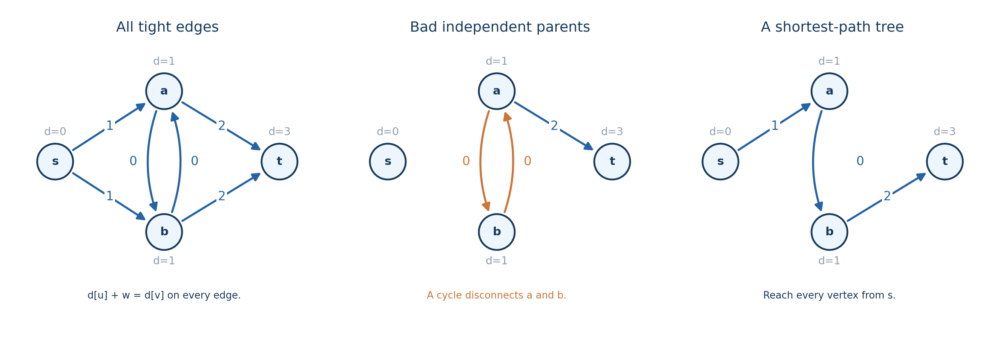

# Chapter 3 Dijkstra 进阶与最短路树

你已经会在非负权图上跑 Dijkstra。现在把题目改一下：从 $s$ 到 $t$，途中可以免费通过一条边，问最小费用。

枚举免费边会重复求最短路。关键是同一顶点处，免费机会已用与未用的未来不同，只存一个距离会丢失状态。

Dijkstra 扩展通常先改状态含义与合法转移，再判断距离之外还须保留什么信息。

本章依次讲定型证明、多源、反图、状态图、区间建图、紧边与最短路树。除重标权节外均假设非负权。默认允许重复点边，称为游走；简单路径会明确注明。例子为教学示例，不附模板或训练题单。

## 1. 扩展算法以前，先抓住定型证明

设有向图有 $n$ 个顶点、$m$ 条边，源点为 $s$，边权为 $w(u,v)\ge0$。无向边可以看成两个方向的转移。

$\delta(s,v)$ 为真实最短距离，$d[v]$ 为松弛中的标签。初始化 $d[s]=0$，其余无穷；每次选未定型且标签最小的 $u$，确定距离并松弛出边。

核心结论只有一句：**$u$ 被定型时，$d[u]$ 已经等于真实最短距离，后面不会再出现更短的路线。**

每个有限标签都来自一条真实路线，因此始终有

$$
d[v]\ge\delta(s,v).
$$

这意味着算法可能暂时找得不够短，却不可能凭空找到一条比最短路还短的合法路线。

归纳假设此前定型均正确。取 $s$ 到 $u$ 的最短路径，其首个未定型点为 $x$。若 $x\ne s$，前驱 $p$ 已定型，且最短路前缀最短，松弛已给出 $d[x]=\delta(s,x)$；$x=s$ 时初值正确。

从 $x$ 继续走到 $u$，费用不会减少，因为后缀边权非负。于是

$$
\delta(s,x)\le\delta(s,u).
$$

而 $u$ 是当前最小标签，因此

$$
d[u]\le d[x]=\delta(s,x)\le\delta(s,u).
$$

结合开头的 $d[u]\ge\delta(s,u)$，只能全部取等号。这个归纳过程就证明了定型正确。

证明只要求非负，允许零权。负边使后缀可能降费：$s\to u$ 为 $2$，$s\to v$ 为 $5$，$v\to u$ 为 $-4$，会先将 $u$ 按 $2$ 定型，实际距离却为 $1$。

允许负边下重新处理已定型点，便失去单次定型保证，须另证正确性与复杂度。

### 堆里有旧条目时，什么才算定型

竞赛实现通常不修改堆中已有条目，而是在 $d[v]$ 严格变小时加入一个新条目 $(d[v],v)$。旧条目留在堆里，弹出时再判断。

弹出 $(D,u)$ 时，$D\ne d[u]$ 即旧标签，直接跳过。仅严格改善时入堆，则非负权下每点出边至多有效处理一次。

有 $m$ 条边就至多有 $m$ 次成功松弛，懒删除堆可能有 $O(m)$ 个条目。允许平行边的一般图，单源时间可写为

$$
O\bigl(n+m+m\log(m+2)\bigr),
$$

图、距离和堆的总空间为 $O(n+m)$。为方便后面给扩展图写复杂度，统一使用稍宽的记号

$$
\mathcal D(N,M)=O\bigl((N+M)\log(N+M+2)\bigr),
$$

其中 $N,M$ 是实际运行图的点数与边数，而不一定是原题给的 $n,m$。

只求 $s$ 到 $t$ 距离，可在 $t$ 有效出堆时结束，不能在首次松弛时结束。等长前驱、路线计数未必同步收齐，零权边尤其如此。

## 2. 先试着把问题拆成几次普通最短路

并非所有附加条件都需要扩状态。有时只要换一个起点、反向走图，或者固定一个特殊步骤，就能把问题拆开。

### 多源：把“选择从哪里出发”放在第一步

给定若干起点 $s_i$，从起点 $s_i$ 出发先付费用 $b_i\ge0$，之后按原图边权通行。目标是求

$$
d[v]=\min_i\{b_i+\delta(s_i,v)\}.
$$

建虚拟源 $S$，以费用 $b_i$ 连向 $s_i$。新图首步恰对应选择起点并支付初始费，余下为原路线；反向补上首边也成立，费用与可行性双向对应。

无须实建 $S$：各起点初始化为 $b_i$ 并入堆，同顶点取最小初值。全为零时即到源集合的最近费用，只跑一次 Dijkstra。

初始费可负而原边非负时，给所有 $b_i$ 加常数 $C$ 至非负，答案再减 $C$。每条路线仅多付一次，不能推广为每条原边加常数。

多源数量不超过顶点数时，时间仍可用 $\mathcal D(n,m)$ 表示，空间为 $O(n+m)$。

- [CF938 D — Buy a Ticket](https://codeforces.com/problemset/problem/938/D)

### 反图：把“所有点到终点”改成“终点到所有点”

如果想知道每个点到固定终点 $t$ 的距离，不必从所有点分别出发。将每条边 $u\to v$ 改成 $v\to u$，权值不变，得到反图。

原图中的一条 $v\leadsto t$ 路线，倒过来就是反图中的 $t\leadsto v$ 路线，而且每条边费用都不变，因此

$$
\delta_G(v,t)=\delta_{G^{\mathrm{rev}}}(t,v).
$$

在反图从 $t$ 跑一次，就得到了所有点到 $t$ 的距离。有向图必须真的反转边的方向；无向图本来就能双向走，不需要另建方向。

- [ABC035 D — トレジャーハント](https://atcoder.jp/contests/abc035/tasks/abc035_d)

### 一次特殊转移：固定中间这一步，前后分别最优

回到开头的免费边问题。先算从 $s$ 出发的距离 $d_s[u]$，再在反图从 $t$ 出发，得到所有点到 $t$ 的距离 $d_t[v]$。

假设特殊操作恰好用在边 $u\to v$ 上，并把这一次通过的费用改为 $g(u,v)\ge0$。如果固定了这一步，最优总费用就是

$$
\boxed{d_s[u]+g(u,v)+d_t[v].}
$$

任意方案的前后段分别至少花 $d_s[u]$、$d_t[v]$，故该式是下界；拼接最短前缀、指定的特殊通过、最短后缀即可达到，操作只用一次。

因此枚举特殊边取最小即可。免费通过对应 $g=0$；如果允许至多一次，再和完全不使用操作的 $d_s[t]$ 比较。无向边要分别考虑两个方向；前缀或后缀不可达的候选直接跳过。

总共两次 Dijkstra，再扫一遍边，时间为 $\mathcal D(n,m)+O(m)$，空间为 $O(n+m)$。

拼接依赖游走模型：最短前后缀可能重复原顶点或原边，但特殊操作只在指定的那次通过生效。若要求整条路线简单，须另证拼接合法。

这种拆分适合“选定一个分界步骤后，前后互不干扰”的模型。若多个特殊操作共享资源、规定使用顺序，前后普通最短路就可能已经不够了。

- [CSES — Flight Discount](https://cses.fi/problemset/task/1195)

## 3. 无法独立拆开时，把影响未来的信息放进状态

到同一 $v$，更便宜但已用机会的路线，可能输给稍贵但保留机会的路线，因此不能只留当前费用最小者。

最自然的办法是把节点改成 $(v,b)$，其中 $b=0$ 表示机会未用，$b=1$ 表示机会已用。原边 $u\to v$、权为 $w$，对应三类状态转移：

$$
(u,0)\to(v,0)\text{，费用 }w;
$$

$$
(u,1)\to(v,1)\text{，费用 }w;
$$

$$
(u,0)\to(v,1)\text{，费用 }0.
$$

前两类是正常付费，第三类是这一步使用机会。没有从已用状态回到未用状态的转移，所以不能把机会恢复后再次使用。

从 $(s,0)$ 出发，恰好使用一次就取 $(t,1)$ 的距离，至多一次就取两种终点状态距离的最小值。

原方案按操作前后标 $0/1$，得到等费用状态路线；反向投影时每步有原边，且只能由 $0$ 层跨 $1$ 层一次。因此双向对应，最短距离相同。

状态数为 $2n$，转移数为 $3m$，时间为 $\mathcal D(2n,3m)$，空间为 $O(n+m)$。它与上一节枚举特殊边的方法解决的是同一模型；枚举法利用了只有一个分界的特点，分层法则更容易扩展到多次机会。

### 怎么判断还缺哪个状态维度

判断能否合并状态：到达后可选动作及其费用是否完全相同？不同就须补信息。

| 会影响后续选择的信息 | 常见状态 | 为什么不能省掉 |
| --- | --- | --- |
| 已用或剩余次数 | $(v,k)$ | 后续操作是否还能使用不同 |
| 走过步数模 $q$ | $(v,r)$ | 同一顶点在不同余数下的合法终点或动作不同 |
| 当前交通方式、模式 | $(v,\text{mode})$ | 能走的边和切换费用不同 |
| 上一步方向 | $(v,\text{dir})$ | 下一步是否转弯、转弯费多少不同 |
| 已匹配的有限自动机状态 | $(v,\text{state})$ | 后续边标签能否组成合法序列不同 |

比如转弯收费时，从南边到达 $v$ 和从西边到达 $v$，即使当前费用相同，下一步向北走的费用也可能不同。缺少入方向，就无法仅由当前节点决定下一步费用。

额外维度有 $K$ 种时，常见规模为 $O(nK)$ 点、$O(mK)$ 边，还须计入状态切换。复杂度按实际状态图计算。

### 有些不同状态能否继续合并

可以，但需要更强的比较依据。例如在同一顶点，一个方案费用不高于另一个、资源也不少，而且资源更多不会增加未来费用或带来限制。那么后者的任意后续方案，都能由前者照做且不更贵，后者就可以删除。

支配须证明保留状态能模拟被删状态的全部后续选择且不更贵。费用更低但资源更少时，通常互不支配，须同时保留。

> **练习（估算 CF 难度）**：[Paired Payment](https://codeforces.com/problemset/problem/1486/E)（约 2100）；[Minimum Path](https://codeforces.com/problemset/problem/1473/E)（约 2300）。

## 4. 边太多时，先压缩转移，再运行 Dijkstra

另一类问题的状态已经很清楚，瓶颈却在边数。例如顶点编号为 $1,\ldots,n$，一次操作允许从点 $v$ 以费用 $w\ge0$ 到达区间 $[l,r]$ 中任意点。

点向区间逐点连边，一次可达 $\Theta(n)$ 边，$q$ 次为 $\Theta(nq)$。起点、费用与目标范围重复，可共享辅助结构。

建立两套线段树辅助节点，叶子对应原顶点，两套内部节点彼此独立：

- 出树的结构边从父区间指向子区间，权为零。进入某个区间节点后，只能向下到达该区间的原顶点。
- 入树的结构边从子区间指向父区间，权为零。原顶点可以向上到达包含它的区间节点。

如果叶子直接共用原顶点，方向已经足够；若使用独立叶子副本，连接原顶点时也必须分别遵循出树向原顶点、原顶点向入树的方向。

把 $[l,r]$ 拆成 $O(\log n)$ 个标准线段树区间。点到区间操作只需从 $v$ 向这些出树节点各连一条权为 $w$ 的边；区间到点操作则从这些入树节点各向目标点连一条权为 $w$ 的边。

若一套树父子边双向，原顶点可免费上升再下降到其他点，产生原题未允许的转移，因此须两套方向。

### 辅助图不能多给路线，也不能少给路线

对原来允许的一次点到区间转移 $v\to x$，覆盖区间中恰好有一个标准节点包含 $x$。先付 $w$ 到这个出树节点，再沿零边下降到 $x$，总费用不变。区间到点同理，先从 $x$ 沿入树上升，再付 $w$ 到目标。

反向看相邻两个原顶点间的辅助路线：进入出树后只能下降到指定区间；先走入树则只能上升到包含起点的区间，再经操作边到目标。两套内部节点独立，不会产生额外目标。

把每段辅助路线压回一次原转移，就得到原题中的合法路线，费用也逐段相同。两方向都成立，才能保证最短路没有被辅助节点改变。普通点到点边直接保留即可。

每套树有 $O(n)$ 个节点与结构边，$q$ 次操作一共增加 $O(q\log n)$ 条边。如果还保留 $m$ 条普通边，新图规模为

$$
N=O(n),\qquad M=O(n+m+q\log n).
$$

建图的时间、空间为 $O(n+m+q\log n)$，然后运行 $\mathcal D(N,M)$ 的最短路。

区间到区间：为操作建专属中转点，源入树覆盖节点以零边进入，中转点以费用 $w$ 连目标出树覆盖节点。费用只付一次，每次增加 $O(\log n)$ 边、一点，计入新增 $O(q)$ 点。

线段树在这里负责共享邻接关系，并不是拿它查询当前最短距离。是否能优化，取决于转移集合有没有这种可共享的结构。

> **练习（估算 CF 难度）**：[Legacy](https://codeforces.com/problemset/problem/786/B)（约 2300；2017；区间结构练习）。

## 5. 距离求出来以后，把所有“仍可最优地走”的边留下

从这里开始，$d[v]$ 都表示已经求完的最短距离。固定源点 $s$，只考虑从它可达的顶点。一条边 $u\to v$ 若满足

$$
\boxed{d[u]+w(u,v)=d[v],}
$$

就称为紧边。它的含义很直接：先最优地到达 $u$，再经过这条边，仍然是最优地到达 $v$。所有可达点与紧边构成紧边图 $H$。

最短路线上的每条边都是紧边。因为若某个中间点之前的前缀不最短，就可以替换成更短前缀，使整条路线更短，和最优性矛盾。

反过来，从 $s$ 出发，沿紧边走到某个终点，即使重复经过零权环，总费用也会逐项相消：

$$
\sum_{(u,v)\text{ 沿路线}}w(u,v)
=\sum(d[v]-d[u])
=d[\text{终点}]-d[s]
=d[\text{终点}].
$$

所以从源点沿紧边的游走全部最短。紧边图保留全部最短选择；最短路树只选其中足以保留源点距离的一部分。

### 如果只关心到某个目标的最短路线

再求每个点到 $t$ 的距离 $d_t$。边 $u\to v$ 位于某条最短 $s\leadsto t$ 游走上，当且仅当前后距离有限，且

$$
d_s[u]+w(u,v)+d_t[v]=d_s[t].
$$

必要性来自最短路线的前后缀都必须最短；充分性来自把最短前缀、该边和最短后缀拼起来，恰好达到 $d_s[t]$。

零权边下要保留“游走”这个词。例如 $s\to t$ 权为 $1$，$s\to u$、$u\to s$ 权为 $0$。边 $s\to u$ 满足这个等式，它属于最短游走 $s\to u\to s\to t$，但不属于任何简单的 $s\leadsto t$ 路径。

正权下删环严格降费，最短游走必简单，该等式也刻画最短简单路径上的边。零权下两种结论须区分。

### 紧边图什么时候是 DAG

若所有边权严格为正，紧边总满足 $d[u]<d[v]$。沿每条边距离都严格增加，不可能形成有向环，按距离递增就是一个拓扑序。

非负紧边环的权和为距离差之和，即零，所以每条边均零、各点同距。距离顺序无法处理同层依赖。

对紧边图求强连通分量后，分量内部的边都是零权，缩点图是 DAG。这个结构可以帮助处理分量之间的依赖，但不能不加分析就把每个分量的全部内部信息压成一个数。

### 为什么零权边会让最短路计数出错

正权下，可以按距离顺序传播计数。设 $\operatorname{cnt}[v]$ 为从 $s$ 到 $v$ 的最短路线条数，令 $\operatorname{cnt}[s]=1$，沿紧边做

$$
\operatorname{cnt}[v]
=\sum_{u\to v\text{ 为紧边}}\operatorname{cnt}[u].
$$

每条路线都有唯一的最后一条边，因此按最后一条边分类不会漏算；拓扑顺序保证所有前驱计数都已完成。平行边若算不同路线，要逐条计数；若只按节点序列区分，就还要处理重复边。

零权下，即使没有环，Dijkstra 的弹出顺序也不一定满足依赖。例如

$$
s\to a:0,\quad s\to b:0,\quad b\to a:0,\quad a\to t:1.
$$

$a,b$ 同距为零。若先处理 $a$，它按计数 $1$ 向 $t$ 传播；随后 $b$ 增加 $a$ 的计数，却不会让它重传，因而漏掉 $s\to b\to a\to t$。

先求距离，再建紧边图。无环则拓扑计数；若从 $s$ 可达且能通向目标的紧边环存在，可绕行任意次，最短游走数无穷。

简单最短路径数虽有限，零权 SCC 内仍涉及一般简单路径选择，不能缩点后默认只有一种穿过方式。距离定型不代表附加信息也已完成。

- [CSES — Investigation](https://cses.fi/problemset/task/1202)

## 6. 最短路树：边都紧还不够，必须真的连成树

设源点可达集合为 $R$。最短路树选 $|R|-1$ 条有向边，构成以 $s$ 为根覆盖 $R$ 的向外树，并保留各点距离 $d[v]$。不可达点不入树，边数未必为 $n-1$。

如果一棵根向树的每条边都紧，根到某个节点的费用就能像上一节那样逐项相消，自动等于最短距离。反过来，最短路树的每条父边也必须紧。因此可以把问题改写成：在紧边图中，选一棵覆盖所有可达点的根向树。

这里“选一棵树”不是可省略的条件。看下面的例子，所有六条边都满足紧边等式，但如果让 $a,b$ 互相当父亲，仍然无法从 $s$ 到达它们。

$d[a]=d[b]=1$，双向零边都紧，但互选父亲会成环。正权紧前驱距离更小，零权紧前驱可能同距，不能仅逐点检查紧入边。

### 方法一：松弛严格改善时，记录是从谁来的

运行 Dijkstra 时，若已经有效弹出的点 $u$ 通过边 $e=(u,v)$ 严格降低了 $d[v]$，就把 $u$ 记为 $v$ 的父亲，把 $e$ 记为它的父边。最终保留每个点最后一次严格改善时的记录。

最后改善 $v$ 时，父亲 $u$ 已定型，$v$ 尚未定型，否则不可能再严格改善。最终父亲定型早于儿子，逆向追踪顺序严格减小，故无环。

非源可达点首次获得有限距离时即有父边，之后只替换；源点不会被非负路线严格改善，是唯一无父亲点。无环保证沿父边最终到源。

最后一次改善时有 $d[v]=d[u]+w(u,v)$，父亲的距离已经固定，儿子此后也没有再改善，所以最终父边仍紧。无环、根可达、边紧三点合起来，证明它是最短路树。

防环靠定型顺序，故允许零权。等长时随意将已定型点改挂到后来的同距点，会破坏保证。输出原边须存边编号，以区分平行边。

### 方法二：距离求完，在紧边图里搜一遍

如果不想让父边记录与 Dijkstra 的平局处理纠缠，可以先求距离，再从 $s$ 在紧边图中做 DFS 或 BFS。第一次发现一个顶点时，把发现它的边设为父边。

每个可达点有全紧边的最短路径，搜索必覆盖它；首次发现边构成树且全紧，故为最短路树。额外时间 $O(n+m)$、标记空间 $O(n)$，也可扫描原边时即时判紧，无须另存图。

若希望在费用最短的前提下，到每个点还尽可能少走边，直接在紧边图上 BFS 即可：把每条紧边都看成单位长度，得到最少跳数 $h[v]$。BFS 父边满足 $h[v]=h[u]+1$，既保证无环，又同时保留最短费用和最少边数。

也可以一次运行按 $(\text{费用},\text{跳数})$ 字典序比较的 Dijkstra，每次扩展增加 $(w,1)$。但先算费用、再在紧边图 BFS，把两个优化目标分开，通常更容易检查。

### 最短路树和最小生成树到底差在哪

看无向三角形：$s-a$、$s-b$ 的权都为 $2$，$a-b$ 的权为 $1$。源点到 $a,b$ 的最短距离都为 $2$，所以最短路树必须保留从 $s$ 出发的两条边，总权为 $4$。

最小生成树则会保留一条权 $2$ 的边和权 $1$ 的边，总权为 $3$；但这时到另一个点的树上距离变成 $3$，没有保留源点最短距离。

前者要求从指定根到每个点都尽量短，后者要求整棵连通树的边权和尽量小。树形外观相似，不代表优化目标相同。

### 如果在所有最短路树中，还要最小化边权和

正权下，每个非源点选最便宜紧入边，即达到逐点必要费用的下界。沿父边距离严格下降，独立选择仍无环且最终到源，因此下界可同时达到。

非负权下，图中 $a,b$ 都选零权入边就会成环，不能继续逐顶点独立选。不过，这个问题还有一个具体的修复，不必立即转向一般最小树形图算法。

在可达紧边图求 SCC，内部边均零，缩点为 DAG。每个非源分量至少需要一条外部入边；原权非负，其进入费用至少为最便宜外部紧入边的权。

各非源分量选最便宜外部紧入边。DAG 无环且各非源分量有入边，反向追踪最终到源分量，形成根向树。各分量以内入边终点为根建零权搜索树，源分量以 $s$ 为根；强连通保证覆盖。

这样各分量只花一次最小进入费用，内部不增加费用，所有顶点连成树且所有边紧，恰好达到上述下界。求完距离后，这部分只需线性的 SCC、扫边和内部搜索。

前提是原权非负，目标也是原权总和。另设独立选边成本时，零权 SCC 内成本未必零，不能套此结论。

### 选定一棵树以后，能读出哪些信息

如果题目固定采用你选的这棵树路由，一条树边下方的所有目的地都会经过它，可以用子树大小或子树权重求负载，也可以在树上做倍增、LCA 等查询。

但树上两个非根节点之间的距离未必是原图最短距离。刚才三角形里，树上 $a,b$ 之间费用为 $4$，原图只需 $1$。

删树边只说明子树在所选树中失去根路径。原图仍可能有等长或更长绕行，新距离须分析非树边；所选树不保留全部最短选择。

> **练习（估算 CF 难度）**：[Road Reduction](https://atcoder.jp/contests/abc252/tasks/abc252_e)（约 1800）。

- [CF545 E — Paths and Trees](https://codeforces.com/problemset/problem/545/E)

## 7. 有负边时，能不能先把边权合法地变成非负

给每条边加一个足够大的常数，看起来能消掉负边，却会改变最优路线，因为经过边数不同的路线增加的费用不同。

例如 $s\to t$ 直接费用为 $3$，另有 $s\to a$ 权为 $-1$、$a\to t$ 权为 $2$。原来两段路线费用为 $1$，更优；每条边都加 $3$ 后，直接路线费用为 $6$，两段路线费用为 $7$，优劣反了。

需要的是一种只按起终点改变总费用的变换。给每个顶点指定势能 $h(v)$，把边权改为

$$
w'(u,v)=w(u,v)+h(u)-h(v).
$$

沿一条 $s\leadsto t$ 路线求和，中间顶点的势能一正一负全部抵消，得到

$$
w'(P)=w(P)+h(s)-h(t).
$$

因此同一起终点的所有路线都增加同一个常数，最短路线的选择不变。只要能保证所有 $w'\ge0$，就能在新权下运行 Dijkstra，最后用

$$
\boxed{d(s,t)=d'(s,t)-h(s)+h(t)}
$$

恢复原距离。这里 $d'$ 表示重标权后的距离。变换还保留对应源点的紧边关系：把 $d'(s,v)=d(s,v)+h(s)-h(v)$ 代入新权的紧边等式，两端势能会消去。

### 满足条件的势能从哪里来

假设整张图没有负环。添加一个虚拟源 $S$，向每个顶点连零权边，用 Bellman–Ford 求出

$$
h(v)=\delta(S,v).
$$

虚拟源使每个顶点可达，没有负环使这些距离有限。最短距离满足

$$
h(v)\le h(u)+w(u,v),
$$

把它移项，正好得到 $w(u,v)+h(u)-h(v)\ge0$，所以重标权以后所有边都非负。

负环上重标权求和时势能抵消，总权仍负，不可能每边均非负。因此存在负环时无全图可行势能。

这只说明全图势能不存在。某对起终点是否受负环影响，还须判断可达范围，不能断言所有最短路均无定义。

实现时把所有原顶点的 Bellman–Ford 初始值设为零，就等价于加入这些虚拟源边。对原边做 $n-1$ 轮松弛，再用第 $n$ 轮检查是否仍可改善；仍有改善说明存在负环。最坏时间为 $O(nm)$。

势能只需求一次，之后可复用于各个源点，这就是 Johnson 方法的核心。若需要 $k$ 个源点，使用本章的懒删除堆，时间可以写为

$$
O(nm+n+m)+k\,\mathcal D(n,m).
$$

逐源处理的工作空间 $O(n+m)$，保存全部答案另需 $O(kn)$。单源先跑 Bellman–Ford 再跑 Dijkstra 通常不省；优势在势能可复用。

> **练习（估算 CF 难度）**：[Skiing](https://atcoder.jp/contests/abc237/tasks/abc237_e)（约 2000）。

### SPFA 补充练习

- [ABC061 D — Score Attack（独立估算 CF 1800）](https://atcoder.jp/contests/abc061/tasks/abc061_d)
- [ABC137 E — Coins Respawn（独立估算 CF 1900）](https://atcoder.jp/contests/abc137/tasks/abc137_e)
- [ABC404 G — Specified Range Sums（独立估算 CF 2300）](https://atcoder.jp/contests/abc404/tasks/abc404_g)
- [CF1131 D — Gourmet choice（独立估算 CF 2000）](https://codeforces.com/problemset/problem/1131/D)
- [ARC015 C — 変わった単位（独立估算 CF 1900）](https://atcoder.jp/contests/arc015/tasks/arc015_3)

## 8. 目标不是边权和时，检查同一个证明还能不能成立

有些问题也能用优先队列定型，但路线代价不是边权之和。例如要求最小化沿途最大边权：

$$
B(P)=\max_{e\in P}w(e),\qquad w(e)\ge0.
$$

从当前点 $u$ 经过权为 $w$ 的边，到达下一点的候选值是

$$
\max(d[u],w).
$$

初始化源为零、其余无穷，按最小标签处理。前缀最大边权不超过整条路线，更优前缀走同一边也不会变差，因此首个未定型点仍满足第 1 节的夹逼证明。

把这两个条件写得一般一些。设一条边 $e$ 的扩展把当前标签 $x$ 变为 $F_e(x)$，标签可以按统一的全序比较。需要检查

$$
x\le y\Longrightarrow F_e(x)\le F_e(y),
\qquad F_e(x)\ge x.
$$

首条件保证更优前缀在相同扩展下不吃亏，可只留最佳标签；次条件保证延伸不降低标签，较差未处理前缀不能突然产生更优结果。

再要求状态包含未来所需信息、初值正确、标签由实际路线达到，即可沿用定型证明。非负加法 $F_e(x)=x+w$ 与瓶颈 $F_e(x)=\max(x,w)$ 均满足条件。

最大化沿途最小容量的最宽路，则把方向反过来：候选值取 $\min(d[u],w)$，从大标签到小标签定型，源点容量取 $+\infty$。它同样依赖“更好的前缀不会在相同扩展下吃亏”和“延伸不会改善瓶颈”这两点。

转移含 `min`、`max` 并不足以套 Dijkstra。未记录资源或更优标签无法保证未来更优时，须补状态或保留多个不受支配标签。推广的是证明。

- [P1396 — 营救](https://www.luogu.com.cn/problem/P1396)
- [ABC192 E — Train](https://atcoder.jp/contests/abc192/tasks/abc192_e)
- [CCO '12 P2 — The Hungary Games](https://dmoj.ca/problem/cco12p2)

## 9. 回到实现时，应检查哪几件事

最短路模型里最容易漏掉的条件，可以沿着本章的推理检查：

| 你做的变换或附加工作 | 需要确认的具体问题 |
| --- | --- |
| 多源初始化 | 初始费用是否恰好支付一次，同点多个初值是否取最小 |
| 反图 | 每条有向边是否真的反向，权值是否保留 |
| 枚举一次特殊步骤 | 前后能否独立拼接，要求恰好还是至多一次 |
| 扩展状态 | 合并到同一状态后，未来动作和费用是否完全相同 |
| 线段树建图 | 辅助边方向是否正确，是否多给了原题没有的路线 |
| 最短路计数 | 紧边依赖是否无环，使用的顺序是否真是拓扑序 |
| 选择父边 | 每条边紧之外，能否保证无环且都从根可达 |
| 势能重标权 | 势能是否存在，新权是否非负，还原公式是否正确 |

按实际状态图估数值范围：原图非负边权至多 $W$ 时，存在至多 $n-1$ 边的简单最短路径，距离至多 $(n-1)W$。扩状态须换实际点数，状态简单路径投影后仍可能重复原点。

INF 须大于所有答案，且不参与加边权。有限距离相加、特殊费用、势能差与多维标签各分量也须查溢出，必要时用宽中间类型。

浮点紧边不能直接用机器精确相等；统一 epsilon 也可能改变连通性与环。按范围和误差要求设计比较，能用整数或精确变换时优先。

扩展先证方案与状态图对应，再证最小标签能定型。距离正确后，计数、选树等目标仍须各自证明。

## 参考资料

以下资料供对照势能与父边记录；正文中的状态对应、零权反例及选树证明另行展开。

1. [MIT 6.046J — Lecture 11: All-Pairs Shortest Paths](https://ocw.mit.edu/courses/6-046j-design-and-analysis-of-algorithms-spring-2015/312f4a419009b58f8147b75975db4347_MIT6_046JS15_lec11.pdf)。Johnson 部分解释了势能差为何在路线求和时抵消、Bellman–Ford 如何构造势能，以及负环为何阻止全图非负重标权。讲义使用的部分复杂度基于 Fibonacci 堆，本章按懒删除二叉堆另计。
2. [AtCoder ABC252 E — Road Reduction，官方解说](https://atcoder.jp/contests/ABC252/editorial/4005?lang=en)。可对照在 Dijkstra 中记录到达每个点的最后一条边，从而保留源点最短距离的用法。本章对同距父边、零权环和最小总权最短路树的分析，是额外展开。
