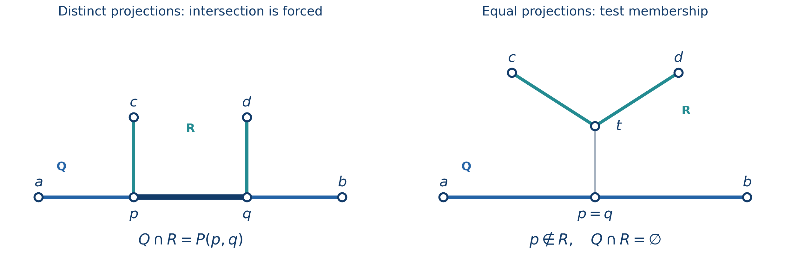
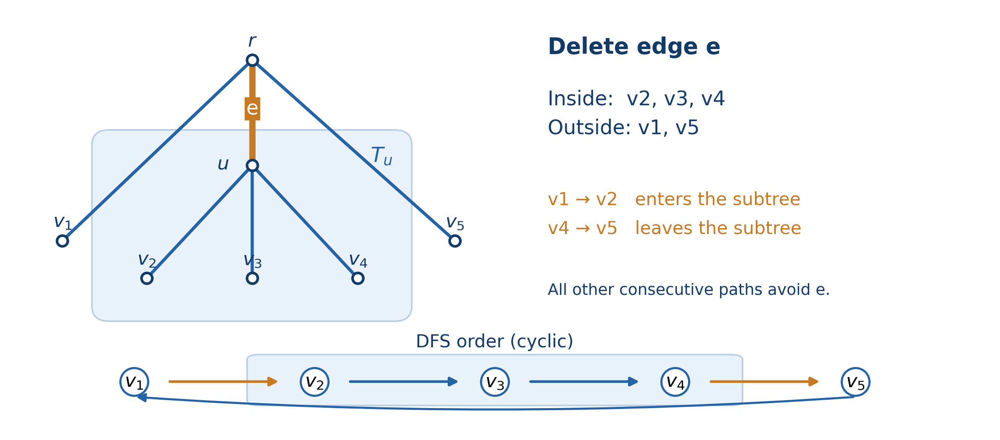

# Chapter 9 LCA 的进阶性质与应用

已经会求两个点的 LCA 以后，接下来值得研究的，是它究竟保留了树上的哪些信息。

点集 LCA、路径交集、动态连接子树都依赖同一结构：树上两点间只有一条简单路径。

前置：LCA 基本求法。固定根 $r$，$\operatorname{dep}(v)$ 为**边数深度**，$\operatorname{tin}(v)$ 为 DFS 首次进入时间，$P(u,v)$ 为含端点的简单路径；祖先关系包含自身。

需要谈距离时，默认每条边的长度严格为正。记 $D(v)$ 为根到 $v$ 的路径长度，则

$$
d(u,v)=D(u)+D(v)-2D(\operatorname{lca}(u,v)).
$$

注意，比较 LCA 的深浅用的是 $\operatorname{dep}$，带权距离用的是 $D$，两者不要混用。大部分结构性质与边权无关；正权条件主要保证距离具有通常的度量性质，例如

$$
x\in P(a,b)\iff d(a,x)+d(x,b)=d(a,b).
$$

如果有零权边，路径外的点也可能满足右侧等式；不过此时仍可用按边数计算的无权距离判定路径成员。下文的最近点与最短路线结论，也都在正权前提下讨论。

## 1. 一个点集的 LCA，究竟需要记住多少信息？

先看最直接的做法。将 $\operatorname{lca}(u,v)$ 简记为 $u\wedge v$，这个运算满足

$$
u\wedge v=v\wedge u,\qquad
(u\wedge v)\wedge w=u\wedge(v\wedge w),\qquad
u\wedge u=u.
$$

交换律、幂等律直接来自定义。结合律中，无论先合并谁，结果都是三点的最深公共祖先；公共祖先构成根链，最深点唯一。

非空 $S$ 的 LCA 可逐个或分块合并。线段树区间只存 LCA，合并再求一次即可。空区间须设“无节点”单位元，不能用根：$\operatorname{lca}(r,u)=r$ 会改变结果。

LCA 摘要不可相减。根 $r$ 有叶子 $a,b$ 时，$\{a,b\}$ 与 $\{a,r\}$ 的 LCA 都为 $r$；同样删除 $a$ 后，却分别为 $b,r$。摘要与删除操作相同，结果不同，故信息不足。

### DFS 序的两个极值就够了

现在换个问题：能否找出点集内两个有代表性的点，让它们的 LCA 就是整个点集的 LCA？

答案是 DFS 进入时间最小、最大的两个点。设它们分别为 $x,y$，那么

$$
\boxed{\operatorname{lca}(S)=\operatorname{lca}(x,y).}
$$

令 $h=\operatorname{lca}(x,y)$。其子树在 DFS 序上连续，包含 $x,y$，便包含进入时间夹在两者之间的全部点，故包含 $S$，$h$ 是公共祖先。

另一方面，$S$ 的任何公共祖先都必须同时是 $x,y$ 的祖先，不可能比 $h$ 更深。这样就证明了 $h$ 恰好是整个点集的公共 LCA。

这里用的必须是 DFS **先序进入时间**，而不是节点编号，也不是随意选取的遍历顺序。真正支撑结论的是“每棵子树对应一个连续区间”。

因此，维护点集时可以存两种摘要：

| 保存的信息 | 如何合并 | 删除时缺少什么 |
| --- | --- | --- |
| 整个点集的 LCA | 对两个摘要再求 LCA | 无法还原剩余集合的 LCA |
| DFS 序最小点与最大点 | 分别取更小、更大的进入时间 | 删掉极值后，需要知道新的极值 |

动态集合按 $\operatorname{tin}$ 存平衡树，修改 $O(\log n)$，查询取两端求 LCA。序列区间查询同样只需最小、最大进入时间对应的点。

### 删掉一个点，让剩余点集的 LCA 尽量深

若 $|S|\ge2$，删一点使剩余 LCA 最深，**只需考虑 DFS 序两端点**。

删内部点保留两端，LCA 不变；删极值只会减少公共祖先限制，LCA 保持或下移。因此至少一个极值删除方案不劣。

这个论证保证的是“存在一个最优方案，删除的是极值”，不是“所有最优方案都只能删除极值”。当所有删除方案都不改变 LCA 时，内部点当然也可以是最优选择。

值得记住的是这种推理方式：一个摘要虽然不能直接撤销，但若答案只由少数元素决定，就可以先找出哪些删除操作有可能改变它，再缩小优化的候选范围。

> **练习（估算 CF 难度）**：[Company](https://codeforces.com/problemset/problem/1062/E)（约 2300；2018；直接练本节的删点性质）。

## 2. 从三点的汇合位置，求出两条路径的完整交集

回顾三点性质。对于 $a,b,c$，三个两两 LCA 中，两个较浅的结果相同，剩下的结果是它们的后代；三个结果也可能完全相同。把其中最深的点记为

$$
\mu(a,b,c).
$$

这个点是 $P(a,b),P(b,c),P(c,a)$ 三条路径唯一的公共点，也称三点的中位点。LCA 的表达依赖所选的根，但这三条路径不依赖根，所以它们确定的 $\mu$ 也不依赖根。

设 $h=\operatorname{lca}(a,b)$。若 $c$ 从 $h$ 上方接入 $P(a,b)$，入口是 $h$；否则入口是其所在分支与 $a$ 或 $b$ 的汇合点，恰为三个两两 LCA 中最深者。三条路径在此分开，其他点至多属于两条，故公共点唯一。

### 点到路径的投影，首先是一个入口

固定路径 $Q=P(a,b)$。给一个点 $x$，它到 $Q$ 的最近点是

$$
\pi_Q(x)=\mu(a,b,x).
$$

比“最近”更有用的是下面的结构：**从 $x$ 到 $Q$ 上任意一点，都必须先经过同一个入口 $\pi_Q(x)$。** 如果 $x$ 本就在 $Q$ 上，入口就是 $x$。

若有两个入口，连接 $x$ 与两入口的支路加上 $Q$ 内路径便成环，矛盾。正权下进入后继续沿 $Q$ 走只会增距，所以入口也是唯一最近点。

记入口为 $p$，分别考虑 $x$ 到 $a,b$ 的路径，有

$$
d(x,a)=d(x,p)+d(p,a),\qquad
d(x,b)=d(x,p)+d(p,b).
$$

又因为 $p\in P(a,b)$，所以 $d(p,a)+d(p,b)=d(a,b)$。两式相加便得到

$$
\boxed{d(x,Q)=\frac{d(x,a)+d(x,b)-d(a,b)}2.}
$$

这个公式其实是在把两次重复走过的“入口之前那一段”单独提取出来。

### 把另一条路径的两个端点投影过来

现在给另一条路径 $R=P(c,d)$，我们不只想判断是否相交，还想知道整个交集。先计算

$$
p=\pi_Q(c),\qquad q=\pi_Q(d).
$$

如果 $Q,R$ 相交，那么

$$
\boxed{Q\cap R=P(p,q).}
$$

若交集含 $s,t$，必含唯一的 $P(s,t)$，故交集连续。从 $c\to d$ 看，首次进入 $Q$ 为 $p$，最后离开为 $q$，所以交集恰为 $P(p,q)$。

图 9-1：左图中，两个投影不同，路径 $c\to d$ 必须经过中间深蓝色的 $P(p,q)$。右图中，两个投影虽然相同，但 $p$ 不在 $R$ 上，两条路径仍然不相交；灰色的 $P(p,t)$ 是它们之间的连接段。

这里还差一步：怎么知道交集是否存在？可以分开看两种情况。

- 若 $p\ne q$，$c,d$ 接到 $Q$ 的位置不同，两端之间的唯一路径必然经过 $P(p,q)$，所以一定相交。
- 若 $p=q$，两端可能从同一条支路接向 $Q$，而 $c\to d$ 在到达 $Q$ 之前就已经汇合。此时要额外检查 $p$ 是否在 $R$ 上；在则交集是单点 $p$，不在则交集为空。

为了统一处理，也可以直接检查

$$
Q\cap R\ne\varnothing
\iff d(c,p)+d(p,d)=d(c,d).
$$

相交时，公共边的总长度为 $d(p,q)$；无权树中公共节点数为 $d(p,q)+1$。求出了两个端点后，交集就能继续与第三条路径求交，无需把公共路径上的节点逐个列出来。

不相交时必有 $p=q$。将 $p$ 投影到 $R$ 得 $t=\pi_R(p)$，最短连接为 $P(p,t)$：从 $R$ 向 $Q$ 必经唯一入口 $p$，而 $t$ 是 $R$ 上最近点。

上述每一步都只需常数次 LCA。若一次 LCA 用 $O(\log n)$，一次路径求交或路径间距离查询也就是 $O(\log n)$。单点路径、相交于端点等退化情形都包含在这些结论中。

> **练习（估算 CF 难度）**：[Passable Paths (hard version)](https://codeforces.com/problemset/problem/1702/G2)（约 2100）。

## 3. 多条路径要有公共点，为什么两两相交就够了？

有限条非空树路径两两相交，必有公共节点；该 **Helly 性质**也适用于任意非空连通子图。

证明时先找一个能代表连通子图的位置。对于非空连通子图 $C$，记其中深度最小的节点为 $t(C)$。这个点唯一，而且它是 $C$ 内所有节点的祖先。

连通子图包含任意两点间的唯一路径。若有两个同样浅的点，路径会经过更浅 LCA，矛盾；若 $t(C)$ 不是 $z\in C$ 的祖先，$P(t(C),z)$ 同样经过更浅 LCA，矛盾。

接着，在所有子图的最高点 $t(C)$ 中挑一个最深的，记作 $t_*$，它对应的子图记作 $C_*$。我们来证明这个看似只由一个子图选出的点，其实属于所有子图。

任取另一个子图 $C$。因为两两相交，存在 $z\in C\cap C_*$。$t(C)$ 与 $t_*$ 都是 $z$ 的祖先，所以它们位于同一条祖先链上。又因为 $t_*$ 是所有最高点中最深的，$t(C)$ 必须是 $t_*$ 的祖先。于是

$$
t_*\in P(t(C),z)\subseteq C.
$$

$C$ 是任取的，因此 $t_*$ 在所有子图中。整个证明没有枚举交点，而是借一个交点，把两个子图的最高点放到了同一条祖先链上。

对于路径 $P(a_i,b_i)$，其最高点恰好是 $\operatorname{lca}(a_i,b_i)$。这直接给出一个更实用的算法：从所有路径的 LCA 中选最深的点 $t_*$，再检查它是否在每条路径上。

全部通过即得公共点；有一条不通过则无公共点。因为若确有公共点，路径两两相交，上述证明保证 $t_*$ 属于每条路径。

所以，检查 $k$ 条路径是否有共同节点，只用 $O(k)$ 次 LCA，不需要检查 $O(k^2)$ 对路径。公共交集非空时，$t_*$ 还是交集中深度最小的点。

公共点未必唯一，重复长路径的交集仍为整段。求完整交集可逐条用两端点法，共 $O(k)$ 次 LCA。Helly 还说明：无全体公共点时，必有两条已不相交。

## 4. 按 DFS 序绕一圈，为什么能算出连接子树的长度？

给一批标记点 $S$，把连接它们所必需的全部边保留下来，得到最小连通子树 $H(S)$。记它的边权和为 $W(S)$。若只有一个标记点，连接子树就只有这个点，$W(S)=0$。

将不同标记点按 DFS 进入时间排序为 $v_1,\ldots,v_k$，并令 $v_{k+1}=v_1$。有一个适合动态维护的公式：

$$
\boxed{2W(S)=\sum_{i=1}^{k}d(v_i,v_{i+1}).}
$$

右边没有直接枚举连接子树的边，只沿 DFS 序访问相邻标记，并在最后返回第一个标记。理解它的最好办法，是固定一条边，数它被右侧计算了几次。

设这条边是 $e=(\operatorname{par}(u),u)$。删掉它，树分成 $u$ 的子树 $T_u$ 和外部两部分。

标记只在一侧时，边 $e$ 既不属于 $H(S)$，也不被相邻路径经过。两侧均有标记时，$T_u$ 内标记在 DFS 序上连续，环形访问恰进入、离开各一次，故跨 $e$ 两次；它也恰为连接两侧的必要边。

每条必要边计入两次，其余边计入零次，逐边相加便得到公式。

图 9-2：子树 $T_u$ 内的标记是连续的 $v_2,v_3,v_4$。只有 $v_1\to v_2$ 和 $v_4\to v_5$ 两条相邻路径经过边 $e$，因此这条边在距离和中出现两次。最下面的回边表示访问顺序闭合，原树本身没有增加边。

### 插入一个点，只改两个相邻关系

假设当前集合非空，准备插入一个尚未出现的点 $x$。在 DFS 序的环中，找到它的前驱 $p$ 和后继 $q$。原先的一项 $d(p,q)$ 被两项 $d(p,x)+d(x,q)$ 替换，其余项完全不动。因此

$$
\boxed{\Delta W=\frac{d(p,x)+d(x,q)-d(p,q)}2.}
$$

删除前取前驱、后继并反向更新。单点集合插入时前后继相同，公式仍成立；空集插首点、删末点单独令 $W=0$。重复标记另存次数，仅在 $0\leftrightarrow1$ 时改有序集合及距离和。

几何解释：$x$ 接入 $H(S)$ 的入口 $z$ 唯一，新增边为 $P(x,z)$，故 $\Delta W=d(x,H(S))$。DFS 序两邻居即可算出该长度。

使用平衡树查找前驱、后继需要 $O(\log n)$，距离计算只需常数次 LCA。配合倍增，每次插入、删除总计 $O(\log n)$。

### 连接费用与走遍费用为什么差一个系数？

$W(S)$ 为连接边长。闭合访问全部标记时，每条必要边至少往返一次，下界 $2W(S)$；沿连接子树往返遍历即可达到。

如果固定从 $s\in S$ 出发，在 $t\in S$ 结束，就不必沿 $P(s,t)$ 返回，最短路程变成

$$
\boxed{2W(S)-d(s,t).}
$$

逐边看：$s,t$ 分居两侧的必要边至少走一次，同侧则为访问另一侧至少走两次。让 $P(s,t)$ 走一次、其余分支往返，同时达到各边下界。

若起点、终点可在 $S$ 中自由选择，便应使节省的 $d(s,t)$ 最大，答案为

$$
2W(S)-\operatorname{diam}(S),
$$

其中 $\operatorname{diam}(S)=\max_{s,t\in S}d(s,t)$。固定端点不在 $S$ 时，先将端点加入集合，再使用固定端点公式。

## 5. 每对节点在 LCA 处汇合：计数与复杂度可以一起理解

某些树形 DP 的二重合并可分摊到跨集合节点对，全树只枚举 $O(n^2)$ 对，无须估成 $O(n^3)$。

设处理节点 $u$ 时，已经合并的部分是 $A$，接下来合并一个儿子子树 $B$。$A$ 包含 $u$ 以及若干已经处理的儿子子树，与 $B$ 不相交。任取 $a\in A,b\in B$，都有

$$
\operatorname{lca}(a,b)=u.
$$

将 $O(|A||B|)$ 次操作分摊给跨集合点对。固定 $\{a,b\}$ 只在 $\operatorname{lca}(a,b)$ 处、两部分首次合并时出现；更低不同时在场，更高已在同一子树，不再跨组。

因此总费用由不同节点对数控制，为 $O(n^2)$。只需证明操作对应对象及重复次数，无须逐层精确求和。来源 [1] 第 7 节讨论此法。

前提是状态数由所在部分大小控制，状态可对应不同节点，单个状态对工作量为常数。额外独立维度仍须计费，树形背包并不自动保证 $O(n^2)$。

### 不逐对求 LCA，也能统计 LCA 的分布

设节点 $v$ 上放有 $m_v$ 个可区分对象，其中 $m_v$ 是非负整数，同一节点允许放多个对象。记 $C_u$ 为 $u$ 子树中的对象总数。

LCA 恰为 $u$ 的对象对：先取子树任意两对象，共 $\binom{C_u}{2}$；再减同一孩子子树内的对，它们 LCA 更深。各孩子互斥，无重复扣除，因此

$$
\boxed{N_u=\binom{C_u}{2}-\sum_{c\text{ 是 }u\text{ 的儿子}}\binom{C_c}{2}.}
$$

减完后，留下的正好是来自不同儿子子树的对象对，以及至少一个对象就在 $u$ 上的对象对。两个不同对象即便在同一节点 $u$ 上，也应该保留，因为它们所在节点的 LCA 就是 $u$。

于是，对任意节点函数 $f$，都有

$$
\sum_{\{a,b\}} f(\operatorname{lca}(a,b))
=\sum_u N_u f(u),
$$

左侧对不同对象的无序对求和。一次后序遍历就能求出全部 $C_u,N_u$，总时间 $O(n)$，不需要对每一对对象调用 LCA。

若每个对象 $a$ 带有一般实数权重 $w_a$，要统计的是对象对的权重乘积，就不能把权重和代入组合数解释成数量。对任意一批对象 $A$，正确的配对权重总和是

$$
B(A)=\frac12\left[\left(\sum_{a\in A}w_a\right)^2-\sum_{a\in A}w_a^2\right].
$$

用整个子树的 $B$ 减去各儿子子树的 $B$，同样得到 LCA 恰为 $u$ 的点对权重贡献。这里减平方和，是为了去掉对象与自己的配对。

### 求距离和时，把贡献交给边往往更直接

如果目标是对象两两距离之和，逐对分析 LCA 反而绕了一步。令对象总数 $K=C_r$，边 $(\operatorname{par}(u),u)$ 的长度为 $\ell_u$。删去它后，两侧分别有 $C_u$ 与 $K-C_u$ 个对象，恰有 $C_u(K-C_u)$ 个无序对象对需要跨过这条边，所以

$$
\boxed{\sum_{\{a,b\}}d(a,b)
=\sum_{u\ne r}\ell_u C_u(K-C_u).}
$$

同一节点上的对象距离为零，也自然符合公式，因为没有任何边把它们分开。

点对贡献取决于**在哪里汇合**时按 LCA 分类，取决于**经过哪些边**时逐边分摊。先选分类方式，再优化查询。

## 6. 三个人的中位点，怎样推广到很多个人？

三点中位点 $\mu(a,b,c)$ 最小化距离和。多人情形须从目标函数重推，不能直接取最深两两 LCA 或全体公共 LCA。

仍设节点 $v$ 上有 $m_v$ 个人，总人数为 $K>0$。把集合位置选在节点 $x$，总代价为

$$
F(x)=\sum_v m_vd(x,v).
$$

考虑沿一条长度为 $\ell$ 的边，从 $x$ 移到相邻节点 $y$。删去该边后，设 $y$ 所在一侧有 $C$ 个人。移过去会让这 $C$ 个人的距离各减少 $\ell$，其余 $K-C$ 个人的距离各增加 $\ell$，所以

$$
\boxed{F(y)-F(x)=\ell(K-2C).}
$$

由此得到最优位置的充要条件：

> 删除节点 $x$ 后，剩下的每个连通分量中，人数都不超过 $K/2$。

必要性很好理解。如果某一侧人数超过一半，就沿那条边移过去，距离和立刻减小，因此 $x$ 不可能最优。

充分性：从 $x$ 沿任意简单路径前进，首步前方人数不超过一半，之后前方人群只会缩成其子集。由变化量公式，每一步代价都不下降。任何节点均可如此到达，故 $x$ 全局最优。

这就是树上中位点，也可理解为按人数衡量的带点权重心。三个人时，每个分量中人数最多为一个，这恰好描述了三条两两路径的共同汇合点，因此退化为 $\mu(a,b,c)$。

$K$ 为偶数时可能多解：平分人数的边上移动代价为零，最优点可能构成路径。允许同点多人；非负实数需求权重也可替代人数与 $K/2$，证明相同。

用一个小例子区分公共 LCA 与最优集合点：以星形树中心为根，在三个不同叶子分别放 $3,1,1$ 个人。所有人的公共 LCA 是中心，但最优集合位置是放了三个人的叶子，因为那边已经占总人数的一半以上。共同祖先描述的是根下的分支关系，中位点描述的是人群在各个方向的分布。

来源 [2] 给出了全部节点各放一个人、边长为一时的距离和换根公式。上面的推导将它推广到带标记数量、正边权的情形，并进一步给出了最优性的充要条件。

## 7. 最后看一点虚树：为什么只加相邻 LCA 就足够？

前面已经见到，点集按 DFS 序排序后，两个极值能决定公共 LCA，相邻关系能决定连接子树长度。虚树利用的是同一个顺序的另一种压缩能力：只需加入线性个分叉点，就能保留与这一批标记相关的连接结构。

设 $S$ 有 $k\ge 1$ 个不同节点，按 DFS 序排为 $v_1,\ldots,v_k$。把

$$
\operatorname{lca}(v_1,v_2),\ldots,
\operatorname{lca}(v_{k-1},v_k)
$$

加入 $S$ 并去重，得到集合 $C$。这里不需要额外加入首尾相邻的一对。核心结论是：原始点集中任意两点的 LCA，都已经在 $C$ 内。

设 $h=\operatorname{lca}(a,b)$。$h\in S$ 时已包含；否则两点在其不同孩子子树。各非空孩子的标记在 DFS 序上成连续块，取相邻两块交界的两个标记，它们在全序列相邻且 LCA 为 $h$，故 $h$ 已加入。来源 [1] 第 9 节讨论此性质。

闭包性：新增点都是原始点集的 LCA。由结合律，再求两个新增点的 LCA 等价于合并其原始点集；第 1 节证明这等于该集合 DFS 序两端的 LCA。原始点对 LCA 已全在 $C$，故不再产生新点。

我们最多只加入 $k-1$ 个候选点，因此

$$
|C|\le 2k-1.
$$

$C$ 中各点连向最近严格祖先，得到虚树。边代表整段原树祖先链，长度为根距离差。链内无标记或必要分叉，否则该点是原始标记对的 LCA，已在 $C$ 中，不会被压掉。

所以虚树保留了标记之间的距离、分叉关系，以及删边后标记分居两侧的数量。第 5 节的点对距离和便能直接搬过来：一条压缩边长为 $\ell$，下方有 $C'$ 个对象，总共有 $K$ 个对象，它的贡献仍是

$$
\ell C'(K-C').
$$

原链各边切出的标记集合相同，贡献系数一致，才能合并长度。若查路径最小值，须存整段最小值；若内部约束无法合并，不能只留长度。

排序、加入相邻 LCA、再次排序去重，再用祖先栈连最近祖先。排序 $O(k\log k)$、LCA 共 $O(k)$ 次；倍增下总时间 $O(k\log k+k\log n)$，额外空间 $O(k)$。仅在题目要求连接原根时才补原根。

虚树并没有改变这些性质，只是删掉了当前点集用不上的部分。真正让它成立的，是 DFS 子树区间、两点唯一通路，以及分叉位置可以由 LCA 表达。

> **练习（估算 CF 难度）**：[Sum of Tree Distance](https://atcoder.jp/contests/abc359/tasks/abc359_g)（约 2400；综合练习：点对距离与虚树）。

## 参考资料与阅读定位

本章以原稿所引用的 `LCA.pdf` 三点性质为起点，不重复基础 LCA 求法。其余性质在正文中给出了独立推导；下面两份原始资料用于对应的延伸阅读，本次改写已重新读取相关正文。

1. [-is-this-fft-：Collection of little techniques](https://codeforces.com/blog/entry/100910)。第 7 节讨论某些树形 DP 的 $O(n^2)$ 点对分摊，第 9 节讨论 DFS 序相邻点产生全部两两 LCA 的性质。本章进一步解释了它们与删除候选、LCA 闭包之间的联系。
2. [AtCoder ABC220 F 官方解说：Distance Sums 2](https://atcoder.jp/contests/abc220/editorial/2705)。对应第 6 节距离和沿一条边移动时的变化量。原解说讨论无权树全部节点的距离和，本章在相同逐边分析上推广到非负需求与正边权。

路径投影、完整交集、Helly 性质、DFS 环公式和各个计数恒等式的适用条件与证明，均以本章正文为准，不需要读完参考资料才能使用。
