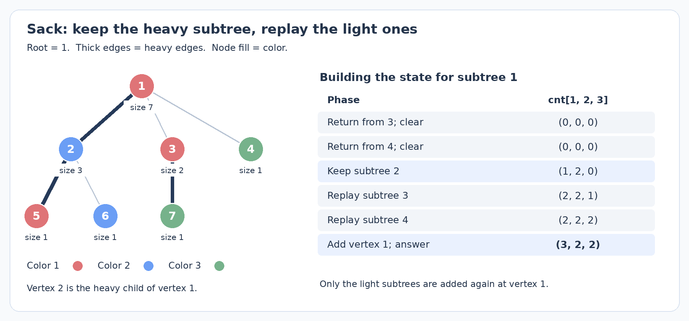

# 启发式合并与 DSU on Tree：保留哪一份信息，重新处理哪些元素？

你已做过 USACO Guide 本节前五题。本篇分清容器合并与 sack，解释结果复用及复杂度中的对数。

本篇训练采用四道有额外建模内容的题：Tree Inversion、XOR Tree、LuoTianyi and XOR-Tree、Leaf Color。它们分别把子树统计接到换根、贪心、最优状态压缩和组合计数上。难度是结合完整解法独立估算的 CF 尺度，约 2300–2600。前五节建立合并与 sack 的框架，后面结合这些题讨论迁移。默认不附完整代码；完整题解集中在[习题分析](small-to-large-and-dsu-on-tree-exercises.md)。

## 1. 这些名字分别在说什么？

| 名称 | 本篇采用的含义 | 保留的信息 |
| --- | --- | --- |
| 启发式合并 / small-to-large | 合并两份可枚举的信息时，优先把小的一份加入大的一份 | 两个容器中的记录，合并后复用较大的容器 |
| 树上的启发式合并 | 后序遍历，在父亲处合并各个子树的信息 | 每个已处理子树有一份可以交给父亲的容器 |
| DSU on Tree / sack | 本篇特指保留重儿子统计、重新加入轻子树的遍历安排 | 一份全局统计，随 DFS 顺序变成不同子树的统计 |
| DSU，即并查集 | 维护元素属于哪个连通分量，支持集合合并与代表元查询 | 父指针、分量大小及可选的分量信息 |

命名并不统一：Arpa 将容器合并和 sack 都放在 DSU on Tree 下，USACO Guide 的 small-to-large 侧重容器合并。看实现时，应区分每个子树独立容器与共用全局统计。

共同思想：**保留较大结果，只为较小部分重新付费。** 并查集按大小合并也用类似分析，但 sack 无须 `find`、`union`。重儿子可与树链剖分同样选择；这里用轻边限制重复次数，无须拆链。

下面始终把根定好，记 $S_u$ 为 $u$ 的子树顶点集合，$s_u=|S_u|$。先用一个自构问题作为公共模型：每个点有颜色，要求每个子树的颜色频次。两种方法维护的数学对象相同，差别在于这份频次表放在哪里、何时还有效。

## 2. 小并大：先证明总共搬多少次，再计算单次搬运的代价

若每次新建父容器并复制所有孩子，链上会重扫大小为 $1,2,\ldots,n-1$ 的结果，总扫描量为 $\Theta(n^2)$。

父亲可复用一个孩子的容器，再加入其余信息。交换拥有者或句柄可为常数时间，避免复制整个大容器。

### 没有去重时，逐元素的翻倍证明

先看最清楚的模型：容器保存互不相同的原始元素，两个集合不相交。每次把元素较少的集合搬进较多的集合。若某元素搬运前所在集合大小为 $s$，另一个集合至少有 $s$ 个元素，搬运后它所在集合至少有 $2s$ 个元素。

每次搬运使所在集合至少翻倍，因此一个元素最多搬 $\lfloor\log_2 n\rfloor$ 次，总枚举量 $O(n\log n)$。平衡树单条插入 $O(\log n)$，总时间 $O(n\log^2 n)$；哈希更新期望 $O(1)$ 时，总时间期望 $O(n\log n)$，不是确定性最坏界。

证明要求持续合并、不拆分原始元素，且代价由小集合控制。有序数组线性归并还会扫描大集合，不能套此界。

### 有重复颜色时，到底什么在翻倍？

若容器是去重的颜色集合，直接说“每次合并后颜色数翻倍”就不成立。例如 $\{红,蓝\}$ 与 $\{红,绿\}$ 都有两种颜色，合并后却只有三种。

我们可以换一个计量方式：一份信息背后代表的原始顶点数或球数，称为它的质量 $w$；容器实际记录数记为 $r$。颜色被去重或压成频次后，仍有 $r\le w$。两份信息合并时，原始对象互不相交，质量相加。

若算法枚举记录较少的容器，一次工作量为

$$
\min(r_A,r_B)\le\min(w_A,w_B).
$$

把这次工作分摊给质量较小的一方中的原始对象，每个对象承担至多常数份。这个较小质量的集合合并后，质量至少翻倍，因此每个原始对象最多承担 $O(\log n)$ 次费用，总工作量仍是 $O(n\log n)$。

分摊对象不必是实际移动的颜色记录：程序按记录数选方向，证明按原始对象质量付费。直接按质量选方向也成立，因为记录数不超过质量。

要求记录数不超过所代表的原始对象数。额外生成记录、复制或拆分状态时须重证；$m$ 次调用中的空集合等常数开销另计 $O(m)$。

## 3. 每个子树一份容器时，怎样复用结果？

先给公共颜色模型加一个查询：求每个子树中出现次数最多的所有颜色编号之和。这里只用它解释容器与辅助量的关系，不把它列为训练题。

对一个子树，保存颜色频次表 $f[c]$，以及两个量：最大频次 $mx$，达到这个频次的颜色编号之和 $sum$。孩子内部的答案先分别算好；父亲拿一个孩子的容器作为起点，然后把其他孩子的记录 $(c,d)$ 加入，即令 $f[c]\gets f[c]+d$。

每次频次增加后，只需看这个颜色：若新频次超过 $mx$，令 $mx$ 为新值、$sum=c$；若恰好等于 $mx$，令 $sum\gets sum+c$；否则不变。这是因为合并过程中其他颜色频次没有减少，原有最大值不会因为本次操作失效。

继承大容器时，也要继承与它一致的 $mx,sum$。不能拿着已经填好的频次表，却把辅助统计当作空表重新开始。全部孩子及 $u$ 自己合并完后，$ans[u]=sum$。

使用有序映射并按记录数小并大，总时间 $O(n\log^2 n)$。也可以选顶点数最大的孩子作为起点，再枚举其余孩子的记录：每条记录可用对应轻子树的顶点数支付费用，得到同样的上界。

父亲复用后容器会继续变化，孩子答案须事先保存，不能把容器视为永久快照。小容器合并后应释放或清空；保留所有副本会破坏活动记录量 $O(n)$ 的空间界。

合并后不能再扫描整表求最大值：颜色互异的链会重扫大小为 $1,2,\ldots,n$ 的表，仍为平方级。维护 $mx,sum$，使读取答案也足够快。

下面用同一个统计目标换一种存储方式。

## 4. Sack：只用一份全局统计，怎样让它恰好表示当前子树？

颜色编号或离散化后，用全局数组 $cnt[c]$ 保存活动顶点的颜色频次，单点加入 $O(1)$。关键是回答 $u$ 时，让活动集合恰为 $S_u$。

朴素办法是每个子树重新加入全部顶点、回答、再清空。一条链的总加入量仍是平方级。Sack 的安排是：为每个 $u$ 选顶点数最大的孩子 $h(u)$，称为重儿子；其他孩子称为轻儿子。先处理轻儿子并清空，再处理重儿子并保留，最后只重新加入轻子树和 $u$。

### 先给递归函数一个准确的约定

记过程为 $solve(u,keep)$。本篇的调用约定是：

- 进入时，全局统计为空。
- 过程中计算好 $S_u$ 内所有需要的答案。
- 返回时，若 $keep=true$，全局统计恰好表示 $S_u$；若为 false，则重新变为空。

`keep` 控制是否保留频次等工作状态，已经写入答案数组的结果始终保留。

入口为空可递归保持：父亲尚未加入自己，轻儿子依次返回空状态，最后调用重儿子；重儿子返回后只枚举顶点，不再递归调用 $solve$。

```text
预处理子树大小，并选出每个点的重儿子 h[u]

solve(u, keep):
    对每个轻儿子 v:
        solve(v, false)
    若重儿子存在:
        solve(h[u], true)
    对每个轻儿子 v:
        枚举 x 属于 S_v，执行 add(x)
    add(u)
    此时全局统计恰好表示 S_u，回答挂在 u 上的询问
    若 keep 为 false:
        枚举 x 属于 S_u，删除它的贡献，使全局状态恢复为空
```

用 DFS 序区间或直接遍历枚举轻子树。`add(u)` 只加入单点，不能重扫已保留的重子树。

### 跟一次具体状态变化

下图是自构的七点树。结点填色表示颜色编号 1、2、3，粗边表示按子树顶点数选出的重边；2 的两个孩子大小相同，任选 5 为重儿子。



计算根 1 时，先完成轻子树 3 和单点子树 4，各自回答完后清空。随后重子树 2 返回，留下的顶点恰为 $\{2,5,6\}$，颜色频次是 $(1,2,0)$。

再加入子树 3 的 $\{3,7\}$，频次变成 $(2,2,1)$；加入顶点 4，得到 $(2,2,2)$；最后加入根 1，得到 $(3,2,2)$。这才是根子树的完整频次。若求最多颜色的编号和，根的最多颜色只有编号 1，答案为 1；子树 2 的最多颜色为编号 2，答案为 2。

轻子树先独立求答案并清空，再为父亲加入一次；重子树同样已遍历，但状态保留，父亲不再枚举。

## 5. 为什么是 $O(n\log n)$，清空又该怎样计费？

若 $v$ 是 $u$ 的轻儿子，重儿子大小至少为 $s_v$，因此

$$
s_u\ge1+s_v+s_{h(u)}\ge1+2s_v.
$$

从一个点向上经过一条轻边，所处子树大小至少翻倍；一个点到根的路径最多有 $O(\log n)$ 条轻边。一个顶点 $x$ 除了自己的单点加入外，只有在它位于某个祖先的轻子树时，才会被重新枚举。总加入次数因此为

$$
O\!\left(n+\sum_u\sum_{v\text{ 为 }u\text{ 的轻儿子}}s_v\right)
=O(n\log n).
$$

清空发生在 $keep=false$ 的调用结束时。这些调用正好是轻儿子对应的子树；根若也要求清空，再多付出 $O(n)$。因此删除总次数也在同一界内。若单点加入、删除代价是 $T_{upd}$，每个询问代价是 $T_{qry}$，总时间应写成

$$
\boxed{O(n\log n\cdot T_{upd}+q\cdot T_{qry}+n).}
$$

常数更新的数组统计为 $O(n\log n+q)$；树状数组或平衡树更新可能再带一个对数。整题复杂度取决于单点操作代价。

重儿子按子树顶点数选，才能限制重新枚举量；颜色种数或高度不满足此证明。清空只撤销本次子树贡献或记录位置，不能每次清零整个全局数组。

### 最大频次在清空时要逐步维护吗？

单点加入时，按第 3 节规则维护 $mx,sum$ 即可，每次只增加一种颜色的一次出现，所以是 $O(1)$。但删除一个点后，最大频次可能降低，原来的单向更新规则不能直接反着用。

清空会删除全部 $S_u$，中途没有查询。因此逐点撤销 $cnt$，结束后将 $mx,sum$ 置零即可，无须逐次维护删除后的众数。保留重子树时也保留辅助量。

该技巧要求清空后恰为空，且过程中无查询。若还有外部元素，不能归零；其他统计也须设计删除或恢复空状态的方法。

于是同一题有序映射合并为 $O(n\log^2 n)$，Sack 配颜色数组为 $O(n\log n)$。减少的是一次单点更新的代价；两种方法都利用了较大部分的复用。

## 6. Tree Inversion：先把换根的变化写成子树查询

[ABC337 G — Tree Inversion](https://atcoder.jp/contests/abc337/tasks/abc337_g)（AtCoder，2024；独立估算约 2300）给一棵点编号为 $1,\ldots,n$ 的树。对每个根 $r$，求有多少对 $(v,w)$ 满足 $v<w$，且 $w$ 在 $r$ 到 $v$ 的路径上。$w=r$ 也允许。

即统计每个根下“祖先编号大于后代编号”的点对。只求一个根可用 DFS 维护祖先编号；求所有根，先分析跨一条边换根时哪些贡献改变。

固定 1 为预处理根，记 $Q_u(t)=\#\{x\in S_u:x<t\}$。当根从父亲 $p$ 移到孩子 $u$ 时，删去边 $(p,u)$ 后的两侧分别为 $S_u$ 和它的补集。

除 $p,u$ 以外，每个点原来朝向根的那条边都不变，因此它的后代集合不变。只需检查以 $p$ 或 $u$ 为祖先端点的贡献。

- $p$ 不再是 $S_u$ 中顶点的祖先，失去 $Q_u(p)$ 对。
- $u$ 新成为补集中所有顶点的祖先，增加其中编号小于 $u$ 的数量。全树共有 $u-1$ 个编号小于 $u$ 的点，扣掉 $S_u$ 中的 $Q_u(u)$ 个，增加 $u-1-Q_u(u)$ 对。

于是

$$
\boxed{f(u)=f(p)-Q_u(p)+(u-1)-Q_u(u).}
$$

初始答案也用同一种查询表达：以 1 为根，每个祖先端点 $w$ 对子树中所有编号小于它的点贡献一次，所以

$$
f(1)=\sum_w Q_w(w).
$$

每个子树只需两次编号阈值计数，再线性换根。Sack 配树状数组维护活动编号；活动集合为 $S_u$ 时保存 $Q_u(u)$、$Q_u(p)$。根无父亲，省去后者。

例如三点链 $1-2-3$，以 1 为根没有逆序祖先对。移到 2：$Q_2(1)=Q_2(2)=0$，所以 $f(2)=1$，对应祖先 2 与后代 1。再移到 3，$Q_3(2)=Q_3(3)=0$，得到 $f(3)=3$。

树状数组单次更新 $O(\log n)$，sack 总时间 $O(n\log^2 n)$、空间 $O(n)$，答案用 64 位。普通 `set.lower_bound` 不返回排名，迭代器 `distance` 可能线性。

也可用 $O(n\log n)$ 离线法：DFS 只加入编号，子树进出时的前缀计数之差即子树计数，依据是 DFS 区间连续。两条路线见[配套第 1 题](small-to-large-and-dsu-on-tree-exercises.md#1-abc337-g--tree-inversion)。

## 7. 路径配对：合并之前，为什么要先查询整组？

子树信息还可以用来匹配两个端点。为了避免重复统计，常把树路径归到端点的 LCA：两端点要么分别位于 LCA 的不同孩子子树，要么有一个端点就是 LCA 自己。

处理 $u$ 时，保留一个孩子的信息，再逐个处理其他孩子。当前统计中只放已经处理的子树以及可选的 $u$；对于下一棵子树，先让里面的所有候选查询已有统计，全部查询结束后，再统一加入。

若查询一个点后立刻加入，同组后续点会与它配对，误计 LCA 更深的路径。**先查整组，再统一加入，保证端点组不重叠。** 交换容器句柄不改变组的互斥关系。

先用一类定长路径查询说明：在边权和恰为 $K$ 的路径中，最少使用多少条边？记 $D[x]$ 为根到 $x$ 的边权和，$dep[x]$ 为边深度。LCA 为 $u$ 时，

$$
D[x]+D[y]-2D[u]=K.
$$

固定 $u,x$，只需要查询 $D[y]=K+2D[u]-D[x]$。用映射 $best[d]$ 保存已有端点中根距离为 $d$ 的最小边深度，候选边数就是

$$
dep[x]+best[K+2D[u]-D[x]]-2dep[u].
$$

同键只留最小深度：其余项固定，候选来自另一组，LCA 确为 $u$。先继承重儿子表，查询 $u$ 与重子树的配对，再加入 $u$；轻子树依次先查后加，最终表表示整个 $S_u$。

摘要须同时保证数值足够比较、端点组合法。零权边可能让相同根距离对应不同边深度，仍取最小深度；距离与查询键用 64 位。

按顶点数选重儿子、枚举轻子树原始顶点，有序映射路线为 $O(n\log^2n)$。这里父亲消费的是子树返回的映射；不是把全局 sack 的 $cnt$ 随意换成 $best$ 就自动得到算法。

> **迁移练习**：[CF1709 E — XOR Tree](https://codeforces.com/problemset/problem/1709/E)（CF，2022；独立估算约 2400）。需要基础前缀异或与贪心证明。题目同时考察“不同组之间怎样发现冲突”与“发现冲突后该对状态做什么”，不需要 Trie。完整分析见[配套第 2 题](small-to-large-and-dsu-on-tree-exercises.md#2-cf1709-e--xor-tree)。

## 8. 返回给父亲的，也可能是一组最优 DP 状态

子树优化的返回值可能是最优目标集合，而非原始顶点。此时须先证明状态含义，不能直接套逐顶点 sack。

[CF1824 C — LuoTianyi and XOR-Tree](https://codeforces.com/problemset/problem/1824/C) 要求修改尽量少的点值，使每条根到叶路径的点权异或都为 0；允许改成任意非负整数。独立估算约 2500。它与上一题都是异或树题，但条件和修改目的不同，不能沿用“发现一条零异或路径就处理它”的规则。

设 $F_u(t)$ 为：只允许修改 $S_u$ 内顶点，使所有从原树根到 $S_u$ 内叶子的路径异或都变成 $t$，至少修改多少次。子树外的点权先保持原值。直接枚举 $t$ 不可行，但这里有一个有用的压缩：

$$
|F_u(t_1)-F_u(t_2)|\le1.
$$

取目标 $t_1$ 的最优方案，把 $u$ 的最终点权再异或 $t_1\oplus t_2$。所有相关路径经过 $u$，目标同时变为 $t_2$，至多多改一个顶点；若 $u$ 已改过则不增加次数。交换目标即得反向不等式。

所以只需保存最低代价 $m_u$ 及对应目标集合 $T_u$；其余目标代价恰为 $m_u+1$。无限值域由此压成一个数和一个稀疏集合。

父亲需要比较孩子们的最优目标是否一致。合并时出现的“次数”数的是一个目标受到多少个孩子集合支持，不是有多少原始叶子具有这个异或。因此，一个孩子内部同一目标只贡献一票。如何由支持数推出父亲代价，以及筛掉非最优目标后为什么还能控制总扫描量，见[配套第 3 题](small-to-large-and-dsu-on-tree-exercises.md#3-cf1824-c--luotianyi-and-xor-tree)。这两步都不能用“小并大”代替证明。

> **组合计数提高**：[ABC340 G — Leaf Color](https://atcoder.jp/contests/abc340/tasks/abc340_g)（AtCoder，2024；独立估算约 2600）。需要基础树形计数 DP 与模运算。本篇采用稀疏 DP 合并路线，不要求虚树。建议独立区分“还要向父亲连接的部分方案”和“已经成为完整答案的方案”，再看[配套第 4 题](small-to-large-and-dsu-on-tree-exercises.md#4-abc340-g--leaf-color)。

## 9. 选哪种写法，先看你实际要做什么操作

| 问题 | 容器合并 | Sack |
| --- | --- | --- |
| 子树状态放在哪里？ | 各自一份，逐步交给父亲 | 共用一个全局状态 |
| 父亲复用什么？ | 较大孩子的容器 | 重儿子留下的工作状态 |
| 小的一方怎样处理？ | 枚举小容器中的记录 | 重新枚举轻子树的原始顶点 |
| 怎样得到答案？ | 合并完成时读当前容器及辅助统计 | 活动顶点恰为 $S_u$ 时回答挂在 $u$ 的询问 |
| 是否需要撤销？ | 通常无需逐点撤销，合并后消耗小容器 | 需要能删除贡献，或在同一复杂度内恢复空状态 |
| 常见代价 | 有序映射常为 $O(n\log^2 n)$ | 常数单点更新时为 $O(n\log n+q)$ |

稀疏映射需合并、筛选或压缩时，容器合并直接；能全局快速加入单点并恢复空状态时，sack 方便。

两种方法都只控制复用：众数仍需 $mx,sum$，换根仍须推导差值，路径配对须证明摘要与查询顺序，DP 须证明压缩与转移。复杂度分开计算枚举、更新、查询代价。

## 参考与阅读范围

- [USACO Guide — Small-To-Large Merging](https://usaco.guide/plat/merging)：对照容器交换与小并大。本文对颜色去重后的复杂度补充了原始对象质量的分摊证明，不展开更高级合并结构。
- [Arpa — Sack (dsu on tree)](https://codeforces.com/blog/entry/44351)：对照 map 复用、重儿子保留与 DFS 序枚举几种写法。本文统一为“入口为空、返回保留或清空”的调用约定。
- [ABC337 G 官方解说](https://atcoder.jp/contests/abc337/editorial/9202)：从每个点对贡献的根集合出发做树上差分；本文从相邻换根的变化量重新推导，并比较 sack 与一次 DFS 的计数维护。
- [CF1709 E 官方题解页面](https://codeforces.com/blog/entry/105164)：已读取公开实现中的冲突检查、集合合并与清空；页面文字讲解未完整显示，配套分析另行给出路径覆盖的正确性证明。
- [CF1824 C / CF1825 E 官方题解](https://codeforces.com/blog/entry/116328)：同一道 Div. 1 / Div. 2 题，题解中的 E 节。用于核对两层代价、孩子支持次数与集合筛选。
- [ABC340 G 官方解说](https://atcoder.jp/contests/abc340/editorial/9256)：原解说主要介绍虚树路线。配套分析独立推导稀疏 DP 合并，不将虚树作为本题前置。
