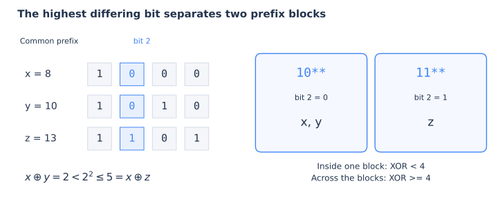

# 二进制性质：从逐位运算到整数结构

位运算从三处观察：逐位可能、最高不同位、置位集合。本篇由此推导存在性判定、最小 XOR 对与区间状态压缩。

默认非负整数，补集固定为 $W$ 位，位编号从零开始。$\operatorname{popcount}(x)$ 为一的个数。算术公式先按数学整数理解，实现须查溢出。

## 1. 每一位的贡献：从位运算推出普通算术关系

对一位 $a_i,b_i\in\{0,1\}$，只有四种情况：

| $a_i$ | $b_i$ | 普通和 $a_i+b_i$ | XOR | AND | OR |
|---|---|---|---|---|---|
| 0 | 0 | 0 | 0 | 0 | 0 |
| 0 | 1 | 1 | 1 | 0 | 1 |
| 1 | 0 | 1 | 1 | 0 | 1 |
| 1 | 1 | 2 | 0 | 1 | 1 |

将这一位乘以权重 $2^i$，再对所有位求和，就得到

$$\boxed{a+b=(a\oplus b)+2(a\mathbin{\&}b)
=(a\mid b)+(a\mathbin{\&}b).}$$

由此可将 AND、OR 转为两数之和。右侧仍是普通加法，重叠位由它处理进位，例如 $3+1=(3\oplus1)+2(3\mathbin{\&}1)=2+2=4$。

另外，OR 中的一位，恰好分成“只有一个数含有”和“两个数都含有”两类；这两类互不重叠，因此

$$a\mid b=(a\oplus b)+(a\mathbin{\&}b),$$

从而

$$\boxed{a\oplus b=(a\mid b)-(a\mathbin{\&}b).}$$

这里的减号是普通减法。它在这对表达式中成立，不能任意将 XOR 换成减法。

### “没有进位”究竟等价于什么？

由第一条恒等式，

$$\boxed{a+b=a\oplus b\iff a\mathbin{\&}b=0.}$$

也就是说，两个数没有共同的一位时，普通相加就是 XOR，也等于 OR。若存在共同的一位，普通和一定严格大于 XOR。

对多个非负整数也有相同的判定方向：普通和等于它们的 XOR，当且仅当每一位至多在一个数中出现。因为某位出现 $c_i$ 次时，普通和与 XOR 的差为

$$\sum_i\bigl(c_i-(c_i\bmod2)\bigr)2^i,$$

每项均非负，差为零恰好要求全部 $c_i\le1$。

### 从两数之和恢复原数

若能得到三个不同位置之间的和 $s_{12},s_{13},s_{23}$，则

$$a_1=\frac{s_{12}+s_{13}-s_{23}}2,\qquad
a_2=s_{12}-a_1,\qquad a_3=s_{13}-a_1.$$

得到一个原数以后，其他位置只需要知道它与这个数的和即可。这一步使用的是普通方程；位运算负责提供方程的右边。

> **复习例题**：[CF1556 D — Take a Guess](https://codeforces.com/problemset/problem/1556/D)（2021；独立估算约 1900；原题为交互题，可只练恢复模型）。它直接使用了“位运算信息 → 两数之和 → 普通方程”的转换。完整分析见[配套第 1 节](binary-properties-exercises.md#1-cf1556-d--take-a-guess)。

### 已知和与位运算结果：哪些条件才足以保证有解？

设希望找到非负整数 $x,y$，满足 $x+y=S$、$x\oplus y=X$。由上一节，AND 的值已经被唯一确定为

$$A=\frac{S-X}{2}.$$

所以首先要求 $S\ge X$，且 $S-X$ 为偶数。但这还不够：AND 为一的位置要求两数都为一，XOR 为一的位置要求两数恰有一个为一，它们不能重叠。因此

$$\boxed{\exists x,y\ge0:
x+y=S,\ x\oplus y=X
\iff S\ge X,\ S-X\text{ 为偶数},\ A\mathbin{\&}X=0.}$$

充分性可以直接构造：取 $x=A$、$y=A\mid X$。由于 $A$ 与 $X$ 的一位不相交，$y=A+X$，所以和为 $2A+X=S$，XOR 为 $X$。

条件满足时，$X$ 的每个一位可独立放入 $x$ 或 $y$，其余位固定。有序对共 $2^{\operatorname{popcount}(X)}$ 个；若要求两数均正，须再排除含零对。

若题目给的是 AND 值 $A$ 与和 $S$，则 XOR 必须为 $D=S-2A$，对应判定为

$$\boxed{S\ge2A,\qquad A\mathbin{\&}(S-2A)=0.}$$

这一次不需要额外要求 $S-2A$ 为偶数：它直接是 XOR，而不是某个量的两倍。比如 AND 为零、和为一，可以取 $(0,1)$。

> **练习**：[ABC238 D — AND and SUM](https://atcoder.jp/contests/abc238/tasks/abc238_d)（2022；独立估算约 1500；基础验收）。完整分析见[配套第 2 节](binary-properties-exercises.md#2-abc238-d--and-and-sum)。

### 将逐位观察用于总贡献

设有 $n$ 个数，第 $i$ 位有 $c_i$ 个一。对所有无序下标对 $p<q$，XOR 在这一位为一恰好需要一零一一，因此

$$\boxed{\sum_{p<q}(a_p\oplus a_q)
=\sum_i c_i(n-c_i)2^i.}$$

右侧虽然是“选一个一、选一个零”，却没有重复计算：每个满足条件的无序对里，一元素与零元素的角色唯一。

相同方法给出

$$\sum_{p<q}(a_p\mathbin{\&}a_q)=\sum_i\binom{c_i}{2}2^i,$$

$$\sum_{p<q}(a_p\mid a_q)
=\sum_i\left(\binom n2-\binom{n-c_i}{2}\right)2^i.$$

这些统计按原下标计数，相同数值出现多次仍是不同元素。计算为 $O(nW)$，各位计数占 $O(W)$ 空间；最终总和可能远大于任意单个输入。

## 2. 最高不同位：从数值比较推出候选结构

对不同 $a,b$，令 $k$ 为 $a\oplus b$ 最高一位。高位相同，本位不同；低位合计至多 $2^k-1$，无法推翻本位的大小。

因此，$a<b$ 当且仅当第 $k$ 位上 $a$ 为零、$b$ 为一。这也是 01 Trie 从高位贪心、线性基最值查询从高主元开始的共同依据。

再给两数同时异或一个固定值 $t$。它们的最高不同位仍是 $k$，因为

$$(a\oplus t)\oplus(b\oplus t)=a\oplus b.$$

$t$ 的第 $k$ 位为零则保留次序，为一则翻转。整体 XOR 保持两点 XOR 值，却不保持整数排序，不能继续沿用原数组次序。

### 为什么全局最小 XOR 对一定可以在相邻元素中找到？

先考虑三个不同的非负整数 $x<y<z$。设 $k$ 是 $x,z$ 的最高不同位，则

$$x\oplus z\ge2^k.$$

固定高位前缀对应连续数值区间。$x,z$ 高于 $k$ 的位相同，中间的 $y$ 也相同。若 $y$ 第 $k$ 位为零，则 $x\oplus y<2^k$；为一则 $y\oplus z<2^k$。因此

$$\boxed{\min(x\oplus y,y\oplus z)<x\oplus z.}$$

图中 $8=1000$、$10=1010$、$13=1101$ 共享最高的一位；在第 2 位上，前两者属于零分支。于是 $8\oplus10=2<4\le8\oplus13=5$。图示对应一般证明中的“中间数总会和某一个端点落入同一分支”。

最小 XOR 对若不相邻，取中间数便可得到更小对，矛盾。故排序后只查相邻项；重复值相邻，直接给出零。静态时间 $O(n\log n)$。

### 动态插入、删除只会改变常数个相邻关系

维护有序多重集 $S$，另用多重集 $E$ 保存所有相邻位置的 XOR。向相邻的 $p,q$ 之间插入 $x$，只会发生

$$\text{删除 }p\oplus q,\qquad
\text{加入 }p\oplus x\text{ 和 }x\oplus q.$$

删除反向处理，缺少邻居则略去对应项。修改 $O(\log n)$，查询取 $E$ 最小值。重复元素与相同 XOR 的邻边均按出现次数保留，只删一次。

此结论只用于全局最小对。固定 $x=10$、集合 $\{8,9,12\}$ 时，前驱九并非最优，$10\oplus8=2<3=10\oplus9$。最大对也未必相邻：$\{0,4,5,6\}$ 相邻 XOR 为 $4,1,3$，全局最大却为 $0\oplus6=6$。

> **例题**：[ABC308 G — Minimum Xor Pair Query](https://atcoder.jp/contests/abc308/tasks/abc308_g)（2023；独立估算约 2100；有序多重集与局部修改）。上面的三数性质正是[官方题解](https://atcoder.jp/contests/abc308/editorial/6716)使用的观察。完整分析见[配套第 3 节](binary-properties-exercises.md#3-abc308-g--minimum-xor-pair-query)。

### 连续整数区间：公共高位前缀控制 AND 与 OR

这里讨论的是数值区间 $L,L+1,\ldots,R$，不是任意数组的一段。

当 $L<R$，令 $k$ 为 $L\oplus R$ 的最高一位，$P$ 为两端点高于 $k$ 的公共部分，即将低 $k+1$ 位清零后的值。整个区间高于 $k$ 的位都相同。

区间还一定包含跨过两半边界的两个相邻数

$$P+2^k-1,\qquad P+2^k.$$

它们低 $k+1$ 位分别为“零后接全一”和“一后接全零”。所以在整个区间的 AND 中，这些低位全部为零；在 OR 中则全部为一。因此

$$\boxed{\bigwedge_{x=L}^{R}x=P,\qquad
\bigvee_{x=L}^{R}x=P+(2^{k+1}-1).}$$

若 $L=R$，两种结果都是 $L$，不应对零计算最高一位。例如 $[10,13]$ 的公共高位为 $1000$，故 AND 为八、OR 为十五。

## 3. 一位看成一个元素：从集合包含推出单调性

固定 $W$ 位，让掩码 $S$ 表示哪些位置取一，全集为 $M=2^W-1$。于是 AND 是交集，OR 是并集，XOR 是对称差，$M\oplus S$ 是补集。

集合包含关系有直接的判定：

$$\boxed{S\subseteq T\iff S\mathbin{\&}T=S\iff S\mid T=T.}$$

特别地，$S\mathbin{\&}T=0$ 表示不相交，此时 $S+T=S\mid T=S\oplus T$。若 $T\subseteq S$，删除 $T$ 的元素也可以写成

$$\boxed{S\setminus T=S\oplus T=S-T.}$$

减法成立是因为 $T$ 的每个一位在 $S$ 中本来就存在，逐位删除不需要借位。缺少包含条件时不成立，例如 $4-1=3$，而 $4\oplus1=5$。

非负掩码中 $S\subseteq T$ 推出 $S\le T$，反向不成立，如 $3<4$ 而 $011$ 不包含于 $100$。因此 $x\ge k$ 与 $(x\mathbin{\&}k)=k$ 是不同限制。

涉及取反时必须说明位宽。集合补集是 $M\oplus S$；程序里的 `~S` 会翻转整个类型的所有位，未必就是题目所用的 $W$ 位补集。

### 单向变化：为什么许多区间状态只有 $O(W)$ 种？

给当前结果再 AND 一个数，只会删去一位；再 OR 一个数，只会增加一位。因此它们既对集合包含单调，也对非负整数的数值大小单调：

$$x\mathbin{\&}a\le x,\qquad x\mid a\ge x.$$

固定 $l$ 扩大 $r$，区间 AND 单调不增。因此 AND 至少为 $k$ 的右端点成前缀，可二分；这里是数值比较，不是置位包含。

固定右端点并向左扩展，AND 每次严格变化至少永久清除一位，故**不同结果至多 $W+1$ 个**。OR 同理，每次至少永久增加一位。

将以当前位置结尾的区间按长到短排列，保存不同结果及次数。接新元素后统一 AND/OR，再追加单点区间。AND 按包含关系递增，OR 递减，更新后仍保序，故同值连续，可线性合并。每轮 $O(W)$ 状态，总时间 $O(nW)$、滚动空间 $O(W)$；全局结果存储另计。

XOR 不具备这样的单向变化，一位可能反复出现、消失。固定右端点的不同子数组 XOR 可以远多于 $W+1$，不能照搬这个状态上界。

> **练习**：[CF1878 E — Iva & Pav](https://codeforces.com/problemset/problem/1878/E)（2023；独立估算约 1600；额外前置：二分与区间查询）。它检验的是数值单调性，不要求使用上面的状态压缩。完整分析见[配套第 4 节](binary-properties-exercises.md#4-cf1878-e--iva--pav)。

### 独立选择各个位：子掩码的个数、总和与总 XOR

$M$ 有 $r$ 个一位，每位独立选取，共 $2^r$ 个子掩码，含零。一般生成空间的位未必独立，应按秩计数：仅生成元 $3=(11)_2$ 时，空间只有 $\{0,3\}$。

若掩码 $M$ 有 $r\ge1$ 个一位，每个一位恰好在一半的子掩码中出现，所以

$$\boxed{\sum_{s\subseteq M}s=M\cdot2^{r-1}.}$$

全部子掩码求 XOR 只看次数奇偶：$r\ge2$ 时每位置位 $2^{r-1}$ 次，结果零；$r=1$ 时为 $M$；$r=0$ 时也为零。

## 使用这些性质时，先核对哪几个条件？

| 看到的限制 | 优先检查的结构 | 不能省掉的条件 |
|---|---|---|
| AND、OR、XOR 与和同时出现 | 每一位分成共同的一与不同的一 | 数学恒等式的中间值也要装得下 |
| 求最小两两 XOR | 最高不同位、排序后的相邻项 | 两个不同出现；重复值要保留 |
| 区间 AND、OR | 位只会单向变化 | 非负整数；阈值大小与集合包含不同 |
| 固定掩码、子集关系 | 一位看成集合元素 | 补集的全集与位宽要明确 |
| 求所有方案的和、XOR、奇偶性 | 固定一位统计参与次数 | 下标方案与不同结果要分清 |

检查零值、空集、有无序、重复次数。移位小于类型位宽，最高位函数避开零，按位与比较混用时加括号，如 `(a & b) == 0`。

## 参考与进一步阅读

- [ABC308 G 官方题解](https://atcoder.jp/contests/abc308/editorial/6716)：三数间的 XOR 不等式与相邻候选维护。第 2 节围绕最高不同位重新展开证明，并补充重复值与误用反例。
- [ABC238 D 官方题解](https://atcoder.jp/contests/abc238/editorial/3369)：AND 与和的存在性条件。可对照其必要条件与充分性构造。
- [CF1556 D 原题](https://codeforces.com/problemset/problem/1556/D)：AND、OR 查询恢复数组。本文依据题面查询规则，用恒等式与普通方程给出恢复过程；不依赖交互代码模板。
- [CF1878 E 官方题解页面](https://codeforces.com/blog/entry/120813)：E 题的按位前缀计数与二分；页面正文部分显示加载占位时，可核对所附的官方实现。
- 已有的[01 Trie 笔记](../../data-structure/binary-trie/binary-trie.md)、[线性基笔记](../xor-basis/xor-basis.md)：分别继续讨论从真实元素中选一个，以及从生成空间中选一个。

其他基础公式已在正文中给出独立推导；配套练习均有[完整分析](binary-properties-exercises.md)，可在自主尝试后对照。
