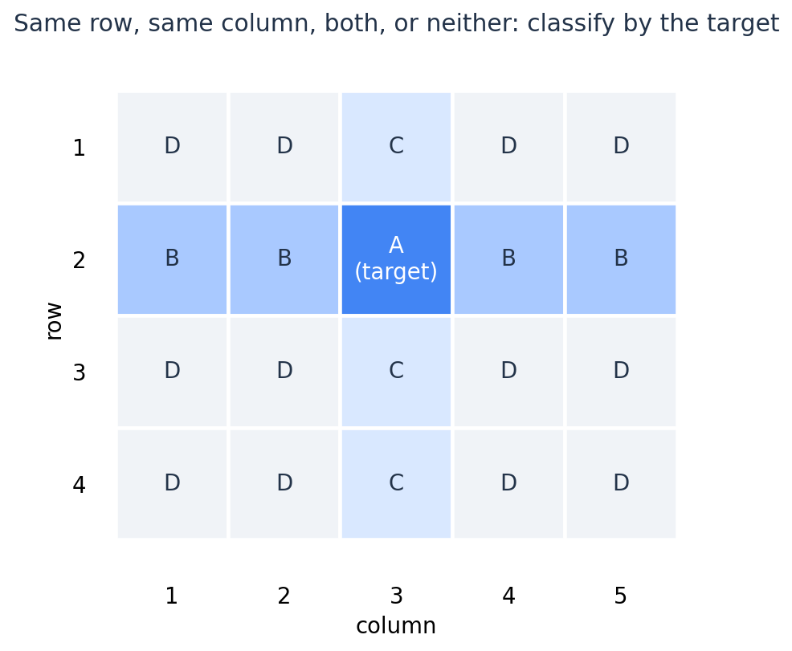
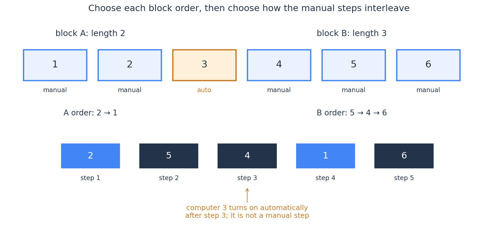
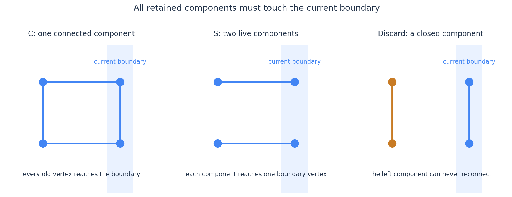
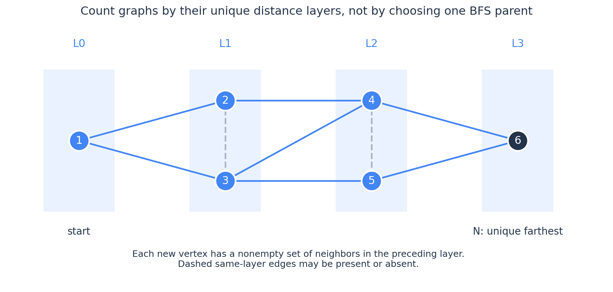

# 组合数学 + DP：六道例题的完整推导与八道迁移练习

这篇直接从题目开始。每道例题都给出题意、尝试的切入点、状态与转移的推导、计数不重不漏的理由，以及落到数据范围时需要处理的边界。正文之后的迁移题只给链接与必要前置，不给完整解法。

[组合数学篇](../combinatorics/combinatorics.md)中已经展开过的 Alphabet Tiles、Group Projects、Make Pair 不重复讲；Counting Factorizations 原先只作为练习出现，这次展开。全文不使用生成函数，主要状态均保留实际方案数，不要求先做阶乘归一化。

| 例题 | 主要练习内容 | 独立估算 CF 难度 |
| --- | --- | --- |
| ABC232 E — Rook Path | 对具体位置分类，数清每类转移的选择数 | 1900 |
| ABC217 G — Groups | 禁止加入的组，能否仅由一个数量确定 | 2100 |
| CF1794 D — Counting Factorizations | 重复值的角色选择与指数位置的分配 | 2100 |
| CF1515 E — Phoenix and Computers | 手动操作的连续块、块内顺序与块间交错 | 2400 |
| ABC248 F — Keep Connect | 哪些历史连通结构必须保留，哪些能舍去 | 2300 |
| ABC281 G — Farthest City | 逐层构造图，将选点与选边变成转移系数 | 2500 |

最后一题作为综合提高；不要求第一次就能独立想到。所有复杂度按固定宽度整数模运算计，组合数越界取零，但这不代替对数组下标和其他状态范围的检查。

## 1. ABC232 E — Rook Path：巨大棋盘上，怎样只维护四个数量？

[原题](https://atcoder.jp/contests/abc232/tasks/abc232_e)（2021）

在 $H\times W$ 的棋盘上，车从 $(x_1,y_1)$ 出发，每次必须移到同一行或同一列的另一个格子。恰好走 $K$ 次，到达 $(x_2,y_2)$ 的操作序列有多少种？模 $998244353$。

范围是 $2\le H,W\le10^9$、$K\le10^6$。答案区分每一步实际走到的位置。

### 从“记住当前格子”开始，哪些差别影响后续？

最直接的状态是每个格子的到达方案数。棋盘太大，无法逐格维护。先固定目标 $(x_2,y_2)$，考虑当前位置与目标的关系：

- $A$：恰好在目标。
- $B$：与目标同行，但不同列。
- $C$：与目标同列，但不同行。
- $D$：与目标既不同行，也不同列。

这里不是只凭“对称”就把格子合并。真正要核对的是：从同一类的任意具体格子出发，下一步进入四类格子的选择数是否完全相同。

例如当前在 $B$ 类：水平移动时，有一个目标格子可去，还有 $W-2$ 个其他 $B$ 类格子；竖直移动时，有 $H-1$ 个 $D$ 类格子。不同的 $B$ 类格子，得到的这三个数量都一样。

图中的分类依据是目标，不是起点。起点可以落在任何一类，初始时相应类的方案数设为一。

把所有情况列出来，下面的每个数都是“从一个具体格子出发，可选多少个下一格”：

| 当前类别 | 去 $A$ | 去 $B$ | 去 $C$ | 去 $D$ |
| --- | ---: | ---: | ---: | ---: |
| $A$ | $0$ | $W-1$ | $H-1$ | $0$ |
| $B$ | $1$ | $W-2$ | $0$ | $H-1$ |
| $C$ | $1$ | $0$ | $H-2$ | $W-1$ |
| $D$ | $0$ | $1$ | $1$ | $H+W-4$ |

最后一行值得单独检查。从既不同行也不同列的格子出发，水平移到目标列，得到一个 $C$ 类格子；竖直移到目标行，得到一个 $B$ 类格子。其他可走格子仍属于 $D$。一步只能改行或改列，因此不能直接到目标。

### 状态中的数，是整类方案的总和

令 $A_t,B_t,C_t,D_t$ 分别表示走 $t$ 步、落在相应类别中任意格子的操作序列总数。它们不是单个代表格子的方案数。

由表格直接得到

$$
\begin{aligned}
A_{t+1}&=B_t+C_t,\\
B_{t+1}&=(W-1)A_t+(W-2)B_t+D_t,\\
C_{t+1}&=(H-1)A_t+(H-2)C_t+D_t,\\
D_{t+1}&=(H-1)B_t+(W-1)C_t+(H+W-4)D_t.
\end{aligned}
$$

为什么类总和乘一个系数就够？以 $B_t$ 为例，它汇总了许多条落点不同的路径，但每条路径都恰好有 $W-2$ 个下一格留在 $B$，所以总贡献为 $(W-2)B_t$，无须知道这些路径分别落在哪一列。

也不会重复：一个具体的新路径，删去最后一步就有唯一的旧路径，最后一步的实际落点也唯一。分类只压缩存储，不会把不同的实际路径合成一个答案。

初始化由起点所属类别决定；四个数中恰好一个为一。目标类 $A$ 只有一个格子，答案直接是 $A_K$。时间 $O(K)$，额外空间 $O(1)$。

### 用最小例子检查系数

在 $2\times2$ 棋盘上，从一个角走到对角，恰好两步。初始在 $D$：

$$
(A_0,B_0,C_0,D_0)=(0,0,0,1),
$$

一步后为 $(0,1,1,0)$，两步后 $A_2=2$，正是先横后竖、先竖后横两种。

当 $H=2$ 或 $W=2$，表中有些系数恰好为零。这表示某类移动没有选择，不需要改变状态定义。每轮必须使用旧层的四个数，不能写回一个量后又拿它参与其他新量的计算。

按目标分类还有一个方便之处：最后不用把某一类总数除以类别大小。若改用起点分类再求某个终点的数，不能未经检查就做模意义的均分；类别大小未必可逆。

> **迁移练习**：[ABC253 E — Distance Sequence](https://atcoder.jp/contests/abc253/tasks/abc253_e)（估算约 1900；2022；额外前置：前缀和）。练习判断当前位置还能保留多少信息，以及怎样汇总一批前驱。本题不保证能压成固定数量的类别。

## 2. ABC217 G — Groups：每个组里有什么，为什么可以不记录？

[原题](https://atcoder.jp/contests/abc217/tasks/abc217_g)（2021）

将编号 $1,\ldots,N$ 的人划成 $k$ 个非空、无编号组。同余于模 $M$ 的人不能在同一组。对每个 $k=1,\ldots,N$ 求方案数，模 $998244353$。$N\le5000$，$2\le M\le N$。

例如 $N=4,M=2$，$1,3$ 不能同组，$2,4$ 也不能同组。划成两个组时只有

$$
\{\{1,2\},\{3,4\}\},\qquad
\{\{1,4\},\{2,3\}\}.
$$

组没有编号，但人有不同身份。

### 看起来需要记录各组余数集合，先检查真正要问的量

按编号从小到大加入人。加入第 $i$ 人时，可以单独开新组，也可以加入一个已有组。

若要判定某个指定组能否加入，确实需要知道它已经含有哪些余数。但 DP 不一定需要回答“指定组是否合法”；它可能只需要知道“有多少个组合法”。

前 $i-1$ 人中，与 $i$ 同余的人为

$$
i-M,\ i-2M,\ldots,
$$

一共有

$$
q_i=\left\lfloor\frac{i-1}{M}\right\rfloor
$$

个。由于旧划分本来就合法，这些人必须两两处在不同的组。因此，他们恰好禁止了 $q_i$ 个不同组，没有两个禁忌对象落在同一组造成重复。

于是，对任意一个含 $j$ 个组的合法旧划分，第 $i$ 人都恰好有 $j-q_i$ 个旧组可加入。组的具体成员虽然不同，合法组的数量始终相同。

如果没有“这些禁忌对象必在不同组”的性质，这一步就不能成立。例如只知道有两个人不能与新人同组，但他们可能已在同一组，也可能分属两组，那么被禁止的组数就可能是一或二，单记 $j$ 不够。

### 把这个数量放入递推

定义

$$
f_i(j)=\text{将前 }i\text{ 人合法划成 }j\text{ 个非空、无编号组的方案数}.
$$

给定最终划分，观察第 $i$ 人：

若它单独成组，删去它后有 $j-1$ 个组；否则删去它后仍有 $j$ 个组，而放回时有 $j-q_i$ 个合法旧组可选。所以

$$
\boxed{
f_i(j)=f_{i-1}(j-1)+(j-q_i)f_{i-1}(j).
}
$$

初始化 $f_0(0)=1$，最终依次输出 $f_N(1),\ldots,f_N(N)$。每层枚举组数，时间 $O(N^2)$，滚动空间 $O(N)$。

这里仍然不需要给组编号。一个具体旧划分中，每个组都是不同的非空元素集合，选择加入哪个集合，本身就是不同选择。递推也不再乘 $j!$，因为题目没有给组编号。

若形式上枚举到 $j<q_i$，对应旧划分不可能存在，$f_{i-1}(j)=0$。实现时可跳过这项，或者仅在 $j\ge q_i$ 时使用第二项；不要把负的 $j-q_i$ 解释成真实选择数。也可以采用每层重新清零的数组，以免混用新旧层。

### 跟踪一遍 $N=4,M=2$

| 已处理人数 $i$ | $f_i(1)$ | $f_i(2)$ | $f_i(3)$ | $f_i(4)$ |
| --- | ---: | ---: | ---: | ---: |
| $1$ | $1$ | $0$ | $0$ | $0$ |
| $2$ | $1$ | $1$ | $0$ | $0$ |
| $3$ | $0$ | $2$ | $1$ | $0$ |
| $4$ | $0$ | $2$ | $4$ | $1$ |

加入第 $3$ 人时，它不能加入包含第 $1$ 人的组，因此从“两人同组”的旧划分只能开新组；从“两人分组”的旧划分，能加入含第 $2$ 人的组，也能开新组。

这道题的状态压缩具体依赖于编号顺序：同一余数的旧人数 $q_i$ 已由 $i$ 决定，而他们占据的组数又恰好等于人数。

> **短迁移练习**：[CF1957 C — How Does the Rook Move?](https://codeforces.com/problemset/problem/1957/C)（估算约 1800；2024）。数的是最终棋盘，落子顺序不应重复计入；适合练习固定一个尚未处理的对象后分类递推。

> **可选提高**：[ABC194 F — Digits Paradise in Hexadecimal](https://atcoder.jp/contests/abc194/tasks/abc194_f)（估算约 2400；2021；额外前置：数位 DP）。练习已使用类型的数量何时足够，以及边界约束何时要求保留具体类型。

## 3. CF1794 D — Counting Factorizations：重复数值怎样选择角色与分配指数位置？

[原题](https://codeforces.com/problemset/problem/1794/D)（2023）

一个正整数的质因数分解写成

$$
m=p_1^{e_1}\cdots p_n^{e_n},\qquad p_1<\cdots<p_n.
$$

给出一个包含 $2n$ 个数的多重集合，它必须恰好等于所有底数与指数构成的多重集合

$$
\{p_1,e_1,\ldots,p_n,e_n\}.
$$

求可能的整数 $m$ 的数量，模 $998244353$。$n\le2022$，输入数值不超过 $10^6$。底数必须是互不相同的质数，指数只要求是正整数。

例如多重集合 $\{1,2,2,3\}$：底数只能选 $2,3$，指数剩 $1,2$。将它们分别分配给两个底数，有 $2^1 3^2=18$ 和 $2^2 3^1=12$ 两个答案。

### 先把“相同的出现”合并成一个类型

设不同数值为 $v_1,\ldots,v_D$，出现次数为 $c_1,\ldots,c_D$。

对于数值 $v_i$，只有两种角色安排：

- 不作为底数，全部 $c_i$ 份都作为指数。
- 若 $v_i$ 是质数，取其中一份作为底数，其余 $c_i-1$ 份作为指数。

第二种不是 $c_i$ 个不同选择。输入多重集合中的相同数没有身份，拿走哪个副本都得到同一个底数集合与剩余指数集合。

底数还必须互不相同，所以某个质数值至多承担一次底数角色。非质数，包括一，只能承担指数角色。

### 给指数准备 $n$ 个位置

最终选好底数后，将它们从小到大排列，第 $r$ 个指数位置就对应第 $r$ 个底数。这样，底数集合与长度为 $n$ 的指数序列一一确定整数 $m$；由唯一分解，不会有不同的这类表示产生同一个整数。

现在先预留这 $n$ 个有区别的位置。处理一个类型时，决定它是否用作底数，并把剩下的相同数值放进若干尚空的指数位置。

这些位置不需要提前知道对应哪个质数。最终选出的质数集合会给位置确定唯一含义；题目也没有额外条件限制某个指数能配给哪个质数。

这不是在数可以任意编号的额外对象：位置顺序已经约定为最终底数从小到大的顺序。

### 少记一维：已经填了多少位置，其实能推出

处理完前 $i$ 种数值，设总共处理的副本数为

$$
A_i=\sum_{r=1}^i c_r.
$$

如果其中有 $b$ 份承担底数角色，其余必然都承担指数角色，所以已填指数位置数为

$$
u=A_i-b.
$$

因此只需定义 $f_i(b)$：处理完前 $i$ 种数值，选出 $b$ 个不同底数，并将其余副本放入指数位置的方案数。$A_i$ 由阶段决定，不必额外存储 $u$。

设下一种数值出现 $c$ 次，令 $\delta$ 表示是否选它作底数。$\delta=0$ 总是允许；只有它为质数时才允许 $\delta=1$。需要放进指数位置的副本数为 $r=c-\delta$，而空位数为 $n-u$。于是

$$
\boxed{
f_{i+1}(b+\delta)\mathrel{+}=
f_i(b)\binom{n-(A_i-b)}{c-\delta}.
}
$$

只从 $0\le b\le n$、$0\le A_i-b\le n$ 的状态出发，并要求新底数数目不超过 $n$。从 $n-u$ 个空位里选择 $r$ 个填相同数值，正是组合数；不需要再乘 $r!$。

初始 $f_0(0)=1$，最终取 $f_D(n)$。由于 $A_D=2n$，选出 $n$ 个底数时，已填指数位置数自动是 $n$。

### 再检查两种重复，分别有没有处理

给定一个最终整数，唯一分解确定底数集合和每个指数，因此每种数值的 $\delta$、它占据的指数位置都唯一。这些信息完全恢复一条转移路径，故不会把同一整数多算。

反过来，任何最终选满 $n$ 个底数、填满 $n$ 个指数位置的路径，都得到互异质数底数和正整数指数；所有输入副本也恰好用完，因而一定是合法答案。

例如输入 $\{2,2,2,3\}$，仍只能选底数 $2,3$，指数为 $2,2$。填这两个位置只有 $\binom22=1$ 种，答案是 $36$，不是两种；这与前一个例子的两个不同指数形成对照。

质数预处理可用基础筛，耗时 $O(V\log\log V)$、空间 $O(V)$，其中 $V$ 为输入最大值。DP 为 $O(Dn)$，由于 $D\le2n$，至多 $O(n^2)$；滚动状态空间 $O(n)$。组合数可用到 $n$ 的阶乘、逆阶乘表，使每次查询为常数时间，预处理另计一次逆元求法的代价。

需要注意，若某一步处理后指数副本已超过 $n$，就直接丢弃这个分支：以后增加底数只会从以后处理的副本中拿走一个，不能把已经放进位置的旧副本改成底数。处理某个类型时，它的角色决定已经完成。

这条递推中的状态保留实际方案数，系数始终对应“从剩余位置里选几个”。底数角色与指数位置都确定以后，唯一分解就把这个构造结果对应到一个整数。

> **可选综合练习**：[ABC231 G — Balls in Boxes](https://atcoder.jp/contests/abc231/tasks/abc231_g)（估算约 2500；2021；额外前置：期望线性性与基本概率）。可用计数与二次 DP 完成，不需要生成函数；操作次数很大，需要先判断究竟应当按什么量建立状态。

## 4. CF1515 E — Phoenix and Computers：先确定哪些电脑手动开启，再数顺序

[原题](https://codeforces.com/problemset/problem/1515/E)（2021）

一行 $n$ 台电脑起初都关闭。每次选择一台尚未开启的电脑手动开启；若某台内部电脑的左右邻居都已开启，它会立即自动开启。已经自动开启的电脑不能再手动选择。

要求最终全部开启，数不同的手动开启序列。手动开启的集合不同，或者顺序不同，都算不同答案。$3\le n\le400$，对题目给出的素数 $M$ 取模。

模拟整个开关状态需要二进制集合，显然无法做到 $n=400$。先不按操作时间推进，而是观察一个已经完成的合法过程，其手动开启集合沿数轴具有什么结构。

### 自动开启的位置不能相邻，也不能在两端

两端电脑没有两个邻居，必须手动开启。

如果两个相邻位置都计划自动开启，那么它们中先开启的那个，需要另一个已经开启，矛盾。所以自动位置必须孤立，左右两侧都是手动位置。

因此，所有手动位置恰好组成若干个非空连续块，相邻块之间隔着一台自动电脑，且首尾都属于手动块：

$$
\text{手动块}\ \vert\ \text{自动点}\ \vert\
\text{手动块}\ \vert\ \cdots\ \vert\ \text{手动块}.
$$

这里的块由最终手动集合唯一确定。我们不会任意把一段手动位置再拆成几个块，因为那会引入同一过程的多种分解。

但仅有这个形状仍不够：同一块内部，某些手动顺序可能导致一台计划手动的电脑提前自动开启。

### 一段长度为 $t$ 的手动块，合法内部顺序为什么是 $2^{t-1}$？

先看块内最后一个手动位置。如果它在块内部，它的两个邻居也是手动位置，并且都比它更早开启；在第二个邻居开启时，它就已经自动开启，不能再作为最后一个手动位置。因此，最后一个位置必须是块的左端或右端。

删去这个最后位置，余下仍是一段连续块。递归地逆向删除，每次只可删左端或右端，直到剩一个位置。于是有

$$
B_1=1,\qquad B_t=2B_{t-1},
$$

即

$$
\boxed{B_t=2^{t-1}.}
$$

还要证明这样得到的顺序确实都合法，而不只是必要条件。反向看，每次删端点得到的顺序，正向的每个已开启前缀都占据块内一段连续区间；未开启的位置都在这段区间外，不会被两个已开启的块内邻居夹住。

块外的自动分隔点也不会提前触发一个仍应手动开启的块端点：分隔点要自动开启，前提已经包含相邻的这个端点开启。因此它不能先亮起来，再把该端点提前变成自动开启。

所以这些顺序全部合法，而且最后位置的左右选择能唯一恢复，数量确为 $2^{t-1}$。

长度三时，四个内部顺序为

$$
(1,2,3),\quad(2,1,3),\quad(2,3,1),\quad(3,2,1).
$$

另外两个排列 $(1,3,2),(3,1,2)$ 都不合法：中间位置会提前自动开启。这里不能用 $t!$ 代替 $B_t$。

### 不同块的操作能任意交错吗？

固定各块的一个合法内部顺序。将不同块的操作任意交错，不会改变任一块内部的相对次序。

前面已证明，自动分隔点不会导致手动块端点提前自动开启；块内合法性又只取决于该块的内部顺序。因此任意交错都合法。两侧边界手动位置最终都会开启，所以每个分隔点也最终都会自动开启。

例如固定块长为二和三，中间隔一个自动点。一共手动操作五次，块内顺序有 $2^1\cdot2^2=8$ 种，交错方式有 $\binom52=10$ 种，对应这组固定块位置的总贡献为八十。

图中一个具体操作顺序是 $(2,5,4,1,6)$。位置三在位置二、四都开启后自动开启，不进入手动操作序列；也不占用一个需要交错的操作位置。

### 按空间上的最后一块建立 DP

定义 $F(i,j)$：在前 $i$ 个位置上，按上述方式形成完整块结构，最右位置是手动位置，一共使用 $j$ 次手动操作的合法序列数。这里只处理最终块结构及其手动顺序，不逐时模拟开关。

对 $i\ge1$，若整个前缀只有一个块，则只能 $j=i$，贡献 $B_i$。

否则固定最后一块长度为 $t$。它前面是一个自动分隔点，更前面的完整前缀长度为

$$
m=i-t-1\ge1.
$$

旧前缀用了 $j-t$ 次手动操作；最后一块有 $B_t$ 个内部顺序；将两部分手动操作交错，有 $\binom jt$ 种。所以

$$
\boxed{
F(i,j)=
\mathbf1_{j=i}\,B_i+
\sum_{\substack{1\le t\le i-2\\t\le j}}
F(i-t-1,j-t)B_t\binom jt.
}
$$

答案为 $\sum_{j=1}^n F(n,j)$。按 $i$ 递增计算即可；无效的 $j$ 和前驱状态视为零。

也可以从已有前缀向后添加一段“自动分隔点 + 手动块”，将 $F(i,j)$ 转移到 $F(i+t+1,j+t)$，系数为 $B_t\binom{j+t}{t}$。第一个块没有前置自动点，需要单独初始化 $F(t,t)=B_t$。不要为了统一转移，凭空把一个真实自动位置加到首尾。

为什么不会数重？最终手动序列唯一确定手动集合、最后一个手动块的位置与长度；提取最后一块的操作，就得到它的内部顺序与其在总序列中的操作位置，其余则是旧前缀的顺序。恰好恢复递推中的全部选择。

$n=4$ 时，四个位置全手动贡献 $B_4=8$；只有位置二自动、只有位置三自动，各贡献六，合计二十。原题样例相符。

共有 $O(n^2)$ 个状态，每个枚举最后块长，时间 $O(n^3)$、空间 $O(n^2)$，组合数用 Pascal 表或合法的阶乘表预处理。输入模数是素数且远大于 $n$，两种求法都可用。

> **迁移练习**：[CF1920 E — Counting Binary Strings](https://codeforces.com/problemset/problem/1920/E)（估算约 2300；2024）。练习将字符串换一种分段表示，再把全局统计量放入 DP；还需要根据实际转移范围分析总复杂度。

> **迁移练习**：[ABC207 E — Mod i](https://atcoder.jp/contests/abc207/tasks/abc207_e)（估算约 2200；2021；额外前置：前缀和与同余）。练习让最终切分位置唯一确定前驱，并将大批前驱的贡献汇总起来。

## 5. ABC248 F — Keep Connect：为什么边界连通还不够？

[原题](https://atcoder.jp/contests/abc248/tasks/abc248_f)（2022）

两行 $N$ 列的梯形网格图：上下两行各有相邻列之间的水平边，每列还有一条竖边，共 $2N$ 个顶点、$3N-2$ 条边。对每个 $d=1,\ldots,N-1$，求删去恰好 $d$ 条边后图仍连通的方案数，模题目给定的素数 $P$。$N\le3000$。

题目数的是保留哪些边，不是删边顺序。同一删边集合的各种执行顺序不能额外计入。

### 从左向右决定边，未来只会接触最右列的两个顶点

处理完前 $i$ 列后，所有将来新增的边都必须通过第 $i$ 列的上下两个顶点，才能连接到旧图。

因此，若旧图已经出现一个连通分量，里面不含这两个边界顶点，那么这个分量再也无法连到未来。即使以后所有边都保留，最终也不可能连通，可以立即丢弃。

这一步比单纯记录“最右列两个点是否连通”更重要：两个边界点即使已经连通，旧图内部仍可能藏着一个永远无法接回来的孤立部分。

图右的两个边界点在同一分量，但左侧已经与它们断开。这种状态不属于下面的“连通态”，应当直接剔除。

在这个必要条件下，因为边界只有两个顶点，只剩两类局部图：

- $C$：整个旧图连通，两个边界点在同一个连通分量。
- $S$：旧图恰有两个连通分量，分别包含一个边界点。

记 $C_i(d),S_i(d)$ 为前 $i$ 列删去 $d$ 条边后，处于上述状态的图的数量。第一列只有一条竖边：

$$
C_1(0)=1,\qquad S_1(1)=1.
$$

其他状态为零。现在逐列新增两条水平边和一条新竖边。

### 从连通态出发，局部选择为什么是 $1,3,2$？

旧图处于 $C$ 时，可以把它整体看成一个已连接的部分，新上下顶点是另外两个点。三条新边在这三个部分之间构成一个三角形。

- 三条全保留：仍连通，新增删除数零，只有一种。
- 恰删一条：剩两条仍连接全部三个部分，新增删除数一，有三种。
- 恰删两条：若仅保留上水平边或下水平边，旧部分仍接触新边界，得到 $S$，有两种。
- 若仅保留新竖边，或三条全删，旧部分失去与新边界的全部联系，应当丢弃。

注意“三角形”只是将旧连通部分收缩后分析连接关系，不表示原图真的多了一条边。

### 从分离态出发，为什么没有类似的三种选择？

旧图处于 $S$ 时，上下两个旧连通分量本来不相连。新上水平边是旧上分量通向未来的唯一出口，新下水平边则是旧下分量的唯一出口。因此两条水平边都必须保留。

新竖边保留，两个旧分量与两个新顶点全部连通，得到 $C$；新竖边删除，则仍是 $S$。只有这两种合法情况。

完整转移表为：

| 旧状态 | 新状态 | 新增删除数 | 选择数 |
| --- | --- | ---: | ---: |
| $C$ | $C$ | $0$ | $1$ |
| $C$ | $C$ | $1$ | $3$ |
| $C$ | $S$ | $2$ | $2$ |
| $S$ | $C$ | $0$ | $1$ |
| $S$ | $S$ | $1$ | $1$ |

于是

$$
\boxed{
\begin{aligned}
C_{i+1}(d)&=C_i(d)+3C_i(d-1)+S_i(d),\\
S_{i+1}(d)&=2C_i(d-2)+S_i(d-1).
\end{aligned}
}
$$

删边数为负时对应项为零。最终只取 $C_N(d)$，因为 $S$ 只是可能在将来合并的中间状态，不能作为最终连通图计入。

### 为什么不需要保存旧图究竟怎样连接？

后面的所有连接都通过边界。如果旧图处于 $C$，边界内部的具体路径不影响新增三条边的连通效果；处于 $S$ 时，两个旧分量也只分别通过两个边界点对外连接。

不同的旧图仍是不同方案，只是它们面对每类局部删边选择时的结果一致，才可以把数量汇总。固定每条边在哪一列被决定后，一个最终保留边集合也有唯一的构造路径，不会把同一图多算。

用 $N=2$ 检查：原图是一个四边形，删一条边的四种选择都连通，所以 $C_2(1)=4$。$N=3$ 时得到 $C_3(1)=7,C_3(2)=15$，与原题样例一致。

每列枚举删边数，时间 $O(N^2)$；只保留相邻两列，空间 $O(N)$。最终连通图至少有 $2N-1$ 条边，因此最多删 $N-1$ 条，保留这一范围的计数即可。删除数只会增加，超过最终需要范围的状态不必继续保留。

> **迁移练习**：[ABC287 F — Components](https://atcoder.jp/contests/abc287/tasks/abc287_f)（估算约 2400；2023；额外前置：树形 DP 与子树合并）。练习数清两个局部结构合并时，连通分量数如何变化；还需按实际子树规模核算总转移次数。

## 6. ABC281 G — Farthest City：怎样把整张图变成一层一层的组合选择？

[原题](https://atcoder.jp/contests/abc281/tasks/abc281_g)（2022；综合提高）

数 $N$ 个有编号顶点的简单连通无向图，要求从顶点一出发，顶点 $N$ 是唯一最远点：

$$
d_u<d_N\qquad(2\le u\le N-1),
$$

其中 $d_u$ 是从一到 $u$ 的最短路长度。对给定整数 $M$ 取模，$N\le500$，$10^8\le M\le10^9$，**不保证 $M$ 是素数**。

逐条边决定是否存在，共有 $2^{\binom N2}$ 种图，无法枚举。题目条件直接谈最短路长度，因而先固定每个点的距离层，再研究哪些边可以选择。

### 固定距离层后，哪些边必须有，哪些边不能有？

记第 $r$ 层为 $L_r=\{u:d_u=r\}$。$L_0=\{1\}$，题目要求最后一层恰好是 $\{N\}$。

一张图的实际距离层一定满足：

1. 每个非起点顶点，至少有一个邻居在前一层。取一条最短路，其倒数第二个顶点就给出了这样的邻居。
2. 不同层之间，只有相邻层能连边。若某条边两端层数相差至少二，就能给较远端构造一条更短的路。
3. 同层内部的边可以任意存在，不会缩短层数。

前两条也足以保证指定层数确实是最短路距离，不能只证明必要性。

一方面，每个点通过前一层邻居不断往前走，得到一条长度恰好等于其层数的路；另一方面，任何边最多使层数变化一，从第零层走到第 $r$ 层至少要走 $r$ 步。因此指定层数同时给出上下界，正是实际距离。

图中各层依次为 $\{1\},\{2,3\},\{4,5\},\{6\}$，六是唯一最远点。新层有两个点时，它们之间的边也可以选。两层以上的跨层边则禁止。

### 一次添加大小为 $k$ 的新层，分别选择什么？

假设已经放置 $i$ 个普通顶点，这里“普通”指除 $N$ 外的顶点，包含起点一；当前最外层有 $j$ 个点。还未放置的普通顶点有 $N-1-i$ 个。

先暂时不放 $N$，添加下一层的 $k\ge1$ 个普通顶点：

**选择标签。** 从剩余普通顶点中选出这一层的集合，有

$$
\binom{N-1-i}{k}
$$

种。层内不排序，因为对象是一张图，不是一个顶点排列。

**选择与前一层之间的边。** 每个新点必须选前一层的一个非空邻居子集，有 $2^j-1$ 种；不同新点对应不同的边，因此可独立选，合计

$$
(2^j-1)^k.
$$

**选择新层内部的边。** $k$ 个点之间有 $\binom k2$ 对，每条边独立选或不选，贡献

$$
2^{\binom k2}.
$$

于是这一类转移的系数为

$$
\boxed{
\binom{N-1-i}{k}(2^j-1)^k2^{\binom k2}.
}
$$

没有遗漏通向更早层的边：层数相差至少二的边已经被禁止；当前最外层内部的边也已在上一轮确定，无须再选一次。

### 为什么不能把“至少一个邻居”换成“选择一个父亲”？

如果只为新点挑一个前一层父亲，系数会变成 $j^k$，但原图允许新点同时连接前一层的多个顶点。

例如前一层有两个点时，一个新点的邻居集合可以是只连左边、只连右边、两边都连，共三种，不是两种。若先选一个父亲，再随意补其他边，邻居有两个人的图又会因父亲选择不同而重复计算。

本题数的是图。BFS 距离层由图唯一确定，某棵 BFS 树却未必唯一，因此构造时保留整组邻居选择更自然。

### 状态与收尾

定义

$$
f(i,j)=\text{已构造 }i\text{ 个普通顶点、最外层大小为 }j\text{ 的合法分层局部图数}.
$$

已经使用的具体标签、边都仍在局部方案里；状态只把这些方案的数量汇总。对其中任意方案，剩余标签数相同，每个新点可选的前层邻居集合数也相同，故可使用统一系数。

初始化只有起点：

$$
f(1,1)=1.
$$

对每个 $1\le k\le N-1-i$，更新

$$
\boxed{
f(i+k,k)\mathrel{+}=
f(i,j)\binom{N-1-i}{k}(2^j-1)^k2^{\binom k2}.
}
$$

当全部普通顶点已经放置，即 $i=N-1$，最后单独添加 $N$。它必须连接当前最外层的一个非空子集，且不能连接更早层，所以答案为

$$
\boxed{
\sum_{j=1}^{N-1}f(N-1,j)(2^j-1).
}
$$

不能提前把 $N$ 放入一个含其他普通点的层，因为它必须严格比所有其他点更远。也不能在中间放一个空层，然后继续添加点；连通图的非空距离层连续出现。

### 从最终图能恢复哪些选择？

运行 BFS 后，各层集合唯一确定；层与层之间的边、各层内部的边也由最终图唯一确定。这些信息逐轮恢复每次转移中的标签集合和全部选边结果，因此每张图恰好计算一次。

反过来，前面的充分性证明已经说明，每条构造路径都得到一张连通图，指定层数正是实际距离，$N$ 也确实唯一最远。所以不会计算到非法图。

不需要额外记录当前是第几层：接下来可以选择哪些边、最终是否可以添加 $N$，只由剩余标签数与当前最外层大小决定。不同层数的局部图可以汇总，但它们仍是不同方案。

### 用 $N=4$ 把整个计数算出来

除起点一与终点四外，只有二、三两个点。

若二、三同在第一层，那么它们都必须连接一；二、三之间的边可有可无，提供两种选择；四可连接二、三的任意非空子集，提供三种选择，共六张图。

若二、三分处第一、第二层，顺序有两种；每个后继层只有一个点，边只能构成相应的链，共两张图。

合计八，正是原题样例。这里的六张图中包含有环的图，不能将本题当成树计数。

### 预处理必须让一次转移保持常数时间

共有 $O(N^2)$ 个状态，每个枚举下一层大小，DP 为 $O(N^3)$。但若每个转移都重新快速幂，复杂度还会多一个对数因子。可以预处理：

$$
T(j,0)=1,\qquad T(j,k+1)=T(j,k)(2^j-1)\pmod M,
$$

得到所有 $(2^j-1)^k$，时间、空间均为 $O(N^2)$。再令

$$
E_0=1,\qquad E_{k+1}=E_k2^k\pmod M,
$$

即可线性求出 $E_k=2^{\binom k2}$，其中 $2^k$ 也按次乘二预处理。

组合数用 Pascal 递推预处理到 $N$，只需加法，不要求模数是素数。本题不能直接套依赖阶乘逆元的固定模数组合数函数。

总时间 $O(N^3)$、空间 $O(N^2)$。相乘时先提升到足够宽的整数类型，每次乘法后取模，避免三个模数范围内的因子直接相乘溢出。

> **迁移练习**：[ABC132 F — Small Products](https://atcoder.jp/contests/abc132/tasks/abc132_f)（估算约 2300；2019；额外前置：整除分块，见[数论篇](../number-theory/number-theory.md)）。虽是较早的题，但它提供了不同于固定四类的值域压缩方式，保留作对照训练。需要同时处理状态数量与每一层转移的计算量。

## 核对来源

正文以题意为起点展开证明，各例题的状态解释与记号不要求和官方实现逐行一致。尤其是第一题按目标分类，第三题使用直接分配指数位置的等价递推。

- [ABC232 E 官方解说](https://atcoder.jp/contests/abc232/editorial/3155)：位置类别与转移数量；官方按起点分类，本文改为按目标分类后直接取目标类答案。
- [ABC217 G 官方解说](https://atcoder.jp/contests/abc217/editorial/2619)：同余冲突人数与禁止组数的对应。
- [CF1794 D 官方题解](https://codeforces.com/blog/entry/113500)：可与题面及公开实现核对底数选择、重复值与指数分配。本文使用保持实际方案数的位置选择版本。
- [CF1515 E 官方题解](https://codeforces.com/blog/entry/90236)：公开实现的块长转移与交错系数。本文额外展开块内顺序的充要条件及自动分隔点的影响。
- [ABC248 F 官方解说](https://atcoder.jp/contests/abc248/editorial/3803)：不能再接触边界的连通分量必须丢弃，以及两类合法边界状态。
- [ABC281 G 官方解说](https://atcoder.jp/contests/abc281/editorial/5379)：距离层与允许选边的对应；本文按题面要求令 $N$ 为唯一最远点。
