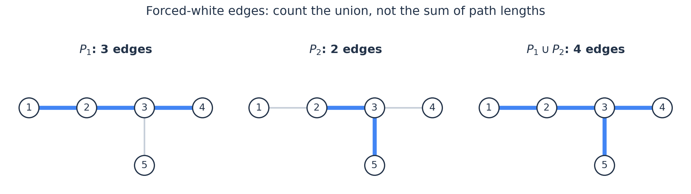
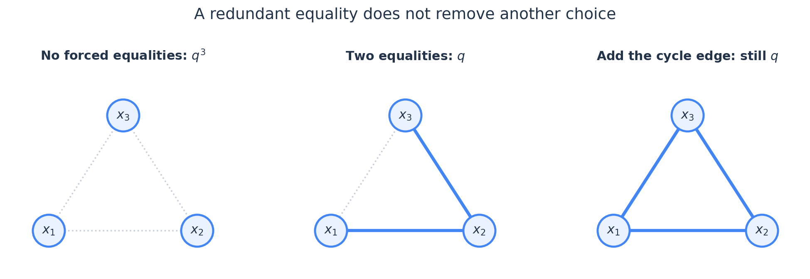
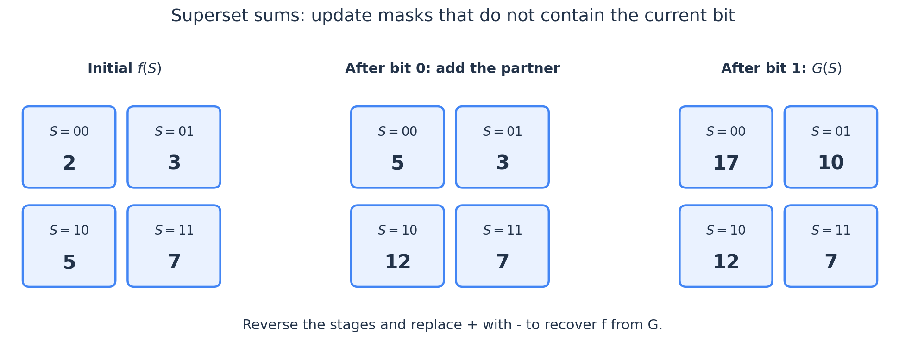

# 容斥原理：怎样把条件变成容易计算的交集

你已经做过 Roundgod [容斥教程](https://codeforces.com/blog/entry/64625) 的 Example 1、2：用不同质因子处理互素计数，以及用变量平移处理有上界的整数拆分。下面不再从三集合公式讲起，而是沿着这两道题继续往前走。

容斥题最值得花时间的地方，通常不是正负号，而是下面两个问题：

- 同时强制哪些条件成立以后，剩下的方案会变得好算？
- 写出对子集的求和以后，真的需要逐个枚举子集吗？

本篇先把这两件事讲清，再自然地走到“恰好满足若干条件”和反演。文中未标注出处的小例子均为教学示例；练习难度使用独立估算的 CF 尺度。默认不需要生成函数、SOS DP 或莫比乌斯反演基础，涉及它们时会从当前公式推出来。

## 1. 别追踪加了几轮：固定一个方案，算它最后的系数

设 $\Omega$ 是所有候选方案。我们希望避开 $m$ 个坏事件 $A_1,\ldots,A_m$。对条件下标集合 $S\subseteq[m]$，定义

$$
F(S)=\left|\bigcap_{i\in S}A_i\right|,\qquad F(\varnothing)=|\Omega|.
$$

这里要求 $S$ 中的事件全部发生，**不限制 $S$ 外的事件**。它们可以发生，也可以不发生。

容斥公式是

$$
\boxed{\text{合法方案数}=\sum_{S\subseteq[m]}(-1)^{|S|}F(S).}
$$

为什么对？固定一个方案 $\omega$，设它实际违反的条件下标构成集合 $T$。它被 $F(S)$ 计算，当且仅当 $S\subseteq T$，所以它最终留下的系数为

$$
\sum_{S\subseteq T}(-1)^{|S|}.
$$

若 $T=\varnothing$，只有空集一项，系数为 $1$。若 $T\ne\varnothing$，固定一个 $i\in T$，将不含 $i$ 的子集 $S$ 与 $S\cup\{i\}$ 配对；每对的符号相反，全部抵消，系数为 $0$。

例如一个方案违反了三个条件，它的系数就是

$$
1-3+3-1=0.
$$

这个证明比“先加、减多了、再加回来”更适合检查复杂模型：不论事件怎样重叠，都只要确认非法方案的总系数为零。**事件不需要独立，交集也不需要是空的。**

### 为什么不能把交集算成“恰好发生这些坏事件”？

设只有两个坏事件，一个方案同时属于 $A_1,A_2$。正确展开中，它分别出现在空集、两个单事件项、双事件项里，系数为 $1-1-1+1=0$。

如果你把单事件项改成“只发生 $A_1$”和“只发生 $A_2$”，这个方案在这两项中就消失了，最后反而得到 $1+1=2$。容斥依赖的是“至少包含指定条件”的计数；提前排除额外条件会破坏抵消关系。

此外，给每个方案附上固定权重 $w(\omega)$，将 $F(S)$ 改成相应交集的权重和，证明完全不变。取权重为概率，就得到概率形式的容斥。这与数学期望篇的贡献拆分是同一种做法：先写逐方案成立的等式，再交换求和顺序。

### 按掩码升序累加时，为什么中间和也有界？

在 [CF1750 D — Count GCD](https://vjudge.net/problem/CodeForces-1750D) 的互质计数中，设要统计 $1\le y\le k$、$\gcd(q,y)=1$ 的整数，$q$ 的不同质因子是 $p_0,\ldots,p_{r-1}$。用整数掩码 $S$ 表示选中了哪些质因子，则

$$
F(S)=\left\lfloor\frac{k}{\prod_{i:\,S_i=1}p_i}\right\rfloor.
$$

空积为一。实现时从 $S=0$ 开始，按整数大小逐个枚举到 $2^r-1$，遇到偶数大小的子集就加，奇数大小的子集就减。我们已经知道最后的答案在 $[0,k]$；但**最终答案小，并不能直接推出中间累加值也小**。

这里确实存在一个依赖枚举顺序的更强结论。处理完掩码 $0,\ldots,M$ 后，记

$$
s_M=\sum_{S=0}^{M}(-1)^{\operatorname{popcount}(S)}F(S).
$$

那么对任意 $0\le M<2^r$，都有

$$
\boxed{-k\le s_M\le k.}
$$

这不是对容斥项取绝对值后相加得到的粗界。证明仍然回到本节开头的方法：固定一个整数，观察它在**当前部分和**中的系数。

#### 第一步：哪些子集会计算这个整数？

固定 $y\in[1,k]$，记

$$
T(y)=\{i:p_i\mid y\}.
$$

它被 $F(S)$ 计算，当且仅当 $S\subseteq T(y)$。所以

$$
s_M=\sum_{y=1}^{k}c_M(y),\qquad
c_M(y)=\sum_{\substack{S\subseteq T(y)\\ \operatorname{mask}(S)\le M}}(-1)^{|S|}.
$$

只要证明每个 $c_M(y)$ 都属于 $\{-1,0,1\}$，就能对这 $k$ 个整数求和，得到所需的界。

若 $T(y)=\varnothing$，只有空集贡献，始终有 $c_M(y)=1$。以下考虑 $T(y)\ne\varnothing$。

#### 第二步：为什么一定要选最小下标来配对？

令 $j=\min T(y)$。把不含 $j$ 的有效子集 $U$ 与 $U\cup\{j\}$ 配对。这里的“有效”只表示它是 $T(y)$ 的子集。

两个掩码分别为

$$
H=\operatorname{mask}(U),\qquad H+2^j.
$$

因为 $T(y)$ 中不存在比 $j$ 更小的下标，而 $U$ 也不含 $j$，所以 $H$ 的第 $0,\ldots,j$ 位全部为零，即 $H$ 是 $2^{j+1}$ 的倍数。

在这两个掩码之间，**不可能再出现另一个有效子集**：较低位不允许选择；保持高位不变时，只能决定是否选择第 $j$ 位。这就证明了每一对在有效子集的升序序列中相邻。不同 $H$ 相隔至少 $2^{j+1}$，所以不同配对的区间也不会交叠。

注意，这两项不一定在全部整数掩码中相邻。例如 $j=2$ 时，它们之间可以隔着几个掩码，但那些掩码都不计算当前这个 $y$，对 $c_M(y)$ 的贡献为零。

如果随意选一个较大的下标，配对之间可能交错，一个前缀便可能同时截断多对；因此“选最小下标”是控制部分和的关键。

#### 第三步：一个前缀至多留下一个未抵消项

每对的符号相反：

$$
(-1)^{|U|}+(-1)^{|U|+1}=0.
$$

枚举前缀 $0,\ldots,M$ 时，已经完整经过的对子全部抵消，还没开始的对子贡献为零。由于配对区间互不交叠，至多只有一对刚处理了第一项、尚未处理第二项。

因此当前系数只能是

$$
c_M(y)\in\{-1,0,1\}.
$$

对全部整数求和，

$$
|s_M|
=\left|\sum_{y=1}^{k}c_M(y)\right|
\le\sum_{y=1}^{k}|c_M(y)|
\le k.
$$

例如 $T(y)=\{0,2\}$，计算这个 $y$ 的有效掩码只有以下四个。中间那些无效掩码不会改变它的系数：

| 有效掩码 | 对应子集 | 本项符号 | 处理后的 $c_M(y)$ |
| --- | --- | --- | --- |
| $000$ | $\varnothing$ | $+1$ | $1$ |
| $001$ | $\{0\}$ | $-1$ | $0$ |
| $100$ | $\{2\}$ | $-1$ | $-1$ |
| $101$ | $\{0,2\}$ | $+1$ | $0$ |

两对是 $(000,001)$ 与 $(100,101)$。它也说明了：中间的**逐对象系数**可以为负，所以不能把完整容斥里“非法对象系数为零”的结论提前用到每一步。

#### 这个证明不只适用于质因子容斥

对于任意有限全集 $\Omega$ 和任意坏事件 $A_0,\ldots,A_{r-1}$，定义 $F(S)$ 为交集大小，仍按掩码升序累加完整的普通容斥项，包括空集项。固定对象 $\omega$ 后，只需把 $T(y)$ 换成它所属的坏事件下标集合，证明完全相同：

$$
\boxed{\left|\sum_{S=0}^{M}(-1)^{\operatorname{popcount}(S)}F(S)\right|
\le|\Omega|.}
$$

事件可以任意重叠，不要求独立。若每个对象有固定实数权重 $w(\omega)$，同理得到绝对值上界 $\sum_{\omega\in\Omega}|w(\omega)|$；非负权重时就是全集总权重。

不过，**这个结论依赖上述顺序和交集语义**。改成先加完所有正项、再减所有负项，就不能沿用配对前缀的证明。例如全集只有一个对象，且它属于四个坏事件，所有偶数大小子集共贡献 $8$，尽管全集大小只有 $1$。

#### 回到 Count GCD 的整数类型

在 Victor 的[这次实现](https://vjudge.net/solution/73839047)中，子集严格按 $S=0,1,\ldots,2^r-1$ 枚举。因而本题 $k\le10^9$ 时，累加变量使用有符号 32 位整数是安全的，单次加减得到的中间结果也被上面的界覆盖。

子集乘积也要单独检查：$p_i$ 是 $q$ 的不同质因子，任意子集乘积都整除 $q$；逐个相乘时的每个中间乘积同样如此。因此 $1\le v\le q\le10^9$，这里的整数乘法也安全。

这两个界控制的是不同表达式：一个来自掩码顺序下的配对抵消，一个来自整除关系。仅凭最终答案不超过 $k$，无法同时得到它们。

## 2. 选事件时，先问交集会变成什么

考虑树上边染黑白，每条指定路径都必须至少有一条黑边。直接让多条路径“各选一条黑边”不好算：同一条边可以满足多条路径，同一种染色也会有许多选择方式。

换成坏事件就简单了：

$$
A_i=\{\text{第 }i\text{ 条指定路径上的边全部为白色}\}.
$$

固定一个条件子集 $S$，同时发生这些坏事件，只是在说：这些路径覆盖的所有边都必须为白色。其他边任意，因此

$$
F(S)=2^{(n-1)-|U(S)|},
$$

其中 $U(S)$ 是选中路径的**边集合之并**。注意这个内层是并集，因为我们在合并被强制为白色的边；外层仍然是坏事件的交集。两者操作的对象不同，并不矛盾。

### 路径重叠，究竟影响哪一步？

看下面这棵有四条边的树。指定路径为 $P_1=1\to4$ 与 $P_2=2\to5$。

$P_1$ 有三条边，$P_2$ 有两条边，但它们共同使用边 $2-3$，所以两条路径一起覆盖四条边，而不是五条。合法染色数为

$$
2^4-2^{4-3}-2^{4-2}+2^{4-4}=16-2-4+1=11.
$$

这里并不需要分析两条路径交于几段、哪条黑边负责哪条路径。进入某个交集以后，全部约束都变成了“这些边固定为白色”，重叠只影响去重后的边数。

这正是 [ABC152 F — Tree and Constraints](https://atcoder.jp/contests/abc152/tasks/abc152_f) 的模型。原题 $n\le50,m\le20$，可以将每条路径的边存入一个整数位集。设 $P_i$ 是第 $i$ 条路径的位集，取任意 $i\in S$，递推

$$
U(S)=U(S\setminus\{i\})\mathbin{\mathrm{OR}}P_i.
$$

每个子集做一次 OR 和一次位计数，即可得到对应项。用 DFS 为每条指定路径找边，预处理 $O(mn)$；子集计算 $O(2^m)$，保存全部并集需要 $O(2^m)$ 空间。这些复杂度将不超过 49 位的运算视为常数时间。原题按整数输出，$2^{49}$ 及最终计数均可用有符号 64 位整数保存。

### 不一定总要定义“坏事件”

如果目标是“至少存在一种合法生成方式”，也可以直接把每种方式能生成的对象定义成集合，再算它们的并。此时公式不含空集项，符号为 $(-1)^{|S|+1}$。

真正要检查的是**计数对象**：如果两个方法生成同一个对象，题目要算一次，集合并适合；如果题目本来就区分生成方法，则不应该把它们去重。

> **练习**：[ABC246 F — typewriter](https://atcoder.jp/contests/abc246/tasks/abc246_f)（估算约 1800；2022；前置：位集、快速幂）。与上面的例题相比，先独立明确这道题的一个“方案”是什么。

## 3. 什么时候能把 $2^m$ 项缩成 $m+1$ 项？

回到你做过的上界拆分。如果所有变量的上界相同，固定 $j$ 个变量越界以后，平移掉的总量只与 $j$ 有关，与选了哪 $j$ 个变量无关。所以可以先乘 $\binom mj$，不必枚举具体下标。

一般地，只有在你已经证明

$$
F(S)=H(|S|)
$$

时，才能写成

$$
\sum_{j=0}^m(-1)^j\binom mj H(j).
$$

不是“每个条件看上去一样”，就能自动得到这个结论。比如树上的路径都叫路径，但长度和重叠不同，同样选两条路径，覆盖边数可能不同。

### 对称性为什么能保证只看大小？

考虑长度为 $n$ 的序列，元素来自 $m$ 个标签，要求每个标签至少出现一次。令 $A_i$ 表示标签 $i$ 没有出现。指定 $j$ 个标签缺失后，每个位置有 $m-j$ 种选择，所以

$$
\text{答案}=\sum_{j=0}^m(-1)^j\binom mj(m-j)^n.
$$

这里的对称性可以严格表述：把一组被禁止的 $j$ 个标签重新命名为另一组，可以在两类序列之间建立可逆映射。因此，两组条件的交集大小相同。相比“看起来只与 $j$ 有关”，这个重新命名的论证更可靠。

当 $n<m$ 时答案应为零，容斥仍然成立。公式中的交错和会自行抵消，不需要因为“没有合法方案”而修改事件定义。

> **练习**：[ABC172 E — NEQ](https://atcoder.jp/contests/abc172/tasks/abc172_e)（估算约 2200；2020；前置：排列数、阶乘与逆阶乘）。题目仍有一部分限制应保留在全集中，值得先想清哪些限制要容斥，哪些限制直接计数。

## 4. 上界不一样时，把“选了谁”压成“总共平移多少”

考虑非负整数解

$$
x_1+\cdots+x_n=M,\qquad 0\le x_i\le b_i.
$$

设 $w_i=b_i+1$，坏事件为 $x_i\ge w_i$。选定 $S$ 后，对 $i\in S$ 做变量平移 $y_i=x_i-w_i$，其他变量不变。它与非负整数解

$$
y_1+\cdots+y_n=M-\sum_{i\in S}w_i
$$

一一对应。于是答案为

$$
\sum_{S\subseteq[n]}(-1)^{|S|}
\binom{M-\sum_{i\in S}w_i+n-1}{n-1},
$$

其中剩余总量为负时，对应项定义为零；$n\ge1$。上界是 $b_i$，越界的起点必须是 $b_i+1$，不是 $b_i$。

现在，交集大小不再只依赖 $|S|$，但它仍然不需要整个 $S$，只需要

$$
s=\sum_{i\in S}w_i.
$$

所以定义带符号的汇总

$$
D[s]=\sum_{\substack{S\subseteq[n]\\\sum_{i\in S}w_i=s}}(-1)^{|S|}.
$$

则答案变成

$$
\boxed{\sum_{s=0}^M D[s]\binom{M-s+n-1}{n-1}.}
$$

### 正负号也可以一起放进 DP

初始 $D[0]=1$，其他为零。处理一个权值 $w_i$ 时，子集有两种选择：不选它，系数保持；选它，总和增加 $w_i$，符号取反。因此新旧数组满足

$$
D_{\mathrm{new}}[s]=D_{\mathrm{old}}[s]-D_{\mathrm{old}}[s-w_i],
$$

越界的下标按零处理。若原地更新，必须让 $s$ 从大到小：这样右侧读取的仍然是尚未处理当前元素的旧值。升序会把同一个条件重复选入，变成另一个问题。

只保留 $0\le s\le M$；因为 $w_i\ge1$，已经超过 $M$ 的总和不可能重新变小。$w_i>M$ 的条件也可以直接略过：在总和只有 $M$ 时，它根本不会发生。

例如 $w=(1,2,3)$，只看 $s=3$。子集 $\{3\}$ 的符号为负，子集 $\{1,2\}$ 的符号为正，所以

$$
D[3]=-1+1=0.
$$

它们不是“没有方案”，而是在后续拥有完全相同的计数因子，贡献互相抵消。**DP 存的是净系数，不是普通子集个数，允许为负。**

若有 $a$ 个 $w_i\le M$，这部分时间为 $O(aM)$、空间为 $O(M)$。这并非在所有范围都优于 $2^n$：$n$ 小、$M$ 很大时枚举子集更合理；$M$ 小、$n$ 很大时才适合按总和平移量合并。

### 与逆序对排列的联系

从小到大插入 $1,2,\ldots,n$ 来构造排列。插入最大值 $i$ 时，它可以放在已有元素的不同空隙中，新增的逆序对数 $x_i$ 恰好可以为 $0,1,\ldots,i-1$，且每种新增数对应唯一插入位置。

反过来，从最终排列依次删除最大值，也能唯一恢复这些选择。因此，逆序对数为 $K$ 的排列，与

$$
\sum_{i=1}^n x_i=K,\qquad 0\le x_i<i
$$

的解一一对应。这时越界权值就是 $w_i=i$。

现在能看见一个容易忽略的优化：若 $i>K$，上界 $x_i<i$ 自动成立，不必把它加入系数 DP。只需处理 $1\le i\le\min(n,K)$，系数计算为 $O(K\min(n,K))$。变量总数在组合数中**仍然是 $n$**：我们只删掉不可能违反的上界，没有删变量。

当 $n$ 很大时，也不用预处理到 $n+K$ 的阶乘。令

$$
B_t=\binom{n+t-1}{t},\quad B_0=1,\quad
B_t=B_{t-1}\frac{n+t-1}{t}.
$$

若模数为素数 $p$ 且 $K<p$，分母 $1,\ldots,K$ 都可逆，可以在 $O(K)$ 预处理逆元后依次计算 $B_t$，最后求 $\sum_sD[s]B_{K-s}$。即使 $n$ 大于 $p$，这段递推仍成立，因为它只除以小于 $p$ 的 $t$。

这条路线解释了 Roundgod Example 3 中“按某个统计量合并容斥项”的关键转折，不是对该例全部约束的最优算法承诺。若 $K$ 本身很大，$O(K^2)$ 仍会成为瓶颈。用形式多项式写，$D[s]$ 恰好是 $\prod_i(1-z^{w_i})$ 的系数；不需要学过生成函数，也已经能从选或不选得到同一个 DP。

## 5. “恰好满足 $r$ 个条件”，为什么不能只改一个符号？

继续使用 $A_1,\ldots,A_m$，不过本节不要求它们是坏事。令 $E_t$ 为恰好满足 $t$ 个条件的方案数，并定义

$$
B_j=\sum_{\substack{S\subseteq[m]\\|S|=j}}F(S).
$$

$B_j$ 是把所有 $j$ 条件交集加起来。它不表示“恰好满足 $j$ 个”，也不表示“至少满足 $j$ 个且各算一次”。一个实际满足 $t$ 个条件的方案，可以选出 $\binom tj$ 组被强制的条件，因此

$$
\boxed{B_j=\sum_{t=j}^m\binom tj E_t.}
$$

例如，一个满足三个条件的方案在 $B_2$ 中出现三次，在 $B_1$ 中也出现三次。我们要消掉这层重复。

候选公式为

$$
\boxed{E_r=\sum_{j=r}^m(-1)^{j-r}\binom jr B_j.}
$$

还是固定一个满足 $t$ 个条件的方案。若 $t<r$，它不出现在任何项中；若 $t\ge r$，其总系数为

$$
\begin{aligned}
\sum_{j=r}^t(-1)^{j-r}\binom jr\binom tj
&=\binom tr\sum_{j=r}^t(-1)^{j-r}\binom{t-r}{j-r}\\
&=\binom tr(1-1)^{t-r}.
\end{aligned}
$$

第一步用了恒等式 $\binom tj\binom jr=\binom tr\binom{t-r}{j-r}$：先选 $j$ 个再从中标记 $r$ 个，等价于先选被标记的 $r$ 个，再补上其他 $j-r$ 个。

于是 $t=r$ 时系数为 $1$，$t>r$ 时系数为 $0$，公式得证。$r=0$ 正好退化成普通容斥。

### 一个可以手算的检查

假设三种条件下，按满足条件个数分类的数量是

$$
(E_0,E_1,E_2,E_3)=(2,3,4,1).
$$

那么

$$
B_1=3+2\cdot4+3\cdot1=14,\quad
B_2=4+3\cdot1=7,\quad B_3=1.
$$

恰好满足一条的答案为

$$
E_1=B_1-2B_2+3B_3=14-14+3=3.
$$

若误写成 $B_1-B_2+B_3$，结果是 $8$，因为每个交集项承担的消重任务已经不同，不能沿用普通容斥的系数。

### 如果要求“至少满足 $r$ 条”呢？

将 $E_r+E_{r+1}+\cdots+E_m$ 相加，交换求和，再用帕斯卡恒等式消去相邻项，可以得到（$r\ge1$）

$$
\boxed{\sum_{t=r}^mE_t
=\sum_{j=r}^m(-1)^{j-r}\binom{j-1}{r-1}B_j.}
$$

具体来说，$B_j$ 的系数是

$$
\sum_{t=r}^j(-1)^{j-t}\binom jt
=(-1)^{j-r}\binom{j-1}{r-1}.
$$

把每个 $\binom jt$ 拆成 $\binom{j-1}t+\binom{j-1}{t-1}$，中间项就成对抵消。$r=1$ 时得到 $B_1-B_2+B_3-\cdots$，正是集合并公式；至少满足零条则直接是 $|\Omega|$。

如果所有 $B_j$ 已知，求某个 $E_r$ 只需 $O(m)$；求全部 $E_r$ 的直接做法为 $O(m^2)$。难点依旧可能在怎样得到 $B_j$，这一步不会因为有反演公式就自动变快。

## 6. 强制相等，会把图压成连通块

换一个方向：给无向图 $G=(V,E)$ 的每个点涂上 $q$ 种颜色之一，要求每条边两端颜色不同。

直接处理“不相等”不方便，定义坏事件

$$
A_e=\{e\text{ 的两个端点颜色相同}\}.
$$

固定被选中的边集 $F\subseteq E$，同时发生这些坏事件，意味着沿 $F$ 中的边，两端必须相等。相等关系会沿路径传递，所以图 $(V,F)$ 的每个连通块必须同色。反过来，只要每个块选一种颜色，全部被选约束就都满足了。

因此

$$
\left|\bigcap_{e\in F}A_e\right|=q^{c(F)},
$$

其中 $c(F)$ 包含孤立点。于是合法染色数是

$$
\boxed{\sum_{F\subseteq E}(-1)^{|F|}q^{c(F)}.}
$$

这里不同连通块可以取相同颜色，因为未选中的边没有被要求违反，也没有被要求满足；它们留给外层容斥处理。如果这时又要求不同块异色，就重新落入了“交集里额外加条件”的错误。

### 为什么不能说每选一条边，就少一个自由度？

如果一条新边连接两个不同块，块数确实减少一；如果两端已经连通，它只重复了一条已有的相等关系，块数不变。

图中三个点，先强制 $x_1=x_2$ 与 $x_2=x_3$，已经得到三个点同色。再强制 $x_3=x_1$ 不会减少选择，仍有 $q$ 种，而不是 $q^0$ 种。

所以 $c(F)=|V|-|F|$ 只对森林成立。一般图中，即使 $|F|$ 相同，也不一定具有相同块数。例如在六个点上，选三条不相交的边得到三个块，选一个三角形则得到四个块（另外三个点孤立）。两项的计数分别为 $q^3,q^4$。

枚举每个 $F$，重新求连通块的朴素复杂度为 $O(2^{|E|}(|V|+|E|))$。这个公式本身不是一般图染色的多项式算法；它告诉我们交集的准确结构，接下来还要利用图的特殊形态。

### 环上为什么反而可以只看选了几条边？

设原图是 $n\ge3$ 个点的一个简单环。当选 $k<n$ 条边时，一定没有环，所以 $c(F)=n-k$；只有选中全部 $n$ 条边时，形成一个连通块。

因此答案是

$$
\sum_{k=0}^{n-1}(-1)^k\binom nk q^{n-k}+(-1)^nq.
$$

前面的和与 $(q-1)^n$ 只差 $k=n$ 那一项 $(-1)^n$，补正后得到

$$
\boxed{(q-1)^n+(-1)^n(q-1).}
$$

环的特殊性，不在于容斥原理发生了变化，而在于每个真子集都是森林，交集计数恰好可以按边数分组。这里也能看见第 3 节的“同样大小能否合并”为什么必须先证明。

对应题目：[ABC307 E — Distinct Adjacent](https://atcoder.jp/contests/abc307/tasks/abc307_e)（估算约 1900；2023）。本节已经解释了它的容斥解法；原题还允许 $n=2$，此时直接要求两个点异色，答案 $q(q-1)$，上面的最终公式也成立。

## 7. 从“至少”恢复“恰好”，不一定非要枚举条件子集

第 5 节做的是：先计数满足指定条件的方案，再恢复恰好满足多少条的方案。类似的关系，在整除结构里也经常出现。

例如，统计取值在 $1,\ldots,M$ 中的有序 $k$ 元组，其中 $k\ge1$。记

$$
F(d)=\#\{(x_1,\ldots,x_k):d\mid x_i\text{ 对所有 }i\},
$$

以及

$$
E(g)=\#\{(x_1,\ldots,x_k):\gcd(x_1,\ldots,x_k)=g\}.
$$

每个被 $F(d)$ 计算的元组，都有唯一的 gcd，它是 $d$ 的某个倍数。因此

$$
F(d)=\left\lfloor\frac Md\right\rfloor^k
=\sum_{j\ge1,\,dj\le M}E(dj).
$$

“所有数都能被 $d$ 整除”比“gcd 恰好是 $d$”容易算得多。既然全部更大的倍数已经知道，便可以从大到小计算

$$
\boxed{E(d)=F(d)-\sum_{j\ge2,\,dj\le M}E(dj).}
$$

不必先背一个莫比乌斯公式，也可以把精确分类求出来。这段扣除的总次数为

$$
\sum_{d=1}^M O(M/d)=O(M\log M),
$$

另加计算全部 $F(d)$ 的代价。若逐项快速幂，这部分为 $O(M\log k)$，空间为 $O(M)$。

### 为什么显式展开后会出现莫比乌斯函数？

只要求 gcd 为 $1$ 时，也能直接从你熟悉的质因子容斥推出来。定义

$$
\mu(d)=
\begin{cases}
0,&d\text{ 含有某个质因子的平方},\\
(-1)^s,&d\text{ 是 }s\text{ 个不同质数之积}.
\end{cases}
$$

特别地，$\mu(1)=1$。固定一个 gcd 为 $g$ 的元组，有

$$
\sum_{d\mid g}\mu(d)=
\begin{cases}
1,&g=1,\\
0,&g>1.
\end{cases}
$$

因为非零项正好对应从 $g$ 的不同质因子中选一个子集；$g>1$ 时，仍然是第 1 节的配对抵消。于是

$$
\boxed{E(1)=\sum_{d=1}^M\mu(d)\left\lfloor\frac Md\right\rfloor^k.}
$$

平方因子对应零，并不是额外规定出来的神秘技巧：容斥只需要知道一个质因子是否被选中，不会把同一个坏条件选两次。

更一般地，只要有 $F(d)=\sum_{d\mid g}E(g)$ 且范围有限，就有

$$
E(d)=\sum_{j\ge1}\mu(j)F(dj).
$$

验证只需展开右侧。固定 $g=dt$，$E(g)$ 的系数为 $\sum_{j\mid t}\mu(j)$，仅在 $t=1$ 时留下。一个是从大到小逐项扣除，一个是把扣除过程写成显式系数，两者恢复的是同一个 $E$。

**整除关系很重要。** 如果已知的是 $F(d)=\sum_{g\ge d}E(g)$，恢复方式只是 $E(d)=F(d)-F(d+1)$；不能因为出现了“至少”和“恰好”，就直接套 $\mu$。

> **练习**：[ABC304 F — Shift Table](https://atcoder.jp/contests/abc304/tasks/abc304_f)（估算约 2300；2023；前置：字符串周期、枚举约数）。适合在这里练习“先计数宽松类别，再恢复精确类别”，不要求先使用显式莫比乌斯系数。

## 8. 再往前一步：保留完整条件集合的反演

第 5 节只关心条件个数。如果题目必须区分具体条件，就保留它们的完整集合。

记 $f(T)$ 为**实际满足的条件集合恰好为 $T$** 的方案数，$G(S)$ 为至少满足 $S$ 中全部条件的方案数。那么

$$
G(S)=\sum_{T\supseteq S}f(T).
$$

这次按集合包含关系求和，而不是按个数或整除关系求和。反向公式是

$$
\boxed{f(T)=\sum_{S\supseteq T}(-1)^{|S|-|T|}G(S).}
$$

证明仍然不用新定理：固定 $U\supseteq T$，$f(U)$ 被计算的系数是

$$
\sum_{T\subseteq S\subseteq U}(-1)^{|S|-|T|}.
$$

能自由选择的条件恰好是 $U\setminus T$。这个集合非空时符号成对抵消，只有 $U=T$ 留下系数 $1$。

### 为什么全部子集的求和可以不是 $3^m$？

假设全部 $f(T)$ 已知。若对每个 $S$ 逐个枚举超集，所有 $(S,T)$ 对一共 $3^m$ 个：每个元素可以在 $S$ 里、只在 $T$ 里、或两者都不在。

但可以把选择按位分开做。初始数组 $a=f$，依次处理条件 $i$：对每个不含 $i$ 的 $S$，执行

$$
a[S]\gets a[S]+a[S\cup\{i\}].
$$

处理完一组位置 $P$ 后，$a[S]$ 的含义是：可以在 $P\setminus S$ 中自由补充元素，其他未处理位置必须与 $S$ 保持相同，所有这些原始 $f$ 值的和。处理下一个位置时，右侧分别对应“不补这个位置”和“补这个位置”，两类不重叠，刚好合并。

所有位置处理完，就得到超集和 $G(S)$。每一位只做 $2^{m-1}$ 次相加，总时间 $O(m2^m)$，空间 $O(2^m)$。

同一位的变换里，含 $i$ 的位置保持不变，只有不含 $i$ 的位置加上对应项。因此逆操作就是在这一位做减法。把所有位的操作按相反顺序撤销，即可由 $G$ 还原 $f$，复杂度仍为 $O(m2^m)$。这就是超集方向的 zeta 变换与莫比乌斯反演；本质只是把一串可逆的加法拆开。

若已知关系是 $G(S)=\sum_{T\subseteq S}f(T)$，则方向反过来：对含 $i$ 的 $S$，加上 $a[S\setminus\{i\}]$。不要把“子集和”与“超集和”的更新方向混用。

还有一个实际选择：**只求 $f(\varnothing)$ 时，通常直接做一次 $2^m$ 项容斥就够了，没必要为了用变换而恢复全部 $f(T)$。** 快速变换适合需要批量计算许多关联集合的计数时使用。

> **进阶练习**：[ABC349 F — Subsequence LCM](https://atcoder.jp/contests/abc349/tasks/abc349_f)（估算约 2400；2024；额外前置：质因数分解、LCM 的质因子指数）。先确定真正需要记录哪些条件，再决定是否需要批量计算子集和。原题 $M\le10^{16}$，分解 $M$ 的代价也属于整题复杂度，不能只计算子集部分。

## 9. 写题时，按这个顺序检查

先说清全集中的一个元素是什么。是一个排列、一种染色、一个下标集合，还是一种生成方法？同一对象能否由不同过程生成，决定你是否需要去重。

接着选条件，并完整描述 $F(S)$：哪些约束必须发生，哪些约束保留在全集，哪些约束暂时不管。先推导交集计数，再套符号；否则很容易把原题的难点原封不动留在交集里。

然后固定一个非法方案，检查它的总系数。普通容斥应为零；恰好满足 $r$ 条时，则应仅在实际条件数为 $r$ 时留下一个。这一步往往比对几个大样例更容易发现事件定义错误。

最后才优化求和。观察 $F(S)$ 究竟依赖 $|S|$、权值和、边覆盖并集、连通块，还是完整掩码；按真正足够的信息合并。复杂度要包含交集的计算、组合数或幂的预处理，而不只写一个外层的 $2^m$。

涉及边界时尤其留意空集、空方案和模除法。空集的交集是全集；题目若排除空方案，应从一开始在 $F(S)$ 中一致地排除，或证明最后怎样扣掉。整数恒等式可以取模，但模意义的除法还要检查分母是否可逆。

## 参考与进一步阅读

- [Roundgod — Inclusion-Exclusion Principle](https://codeforces.com/blog/entry/64625)：承接你已做过的前两例，重点可回看 Example 3 怎样合并容斥项。其计数递推在评论中有多次修正；本篇使用独立推导的带符号背包，没有直接沿用那条递推。
- [ABC246 F 官方解说](https://atcoder.jp/contests/abc246/editorial/3713)：核对“至少一种生成方式”的集合并模型。建议完成练习后再读。
- [ABC307 E 官方解说](https://atcoder.jp/contests/abc307/editorial/6667)：同时给出状态压缩 DP 与容斥路线。本篇从一般图的相等约束出发解释环的特殊性。英文容斥段落的条件措辞容易混淆：被强制发生的应是两端相等的坏事件，不能读成强制相异。
- [ABC304 F 官方解说](https://atcoder.jp/contests/abc304/editorial/6518)：用宽松周期计数恢复精确周期计数，也给出了显式莫比乌斯写法。
- [ABC349 F 的题解（spheniscine）](https://atcoder.jp/contests/abc349/editorial/9801)：将数论条件转成少量条件的覆盖，并结合容斥与子集和；建议做完最后一道练习再阅读。本篇只使用了其中计数建模部分，未采用其关于随机分解算法复杂度的简写。

