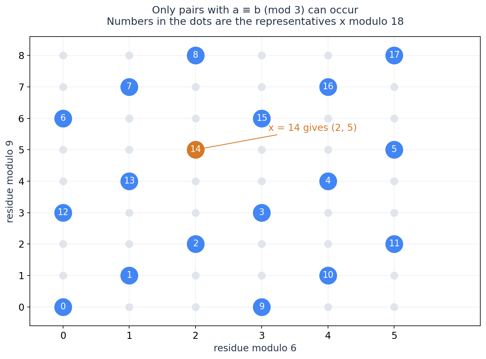

# 数论延伸：广义 CRT 与一次式取整求和

本文接续[数论主篇](../number-theory/number-theory.md)，分别讲非互质 CRT 与 floor_sum，两部分互不依赖。

广义 CRT 前置为线性同余和普通 CRT；取整求和前置为整数除法、交换求和与欧几里得算法。普通 CRT 的证明与练习见主篇第 6 节。

## 1. 广义 CRT：把两个剩余类合并

设已经有两条约束

$$
x\equiv a\pmod m,\qquad x\equiv b\pmod n.
$$

第一条告诉我们 $x=a+mt$。代入第二条，就得到熟悉的线性同余

$$
mt\equiv b-a\pmod n.
$$

令 $g=\gcd(m,n)$，于是

$$
\boxed{\text{两式兼容}\iff g\mid(b-a).}
$$

兼容时，约分后求出

$$
t\equiv\frac{b-a}{g}\left(\frac mg\right)^{-1}\pmod{n/g}.
$$

取一个代表 $t_0$，就得到

$$
\boxed{x\equiv a+mt_0\pmod{\operatorname{lcm}(m,n)}.}
$$

该式也是全部解：$t$ 每增加 $n/g$，$x$ 增加 $mn/g$，线性同余保证没有其他 $t$，故全部交点仍是一条等差数列。

例如 $x\equiv2\pmod6$、$x\equiv5\pmod9$。设 $x=2+6t$，得到 $2t\equiv1\pmod3$，所以 $t\equiv2\pmod3$，最终

$$
x\equiv14\pmod{18}.
$$

若改为 $x\equiv4\pmod9$，两式模 $3$ 不兼容，无解。非互质约束可能冲突，须先判兼容。

横纵坐标为模 $6$、模 $9$ 的余数，只能取两坐标模 $3$ 相同的格子。$18=\operatorname{lcm}(6,9)$ 个蓝点与模 $18$ 的整数一一对应，其余格子不可取。

### 为什么互质模数能够真正独立选择？

$\gcd(m,n)=1$ 时兼容条件恒成立，每对余数 $(a\bmod m,b\bmod n)$ 唯一对应一个模 $mn$ 的整数，因此可以独立求解再组合。

$M=\prod p^{e_p}$ 中不同质数幂两两互质。条件若能逐模 $p^{e_p}$ 检查，可分别求解再 CRT 合并，对应[数论主篇第 4 节](../number-theory/number-theory.md#4-唯一分解乘法约束可以改成每个质因子上的大小关系)。普通大小关系、整数和的范围不属于单一剩余类信息，不能照此拆分。

多条同余顺次合并，只维护最小非负代表与模数。每次用扩展欧几里得；最终 LCM 为 $M$ 且适合固定宽度整数时，$k$ 次约束可界为 $O(k\log M)$。若 $n/g=1$，该约束已被包含，取 $t_0=0$。

得到 $x\equiv r\pmod M$ 后，如果题目还要求 $x\ge L$，最小解是

$$
r+M\left\lceil\frac{L-r}{M}\right\rceil.
$$

区间 $[L,R]$ 内的解数为

$$
\left\lfloor\frac{R-r}{M}\right\rfloor-
\left\lfloor\frac{L-1-r}{M}\right\rfloor.
$$

CRT 合并等式约束，区间、最小值再沿所得等差数列处理。

求 $\operatorname{lcm}(m,n)$ 先除 GCD 再乘；构造解的中间乘积仍可能超过最终模数，须单独检查类型。

> **练习**：[ABC193 E — Oversleeping](https://atcoder.jp/contests/abc193/tasks/abc193_e)（估算约 2300；2021）。关键在于识别哪些周期内的候选足够少，可以先枚举，再合并各自的同余条件。完整分析见[配套第 1 题](number-theory-extensions-exercises.md#1-abc193-e--oversleeping)。

## 2. 一次式取整求和：怎样再次回到欧几里得算法？

[数论主篇第 9 节](../number-theory/number-theory.md#9-整除分块商相同的区间可以一次处理)的整除分块处理 $\lfloor N/i\rfloor$；另一种常见结构则是

$$
F(n,m,a,b)=\sum_{i=0}^{n-1}\left\lfloor\frac{ai+b}{m}\right\rfloor,
$$

其中 $n,a,b\ge0,m\ge1$。变化的是分子，不能套前述整除分块。

先把明显的整数部分拆出来。写 $a=qm+a'$、$b=rm+b'$，则

$$
F(n,m,a,b)=q\frac{n(n-1)}2+rn+F(n,m,a',b').
$$

于是只需处理 $0\le a,b<m$。若 $n=0$ 或 $a=0$，这时剩余和为零。否则令

$$
h=\left\lfloor\frac{a(n-1)+b}{m}\right\rfloor.
$$

把每一项的商想成该列下方的整数点数。固定高度 $y\in[1,h]$，这层哪些列被计算？需要

$$
my\le ai+b
\iff i\ge\left\lceil\frac{my-b}{a}\right\rceil.
$$

因为 $b<m$，这个阈值为正；又因为 $y\le h$，它不超过 $n-1$。所以本层有 $n-\lceil(my-b)/a\rceil$ 列。改为逐层求和，并令 $j=y-1$，得到

$$
\boxed{F(n,m,a,b)
=nh-F(h,a,m,m-b+a-1).}
$$

$h=0$ 时剩余和为零。否则**新模数 $a<m$**；下次拆整数部分出现 $m\bmod a$，按欧几里得算法下降，递归层数 $O(\log m)$。不同 floor_sum 写法计数的是同一批整数点。

例如 $n=4,m=5,a=2,b=1$，原和为 $0+0+1+1=2$。$h=1$，上式给出

$$
4-F(1,2,5,5)=4-2=2.
$$

核心是交换计数顺序：**由逐列改为逐高度，斜率分子、分母随之互换。** 负参数须先按数学下取整归约，不能直接用向零截断的整数除法。

实现可参考 [AtCoder Library 的 floor_sum](https://atcoder.github.io/ac-library/production/document_en/math.html)，核对参数范围和溢出约定；中间结果未必适合 64 位。

> **实现验收**：[AtCoder Library Practice Contest C — Floor Sum](https://atcoder.jp/contests/practice2/tasks/practice2_c)（估算约 2200，按自行推导并实现算法评价；直接调用现成库不代表同等训练难度）。本题直接检验这一节的递推，完整分析见[配套第 2 题](number-theory-extensions-exercises.md#2-atcoder-library-practice-contest-c--floor-sum)。VJudge 对应页暂未核对，保留原题入口。

## 参考

- [AtCoder Library：Math](https://atcoder.github.io/ac-library/production/document_en/math.html)：广义 CRT 与 floor_sum 的接口、范围及复杂度。本文的按高度计数递推是原 notes 的独立推导，不要求与库实现逐行相同。
- [ABC193 E 官方解说](https://atcoder.jp/contests/abc193/editorial/818)：周期中的短活跃区间枚举及同余合并。
- [AtCoder Library Practice Contest C](https://atcoder.jp/contests/practice2/tasks/practice2_c)：floor_sum 的直接实现验收。
