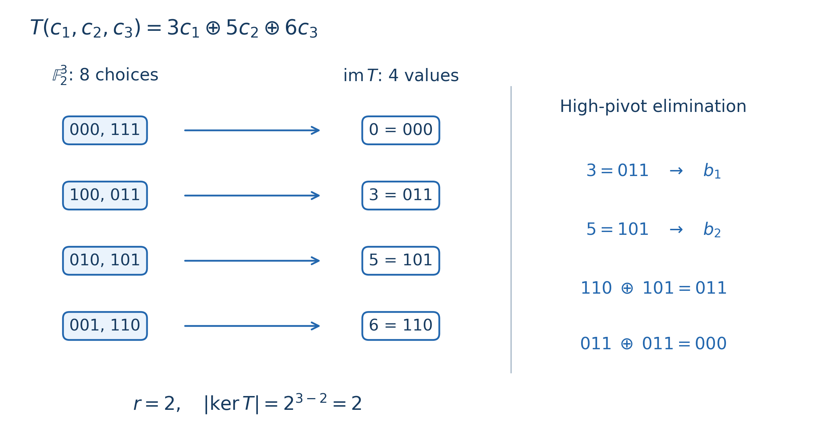

# Chapter 8 线性基与异或空间

上一章的 Trie 保留一批真实元素，查询时从中选一个。线性基则允许我们任选若干元素，关心这些元素一共能异或出哪些值。它不再记住全部子集，而是用至多 $W$ 个数，表示所有 $W$ 位整数中的可达结果。

为什么能压缩得这么多？因为 XOR 恰好是二元域上的向量加法。先把这句话展开，后面的插入、计数和位置限制就能放在同一个模型中理解。

主要参考保留原稿采用的 DrSwad [A Beautiful Technique for Some XOR Related Problems](https://codeforces.com/blog/entry/68953)、此前提供的 Benjamin Qi《Vectors in $\mathbb Z_2^d$》（MIT，2020 年 11 月），以及 [USACO Guide：XOR Basis](https://usaco.guide/adv/xor-basis)。下文按统一符号展开证明；题目旁保留对应的原题与官方材料链接。

## 1. 先分清：子集方案和异或结果

$\mathbb F_2=\{0,1\}$，其中加法按模二计算，所以 $1+1=0$。把一个 $W$ 位整数的每一位当作一个坐标，它就成为 $\mathbb F_2^W$ 中的向量。两个向量相加，就是按位 XOR；乘以标量零或一，分别表示不选它或选它。

给定 $a_1,\ldots,a_n$，用 $c_i\in\{0,1\}$ 表示是否选择第 $i$ 个元素。整个选择方案是向量 $c=(c_1,\ldots,c_n)$，其异或结果由映射

$$T:\mathbb F_2^n\longrightarrow\mathbb F_2^W,
\qquad T(c)=\bigoplus_{i=1}^n c_i a_i$$

给出。这里 $c_i a_i$ 是标量乘法。若把 $a_i$ 写成列向量并排成矩阵，$T$ 就是这个 $W\times n$ 矩阵的乘法。它是线性的：把两份选择方案逐位相加，等价于把它们的结果异或起来。

下面三个对象各自回答不同的问题：

| 对象 | 具体含义 | 用来回答什么 |
|---|---|---|
| 像空间 $\operatorname{im}T$ | 全部可达异或值，也记作 $\operatorname{span}(a_1,\ldots,a_n)$ | 能否得到 $k$？最大可达值是多少？ |
| 核 $\ker T$ | 所有异或结果为零的选择向量 | 有多少种零异或子集？ |
| 像空间的一组基 | 能生成全部可达值，而且线性无关的一组向量 | 如何用少量整数保存整个空间？ |

“线性无关”是说，只有全部系数都为零，才能把这些向量组合成零。基向量的个数称为秩，记作 $r$，必有 $r\le W$。

来看贯穿本章的小例子：$a=(3,5,6)$，二进制为 $011,101,110$。因为 $3\oplus5=6$，第三个数没有带来新结果；所有子集只能得到 $\{0,3,5,6\}$，所以 $\{3,5\}$ 已经是一组基，秩为二。但原来的三个位置仍有八种选择方案，每个结果恰好出现两次。



图左每个三位串表示 $(c_1,c_2,c_3)$，不是异或结果的二进制。比如 $100$ 表示只选 $3$，$011$ 表示选择 $5,6$，两者都得到 $3$。右侧显示第三个向量消元成零，因此不增加秩。

这个例子的计数并非巧合。首先，$r$ 个基向量的 $2^r$ 种系数组合会产生 $2^r$ 个不同值：若两组系数得到同一个值，把它们相加，就得到非零系数组合异或成零，违背线性无关。

其次，若 $k$ 可达，选一份满足 $T(c_0)=k$ 的方案。任意另一份方案 $c$ 满足

$$T(c)=k\quad\Longleftrightarrow\quad T(c+c_0)=0.$$

也就是说，得到 $k$ 的全部方案恰为 $c_0+\ker T$。加上 $c_0$ 是一个双射，所以每个可达值对应的方案数都相同。全部 $2^n$ 种选择均分到 $2^r$ 个结果上，得到

$$\#\{c:T(c)=k\}=\begin{cases}
2^{n-r},&k\in\operatorname{im}T,\\
0,&k\notin\operatorname{im}T.
\end{cases}$$

这也解释了秩—零化度公式 $\dim\ker T=n-r$。若只计非空子集，只有目标为零时要减去空集的一种。相同数值出现在不同下标，仍代表不同选择变量；提前去重会保留可达值，却改变方案数。

> **练习（估算 CF 难度）**：[Number of Subset Xors](https://cses.fi/problemset/task/3211)（约 1400；快速自检：秩与不同结果数）。

## 2. 用高位主元，把消元存成整数

既然目标是保存一组基，就不必留下所有输入。我们让每个最高非零位至多对应一个基向量：用 $b_i$ 保存最高非零位为 $i$ 的向量，没有则置零。这个最高非零位称为主元位置。

插入 $x$ 时，从高到低检查它。当前最高位为 $i$，若已有 $b_i$，就用 $x\gets x\oplus b_i$ 清掉这一位；若没有，就把剩下的 $x$ 放在这里。

```text
insert(x):
    从 i = W-1 到 0:
        若 x 的第 i 位为 0，继续
        若 b[i] 非零:
            x = x xor b[i]
        否则:
            b[i] = x
            返回“秩增加”
    返回“原空间已能表示输入值”
```

这段操作为什么没有改变我们要保存的空间？每次异或的都是已有基向量，所以当前余量与原输入之间只差一个旧空间中的向量。把原输入加入旧空间，和把余量加入旧空间，会生成同一空间。

再看新向量是否独立。不同基向量的最高位不同；任意取一个非空组合，找其中主元最高的那个向量。其他参与的向量都没有这一位，无法把它抵消，因此组合不可能为零。若最终余量为零，原输入已经能被旧基表示；若余量非零且主元位置空缺，它就不能由旧基表示，加入后秩恰好增加一。

例如先插入 $3=011$，保存为 $b_1$；插入 $5=101$，保存为 $b_2$。再插入 $6=110$，先异或 $b_2$ 变成 $011$，再异或 $b_1$ 变成零。这既说明 $6$ 不必保存，也给出了 $6=5\oplus3$ 的表示。

判断一个数是否可表示，只做相同的消元而不写入：若走到某个非零位却没有主元，就不可表示；若最终化为零，就可表示。单次插入或判定为 $O(W)$，建基为 $O(nW)$，空间 $O(W)$。合并两个空间时，把一个基的至多 $W$ 个向量插入另一个，时间 $O(W^2)$；得到的是两空间的和，不是交集。

### 最值查询，以及为什么第 $k$ 小要多做一步

这一节前半部分对应 Benq PPT 第 25 张逻辑页的结论：给定 $a$，求所有 $v\in V$ 中 $a+v$ 的最小值，其中 $V=\operatorname{span}(B)$。这里的加号指向量加法，落实到整数上就是 $a\oplus v$。后半部分则讨论如何将空间中的不同值按大小编号。

#### 最值查询：为什么可以从高位贪心？

沿用高位主元数组：$b_i$ 非零时，它的最高非零位恰为 $i$。给定初始值 $x$，我们在陪集

$$x+V=\{x\oplus v:v\in V\}$$

中求最小值或最大值。等价地，依次决定每个基向量选不选，与初始值异或。

比较两个非负整数时，最高的不同位决定大小。因此从高主元到低主元处理。考虑 $b_i$ 时，异或它不会改变高于 $i$ 的位，只会翻转第 $i$ 位和若干低位；之后处理的基向量最高位都低于 $i$，无法再改变第 $i$ 位。此前更高主元的选择已经确定，此时的两种选择，其结果大小就由第 $i$ 位决定，后面的低位无法推翻这一优势。

所以求最小值时，若 $x\oplus b_i<x$，就更新 $x$；求最大值时将比较反过来。遇到空槽 $b_i=0$，异或不会改变结果，不需要特判。

例如基为 $b_2=6=(110)_2$、$b_1=3=(011)_2$，初始值 $x=4=(100)_2$：

| 操作 | 求最小值 | 求最大值 |
|---|---|---|
| 初始 | $4$ | $4$ |
| 考虑异或 $6$ | $4\oplus6=2$，接受，变成 $2$ | $4\oplus6=2$，拒绝，保持 $4$ |
| 考虑异或 $3$ | $2\oplus3=1$，接受，变成 $1$ | $4\oplus3=7$，接受，变成 $7$ |

全部候选恰为 $4\oplus\{0,3,6,5\}=\{4,7,2,1\}$，最小值为一，最大值为七。

以下代码放入已有的 `solve()`，与插入操作共享 `constexpr int W = 60;` 和 `vector<long> b(W);`，沿用 `#define long long long`。所有输入满足 $0\le x<2^{60}$。

```cpp
auto min_xor = [&](long x = 0) {
    for (int i = W - 1; i >= 0; i--) {
        x = min(x, x ^ b[i]);
    }
    return x;
};

auto max_xor = [&](long x = 0) {
    for (int i = W - 1; i >= 0; i--) {
        x = max(x, x ^ b[i]);
    }
    return x;
};
```

两个查询均为 $O(W)$。这里允许空集，所以 `min_xor()` 恒为零；`max_xor()` 求最大子集异或值。指定非零初始值时，查询的是陪集最值，结果未必属于原空间。成员判定也可以写为

$$x\in V\quad\Longleftrightarrow\quad\operatorname{min\_xor}(x)=0.$$

#### 第 $k$ 小：为什么直接按系数编号会失败？

这里将空间中**不同的可达值**排序，包含零，并从零编号。

把基按主元从低到高排列为 $v_0=3=(011)_2$、$v_1=6=(110)_2$。若直接用编号 $k$ 的第 $j$ 位作为 $v_j$ 的系数：

| $k$ | 系数 $(c_1c_0)_2$ | $c_0v_0\oplus c_1v_1$ |
|---|---|---|
| $0$ | $00$ | $0$ |
| $1$ | $01$ | $3$ |
| $2$ | $10$ | $6$ |
| $3$ | $11$ | $5$ |

所有结果都枚举到了，但并不递增。原因是高向量 $v_1=110$ 在低向量的主元位上也有一。已经选择 $v_1$ 后，再选择 $v_0$，反而将这个主元位从一翻成零，把六变成五。

最值查询每一步都根据当前实际数值比较；直接按编号选向量没有这样的比较，因此需要额外保证系数顺序与数值顺序一致。

#### 再消元：让每个主元位只属于一个基向量

把低主元位从所有更高向量中消掉。上例执行

$$v_1\gets v_1\oplus v_0=6\oplus3=5=(101)_2.$$

生成空间保持不变，基变为 $3=011$、$5=101$，按系数编号的结果便是 $0,3,5,6$。

一般地，从低主元到高主元处理，若更高向量含有当前主元位，就异或当前基向量。当前基向量在更低的已有主元位上已经为零，所以这一步不会重新点亮已经清除的主元位。整理结束后，**每个主元位只在它对应的基向量中为一**，得到简化阶梯形。

将整理后的非零基按主元从低到高记为 $v_0,\ldots,v_{r-1}$。对 $0\le k<2^r$，把 $k$ 的第 $j$ 位作为 $v_j$ 的系数，所得结果就是从零编号的第 $k$ 个值。

证明时取两个不同编号，设它们最高的不同系数为第 $j$ 个，对应主元位置为 $p_j$。更高系数相同，所以高于 $p_j$ 的输出位完全相同；更高基向量已清除了第 $j$ 个主元位，更低向量又到不了这一位，因此输出在 $p_j$ 位上的值恰为第 $j$ 个系数。编号较大的那个系数为一，结果也就较大。不同系数组合又恰好覆盖全部 $2^r$ 个值，故编号与排名一致。

以下继续放在同一个 `solve()` 中：

```cpp
vector<long> v;

// 在所有 insert 完成后调用；保留原来的 b。
auto prepare = [&]() {
    auto c = b;

    for (int i = 0; i < W; i++) {
        if (c[i] == 0) {
            continue;
        }
        for (int j = i + 1; j < W; j++) {
            if (c[j] >> i & 1) {
                c[j] ^= c[i];
            }
        }
    }

    v.clear();
    for (auto x : c) {
        if (x != 0) {
            v.push_back(x);
        }
    }
};

// 从 0 编号，kth(0) = 0；越界返回 -1。
auto kth = [&](long k) -> long {
    int r = v.size();
    if (k < 0 || k >= (1LL << r)) {
        return -1;
    }

    long x = 0;
    for (int i = 0; i < r; i++) {
        if (k >> i & 1) {
            x ^= v[i];
        }
    }
    return x;
};
```

先完成插入，再调用 `prepare()`，之后查询 `kth(k)`。若题目从一编号，调用 `kth(k - 1)`。后续若插入新数，必须重新整理，否则 `v` 仍是旧空间的基。整理为 $O(W^2)$，单次查询为 $O(r)$，额外空间为 $O(W)$；这里 $r\le W=60$，`1LL << r` 不会溢出。

严格说，进一步消元是为了支持这种“直接按系数编号”的实现，并非所有第 $k$ 小算法都必须这样做。

这里按不同值排序，零排第一。若按原下标子集方案排序，每个可达值有 $2^{n-r}$ 重数；排除空集后，只有零的重数少一。不要把这两种排名混用。

> **练习（估算 CF 难度）**：[Partial Xor Enumeration](https://atcoder.jp/contests/abc283/tasks/abc283_g)（约 2300）。

## 3. 低位基、Benq 无序基，分别依赖什么？

消元本身不要求高位优先。[CF 68953](https://codeforces.com/blog/entry/68953) 从低位向高位消元，也能维护秩和判断可表示性。但上面的数值最值贪心，依赖的是最高非零位主元，不能把低位槽位照抄进那段查询。

比如低位消元可得到 $b_0=3,b_1=2$。若按槽位从大到小做“异或后变大就接受”，从零先选 $2$，随后拒绝 $2\oplus3=1$，返回 $2$；真正的最大值却是 $3$。问题出在槽位顺序不再对应整数比较的高位顺序。

Benq PPT 第 29 张逻辑页还有一种不显式开主元数组的写法：

```text
对每个输入 a:
    x = a
    按已有基的保存顺序，对每个 v:
        x = min(x, x xor v)
    若 x 非零，追加到基的末尾
```

它没有对基排序，却能插入和判定成员。关键不在于任意顺序都可以，而在于这份列表就是按上述过程逐个构造出来的。

设当前处理的 $v$ 最高位是 $p$。比较 $x$ 与 $x\oplus v$，高于 $p$ 的位相同，只有第 $p$ 位决定谁小。因此取最小值的效果是：若 $x_p=1$ 就消掉它，若已经是零就不动。

构造过程中，每个后来追加的向量，在所有更早向量的主元位置上都为零。这可以归纳证明：处理某个早期主元时将其清零，之后用到的向量在这些已处理的主元上都是零，不会重新点亮它们。因此按保存顺序扫一遍，就能把全部已有主元清零。

若余量非零，却还可以由旧基表示，取这份表示中保存位置最早的基向量。它的主元不在任何更晚的基向量中出现，无法抵消；但余量在这个主元上已经为零，矛盾。所以非零余量确实独立，零余量则说明可表示。

这也给出了适用边界：不能拿任意无关向量组，直接套一次这样的扫描。例如 $[1,3]$ 线性无关，但它不满足构造时留下的不变量；对 $x=2$ 依次取最小值，会从 $2$ 变成 $1$，错误地认为不可表示。它们实际上能够异或出 $2$。需要维护数值最值时，使用上一节明确的高位主元形式，更容易检查证明与实现是否一致。

最后，基变换也有条件。把 $v_i$ 替换为 $v_i\oplus v_j$，其中 $i\ne j$，可以用同一步逆转，因此保持基；加上其他基向量的组合也可以。但若允许组合包含 $v_i$ 本身，就可能出现 $v_i\gets v_i\oplus v_i=0$，破坏线性无关，不能省略“其他”这个限制。

## 4. 用像、核和陪集读三个模型

Benq PPT 第 11–18 张逻辑页把生成空间、矩阵、像与核串在一起。后面的几个模型，正好帮助我们辨认自己究竟在数什么。

| 模型与 PPT 逻辑页 | 怎样转换 | 得到的答案 |
|---|---|---|
| XOR Closure，第 21–29 页 | 非空集合 $S$ 的最小异或闭包就是 $\operatorname{span}S$，原集合按不同值计数 | 还要补入 $2^r-|S|$ 个值 |
| Power Grid，第 31 页 | 顶点是全部 $W$ 位数，允许沿给定向量异或移动；从 $x$ 可达的点是 $x+V$ | 连通块数 $2^{W-r}$ |
| Square Subsets，第 32–34 页 | 对 $1\le a_i\le70$，记录 19 个质数的指数奇偶性；乘积为平方等价于异或为零 | 非空平方子集数 $2^{n-r}-1$，按题目要求取模 |

第一行为什么连零也要补入？因为集合非空，任取其中一个数与自身异或，就必须得到零；继续对元素做异或，恰好产生全部线性组合。第二行中，每个陪集有 $2^r$ 个点，$2^W$ 个点被等大的陪集划分。第三行不是数不同乘积，而是数选择原下标的方案，所以使用核的大小。

这些公式都出现二的幂，但 $r$、$W-r$、$n-r$ 分别表示像空间、陪集数量对应的维度和核的维度，不能仅凭公式长相记忆。

> **团队 VP 回练（估算 CF 难度）**：[C — XOR-Excluding Sets](https://qoj.ac/contest/2828/problem/16117)（SEERC 2025 / 第四届 Universal Cup 第 11 站，约 2500）。在零异或子集计数之外，还要区分哪些原元素能参与非空零异或组合，适合练习给消元过程附加表示信息。完整分析见 [习题分析第 6 节](xor-basis-exercises.md#6-seerc-2025-c--xor-excluding-sets)。

> **团队网络赛回练（估算 CF 难度）**：[A — All Closed](https://qoj.ac/contest/4113/problem/20236)（2026 ICPC 亚洲东部大陆网络赛第二场，约 2500，难度上沿）。从“所有集合同时补入相同元素”转成子空间的封闭扩张，需要理解生成空间、子空间的包含关系，以及秩如何限制扩张次数。完整分析见 [习题分析第 7 节](xor-basis-exercises.md#7-icpc-2026-online-ii-a--all-closed)。

## 5. 三道练习：压缩后，后续条件还在不在？

以下保留原稿从 USACO Guide 练习列表选取的三题；列表包含多个平台，并非都是 USACO 原题。难度按 CF 800–3500 尺度独立估算。

| 题目 | 原始来源 / 平台 | 估算难度 | 主要训练点 |
|---|---|---:|---|
| [Xor Sum 3](https://atcoder.jp/contests/abc141/tasks/abc141_f) | AtCoder ABC141 F，2019 | 2000 | 固定贡献与线性投影 |
| [Xor Battle](https://atcoder.jp/contests/agc045/tasks/agc045_a) | AtCoder AGC045 A，2020 | 2200 | 倒推获胜集合，区分存在与全称 |
| [Trees and XOR Queries Again](https://codeforces.com/contest/1902/problem/F) | Codeforces Round 914，F，2023 | 2500 | LCA 与保留所有深度截断的空间 |

### Xor Sum 3：哪些位真的值得优化？

把数分成两组，最大化两组异或值之和。设全部数的异或是 $t$，一组的异或是 $x$，另一组就为 $t\oplus x$。我们先看每一位的贡献，而不是直接对和做贪心。

若 $t$ 的这一位为一，两组在该位恰好一零一一，合起来的贡献固定；若 $t$ 的这一位为零，两组在该位相同，同时为一才带来额外贡献。所以作为整数有恒等式

$$x+(t\oplus x)=t+2(x\mathbin{\&}\neg t).$$

于是只需要最大化 $t$ 为零的那些位。定义投影 $P(a)=a\mathbin{\&}\neg t$，其中补码限制在使用的 $W$ 位中。投影只是删去一组固定坐标，因此满足 $P(a\oplus b)=P(a)\oplus P(b)$。对全部 $P(a_i)$ 建基，求最大异或 $m$，答案就是 $t+2m$。本题取 $W=60$，总时间 $O(nW)$，最终的整数和要用 64 位类型。

例如全部异或 $t$ 的某一位为一，不管如何划分，这一位给两组之和的总贡献都相同，把它投影掉不会改变最优划分的目标排序。这正是先化简再建基的依据。

即使要求两组非空，也可以检查模型没有多出更优的非法方案：若 $m>0$，取得它的子集既不是空集也不是全集，因为这两种选择的投影异或均为零；若 $m=0$，所有划分目标值相同，而 $n\ge2$ 时存在非空划分。

还可以不存下所有输入。读入时先对原数建基并算出 $t$，再只投影这至多 $W$ 个基向量、重建一个基。因为线性映射满足

$$P(\operatorname{span}S)=\operatorname{span}(P(S)),$$

任何原数的表示投影后仍成立，而投影后的生成元又都来自原空间。这样总时间 $O(nW+W^2)$，额外空间 $O(W)$。[官方题解](https://img.atcoder.jp/abc141/editorial.pdf) 可用于对照去掉固定贡献位的思路。

### Xor Battle：不能重排操作，要倒推状态集合

初始值为零。第 $i$ 步由 $s_i$ 指定的玩家决定是否异或 $a_i$；玩家 0 希望最终为零，玩家 1 希望最终非零。两个玩家交错行动，后手可以根据前面的选择调整策略，不能简单把玩家 0 的所有操作移到最后。

我们从后往前看：在某一步开始前，哪些当前值能让玩家 0 保证获胜？记这个集合为 $V$。所有操作结束时，只有当前值为零才获胜，所以初始倒推集合是 $\{0\}$。

只要还没变成空集，$V$ 就一直是子空间。设现在倒推经过的数为 $a$：

- 若轮到玩家 0，只要“不异或”和“异或”中有一个后继属于 $V$ 即可，所以新集合为 $V\cup(V+a)$。在 $\mathbb F_2$ 上，它恰好是 $\operatorname{span}(V,a)$，把 $a$ 插入基即可。
- 若轮到玩家 1，玩家 0 要对对方的两个选择都能保证获胜，所以新集合为 $V\cap(V+a)$。若 $a\in V$，平移后仍是 $V$；否则两个陪集不相交，交集为空。

为什么后一种情况不可能只剩某一部分？若存在 $z$ 同时属于 $V$ 和 $V+a$，便有 $z=v+a$，从而 $a=z+v\in V$，与假设矛盾。这是空间结构把一次博弈转移压缩成成员判定的原因。

逆序扫描时，遇到玩家 1 的 $a_i$ 不在当前空间中，就可立即判玩家 1 胜：空集再向前做这些并、交操作仍为空。若始终没有出现这种情况，倒推到开局的集合仍为子空间，一定包含初始零，玩家 0 胜。时间 $O(nW)$，空间 $O(W)$。可对照 [官方题解](https://img.atcoder.jp/agc045/editorial.pdf) 的逆序判定。

### Trees and XOR Queries Again：一个基要支持所有深度截断

树上点权 $a_v<2^{20}$。每次给定 $u,v,k$，询问能否从路径 $u\leadsto v$ 上选若干点，使权值异或为 $k$，允许空集。

整条路径的 XOR 只记录全选结果，信息不够。根到点的普通基也不能像前缀 XOR 那样“相减”：$\{1,2\}$ 与 $\{1,2,3\}$ 生成同一空间，但删除元素 $1$ 后，前者只生成 $\{0,2\}$，后者仍生成全部两位数。只知道空间，不知道它如何由原位置产生，就无法确定删除一段后的空间。

因此要让摘要额外保留位置。与 [官方实现](https://codeforces.com/blog/entry/122951) 对应的一种做法是：对每个点 $v$，保存至多 $W$ 个原始点的编号，按深度从大到小排列。注意保存的是原始编号，而不是只有消元后的整数。

假设父亲的列表已经建好。把当前点 $v$ 放在父亲列表之前，从空基开始，依次插入这些点的原始权值。若某点增加秩，就保留它的编号；否则丢掉。保留下来的向量无关，所以列表长度至多 $W$。

这里需要证明的性质比“列表生成整条祖先链”更强：**对任意深度阈值 $d$，只取列表中深度至少为 $d$ 的点，仍能生成祖先链上这个深度范围中的全部权值。** 否则查询时按深度过滤，可能丢掉需要的组合。

这个不变量分两步维持。首先，由父亲已经成立的性质，父亲列表对每个阈值都足以替代原祖先链；加入 $v$ 后，候选列表也对每个阈值正确。其次，本次扫描从深到浅，某个点若被丢弃，它的权值一定已由更早处理的保留点生成，而这些点都不比它浅。任何包含被丢弃点的深度截断，也会包含替代它的全部保留点。因此这次压缩不会改变任何截断后的空间。

查询时求 $l=\operatorname{LCA}(u,v)$，分别从 $u,v$ 的列表中取出深度至少为 $\operatorname{depth}(l)$ 的点，把这些原始权值合并建基，再判断 $k$ 是否可表示。两段祖先链恰好覆盖查询路径；$l$ 可能出现两次，但重复向量不改变生成空间。

这也解释了为什么不能给任意消元向量随便标一个深度再过滤：该向量可能混入更浅点的权值，过滤后就引入了路径外的信息。带位置的消元方法可以设计，但必须证明其自己的截断不变量；这里通过“深到浅挑原始点”直接保证它。

本题 $W=20$。每个点用至多 $W+1$ 个候选重建基，预处理为 $O(nW^2)$；采用倍增 LCA 后，总预处理 $O(nW^2+n\log n)$，空间 $O(nW+n\log n)$。单次合并至多 $2W$ 个向量，连同 LCA 查询，时间为 $O(W^2+\log n)$，适用于 $n,q\le2\cdot10^5$。

## 6. 普通线性基忘掉了哪些信息？

如果后续只问可表示性、秩、不同结果或陪集最值，生成空间就是足够的摘要；再结合原变量数 $n$，还能计算每个结果的子集方案数。投影、空间的和等操作，也能按它们各自的线性含义推导。

但普通基不会告诉你某个值是否在原输入中出现过、用了哪些下标，也不直接支持删除原元素。位置限制需要额外不变量；AND、OR 和带进位的加法需要重新检查是否存在可用的线性映射。输出 $2^r$、$2^{n-r}$ 或第 $k$ 小时，也要分别处理溢出、取模和零的排名。

从 Trie 到线性基，真正改变的是我们允许忘掉什么：Trie 必须保留真实候选的分区，线性基允许丢掉元素身份，只留下它们生成的全部组合。先确定后续查询需要的信息，压缩才有依据。
