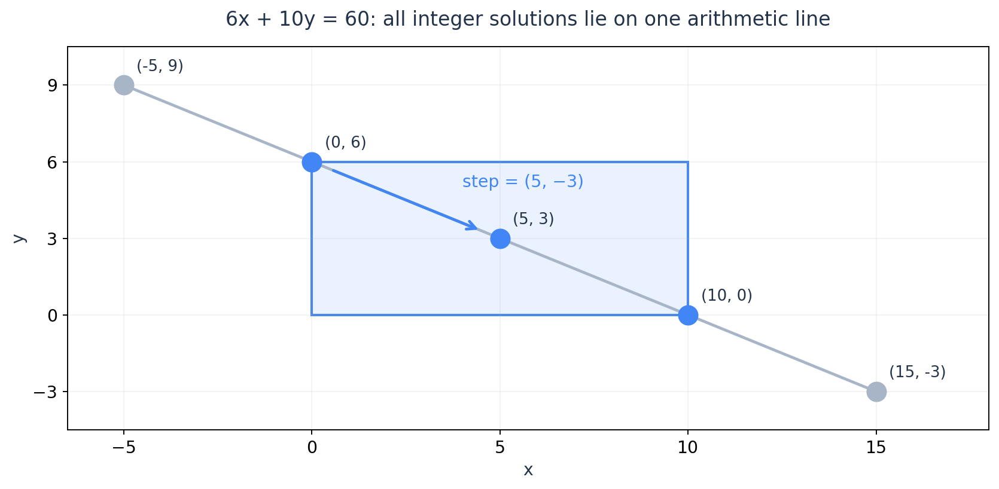
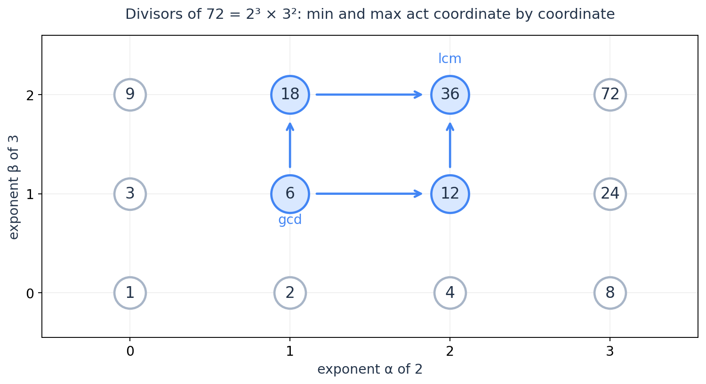
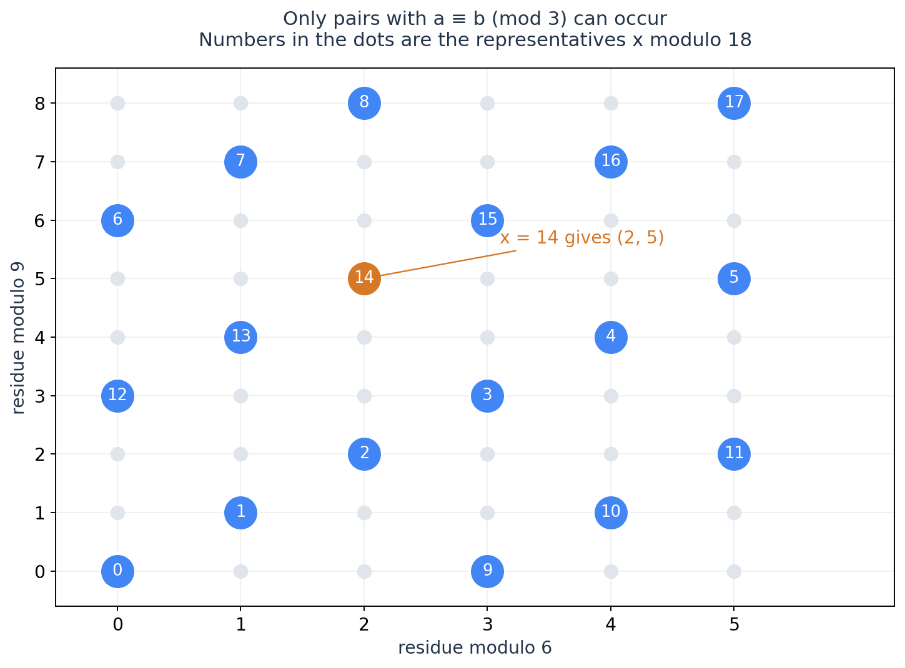
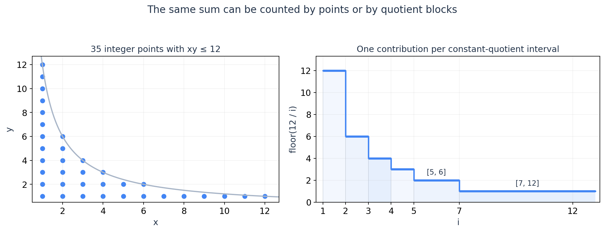

# ICPC 数论：把整数解、质因子、同余和计数串成一套工具

读过初等数论以后，做竞赛题仍然可能出现一种情况：定理基本认识，看到题却不知道该从哪里切入。原因常常不是少记了一个公式，而是没有把题目的约束与合适的表达方式连接起来。

这篇从这些连接出发。我们会反复使用四种表达：

| 题目中出现的结构 | 换一种表达后保留什么 | 首先考虑什么 |
| --- | --- | --- |
| 整数加减、固定步长、线性方程 | 整数线性组合与等差数列 | GCD、裴蜀定理、扩展欧几里得 |
| 乘积、整除、GCD/LCM、阶乘 | 每个质因子的指数 | 唯一分解、约数枚举、质因子估值 |
| 环形移动、余数、多个过程同步 | 剩余类与剩余类的交集 | 线性同余、逆元、CRT |
| 互质条件、批量 GCD、整除求和 | 按公因子分类，或交换计数顺序 | 欧拉函数、质因子容斥、倍数枚举、整除分块 |

表里的方向不是互相独立的专题：同一道题往往需要先换一次表达，再换一次。比如“两个周期何时同步”，先变成两个剩余类的交集，再变成一个线性同余，最后由 GCD 判定有没有解。

范围沿用你之前的训练要求：基础数论工具与建模为主，包含 CRT、整除分块；不展开原根与乘法阶、Lucas、莫比乌斯反演、狄利克雷卷积或复杂数论筛法。容斥已经有[单独一篇](inclusion-exclusion.md)，这里只保留它与数论的接点。第 10 节是取整求和的可选延伸，不是阅读主线的前置条件。

默认你熟悉整除、素数和模运算的定义，不从头建立公理化体系。关键结论会证明，尤其是那些能告诉我们“为什么应该这样建模”的证明。除特别说明外，参与分解与计数的整数为正，模数为正；逆元和欧拉定理主要讨论模数 $m\ge2$。复杂度按竞赛中固定宽度整数的算术模型计算，不涉及任意精度整数的位复杂度。

## 1. GCD 不只是最大公约数：它刻画了整数线性组合的全部结果

对不全为零的整数 $a,b$，记 $d=\gcd(a,b)>0$。裴蜀定理说存在整数 $u,v$，使

$$
au+bv=d.
$$

它在竞赛中真正有用的形式是

$$
\boxed{\{ax+by:x,y\in\mathbb Z\}=d\mathbb Z.}
$$

也就是说，允许正负整数系数时，能够得到的恰好是 $d$ 的全部倍数。

一边很容易：$d$ 同时整除 $a,b$，当然整除所有组合。另一边来自裴蜀等式，把它乘上任意整数 $k$，就能构造出 $kd$。因此，GCD 既给出不可能越过的限制，也提供构造所有允许结果的方法。

### 互除法为什么同时能求出这些系数？

写 $a=qb+r$，则

$$
ax+by=rx+b(qx+y).
$$

反过来，任意组合 $ru+bv$ 也能写成 $au+b(v-qu)$。所以 $(a,b)$ 与 $(b,r)$ 产生的整数线性组合集合完全相同。

反复取余，最后变成 $(d,0)$，其组合集合就是 $d\mathbb Z$。沿等式向回代入，就得到原始 $a,b$ 的系数。这是扩展欧几里得算法在维护的东西：不仅 GCD 相同，能生成的整数集合也相同。

每至多两次取余，较大的正参数至少减半，所以时间为 $O(\log\max(|a|,|b|))$；并不是每次取余都减半。负参数可先取绝对值，最后调整系数符号。

### 可达性问题，为什么常常只剩一个 GCD？

例如在数轴上允许走 $+6,-6,+10,-10$，从 $0$ 能到达哪些整数？答案是所有偶数，因为 $\gcd(6,10)=2$，且 $2=2\cdot6-10$。

但若只允许 $+6,+10$，偶数 $2$ 就不可达。**裴蜀定理处理的是整数系数，不自动保证非负系数，也不保证每条路径的中间状态满足限制。** 遇到取物、分配、不能借钱等问题，GCD 可整除往往只是必要条件，后面还要处理取值范围。

在模 $m$ 的环上，不断加 $a$，不同的可达位置数为

$$
\frac{m}{\gcd(a,m)}.
$$

证明可以直接算首次回到原点的时间。$ta\equiv0\pmod m$ 等价于 $m/d\mid t$，其中 $d=\gcd(a,m)$；最小正 $t$ 就是 $m/d$。从 $0$ 可达的也恰好是模 $m$ 下 $d$ 的倍数。从位置 $s$ 出发，则是与 $s$ 模 $d$ 同余的全部位置。

### 差分为什么能把一批共同变化的数压成一个 GCD？

公因子同时整除 $x,y$，当且仅当同时整除 $x,y-x$，因此

$$
\gcd(a_1+t,\ldots,a_n+t)
=\gcd\bigl(a_1+t,a_2-a_1,\ldots,a_n-a_1\bigr).
$$

后面的差完全不随 $t$ 变化，可以先汇总为一个 GCD。这里的思考方向是：所有数都加同一个量，先看哪些关系在这种变化下保持不变。没有必要对每个查询重新分解质因数。

只有一个数，或所有差都是零时，也可令差分部分的 GCD 为零，使用 $\gcd(x,0)=|x|$，不必破坏这条公式。

> **练习（独立估算 CF 难度）**：[CF1458 A — Row GCD](https://codeforces.com/problemset/problem/1458/A)（约 1700；2020）。本节已经给出了核心性质，适合作为一次短的建模复盘；若做过可直接跳过。

## 2. 线性丢番图方程：先求一组整数解，再沿一条等差方向移动

考虑

$$
ax+by=c,\qquad x,y\in\mathbb Z,
$$

其中先设 $a,b>0$。由上一节，方程有整数解当且仅当 $d=\gcd(a,b)$ 整除 $c$。找到 $au+bv=d$ 后，将系数乘以 $c/d$，就得到一组解 $(x_0,y_0)$。

但竞赛通常不只问“有解吗”，还会限制 $x,y$ 的范围，或者要求某个线性费用最小。这时最有用的是**全部解的形式**：

$$
\boxed{x=x_0+\frac bd t,\qquad
y=y_0-\frac ad t,\qquad t\in\mathbb Z.}
$$

代回去可见它们都是解。反过来，任意另一组解满足

$$
\frac ad(x-x_0)=-\frac bd(y-y_0).
$$

由于 $a/d,b/d$ 互质，$b/d$ 必须整除 $x-x_0$，因此没有其他方向的整数解。这一步解释了为什么两个未知数的范围约束，最终可以压成**一个整数参数的区间**。

图取 $6x+10y=60$。一组解是 $(0,6)$，全部解沿向量 $(5,-3)$ 排列。加上 $0\le x\le10,0\le y\le6$ 后，只留下 $(0,6),(5,3),(10,0)$。

具体地，令 $A=a/d,B=b/d$，若要求 $0\le x\le X,0\le y\le Y$，则

$$
\max\left(\left\lceil\frac{-x_0}{B}\right\rceil,
\left\lceil\frac{y_0-Y}{A}\right\rceil\right)
\le t\le
\min\left(\left\lfloor\frac{X-x_0}{B}\right\rfloor,
\left\lfloor\frac{y_0}{A}\right\rfloor\right).
$$

记左右端点为 $L,R$，答案就是 $\max(0,R-L+1)$。若优化 $ux+vy$，代入后得到

$$
ux+vy=ux_0+vy_0+(uB-vA)t.
$$

只需看系数的正负，在可行区间的一个端点取最优；系数为零时所有解同价。先求参数化解，比直接对 $x,y$ 进行两重搜索清楚得多。

这里的上取整、下取整是数学意义的；例如 $\lfloor-1/3\rfloor=-1$，与 C++ 整数除法向零截断不同。若 $a$ 或 $b$ 为零，则先退化成单变量方程；不能在上面的区间式中除以零。

### 只允许非负系数时，足够大的目标为什么又都能表示？

设 $a,b>1$ 且互质。一个常用的二元结论是：不能写成 $ax+by$（$x,y\ge0$）的最大整数为

$$
ab-a-b.
$$

先看它为什么不能表示。若 $ab-a-b=ax+by$，则 $ab=a(x+1)+b(y+1)$。模 $a$ 可得 $a\mid y+1$，所以 $b(y+1)\ge ab$，而 $a(x+1)>0$，产生矛盾。

再看任何 $c>ab-a-b$ 为什么都能表示。因为 $a,b$ 互质，能在 $0\le x<b$ 中唯一找到一个 $x$ 满足 $ax\equiv c\pmod b$。令 $y=(c-ax)/b$，它是整数，且

$$
c-ax\ge c-a(b-1)>-b.
$$

一个大于 $-b$ 的 $b$ 的整数倍只能非负，因此 $y\ge0$。两边合起来就完成了证明。

这个结论说明：非负约束并没有消失，而是小目标可能被卡住，超过一个明确阈值后全部可行。若 $\gcd(a,b)=d>1$，先要求 $d\mid c$，再整体除以 $d$ 使用；若约分后某个系数为一，则所有非负目标都能表示。不要将二元的这个阈值直接照搬到三种及以上步长。

## 3. 模运算中的除法：约掉了什么，就必须保留什么条件

线性同余

$$
ax\equiv b\pmod m
$$

等价于存在整数 $y$ 使 $ax+my=b$。所以不用重新发明一个判定定理：

$$
\boxed{ax\equiv b\pmod m\text{ 有解}
\iff d=\gcd(a,m)\mid b.}
$$

当 $d\mid b$ 时，真正等价的约分是

$$
\boxed{\frac ad x\equiv\frac bd\pmod{m/d}.}
$$

原因是原条件 $m\mid ax-b$，约掉 $d$ 后变成 $m/d\mid(a/d)x-b/d$。**模数也必须一起除。**

现在系数 $a/d$ 与模数 $m/d$ 互质，存在逆元，于是得到唯一的剩余类

$$
x\equiv x_0\pmod{m/d}.
$$

它在原来的区间 $[0,m)$ 里对应 $d$ 个不同解，而不是一个：

$$
x_0,\ x_0+m/d,\ldots,x_0+(d-1)m/d,
$$

其中取 $0\le x_0<m/d$。若 $m/d=1$，约分后的条件不再限制 $x$，直接按模 $1$ 的剩余类处理，不必求逆元。

例如 $8x\equiv4\pmod{12}$，约成 $2x\equiv1\pmod3$，所以 $x\equiv2\pmod3$。原模 $12$ 下的四个解为 $2,5,8,11$。

### 逆元只不过是右侧等于一的线性同余

令 $b=1$，立即得到

$$
\boxed{a^{-1}\pmod m\text{ 存在}\iff\gcd(a,m)=1.}
$$

扩展欧几里得求到 $au+mv=1$，$u\bmod m$ 就是逆元，复杂度为 $O(\log m)$。它不要求模数为素数，也不要求先分解模数。

同理，从 $ab\equiv ac\pmod m$ 只能推出

$$
b\equiv c\pmod{m/\gcd(a,m)}.
$$

只有 $a$ 可逆时，才能保持原模数直接消去。比如 $2\cdot1\equiv2\cdot4\pmod6$，但 $1\not\equiv4\pmod6$。

### 一个整数商已知存在，是否一定需要逆元？

不一定。若已知整数 $N$ 能被正整数 $d$ 整除，要算 $(N/d)\bmod m$，可以先算

$$
r=N\bmod(dm),\qquad \frac Nd\equiv\frac rd\pmod m.
$$

因为 $N=dmq+r$，所以 $r$ 也能被 $d$ 整除，约分后就是 $N/d=mq+r/d$。这里做的是**整数除法**，不要求 $d$ 在模 $m$ 下可逆；代价是要保留模 $dm$ 的信息，并保证能处理这个更大的模数。

例如计算 $n(n+1)/2\bmod m$，可以先在两个连续整数中挑偶数除以二，再相乘取模。若先模 $m$ 再对余数普通除二，则可能丢掉商的信息。

> **练习**：[ABC186 E — Throne](https://atcoder.jp/contests/abc186/tasks/abc186_e)（约 1900；2020）。适合把固定步长的可达性、最小非负解和约分后的模数一起检查。

## 4. 唯一分解：乘法约束可以改成每个质因子上的大小关系

写正整数

$$
a=\prod_p p^{\alpha_p},\qquad b=\prod_p p^{\beta_p},
$$

只有有限个指数非零。唯一分解立刻给出

$$
\begin{aligned}
a\mid b&\iff\forall p,\ \alpha_p\le\beta_p,\\
v_p(ab)&=\alpha_p+\beta_p,\\
v_p(\gcd(a,b))&=\min(\alpha_p,\beta_p),\\
v_p(\operatorname{lcm}(a,b))&=\max(\alpha_p,\beta_p).
\end{aligned}
$$

这里 $v_p(a)$ 表示质数 $p$ 在 $a$ 中的指数。与上一节的线性组合表达不同，质因子指数更适合处理乘积、整除、最大公约数与最小公倍数，不适合直接拆 $a+b$。

图中 $72=2^3\cdot3^2$ 的每个约数，对应唯一一个坐标 $(\alpha,\beta)$。$12$ 与 $18$ 分别是 $(2,1),(1,2)$，逐坐标取较小值得到 GCD $6$，逐坐标取较大值得到 LCM $36$。

### 为什么约数个数是乘积？什么时候可以逐质数独立计数？

若 $n=\prod_{j=1}^r p_j^{e_j}$，一个约数对每个指数独立选择 $0,\ldots,e_j$，因此

$$
\tau(n)=\prod_{j=1}^r(e_j+1).
$$

同样，约数和为

$$
\sum_{d\mid n}d
=\prod_{j=1}^r(1+p_j+\cdots+p_j^{e_j}).
$$

这里乘起来的依据是：每个局部选择的组合都能对应唯一的整数，并且没有其他条件在局部选择之间产生耦合。如果再要求约数 $d\le X$、各数之和固定、或者若干个数必须互不相同，通常就不能照样把局部答案相乘。

例如“LCM 等于 $K$”可以逐质数写成：所有被选数的该质因子指数不超过 $e_p$，且至少有一个数达到 $e_p$。局部条件很清楚，但如果被选数必须来自给定数组，能选哪些指数组合仍由数组决定，不能凭空拼出不存在的元素。

公式 $\gcd(a,b)\operatorname{lcm}(a,b)=ab$ 也来自每个坐标的恒等式 $\min+\max=\alpha+\beta$。它只对两个数这样写；三个数不能直接把 GCD 与 LCM 相乘当成原数乘积。

### 数据范围决定分解方式，不能只看数论公式的复杂度

单次试除可在 $O(\sqrt n)$ 次候选检查内完成分解：取出一个因子后不断除尽，最后剩下的大于一的因子也是质数。实现循环边界可写成检查 $p\le n/p$，避免平方溢出。

若有很多个数且都不超过 $V$，用基础埃氏筛记录每个数的最小质因子，预处理约 $O(V\log\log V)$、空间 $O(V)$；之后分解一个 $a$，每除掉一个质因子至少减半，耗时 $O(\log a)$。这里不展开更复杂的筛法。

若只与“是否含某个质数”有关，关心的是不同质因子数 $\omega(n)$，不是总指数和，也不是约数个数 $\tau(n)$。$2^{20}$ 有 21 个正约数，却只有一个不同质因子。许多容斥只需枚举 $2^{\omega(n)}$ 个子集；但这不代表大整数的质因数分解也同样便宜。

## 5. 阶乘里的整除：别计算阶乘，直接统计质因子出现多少次

对质数 $p$，Legendre 公式为

$$
\boxed{v_p(n!)=\sum_{k\ge1}\left\lfloor\frac{n}{p^k}\right\rfloor.}
$$

证明只需数贡献：$p$ 的每个倍数贡献至少一个 $p$；$p^2$ 的倍数还要多算一个；$p^3$ 的倍数再多算一个，以此类推。整数 $x$ 若恰好含 $e$ 个 $p$，就在前 $e$ 层各出现一次，最终被计算 $e$ 次。

例如 $v_2(10!)=5+2+1=8$。实现时反复把 $n$ 除以 $p$ 并累加商即可，不必真的计算 $p^k$。时间 $O(\log_p n)$。

如果 $K=\prod p^{e_p}$，则

$$
K\mid n!\iff\forall p\mid K,\ v_p(n!)\ge e_p.
$$

右侧随 $n$ 单调，便能转成寻找阈值的问题。注意检查每个**质数的指数**，而不是只检查每个质数有没有出现。例如 $8$ 出现于 $n!$，需要三个因子 $2$，不能只看到 $2\le n$ 就结束。

二项式系数也一样：

$$
v_p\binom nr=v_p(n!)-v_p(r!)-v_p((n-r)!).
$$

它可以判断整除性，或与其他质因子的估值一起计算末尾零的数量。若计数底数为 $B=\prod p^{e_p}$，正整数 $A$ 在 $B$ 进制末尾有

$$
\min_{p\mid B}\left\lfloor\frac{v_p(A)}{e_p}\right\rfloor
$$

个零，因为能整体提取多少个 $B$，取决于最先耗尽的质因子资源。

不要把“我能计算整除性”与“我能用阶乘逆元算组合数”混为一谈。模素数 $p$ 时，阶乘表的下标一旦达到 $p$，阶乘就变成零，不能继续求逆。本篇到此交代边界，不引入你暂时排除的组合数进阶方法。

> **练习**：[ABC280 D — Factorial and Multiple](https://atcoder.jp/contests/abc280/tasks/abc280_d)（约 1800；2022；额外前置：单调性与二分）。题面只有一个数，适合把质因子估值真正落成判定过程。

## 6. CRT：把两个剩余类的交集，重新写成一个剩余类

设已经有两条约束

$$
x\equiv a\pmod m,\qquad x\equiv b\pmod n.
$$

第一条告诉我们 $x=a+mt$。代入第二条，就得到熟悉的线性同余

$$
mt\equiv b-a\pmod n.
$$

令 $g=\gcd(m,n)$，于是

$$
\boxed{\text{两式兼容}\iff g\mid(b-a).}
$$

兼容时，约分后求出

$$
t\equiv\frac{b-a}{g}\left(\frac mg\right)^{-1}\pmod{n/g}.
$$

取一个代表 $t_0$，就得到

$$
\boxed{x\equiv a+mt_0\pmod{\operatorname{lcm}(m,n)}.}
$$

这既是构造，也是全部解的证明：$t$ 每增加 $n/g$，$x$ 增加 $mn/g$；而线性同余告诉我们没有其他 $t$。因此不只找到了某个交点，还把整组交点重新压成了一条等差数列。

例如 $x\equiv2\pmod6$、$x\equiv5\pmod9$。设 $x=2+6t$，得到 $2t\equiv1\pmod3$，所以 $t\equiv2\pmod3$，最终

$$
x\equiv14\pmod{18}.
$$

若第二式改为 $x\equiv4\pmod9$，两条约束在模 $3$ 下要求不同结果，就无解。非互质模数下的问题不是“公式要多补一个逆元”，而是约束本身可能冲突。

图中横纵坐标分别是模 $6$、模 $9$ 的余数。一个整数只会落在两坐标模 $3$ 相同的格子里。蓝点共有 $18=\operatorname{lcm}(6,9)$ 个，与模 $18$ 的全部整数一一对应；并不是 $6\times9$ 个格子都可取。

### 为什么互质模数能够真正独立选择？

当 $\gcd(m,n)=1$，兼容条件自动满足。因此每一对余数 $(a\bmod m,b\bmod n)$ 都唯一对应一个模 $mn$ 的整数。这才是“先在两个模数下独立求解，再组合答案”的依据。

特别地，$M=\prod p^{e_p}$ 的不同质数幂两两互质。若某个问题的条件能逐个模 $p^{e_p}$ 检查，可以分别处理，再用 CRT 合并。这与第 4 节的指数分解相呼应，但并不是所有关于整数的条件都能这样拆：普通大小关系、整数加和范围不属于单独一个剩余类的信息。

多条同余可以顺次合并，只维护当前的最小非负代表和模数。一次合并使用扩展欧几里得，耗时为模数大小的对数级；$k$ 条约束在最终 LCM 适合固定宽度整数的前提下，可界为 $O(k\log M)$。有约分模数 $n/g=1$ 时，该条已经被包含，取 $t_0=0$ 即可。

得到 $x\equiv r\pmod M$ 后，如果题目还要求 $x\ge L$，最小解是

$$
r+M\left\lceil\frac{L-r}{M}\right\rceil.
$$

区间 $[L,R]$ 内的解数为

$$
\left\lfloor\frac{R-r}{M}\right\rfloor-
\left\lfloor\frac{L-1-r}{M}\right\rfloor.
$$

CRT 负责把等式约束合并，区间与最小值要求再沿这条等差数列处理。这比为了“最早同步”直接模拟到某个巨大时间可靠得多。

计算 $\operatorname{lcm}(m,n)$ 应先除以 GCD 再乘；即使最终 LCM 能保存，构造解时的中间乘积也可能更大。公式正确与所用整数类型能否承载运算，是两件要分别核查的事。

> **练习**：[ABC193 E — Oversleeping](https://atcoder.jp/contests/abc193/tasks/abc193_e)（约 2300；2021）。关键在于识别哪些周期内的候选足够少，可以先枚举，再合并各自的同余条件。

## 7. 欧拉函数：先把它当作互质的计数，再看它为什么能控制幂

定义

$$
\varphi(n)=\#\{x\in[1,n]:\gcd(x,n)=1\},\qquad\varphi(1)=1.
$$

对质数幂 $p^e$，不互质的恰好是 $p$ 的倍数，所以

$$
\varphi(p^e)=p^e-p^{e-1}.
$$

而对互质的 $a,b$，CRT 将模 $ab$ 的整数与一对余数一一对应。一个整数与 $ab$ 互质，当且仅当其两个余数分别与 $a,b$ 互质。因此

$$
\varphi(ab)=\varphi(a)\varphi(b)\qquad(\gcd(a,b)=1).
$$

再按质数幂分解，就得到熟悉的乘积公式

$$
\boxed{\varphi(n)=n\prod_{p\mid n}\left(1-\frac1p\right).}
$$

这里有两个可以互相校验的理解：从容斥看，是排除每个质因子的倍数；从 CRT 看，是对每个质数幂的互质余数独立计数。一个关注坏事件，另一个关注余数坐标，最终得到同一数量。

已知质因数分解后，按不同质数依次做 $v\gets(v/p)(p-1)$，就能计算 $\varphi(n)$，不需要浮点数。若需要所有 $1\le n\le V$ 的值，可以先令 $\varphi(n)=n$，再对每个质数的所有倍数做上述更新；基础筛的时间为 $O(V\log\log V)$、空间为 $O(V)$。

### 为什么欧拉定理可以用一个排列来证明？

假设 $\gcd(a,m)=1$。取出模 $m$ 下全部 $\varphi(m)$ 个互质余数，组成集合 $R$。乘以 $a$ 以后，它们仍然与 $m$ 互质；而且若 $ax\equiv ay\pmod m$，由 $a$ 可逆可得 $x\equiv y\pmod m$。

因此乘以 $a$ 将 $R$ **重新排列**，并没有漏掉或重复任何元素。将两边全部相乘：

$$
a^{\varphi(m)}\prod_{r\in R}r\equiv\prod_{r\in R}r\pmod m.
$$

每个 $r$ 都可逆，乘积也可逆，消去后得到欧拉定理

$$
\boxed{a^{\varphi(m)}\equiv1\pmod m\qquad(\gcd(a,m)=1).}
$$

费马小定理是模数为素数 $p$ 的特例：若 $p\nmid a$，则 $a^{p-1}\equiv1\pmod p$，从而 $a^{-1}\equiv a^{p-2}\pmod p$。这解释了竞赛里常见的快速幂求逆元，也解释了为什么不能把任意合数模数都代入“模数减二”。

反过来，一次费马同余成立不能证明模数为素数。例如 $341=11\cdot31$，但 $2^{10}\equiv1\pmod{341}$，当然也有 $2^{340}\equiv1\pmod{341}$。这里不展开素性测试，只区分定理的前提与结论方向。

### 指数取模，为什么必须检查互质条件？

若底数可逆，则对所有 $E\ge0$ 都有

$$
a^E\equiv a^{E\bmod\varphi(m)}\pmod m.
$$

但模 $8$ 时，$\varphi(8)=4$，指数 $1,5$ 模 $4$ 相同，$2^1\equiv2$、$2^5\equiv0$ 却不同。非互质底数的质因子正在逐步积累，在指数较小时不能忽略这件事。

如果题目确实需要处理非互质底数，可以回到已经建立的工具，而不是无条件套一个“广义降幂公式”。分解 $m=\prod p^{e_p}$，对正底数 $a$：

- 若 $p\mid a$，则 $v_p(a^E)=E\,v_p(a)$；达到 $e_p$ 后，这个分量就为零，之前保留真实的小指数计算。
- 若 $p\nmid a$，则在模 $p^{e_p}$ 下可用欧拉定理降低指数。

最后用 CRT 合并。比如 $2^E\bmod12$，在模 $4$ 下 $E\ge2$ 后恒为零，在模 $3$ 下则随指数奇偶变化。于是 $E=1,2,3,4,5$ 的结果依次为 $2,4,8,4,8$：最初的积累与后面的重复，是由不同质数幂分量共同决定的。底数为零时单独按题目对零次幂的约定处理。

### 互质计数，不在完整周期里时仍然需要额外工作

在任意连续 $m$ 个整数中，与 $m$ 互质的恰好有 $\varphi(m)$ 个。但在 $[1,N]$ 中，通常不能直接写成 $N\varphi(m)/m$ 再取整。例如 $m=6,N=5$，互质数为 $1,5$，有两个，而这个近似式向下取整只有一个。

设 $m$ 的不同质因子是 $p_1,\ldots,p_r$，由质因子容斥，精确答案为

$$
\boxed{C(N,m)=\sum_{S\subseteq[r]}(-1)^{|S|}
\left\lfloor\frac{N}{\prod_{i\in S}p_i}\right\rfloor,}
$$

空积取一。$m=1$ 时没有需要排除的质因子，答案为 $N$。分解以后，用递推生成每个子集的乘积，可在 $O(2^r)$ 时间完成求和；区间计数用 $C(R,m)-C(L-1,m)$。

这一步与“GCD 恰好等于某个数”相连：若 $g\mid m$，则

$$
\gcd(x,m)=g\iff g\mid x\text{ 且 }\gcd(x/g,m/g)=1.
$$

先除去规定的公共部分，再排除额外公因子，就把精确 GCD 条件换成了互质条件。分母和区间也要一起缩放，不能只改 GCD 符号。

> **练习**：[CF1295 D — Same GCDs](https://codeforces.com/problemset/problem/1295/D)（约 1900；2020）。适合检查平移后的区间、精确 GCD 与完整余数周期之间的关系。

> **练习**：[CF1750 D — Count GCD](https://codeforces.com/problemset/problem/1750/D)（约 2100；2022）。会用到互质的区间计数，也需要判断一串给定 GCD 约束是否兼容；不需要更高级的反演工具。

## 8. 批量 GCD 计数：按“至少含有这个因子”统计，再恢复精确分类

先看一个欧拉函数的计数恒等式：

$$
\boxed{\sum_{d\mid n}\varphi(d)=n.}
$$

证明并不需要把乘积公式再展开。将 $1,\ldots,n$ 中的整数按 $g=\gcd(x,n)$ 分类。固定 $g\mid n$，写 $x=gy$，条件变成 $\gcd(y,n/g)=1$、$1\le y\le n/g$，所以这一类有 $\varphi(n/g)$ 个。

这些类不重不漏，故 $\sum_{g\mid n}\varphi(n/g)=n$。把约数重新命名，就得到上式。这种证明的价值在于：它不仅证明了公式，还直接给出怎样处理带 GCD 的求和。

例如

$$
\sum_{x=1}^n\gcd(x,n)=\sum_{g\mid n}g\,\varphi(n/g).
$$

左边逐个整数枚举，右边只枚举可能的 GCD；分类后，同一类的答案相同。已分解 $n$ 时，可以枚举约数及其相应欧拉函数值来求和。

### 值域有限时，先算整除条件通常更容易

考虑所有取值在 $1,\ldots,V$ 中的有序 $k$ 元组，$k\ge1$。记 $E(g)$ 为 GCD 恰好等于 $g$ 的元组数。

若先要求每个元素都是 $d$ 的倍数，选择数直接是

$$
F(d)=\left\lfloor\frac Vd\right\rfloor^k.
$$

被计算的元组，其 GCD 可以是 $d,2d,3d,\ldots$，而每个元组有唯一的 GCD，所以

$$
F(d)=\sum_{j\ge1,\,dj\le V}E(dj).
$$

从大到小计算即可：

$$
\boxed{E(d)=F(d)-\sum_{j\ge2,\,dj\le V}E(dj).}
$$

这只是按唯一的 GCD 分类后扣除其他类别，不需要先学习莫比乌斯反演。计算全部 $F(d)$ 若逐项快速幂耗时 $O(V\log(k+1))$；倍数扣除的总次数为 $O(V\log(V+1))$，空间 $O(V)$。

若对象换成“从给定数组中选 $k$ 个不同下标”，先令 $c_d$ 为数组中能被 $d$ 整除的元素个数，对应的宽松计数就换成 $\binom{c_d}{k}$。扣除关系没有改变。值相等的元素仍可能对应不同下标，是否去重要按题面决定。

还要分清“全部数的 GCD 为一”与“两两互质”。$6,10,15$ 的整体 GCD 为一，但每一对都不互质。上面的元组计数处理的是前者，不能直接拿来计算两两互质的方案数。

### 只求 GCD 的总和，是否需要恢复整个精确分布？

未必。由 $g=\sum_{d\mid g}\varphi(d)$，对每个元组先拆贡献，再交换求和顺序：

$$
\begin{aligned}
\sum_{a_1,\ldots,a_k=1}^V\gcd(a_1,\ldots,a_k)
&=\sum_{a_1,\ldots,a_k=1}^V
\sum_{d\mid a_1,\ldots,d\mid a_k}\varphi(d)\\
&=\boxed{\sum_{d=1}^V\varphi(d)
\left\lfloor\frac Vd\right\rfloor^k.}
\end{aligned}
$$

固定 $d$ 时，只剩每个元素都能被它整除，数量正是 $F(d)$。这条路线不先求 $E(g)$，而是直接让每个因子承担一份权重。

[ABC162 E — Sum of gcd of Tuples (Hard)](https://atcoder.jp/contests/abc162/tasks/abc162_e)（估算约 2100；2020）可以直接用本节任一路线完成。它在这里是已分析的例题，不再伪装成一道未给提示的练习。你可以比较两种做法维护的信息：恢复全部类别更通用，拆分目标贡献更直接。

数论计数中的一个常见选择，就是在“按最终值分类”和“按每个因子贡献”之间切换。真正支撑这种切换的不是一个术语，而是每个对象被计算了几次、每次权重是多少。

> **综合练习**：[CF2037 G — Natlan Exploring](https://codeforces.com/problemset/problem/2037/G)（约 2300；2024；额外前置：DAG 上的计数 DP）。可以仅用基础筛、不同质因子的容斥与加权汇总完成，不需要莫比乌斯反演。它更适合检验能否将“数对象”推广成“对对象附带的权值求和”。

## 9. 整除分块：商相同的区间，可以一次处理

考虑

$$
\sum_{i=1}^N\left\lfloor\frac Ni\right\rfloor.
$$

它也可以解释为整数点对 $(x,y)$ 满足 $x,y\ge1,xy\le N$ 的数量：固定 $x=i$ 后，$y$ 有 $\lfloor N/i\rfloor$ 种选择。因此它等于 $\sum_{k=1}^N\tau(k)$，因为固定乘积 $k$ 时，有序因子对由 $k$ 的一个约数唯一确定。

这两个计数方式提供不同算法。值域不大，可以枚举约数与倍数；$N$ 很大、不能开值域数组时，观察商的变化更合适。

设当前左端点为 $l\le N$，商为 $q=\lfloor N/l\rfloor>0$。保持同样商的最远右端点是

$$
\boxed{r=\left\lfloor\frac Nq\right\rfloor.}
$$

因为从 $l$ 开始向右移动，商不可能增加；只要 $i\le N/q$，就仍有 $N/i\ge q$，所以商也不会减小。超过 $r$ 后则必然小于 $q$。

图取 $N=12$。最后一块为 $i\in[7,12]$，商都为一。整个和为

$$
12+6+4+3+2\cdot2+1\cdot6=35.
$$

### 为什么不同商只有 $O(\sqrt N)$ 个？

把下标分两部分：$i\le\sqrt N$ 时，下标数量只有 $O(\sqrt N)$；$i>\sqrt N$ 时，商小于 $\sqrt N$，商的不同取值数也只有 $O(\sqrt N)$。这两种界控制的是不同的对象，合起来才得到块数上界。

如果是带权形式

$$
\sum_{i=1}^N w_i\left\lfloor\frac Ni\right\rfloor,
$$

并且能快速得到权值前缀和 $W(x)$，一块的贡献就是

$$
q\bigl(W(r)-W(l-1)\bigr).
$$

$w_i=1$ 时是块长，$w_i=i$ 时是等差数列和。若没有办法快速得到 $W$，只把外层下标分块并不会自动解决问题。例如上一节的 $\varphi(i)$ 权重，已有欧拉函数前缀和时可以直接分块；若 $N$ 大到无法预处理所有 $\varphi(i)$，则还缺少一个高效求前缀和的方法，本篇不把它当作已经解决。

若同时出现 $\lfloor A/i\rfloor$、$\lfloor B/i\rfloor$，在 $i\le\min(A,B)$ 的正商范围内取

$$
r=\min\left(
\left\lfloor\frac A{\lfloor A/l\rfloor}\right\rfloor,
\left\lfloor\frac B{\lfloor B/l\rfloor}\right\rfloor
\right).
$$

这相当于取两种分段的公共细化，块数可界为 $O(\sqrt A+\sqrt B)$。下标超过分子时，商为零，应该作为尾部单独处理，不能拿零去除。

> **练习**：[CF616 E — Sum of Remainders](https://codeforces.com/problemset/problem/616/E)（约 2200；2016）。虽是较早的题，但它很适合检验带权分块以及零商尾部的处理，保留作本节的应用练习。

## 10. 可选延伸：分子是一次式时，取整求和怎样再次回到欧几里得算法？

整除分块处理 $\lfloor N/i\rfloor$；另一种常见结构则是

$$
F(n,m,a,b)=\sum_{i=0}^{n-1}\left\lfloor\frac{ai+b}{m}\right\rfloor,
$$

其中 $n,a,b\ge0,m\ge1$。不要因为它也含有取整，就照搬上一节的分块式：现在变化的是分子，结构不一样。

先把明显的整数部分拆出来。写 $a=qm+a'$、$b=rm+b'$，则

$$
F(n,m,a,b)=q\frac{n(n-1)}2+rn+F(n,m,a',b').
$$

于是只需处理 $0\le a,b<m$。若 $n=0$ 或 $a=0$，这时剩余和为零。否则令

$$
h=\left\lfloor\frac{a(n-1)+b}{m}\right\rfloor.
$$

把每一项的商想成该列下方的整数点数。固定高度 $y\in[1,h]$，这层哪些列被计算？需要

$$
my\le ai+b
\iff i\ge\left\lceil\frac{my-b}{a}\right\rceil.
$$

因为 $b<m$，这个阈值为正；又因为 $y\le h$，它不超过 $n-1$。所以本层有 $n-\lceil(my-b)/a\rceil$ 列。改为逐层求和，并令 $j=y-1$，得到

$$
\boxed{F(n,m,a,b)
=nh-F(h,a,m,m-b+a-1).}
$$

若 $h=0$，右侧也直接为零。关键在于右边的**新模数是原来的 $a$，严格小于 $m$**。下一次再拆出分子的整数部分，就出现 $m\bmod a$；参数像欧几里得算法一样下降，总递归层数为 $O(\log m)$。这一式与常用 floor_sum 模板的写法可能不同，但数的是同一批整数点。

例如 $n=4,m=5,a=2,b=1$，原和为 $0+0+1+1=2$。$h=1$，上式给出

$$
4-F(1,2,5,5)=4-2=2.
$$

这段推导值得理解的地方不是背递推式，而是：**按列不好求和，就改成按高度数；交换以后，原来的斜率分子与分母互换。** 本篇只讨论非负参数，负参数必须先用数学意义的下取整归约，不能直接依赖向零截断的整数除法。

如果需要检查接口或实际实现，可以参考 [AtCoder Library 的 floor_sum](https://atcoder.github.io/ac-library/production/document_en/math.html)。使用前核对它的参数范围和返回值溢出约定；数学公式本身不保证所有中间结果都适合 64 位。

## 11. 怎样把这些工具用到一道没见过的题里？

先把原题中的量词和范围写清。允许整数还是只允许非负数？要求至少有一个公因子、GCD 恰好等于某数，还是两两互质？模数是否为素数？最后要完整分布，还是只求一个总和？这些差别往往决定了能否使用某个定理。

然后找可消去的共同部分。共同平移可以试差分；精确 GCD 可以先除去指定因子；乘积整除可以逐质数比较指数；两个同步条件可以先代入一个等差数列，再解剩下的同余。

接下来才决定枚举谁：元素很多但值域小，就枚举因子与倍数；整数巨大但不同质因子少，就考虑按不同质因子容斥；区间很长但商值少，就合并同商区间。枚举规模由题目的数据范围决定，不由定理名字决定。

证明只围绕实际需要的结论展开。为了判定可达性，需要证明所有满足 GCD 条件的目标都能达到；为了做参数区间优化，需要证明全部解都在同一条参数线上；为了拆贡献，需要检查每个原始对象最后被计入的总权重。无需每次从头证明唯一分解，但也不能用一个熟悉的定理名字跳过题目中的范围条件。

## 参考与进一步阅读

- [MIT 18.781 数论讲义目录](https://ocw.mit.edu/courses/18-781-theory-of-numbers-spring-2012/pages/lecture-notes/)：本篇对应 Lecture 1–5 中的基础部分。特别是 [Lecture 5：线性同余与 CRT](https://ocw.mit.edu/courses/18-781-theory-of-numbers-spring-2012/7b36e2ada32c5ed0638783d4e66af60c_MIT18_781S12_lec5.pdf)，可以核对剩余类、约分后的解数与欧拉函数的联系。不要求按该课程后续章节继续扩展范围。
- [AtCoder Library：Math](https://atcoder.github.io/ac-library/production/document_en/math.html)：逆元、CRT、floor_sum 的官方接口、前提与复杂度。本文的 floor_sum 使用按高度求和的独立推导，式子不必与库中的循环逐行对应。
- [ABC186 E 官方解说](https://atcoder.jp/contests/abc186/editorial/422)、[ABC193 E 官方解说](https://atcoder.jp/contests/abc193/editorial/818)：线性同余与周期同步的直接竞赛应用，建议完成练习后核对。
- [ABC162 官方解说 PDF](https://img.atcoder.jp/abc162/editorial.pdf)，E 题：按 GCD 精确分类的从大到小扣除法。本篇还用欧拉函数的约数恒等式推导了直接加权计数的另一条路线。
- [CF1750 D 官方题解](https://codeforces.com/blog/entry/108504)、[CF2037 G 官方题解](https://codeforces.com/blog/entry/135533)：互质区间计数与不同质因子的加权容斥。只需其中基础工具的路线，不要求先学更高级的筛法或反演。
