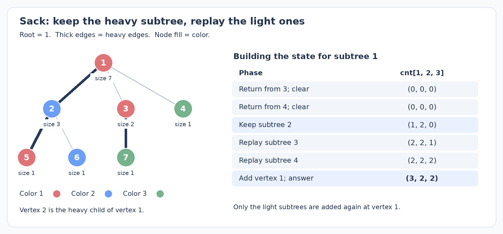

# 启发式合并与 DSU on Tree：保留哪一份信息，重新处理哪些元素？

你已经做过 USACO Guide 这一节的前五题。这篇从这些题背后的共同结构重新组织讲解：先分清名词，再比较两种实现怎样复用已有结果，以及复杂度里的对数从哪里来。Lomsat gelral、Race 作为熟悉的例题重新观察，不要求把旧题再刷一遍；另配几道训练点不同的题。默认不附完整代码。

## 1. 这些名字分别在说什么？

| 名称 | 本篇采用的含义 | 保留的信息 |
| --- | --- | --- |
| 启发式合并 / small-to-large | 合并两份可枚举的信息时，优先把小的一份加入大的一份 | 两个容器中的记录，合并后复用较大的容器 |
| 树上的启发式合并 | 后序遍历，在父亲处合并各个子树的信息 | 每个已处理子树有一份可以交给父亲的容器 |
| DSU on Tree / sack | 本篇特指保留重儿子统计、重新加入轻子树的遍历安排 | 一份全局统计，随 DFS 顺序变成不同子树的统计 |
| DSU，即并查集 | 维护元素属于哪个连通分量，支持集合合并与代表元查询 | 父指针、分量大小及可选的分量信息 |

文献中的命名并不完全统一。Arpa 的文章把容器合并和 sack 的几种实现都放在 DSU on Tree 名下；USACO Guide 的 small-to-large 重点是容器合并。读题解时，最好进一步看它到底维护“每个子树一个容器”，还是“所有子树轮流使用同一份全局统计”。

它们共同的想法是：**较大的那份结果尽量保留，只为较小的部分重新付出代价。** 并查集按大小合并也使用类似的规模分析，但 sack 本身不需要调用 `find` 或 `union`。另外，这里的重儿子与树链剖分中的重儿子可以按同一个定义选出，后续用途却不同：这里利用轻边限制重复处理次数，不需要把路径拆成若干条链。

下面始终把根定好，记 $S_u$ 为 $u$ 的子树顶点集合，$s_u=|S_u|$。先用一个自构问题作为公共模型：每个点有颜色，要求每个子树的颜色频次。两种方法维护的数学对象相同，差别在于这份频次表放在哪里、何时还有效。

## 2. 小并大：先证明总共搬多少次，再计算单次搬运的代价

假设每个点先有一个只包含自身信息的容器。处理完孩子后，若总是新建父亲容器、把所有孩子的信息复制进来，一条链就足以让复杂度变坏：大小为 $1,2,\ldots,n-1$ 的结果会依次被重新扫描，总扫描量为 $\Theta(n^2)$。

其实父亲完全可以接着使用某个孩子的容器，再加入其他孩子和自己。交换容器的拥有者或句柄可以是常数时间；这里需要避免的是复制大容器的全部内容。

### 没有去重时，逐元素的翻倍证明

先看最清楚的模型：容器保存互不相同的原始元素，两个集合不相交。每次把元素较少的集合搬进较多的集合。若某元素搬运前所在集合大小为 $s$，另一个集合至少有 $s$ 个元素，搬运后它所在集合至少有 $2s$ 个元素。

因此，一个元素每搬一次，所在集合大小至少翻倍；集合最多有 $n$ 个元素，它最多搬 $\lfloor\log_2 n\rfloor$ 次。总枚举量为 $O(n\log n)$。假如每条记录插入平衡树要 $O(\log n)$，总时间才是 $O(n\log^2 n)$；若更新有期望 $O(1)$ 的哈希实现，则相应得到期望 $O(n\log n)$。后一个界不能说成哈希表的确定性最坏界。

这里的分析依赖集合持续合并、原始元素归属不被拆开。它也要求合并代价主要由小的一方决定；把两个有序数组每次都线性归并，会扫描大的一方，不能仅凭“小并大”三个字得到同样的界。

### 有重复颜色时，到底什么在翻倍？

若容器是去重的颜色集合，直接说“每次合并后颜色数翻倍”就不成立。例如 $\{红,蓝\}$ 与 $\{红,绿\}$ 都有两种颜色，合并后却只有三种。

我们可以换一个计量方式：一份信息背后代表的原始顶点数或球数，称为它的质量 $w$；容器实际记录数记为 $r$。颜色被去重或压成频次后，仍有 $r\le w$。两份信息合并时，原始对象互不相交，质量相加。

若算法枚举记录较少的容器，一次工作量为

$$
\min(r_A,r_B)\le\min(w_A,w_B).
$$

把这次工作分摊给质量较小的一方中的原始对象，每个对象承担至多常数份。这个较小质量的集合合并后，质量至少翻倍，因此每个原始对象最多承担 $O(\log n)$ 次费用，总工作量仍是 $O(n\log n)$。

注意，这是一种分析中的分摊：承担费用的原始对象不必就是程序实际移动的颜色记录。实际方向按记录数选择，证明按质量来支付费用，便避开了“颜色去重后是否翻倍”的问题。如果直接按质量选择合并方向，也能用同一论证，因为被枚举的记录数不超过较小质量。

这套论证适用于每份状态的记录数不超过其代表的原始对象数的情形。若随意生成额外记录、复制整份状态或拆分集合，必须重新检查这个条件。还有 $m$ 次合并调用时，空集合等常数开销应另外计入 $O(m)$。

> **短练习**：[ABC329 F — Colored Ball](https://atcoder.jp/contests/abc329/tasks/abc329_f)（独立估算约 1600；AtCoder，2023）。训练容器交换与实际对象编号的关系，不需额外知识。题目规定从箱 $a$ 倒入箱 $b$，但实现可以选择复用任一容器；最终必须把并集交给 $b$，并让 $a$ 为空。完整分析见[配套第 1 题](small-to-large-and-dsu-on-tree-exercises.md#1-abc329-f--colored-ball)。

## 3. 复习 Lomsat gelral：每个子树一份容器时，怎样复用结果？

[CF600 E — Lomsat gelral](https://codeforces.com/problemset/problem/600/E) 要求每个子树中出现次数最多的所有颜色编号之和。这里把它作为你做过的题来对照两种写法；独立估算约 2100，原始年份 2015。

对一个子树，保存颜色频次表 $f[c]$，以及两个量：最大频次 $mx$，达到这个频次的颜色编号之和 $sum$。孩子内部的答案先分别算好；父亲拿一个孩子的容器作为起点，然后把其他孩子的记录 $(c,d)$ 加入，即令 $f[c]\gets f[c]+d$。

每次频次增加后，只需看这个颜色：若新频次超过 $mx$，令 $mx$ 为新值、$sum=c$；若恰好等于 $mx$，令 $sum\gets sum+c$；否则不变。这是因为合并过程中其他颜色频次没有减少，原有最大值不会因为本次操作失效。

继承大容器时，也要继承与它一致的 $mx,sum$。不能拿着已经填好的频次表，却把辅助统计当作空表重新开始。全部孩子及 $u$ 自己合并完后，$ans[u]=sum$。

使用有序映射并按记录数小并大，总时间 $O(n\log^2 n)$。也可以选顶点数最大的孩子作为起点，再枚举其余孩子的记录：每条记录可用对应轻子树的顶点数支付费用，得到同样的上界。

有两个实现语义值得先说清楚。第一，父亲复用孩子容器后，容器内容会继续变化；孩子的 $ans[v]$ 已经保存，不能把这个可变容器当作孩子状态的永久快照。第二，小容器合并后应释放或清空，拥有关系要明确；若旧副本全部保留，空间就不再是“当前每个顶点只归属一份活动容器”的 $O(n)$ 记录量。

还有一种容易漏掉的平方复杂度：每个点合并完后，再扫描整张频次表求最大值。一条颜色互异的链会反复扫描大小为 $1,2,\ldots,n$ 的表。小并大只控制合并工作量，查询答案也必须足够快。这里维护 $mx,sum$ 正是为避免这次额外扫描。

这道题的完整分析入口保留在[配套第 2 题](small-to-large-and-dsu-on-tree-exercises.md#2-cf600-e--lomsat-gelral)。下面用同一题换一种存储方式。

## 4. Sack：只用一份全局统计，怎样让它恰好表示当前子树？

颜色已经编号或离散化后，用一个全局数组 $cnt[c]$ 保存当前加入的顶点中各颜色出现次数。单点加入可以是 $O(1)$，不再为每个子树建立一张平衡树。但此时要回答的问题变成：遍历到 $u$ 时，怎样使数组恰好包含 $S_u$？

朴素办法是每个子树重新加入全部顶点、回答、再清空。一条链的总加入量仍是平方级。Sack 的安排是：为每个 $u$ 选顶点数最大的孩子 $h(u)$，称为重儿子；其他孩子称为轻儿子。先处理轻儿子并清空，再处理重儿子并保留，最后只重新加入轻子树和 $u$。

### 先给递归函数一个准确的约定

记过程为 $solve(u,keep)$。本篇的调用约定是：

- 进入时，全局统计为空。
- 过程中计算好 $S_u$ 内所有需要的答案。
- 返回时，若 $keep=true$，全局统计恰好表示 $S_u$；若为 false，则重新变为空。

`keep` 控制是否保留频次等工作状态，已经写入答案数组的结果始终保留。

为什么每次递归入口都能为空？父亲在任何一个孩子递归前都还没有加入自己；轻儿子逐个返回空状态，最后才调用重儿子。重儿子返回后，父亲只枚举顶点做单点更新，不再调用新的 $solve$。所以这个约定可以自顶向下保持。

```text
预处理子树大小，并选出每个点的重儿子 h[u]

solve(u, keep):
    对每个轻儿子 v:
        solve(v, false)
    若重儿子存在:
        solve(h[u], true)
    对每个轻儿子 v:
        枚举 x 属于 S_v，执行 add(x)
    add(u)
    此时全局统计恰好表示 S_u，回答挂在 u 上的询问
    若 keep 为 false:
        枚举 x 属于 S_u，删除它的贡献，使全局状态恢复为空
```

子树枚举可以用预处理好的 DFS 序区间完成，也可以遍历对应轻子树。重点是这里的 `add(u)` 只加入一个顶点；枚举轻子树时才逐点加入，不能又把已经保留的重子树扫一遍。

### 跟一次具体状态变化

下图是自构的七点树。结点填色表示颜色编号 1、2、3，粗边表示按子树顶点数选出的重边；2 的两个孩子大小相同，任选 5 为重儿子。



计算根 1 时，先完成轻子树 3 和单点子树 4，各自回答完后清空。随后重子树 2 返回，留下的顶点恰为 $\{2,5,6\}$，颜色频次是 $(1,2,0)$。

再加入子树 3 的 $\{3,7\}$，频次变成 $(2,2,1)$；加入顶点 4，得到 $(2,2,2)$；最后加入根 1，得到 $(3,2,2)$。这才是根子树的完整频次。若求 Lomsat gelral，根的最多颜色只有编号 1，答案为 1；子树 2 的最多颜色为编号 2，答案为 2。

轻子树不是没计算，而是先独立计算答案并清空，之后为了组成父亲的统计，再加入一次。重子树也不是没有遍历，而是它算好后的状态被直接留下，所以在父亲处不必再次枚举它。

## 5. 为什么是 $O(n\log n)$，清空又该怎样计费？

若 $v$ 是 $u$ 的轻儿子，重儿子大小至少为 $s_v$，因此

$$
s_u\ge1+s_v+s_{h(u)}\ge1+2s_v.
$$

从一个点向上经过一条轻边，所处子树大小至少翻倍；一个点到根的路径最多有 $O(\log n)$ 条轻边。一个顶点 $x$ 除了自己的单点加入外，只有在它位于某个祖先的轻子树时，才会被重新枚举。总加入次数因此为

$$
O\!\left(n+\sum_u\sum_{v\text{ 为 }u\text{ 的轻儿子}}s_v\right)
=O(n\log n).
$$

清空发生在 $keep=false$ 的调用结束时。这些调用正好是轻儿子对应的子树；根若也要求清空，再多付出 $O(n)$。因此删除总次数也在同一界内。若单点加入、删除代价是 $T_{upd}$，每个询问代价是 $T_{qry}$，总时间应写成

$$
\boxed{O(n\log n\cdot T_{upd}+q\cdot T_{qry}+n).}
$$

数组频次配常数更新可以得到 $O(n\log n+q)$；若每次更新还调用树状数组或平衡树，就可能多出一个对数。不能只看到 DSU on Tree 就宣布整题是 $O(n\log n)$。

这里的重儿子应按“稍后要重新枚举多少顶点”来选，即按子树顶点数。若改用颜色种数或高度，这个轻边证明就不再适用。每次回答后把整个全局数组从头清零，也不在上述界内：应只撤销本次子树的顶点贡献，或记录需要清理的位置。

### Lomsat gelral 的最大频次，清空时要逐步维护吗？

单点加入时，按第 3 节规则维护 $mx,sum$ 即可，每次只增加一种颜色的一次出现，所以是 $O(1)$。但删除一个点后，最大频次可能降低，原来的单向更新规则不能直接反着用。

本题可以利用调用约定：清空时，要删掉当前的全部 $S_u$，之后回到空状态；中途不回答询问。因此只需逐点撤销 $cnt$，结束后把 $mx,sum$ 一起置零，无须在每次删除后计算剩余集合的众数。保留重儿子时则连同这些辅助量一起保留。

这一技巧依赖“清空结束后恰为空、清空过程中没有查询”。若还有外部元素要保留，就不能照样把全局辅助量归零。对其他统计，也要分别设计合法的删除或恢复空状态的办法，不能把任意复杂答案都当成可直接撤销。

于是同一题有序映射合并为 $O(n\log^2 n)$，Sack 配颜色数组为 $O(n\log n)$。减少的是一次单点更新的代价；两种方法都利用了较大部分的复用。

## 6. 新例题 Tree and Queries：频次的频次需要维护什么？

[CF375 D — Tree and Queries](https://codeforces.com/problemset/problem/375/D) 的询问是 $(u,k)$：$S_u$ 中有多少种颜色出现至少 $k$ 次？独立估算约 2200；CF，2013。它虽然较早，但这里用它训练与众数不同的维护信息，适合作为 sack 的直接迁移。

所有询问离线挂在顶点 $u$。当 sack 的统计恰好等于 $S_u$ 时回答它们。只有 $cnt[c]$ 还不够快：若每次询问扫描所有颜色，询问部分可能达到 $O(nq)$。

定义

$$
ge[t]=\#\{c:cnt[c]\ge t\},\qquad1\le t\le n.
$$

它数的是达到门槛的颜色种数，不是顶点个数。例如频次为 $(3,2,2)$ 时，$ge[1]=3,ge[2]=3,ge[3]=1$。

加入一个颜色 $c$，频次从 $f$ 变为 $f+1$。它原本已满足门槛 $1,\ldots,f$，现在只新满足门槛 $f+1$，所以只需令

$$
cnt[c]\gets f+1,\qquad ge[f+1]\gets ge[f+1]+1.
$$

删除时从 $f$ 变成 $f-1$，也只失去门槛 $f$，故 $ge[f]\gets ge[f]-1$，再减少频次。每次单点更新仍为常数时间，查询直接返回 $ge[k]$；$k>n$ 时返回 0。

这解释了为什么不必为本题再引入一个树状数组：每次频次只变动 1，而我们保存的正好是“至少”的数量。若合并一个 map 记录时一次加 $d$，就不能只更新一个门槛；它跨过了 $d$ 个门槛。维护操作的粒度必须与统计定义相匹配。

总时间 $O(n\log n+q)$，空间 $O(n+q+C)$，$C$ 为颜色数组范围或离散化后颜色数。完整分析见[配套第 3 题](small-to-large-and-dsu-on-tree-exercises.md#3-cf375-d--tree-and-queries)。

## 7. 回到 Race：合并之前，为什么要先查询整棵轻子树？

子树信息的用途还可以是匹配两个端点。为了避免反复统计，常把一条树路径归到端点的 LCA：两端点要么分别位于 LCA 的不同孩子子树，要么有一个端点就是 LCA 自己。

处理 $u$ 时，保留重儿子的信息，再逐个处理轻子树。当前统计中只放已经处理的子树以及可选的 $u$；对于下一棵轻子树，先让里面的所有顶点查询已有统计，查询全部结束后，再统一把它们加入。

若查一个点就立刻加入它，同一轻子树里后面的点便可能与它配对。这些点对的 LCA 在该轻子树内部，不应再次当成 LCA 为 $u$ 的路径处理。**分两遍的目的，是让当前查询的整组与统计中的端点组互不重叠。**

[IOI 2011 — Race](https://oj.uz/problem/view/IOI11_race) 要求边权和恰好为 $K$ 的简单路径中，最少使用多少条边。这里复用你做过的旧题讲解这种分组顺序；独立估算约 2500，不把点分治当作前置。

下面采用每个子树返回一份映射的合并写法，重儿子仍按子树顶点数选择。

记 $D[x]$ 为根到 $x$ 的边权和，$dep[x]$ 为根到 $x$ 的边数。若 $\operatorname{LCA}(x,y)=u$，则

$$
D[x]+D[y]-2D[u]=K.
$$

固定 $u,x$ 后，需要另一端点满足

$$
D[y]=K+2D[u]-D[x].
$$

所以可以维护映射 $best[d]$：当前已加入的端点中，根距离等于 $d$ 的最小边深度。一次查询的候选边数就是

$$
dep[x]+best[K+2D[u]-D[x]]-2dep[u].
$$

同一个距离保留最小深度已足够，因为对当前查询，其他项完全相同，深度越小，整条路径边数越少。

先继承重儿子映射，处理“$u$ 与重子树端点”的路径，然后把 $u$ 加入；之后每棵轻子树先查询、再加入。映射最终交给父亲，里面保存整个 $S_u$ 按根距离压缩后的最小深度。这个做法不需要把所有距离改成“相对当前根”：使用全局根距离，把 $2D[u]$ 放进查询公式即可。

按顶点数选重儿子并枚举各轻子树顶点，总枚举量 $O(n\log n)$；每个顶点进行常数次有序映射操作，总时间 $O(n\log^2 n)$。映射被复用且小容器及时释放时，空间为 $O(n)$ 记录量。原题边权允许为 0，根距离可能重复，不能把一个距离随便对应到某个深度；根距离也需要 64 位。完整步骤、无解与零权边情况见[配套第 4 题](small-to-large-and-dsu-on-tree-exercises.md#4-ioi-2011--race)。

> **进一步迁移**：[CF1923 E — Count Paths](https://codeforces.com/problemset/problem/1923/E)（独立估算约 2200；CF，2024）。同样在树上合并端点信息，但要自己判断哪些端点还能向父亲延伸。额外前置：基础树形 DP、按 LCA 分类路径。建议先独立思考，再看[配套第 5 题](small-to-large-and-dsu-on-tree-exercises.md#5-cf1923-e--count-paths)。

## 8. 选哪种写法，先看你实际要做什么操作

| 问题 | 容器合并 | Sack |
| --- | --- | --- |
| 子树状态放在哪里？ | 各自一份，逐步交给父亲 | 共用一个全局状态 |
| 父亲复用什么？ | 较大孩子的容器 | 重儿子留下的工作状态 |
| 小的一方怎样处理？ | 枚举小容器中的记录 | 重新枚举轻子树的原始顶点 |
| 怎样得到答案？ | 合并完成时读当前容器及辅助统计 | 活动顶点恰为 $S_u$ 时回答挂在 $u$ 的询问 |
| 是否需要撤销？ | 通常无需逐点撤销，合并后消耗小容器 | 需要能删除贡献，或在同一复杂度内恢复空状态 |
| 常见代价 | 有序映射常为 $O(n\log^2 n)$ | 常数单点更新时为 $O(n\log n+q)$ |

若状态天然是一张稀疏映射，或合并后还要筛掉、压缩一部分候选，容器合并通常直接。若统计适合放在全局数组里，每加入一个点都能快速维护，并能在清空时恢复状态，sack 往往更方便。

两者都没有自动解决“怎样维护答案”这件事。求众数要设计 $mx,sum$，求至少 $k$ 次的颜色种数要设计 $ge$，路径配对要设计足够的端点摘要和查询顺序。讲复杂度时，分开计算枚举次数、每次更新代价和回答询问代价，比记住一个方法名更可靠。

## 参考与阅读范围

- [USACO Guide — Small-To-Large Merging](https://usaco.guide/plat/merging)：对照容器交换与小并大。本文对颜色去重后的复杂度补充了原始对象质量的分摊证明；不展开页面最后的更高级合并结构。
- [Arpa — Sack (dsu on tree)](https://codeforces.com/blog/entry/44351)：对照 map 复用、重儿子保留与 DFS 序枚举几种写法。本文统一为“入口为空、返回保留或清空”的调用约定，不要求同时记住多个模板。
- [ABC329 F 官方解说](https://atcoder.jp/contests/abc329/editorial/7896)：区分箱子编号与存储容器，并分别讨论球数和颜色数两种规模。
- [CF1923 E 官方题解](https://codeforces.com/blog/entry/126339)：其公开实现展示按颜色合并并截断状态的路线，作为配套第 5 题的核对材料。
- Race 的[官方英文题面](https://static.oj.uz/problem/ba16349e8d2a84c8a08fe77d4b271c4/statement/5b6848cebe6e11c5e01f62c5097876901e76cd615351a3c23d0831dd628a419d/statement_en.pdf)：本文独立展开按 LCA 分组的小并大解法；零权边、不同端点和函数式评测接口以原题为准。
