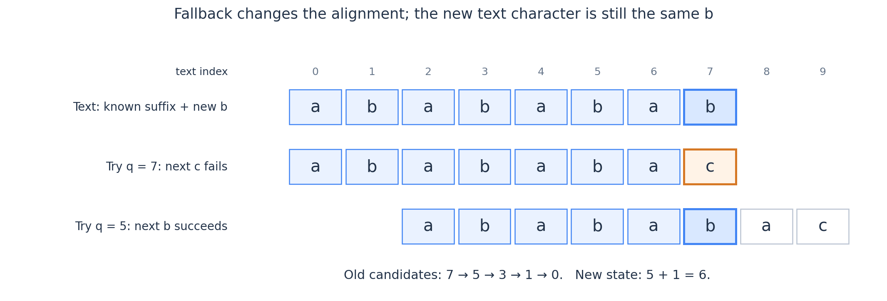
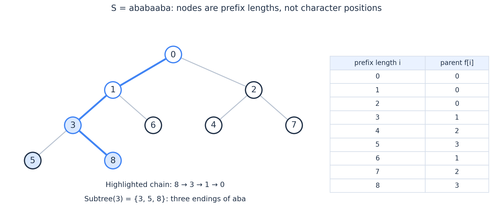
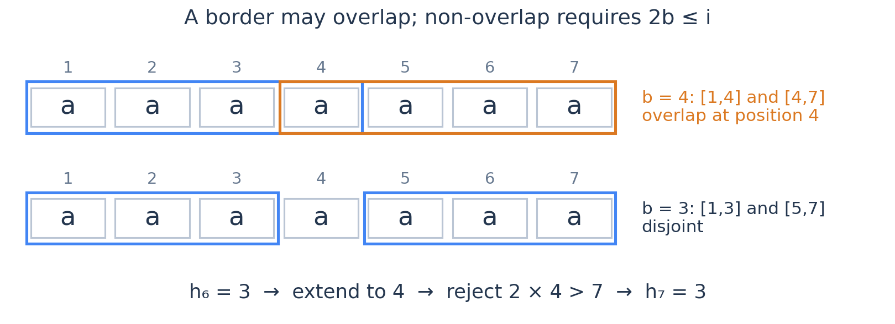
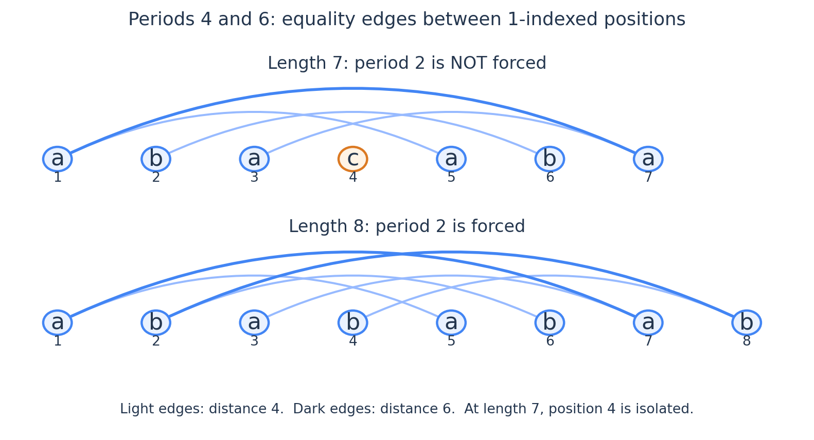
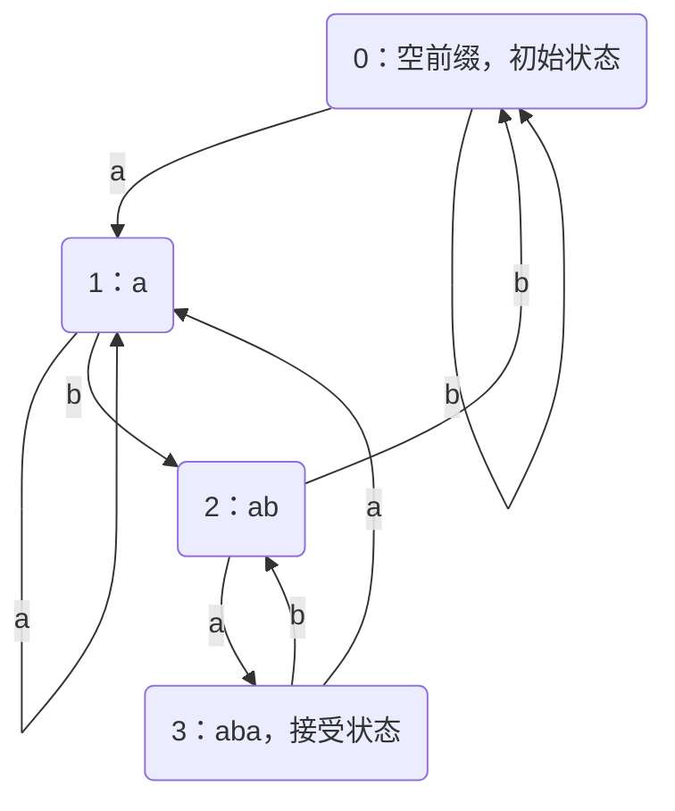

# KMP 与 Border 理论：从候选链到失配树，再到周期结构

你已经写过不少 KMP 题，下面不再以一份模板为中心。我们先回答一个更基本的问题：**已经匹配的内容，究竟替我们保存了哪些信息？**

主线：Border 构成链，链描述 KMP 候选，全部链组成失配树，再由 Border 重叠推导周期与等差结构。

动物园放在失配树的查询应用之后。它用到的性质会先讲清楚，不需要靠这道题来组织整篇内容。

赛前学第 1–7 节普通 KMP、Border 与失配树；第 8、9 节周期结构按需读。自动机、状态图、转移表、DP 均留文末赛后附录。

全文统一使用 **1-index 字符下标与闭区间**：字符串写成 $S[1..n]$，子串 $S[l..r]$ 的长度为 $r-l+1$。记

$$
S_i=S[1..i],\qquad f[i]=S_i\text{ 的最长真 Border 的长度}.
$$

非空真 Border 长 $b$ 满足 $0<b<i$、$S[1..b]=S[i-b+1..i]$，两次出现**允许重叠**。辅助空候选长为 $0$，$S_0=S[1..0]$ 为空串，$f[0]=f[1]=0$；不访问 $S[0]$。

节点与状态均表示**前缀长度**。字符 1-index，长 $i$ 前缀结束于 $i$，节点 $0$ 为空前缀。可在字符串前补不参与匹配的占位字符。沿用你的 `f`：预处理与匹配的 `j` 均为匹配长度，下一比较字符为 `j+1`。

## 1. 最长 Border 保存了全部 Border，而不只是一个最优值

设 $b$ 是 $S_i$ 的一个 Border，另取 $0<a<b$。有一个比“Border 的 Border 还是 Border”更完整的结论：

$$
\boxed{a\text{ 是 }S_i\text{ 的 Border}
\iff a\text{ 是 }S_b\text{ 的 Border}.}
$$

$S_i$ 最后 $b$ 个字符是 $S_b$，所以最后 $a$ 个字符也相同；两者待比较的前缀均为 $S[1..a]$，故 Border 判断等价。

这个等价关系同时回答了两个问题：

- 继续在 $S_b$ 里找 Border，不会引入原串没有的候选；
- 原串中所有小于 $b$ 的 Border，也一个都不会漏掉。

取 $b=f[i]$，再不断重复，就得到全部非空真 Border：

$$
f[i],\ f[f[i]],\ f[f[f[i]]],\ldots
$$

直到到达 $0$。这些长度严格递减，而且中间没有被跳过的合法 Border。

例如 $S=\texttt{ababaaba}$，完整长度为 $8$，其链是

$$
8\longrightarrow3\longrightarrow1\longrightarrow0.
$$

长度 $3$ 对应 $\texttt{aba}$，长度 $1$ 对应 $\texttt{a}$。长度 $2$ 并不是一个“更短所以应该也能用”的候选：前缀是 $\texttt{ab}$，后缀是 $\texttt{ba}$。

这就是为什么失配时不是把长度减一，而是去找下一个 Border。**长度小，不代表它仍然与已经读过的内容相符。**

## 2. KMP 维护的其实是一整组候选，只是用最大值代表它

现在固定一个非空模式串 $P[1..m]$，在文本 $T$ 上从左到右扫描。读完前 $i$ 个字符 $T[1..i]$ 后，定义

$$
q_i=\max\{\ell\in[0,m]:P[1..\ell]\text{ 是 }T[1..i]\text{ 的后缀}\}.
$$

其中 $q_0=0$，允许 $q_i=m$，表示刚刚出现一次完整匹配。问题是：只存最长的 $q_i$，为什么不会忘记其他有用的后缀？

设当前最长长度为 $q$。对于 $0\le\ell<q$，因为文本的最后 $q$ 个字符就是 $P[1..q]$，所以

$$
P[1..\ell]\text{ 是当前文本的后缀}
\iff \ell\text{ 是 }P[1..q]\text{ 的 Border}.
$$

结合上一节，当前所有合法长度恰好是

$$
\boxed{q,\ f[q],\ f[f[q]],\ldots,0.}
$$

所以 KMP 没有假定“小的候选都不重要”，也没有只留下一个未经证明的贪心选择。它把整组候选压成了一个链头；其余候选能通过 $f$ 完整恢复。

### 来了一个字符以后，为什么只需沿这条链找？

设新字符为 $c$。若新状态为 $k>0$，去掉最后的 $c$ 后，$P[1..k-1]$ 必须是旧文本的后缀。因此，$k-1$ 必须在旧候选链上。

反过来，旧链上的候选 $j$ 若满足 $j<m$ 且 $P[j+1]=c$，就能延伸成新候选 $j+1$。两边合起来说明：**新候选与旧候选中能够接上 $c$ 的部分一一对应。**

链按长度递减，首个可延伸候选即最长新状态。$q<m$ 且 $P[q+1]\ne c$ 时仅排除 $q$，再试 $f[q]$，无须重读文本；$q=m$ 无字符可延伸，先退 $f[m]$。

$P=\texttt{abababac}$，已匹配 $7$ 字符，新字符 $\texttt{b}$。候选 $7$ 要求 $\texttt{c}$，退至 $5$ 后可接 $\texttt{b}$，得新状态 $6$。长度 $6$ 不在旧候选链中，却可成为**读新字符后的**状态。

### 为什么计算 $f$ 也用同一套过程？

计算 $f[i]$ 时，旧串是 $P[1..i-1]$，但必须排除整个旧串作为候选，否则再接一个字符会得到长度 $i$，把新串自己当成真 Border。

$i\ge2$ 时从 $f[i-1]$ 延伸，比较 $P[i]$ 与 $P[j+1]$，失配令 $j\gets f[j]$，成功加一。任何新真 Border 删末字符均在旧链中，故不漏。初值 $f[1]=0$。

这也解释了两种操作的联系：模式匹配是在另一条文本上运行这套状态变化；求前缀函数，则是在模式串自己身上运行，并额外排除“整个前缀匹配自己”。

### 线性复杂度来自指针的连续性

单字符可多次回退，但连续扫描中每字符最多增状态 $1$，每次回退严格减且不低于 $0$，所以总回退不超总增长。扫描 $O(|T|)$，含预处理 $O(m+|T|)$。

证明用的是“这根指针从头到尾连续变化”，不是“每次回退都能减半”。$P=\texttt{aaaa\ldots a}$ 时，$f[j]=j-1$，链完全可能有线性长度。

## 3. 完整匹配后的回退与模板约定

本节只沿用前面已经证明的匹配长度与失配回退，不需要引入新的概念。

$P=\texttt{aba}$、$T=\texttt{ababa}$，第三字符到状态 $3$ 并记录；下个 $\texttt{b}$ 从 $f[3]=1$ 延伸到 $2$，再读 $\texttt{a}$ 得第二次匹配。匹配后清零会漏重叠。

可保留 $m$，下次转移前回退；也可记录后立即退 $f[m]$。后者只是后续准备状态，不再是当前最长匹配长度。第 5 节统计须先记录完整状态。

你的模板统一 **`j` 为匹配长度**：均比较 $P[j+1]$，失配 $j\gets f[j]$，成功 $j\gets j+1$。每轮后预处理为 $j=f[i]$，匹配为 $j=q_i$；前者排除前缀匹配自身，后者允许满状态 $m$。

$j=m$ 且结束于文本 $i$ 时记录起点 $i-m+1$，保留满状态。**下个字符比较前先退 $f[m]$**。可用 `j == m || (j > 0 && 当前字符 != P[j + 1])` 统一回退条件，循环仍令 $j\gets f[j]$，避免读模式外字符并保留重叠。

你的模式 `T` 长 `k`，补占位后 `T.size()=k+1`。满状态后比较 `T[k+1]`，对 `std::string` 恰读 `size()` 得末尾 `\0`，不是任意越界内存；字母输入使其失配回退。显式判断满状态更清楚，也适用无该约定的字符容器，仍沿用匹配长度。

> **自主练习**：[LibreOJ 10048](https://vjudge.net/problem/LibreOJ-10048)。

## 4. 失配树的祖先关系，准确地对应什么？

为固定字符串 $S$ 建立节点 $0,1,\ldots,n$，每个 $i>0$ 的父亲是 $f[i]$，根为 $0$。因为父亲编号严格小于儿子，所有点最终都会到达 $0$，这些边组成一棵树，称为失配树。

节点 $i$ 表示固定前缀 $S[1..i]$，不是字符 $S[i]$ 或任意长 $i$ 子串。1-index 只使前缀末位置等于长度，不改父子关系。

根据第 1 节，对 $0<u<v$，有

$$
\boxed{u\text{ 是 }v\text{ 的祖先}
\iff S_u\text{ 是 }S_v\text{ 的 Border}.}
$$

若允许 $u=v$，右边要改成“$S_u$ 是 $S_v$ 的一个前缀兼后缀，允许取整个串”。根 $0$ 则代表空串。只有把这些边界分清，树上的公式才不会平白多一个或少一个。

图取 $S=\texttt{ababaaba}$。节点 $8$ 的祖先链为 $8,3,1,0$；节点 $3$ 的子树则包含 $3,5,8$。从这两个方向看同一棵树：

- 向上走，是枚举当前前缀有哪些 Border；
- 看节点 $u$ 的子树，是找哪些更长前缀以 $S_u$ 结尾。

第二种解释往往比第一种更适合计数题。

### 深度、LCA、长度门限分别解决什么问题？

令根的树深度 $\operatorname{dep}(0)=0$。正节点 $i$ 的链上有 $\operatorname{dep}(i)$ 个非空节点，其中包含 $i$ 自己，所以非空真 Border 个数为

$$
\boxed{\operatorname{dep}(i)-1.}
$$

这里树深度数的是 Border 层数，不是字符串长度。树上的节点编号沿根到叶严格增加，但增长量可以很不一样。

两个节点 $x,y$ 的 LCA，表示同时作为 $S_x,S_y$ 后缀的最长固定前缀，允许它等于某个输入前缀。若要求同时是二者的**真** Border，应取

$$
\operatorname{lca}(f[x],f[y]),
$$

而不是总取 $\operatorname{lca}(x,y)$。例如 $x=y$ 时，后一式返回整个前缀，显然不是真 Border。若结果为 $0$，表示没有非空公共候选。

求长度不超 $L$ 的最长真 Border，从 $f[i]$ 找首个编号不超 $L$ 的祖先。编号严格递减，可倍增，预处理 $O(n\log n)$、查询 $O(\log n)$。若到 $h$，合格非空 Border 数为 $\operatorname{dep}(h)$，含自身不含根。

这给出一个非常通用的基准解：遇到带额外条件的 Border 题，先把它写成清楚的祖先查询，再判断是否有必要利用查询顺序进一步优化。

### 不同教材的 next，未必都是这里的父亲

有的 $\mathrm{next}$ 存最长 Border，有的存下一次比较的字符位置，有的使用 $-1$ 哨兵，还有的已经做过 nextval 优化。名字相同，语义却可能不同。

$q<m$ 时若新字符与 $P[q+1]$ 失配，满足 $P[j+1]=P[q+1]$ 的短候选 $j$ 也必失败，nextval 可跳过它。

但 $j$ 仍可能是真 Border。**匹配时可跳过，不代表计数结构中可删除。** 失配树、Border 计数与祖先查询必须用原始最长真 Border $f$。

## 5. 前缀出现次数，为什么等于失配树的子树和？

先在 $S$ 自己里面数固定前缀 $S_u$ 的出现次数，允许出现位置重叠，且 $u>0$。

以位置 $i$ 结尾的一次出现，等价于 $S_u$ 是 $S_i$ 的后缀，也就等价于节点 $i$ 在失配树的 $u$ 子树里。因此

$$
\boxed{S_u\text{ 在 }S\text{ 中的出现次数}
=u\text{ 的子树中节点 }1,\ldots,n\text{ 的数量}.}
$$

这不是先猜一个树上 DP，再验证能不能过样例；出现位置与子树中的节点之间已经建立了一一对应：每个节点 $i$ 就代表一个结束位置。

给每个 $i=1,\ldots,n$ 单位贡献，再按 $i=n,\ldots,1$ 累加到 $f[i]$。父编号更小，故先汇总子树再上传，无须 DFS。时间、空间 $O(n)$。

在上图中，前缀 $\texttt{aba}$ 的节点为 $3$，子树节点为 $3,5,8$，对应三次出现的结束位置也恰好是 $3,5,8$。这正是 1-index 写法的便利：节点编号直接对应出现的结束位置。

若你做过 [CF432 D — Prefixes and Suffixes](https://codeforces.com/problemset/problem/432/D)（估算约 2000；2014），可以用这个解释重新看一次原解。它较经典，这里只作为“祖先链筛选前缀、子树和统计出现”的直接对照，不要求重复刷题。该题还输出整个串的长度，要将节点 $n$ 自己也包括进去。

### 模式串和文本不同，树仍然有用

为模式 $P$ 建失配树，在文本 $T$ 上跑 KMP。每读完一个位置 $i$，只给最长状态 $q_i$ 放一个单位贡献。

为什么只标记最长状态，不需要沿链逐个加一？因为某个前缀 $P_u$ 在这里出现，当且仅当 $u$ 是 $q_i$ 的祖先。把所有状态标记做一次子树和，就同时完成了所有祖先的计数。

扫描时间 $O(m+|T|)$，再按节点编号逆序汇总 $O(m)$，便能得到模式所有非空前缀在文本中的出现次数。完整匹配状态 $m$ 要先标记，再回退，否则会把完整模式的出现丢掉。

### 区间里的出现次数，也可以变成二维计数

假设询问前缀 $P_u$ 在文本闭区间 $T[L..R]$ 中出现几次。一次出现必须完整包含在区间里，所以它的结束位置 $i$ 应满足 $i-u+1\ge L$ 且 $i\le R$，即

$$
L+u-1\le i\le R.
$$

同时，$q_i$ 应在失配树的 $u$ 子树里。给失配树求从 $1$ 开始的 DFS 序，令 $\operatorname{tin}(u)$ 是进入 $u$ 时的编号，$\operatorname{tout}(u)$ 是其子树内的最大编号。这个子树对应闭区间 $[\operatorname{tin}(u),\operatorname{tout}(u)]$，问题便变成

$$
i\in[L+u-1,R],\qquad
\operatorname{tin}(q_i)\in[\operatorname{tin}(u),\operatorname{tout}(u)].
$$

转为结束位置与失配树 DFS 序的矩形计数。离线扫描加树状数组，时间 $O(m+(|T|+Q)\log(m+1))$。若 $R-L+1<u$ 返回零；否则用扫描至 $R$ 减至 $L+u-2$，边界零尚无字符。按边界挂查询无须排序，计数工具可替换。

> **练习**：[ABC257 G — Prefix Concatenation](https://atcoder.jp/contests/abc257/tasks/abc257_g)（估算约 2400；2022；额外前置：DP 与正确性证明）。它不只问有没有匹配，还要利用各个结束位置的匹配信息完成另一个优化问题。

## 6. 非重叠 Border：先看成祖先查询，再解释为什么能线性扫

长 $i$ 前缀的 Border 对应 $[1,b]$ 与 $[i-b+1,i]$。不重叠要求 $b<i-b+1$，整数下标下等价于

$$
\boxed{2b\le i.}
$$

所以“非重叠”没有改变 Border 的定义，只是在原来的候选链上加了一个长度门限。

令

$$
h_i=\max\bigl(\{0\}\cup\{b:b\text{ 是 }S_i\text{ 的非空真 Border},\ 2b\le i\}\bigr).
$$

由第 4 节，全部合格的非空 Border，就是 $h_i$ 及其非零祖先，数量为

$$
\boxed{\operatorname{dep}(h_i).}
$$

你提到的 [NOI2014 动物园](https://www.luogu.com.cn/problem/P2375)，要求的 $\mathrm{num}[i]$ 正是这个数量，最后输出 $\prod_i(\mathrm{num}[i]+1)$。乘积中的每一项，也正好是从 $h_i$ 到根的整条链的节点数：非空候选有 $\operatorname{dep}(h_i)$ 个，根再贡献一个空候选。

到这里已经有一个完整、容易证明的 $O(n\log n)$ 解：预处理 $f$、树深度和倍增，逐个查询 $h_i$。若想进一步到 $O(n)$，需要证明下面这一件事。

### 为什么从 $h_{i-1}$ 出发，不会丢掉将来能用的较长候选？

先别想指针怎么写。固定任意一个当前合格 Border $b>0$，它满足 $2b\le i$。去掉最后一个字符后，$b-1$ 是上一个前缀 $S_{i-1}$ 的前缀兼后缀，而且

$$
2(b-1)\le i-2\le i-1.
$$

**当前合格长度 $b$ 只能由上步合格的 $b-1$ 延伸。** 上步因太长排除的候选，不会接一字符就突然合格。

上步合格候选为 $h_{i-1}$ 祖先链。从 $j=h_{i-1}$ 比较 $S[i]$、$S[j+1]$，失配沿原 $f$ 回退，成功加一；再回退至 $2j\le i$。初值 $h_1=0$，第二遍扫描 $i=2,\ldots,n$。

第一次过程找到的是“上一步合格候选能够延伸出的最长长度”；第二次删掉其中当前仍太长的候选。刚才已经证明，所有真正的当前合格候选都在这个范围里，所以最终得到的正是 $h_i$。

例如连续的 $\texttt{a}$：处理完长度 $6$ 的前缀，$h_6=3$；再读一个 $\texttt{a}$，临时延伸到 $4$。但长度 $7$ 的两个长度 $4$ 区间会重叠，于是退到 $f[4]=3$，得到 $h_7=3$。长度 $1,2,3$ 全都保留在它的祖先链中。

### 为什么这次跳链是线性，而逐次从 $f[i]$ 跳不一定是？

沿着整个第二遍扫描，$j$ 每步至多增加一，失配回退和门限回退都只会减少它，因此两类回退合计仍为 $O(n)$。加上第一遍求 $f$ 和深度，总时间、空间均为 $O(n)$。

若每轮重设 $j=f[i]$ 再退至 $j\le i/2$，在 $S=\texttt{a}^n$ 上每轮从 $f[i]=i-1$ 退约 $i/2$ 次，总计 $\Theta(n^2)$。连续指针的摊还界不能用于反复抬高起点。

$h_i$ 不能覆盖原 $f[i]$。例如 $\texttt{aaaa}$ 的 $f[4]=3$ 虽超非重叠门限，仍是真 Border，也是其他查询所需父亲。

可推广到 $0\le L_i<i$、$L_i\le L_{i-1}+1$：合格 $b$ 的前驱 $b-1\le L_{i-1}$。若门限骤增便不成立，如全 $\texttt{a}$ 从门限零增至十，旧指针只延伸一次无法恢复十。

## 7. Border 是重叠的边界，周期是同一事实的位移写法

对长度为 $\ell$ 的非空字符串 $X$，定义正整数 $p\in[1,\ell]$ 是它的周期，当且仅当

$$
X[j]=X[j+p]\qquad(1\le j\le\ell-p).
$$

这只要求相隔 $p$ 的位置相同，不要求 $p$ 整除长度。$p=\ell$ 总是一个周期，因为没有需要比较的位置。

将等式整段写出，就是

$$
X[1..\ell-p]=X[p+1..\ell].
$$

因此

$$
\boxed{p\text{ 是周期}\iff \ell-p\text{ 是 Border 长度，允许为空}.}
$$

最长真 Border 对应最短正周期：

$$
\boxed{p_{\min}(S_i)=i-f[i].}
$$

KMP 从 $j$ 退至 $f[j]$，等价于对齐起点右移 $j-f[j]$，即已匹配前缀的最短周期。Border 与周期描述同一组字符等式。

### 周期不等于完整重复块

$X=\texttt{ababa}$ 的最短周期是 $2$，但它不是若干个 $\texttt{ab}$ 的完整拼接。如果题目要求 $X=U^k$ 且 $k\ge2$，除了最短周期 $p$ 以外，还要检查 $p<\ell$、$p\mid\ell$。

必要性：若长 $d<\ell$ 的块完整重复，则 $d\mid\ell$、$d\le\ell/2$ 且 $d$ 为周期；下一节定理推出最短周期 $p\mid d$，故 $p\mid\ell$。充分性由周期等式逐位得到。

周期 $p$ 的正倍数不超 $\ell$ 时仍为周期，沿步长反复比较即可。反向不成立：$\texttt{ababa}$ 周期有 $2,4,5$，$5$ 非 $2$ 倍数；长位移重叠太短，约束不足。

> **练习**：[ABC135 F — Strings of Eternity](https://atcoder.jp/contests/abc135/tasks/abc135_f)（估算约 2400；2019；额外前置：简单图论）。这里的无限重复串需要同时处理局部匹配和全局可延伸性，适合检验你能否区分“一个位置匹配成功”与“可以无限接下去”。

## 8. 两个周期什么时候会被迫拥有更小的公共周期？

设长度为 $\ell$ 的字符串同时有周期 $p,q$，令 $d=\gcd(p,q)$。Fine–Wilf 定理说：

$$
\boxed{\ell\ge p+q-d\quad\Longrightarrow\quad d\text{ 也是周期}.}
$$

直观上，周期 $p,q$ 各自提供了一批“这两个位置相等”的约束；字符串足够长时，这些约束能在每个模 $d$ 的剩余类里连通起来。长度不足时，某些位置之间还没有足够的桥梁。

$p=4,q=6,d=2$，门限 $8$。长 $7$ 的 $\texttt{abacaba}$ 有周期 $4,6$，但位置 $4$ 可独立为 $\texttt{c}$，不具周期 $2$。长 $8$ 时奇、偶位置分别连通，强制周期 $2$。两图分别展示约束，并非任意追加字符都保周期。

### 一个沿欧几里得算法推进的证明

对 $p+q$ 归纳。若 $p=q$，结论直接成立；否则交换后设 $p<q$。

考虑前缀

$$
Y=X[1..\ell-p].
$$

它继承周期 $p$。另外它还有周期 $q-p$：对于 $1\le j\le\ell-q$，由 $X$ 的两个周期，

$$
X[j]=X[j+q]=X[j+q-p].
$$

这正好覆盖 $Y$ 中判断 $q-p$ 为周期所需的全部位置。并且

$$
|Y|=\ell-p\ge q-d
=p+(q-p)-\gcd(p,q-p).
$$

新周期对是 $p,q-p$，和比原来小，因此归纳得到 $Y$ 具有周期 $d$。

还须扩回整个 $X$。$q-p$ 为 $d$ 正倍数，故 $q-d\ge p$、$|Y|\ge p$ 且 $\ell\ge2p$。末尾 $p$ 个字符均能沿原周期 $p$ 对应回 $Y$。

在 $Y$ 里，相同下标模 $d$ 的字符已经全部相等；又因为 $d\mid p$，往回移动 $p$ 不改变模 $d$ 的类别。因此整个 $X$ 的每个模 $d$ 类也全都相等，$d$ 就是 $X$ 的周期。

这里字符串的长度条件不是为了证明看起来方便，而是在保证“前缀中的周期关系足以控制剩余部分”。上面的长度 $7$ 反例说明，少了条件就真的可能失败。

## 9. Border 可以有线性多个，却能用 $O(\log n)$ 段等差数列表示

现在用刚才的定理，解释 Border 理论中一个很有用的结构：**一个字符串的全部 Border 长度，可以分成 $O(\log n)$ 个连续的等差段。**

这里的“连续”指按 Border 长度排序后相邻，不是说长度必须是连续整数。重点也不是压缩字符串字符，而是压缩那条可能很长的候选链。

### 先只看长度至少一半的 Border

设当前字符串长度为 $t$，最短周期为

$$
p=t-f[t].
$$

若 $b$ 是真 Border 且 $b\ge t/2$，对应周期 $q=t-b\le t/2$。由于 $p$ 最短，$p\le q$，所以 $t\ge p+q$，当然也满足 Fine–Wilf 的长度条件。

因此 $\gcd(p,q)$ 也是周期。它不可能小于最短周期 $p$，而又不大于 $p$，只能等于 $p$。于是

$$
p\mid q,\qquad b=t-kp.
$$

反向：$kp$ 仍是周期，故 $kp\le t/2$ 时，$t-kp$ 确为长至少一半的 Border。两方向合得全部长 Border：

$$
\boxed{t-p,\ t-2p,\ldots,\ t-rp,
\qquad r=\left\lfloor\frac{t}{2p}\right\rfloor.}
$$

允许把完整串自己也包含进当前这一段，则再加上首项 $t$。如果 $p>t/2$，$r=0$，这段就只有 $t$ 自己。

### 剩下的为什么可以直接递归处理？

从原串的最长真 Border 长度 $t=f[n]$ 开始。第 1 节已经证明：原串中所有不超过 $t$ 的 Border，正好是 $S_t$ 自己及其全部 Border。

令当前等差段的最后一个长度为

$$
u=t-\left\lfloor\frac{t}{2p}\right\rfloor p.
$$

刚才列出的就是全部不小于 $t/2$ 的候选，因此下一条链边 $f[u]$ 必须严格小于 $t/2$。令新 $t=f[u]$，重复同样的过程即可。

每段后最大未处理长度至少减半，故 $O(\log n)$ 段。每段只求 $p=t-f[t]$、首末项并访问一次 $f[u]$；已有 $f$ 后，可在 **$O(\log n)$ 时间直接构造全部真 Border 的压缩表示**，无须枚举完整链。

以 $S=\texttt{abababababa}$ 为例，它的真 Border 为 $9,7,5,3,1$。上面的过程给出

| 当前最大长度 $t$ | 当前前缀最短周期 $p$ | 本段包含的 Border 长度 | 下一个 $t$ |
| --- | --- | --- | --- |
| $9$ | $2$ | $9,7,5$ | $f[5]=3$ |
| $3$ | $2$ | $3$ | $f[3]=1$ |
| $1$ | $1$ | $1$ | $0$ |

这个分组不一定是段数最少的表示；例如这个例子其实可以把五个数合成一段。我们需要的是稳定保证 $O(\log n)$ 段，不需要再求最优压缩。

### 能压缩候选，不代表每个关于 Border 的问题都会自动变快

区间内长度个数、长度和可按等差段直接算；任意无结构外部权值仍可能逐 Border 查询，不能由段数推出总时间 $O(\log n)$。

$\texttt{a}^n$ 仍有 $n-1$ 个非空真 Border，失配树深度仍为 $n$。**短的是压缩表示，不是祖先链。** 周期分组、倍增、连续指针各有独立复杂度证明。

## 附录：KMP 自动机（赛后选读）

本附录留待比赛后阅读，不是前面失配树、出现次数与非重叠 Border 的前置。

### 先认识“自动机”：在带字符标签的有向图上读取输入

**确定性有限自动机（DFA）**用有限状态记录信息，每读一个字符唯一确定后继。它可画成图，但还须规定输入与接受规则。

状态为点，字符转移为有向边，指定初态、字符集与接受态。**固定节点和字符**恰有一条出边，可自环；不同节点可有同字符边。

从初态依输入字符沿对应边行走，**路线由输入决定，无须 BFS/DFS**。读完整串后在接受态才算接受；中途经过不等于最终接受，也不要求停机。

固定 $P[1..m]$，状态 $q\in\{0,\ldots,m\}$ 是已读文本的最长后缀与模式前缀匹配长度。初始零；第 2 节证明仅凭 $q$ 即可恢复候选并转移，无须全文。$m+1$ 状态可反复走环，处理任意长文本。

例如固定模式 $P=\texttt{aba}$，暂时只允许输入 `a`、`b`。下面画出它的**全部字符转移**。节点里的字符串是该状态对应的模式前缀，不是说已读文本只能等于它。

从状态 $1$ 读 `a` 仍到 $1$，因为末尾最长能匹配的前缀仍是 `a`；从 $3$ 读 `b` 到 $2$，因为追加后末尾能保留 `ab`。输入 `ababa` 时，状态依次为

$$0\xrightarrow{a}1\xrightarrow{b}2\xrightarrow{a}3\xrightarrow{b}2\xrightarrow{a}3.$$

接受态取 $3$ 时判“**以 `aba` 结尾**”：`abab` 中途到过 $3$，最终在 $2$，仍不接受。KMP 搜索在每次到 $3$ 时记录，故 `ababa` 的结束位置为 $3,5$。若判曾经包含，须额外保存匹配标记。

**KMP 自动机将已有匹配过程写成状态与字符转移。** `while` 回退是现场计算转移，表则预存同一结果；是否建表取决于后续用途。

定义 $\delta(q,c)$ 为状态 $q$ 读入字符 $c$ 后的新状态。按第 2 节的推导，有

$$
\delta(q,c)=
\begin{cases}
q+1,&q<m\text{ 且 }P[q+1]=c,\\
0,&q=0\text{ 且 }P[1]\ne c,\\
\delta(f[q],c),&\text{其他情况}.
\end{cases}
$$

最后一行也包含 $q=m$：模式串后面没有 $P[m+1]$ 可读，先退到真 Border，再尝试同一个新字符。**走失配链接不消耗字符，走完整的 $\delta$ 转移才消耗一个字符。**

完整匹配后的回退与模板边界已在第 3 节说明；本附录使用保留完整匹配长度的状态定义。

### 为什么自动机状态足以接 DP？

相同 $q$ 有相同候选链，接同字符得同状态，故可替代过去文本。但匹配次数、是否曾匹配须另存，不包含于 $q$。

计长 $N$ 且不含 $P$ 的串，设 $\mathrm{dp}[i][q]$ 为已生 $i$ 字符、未完整匹配且状态为 $q$ 的数量。枚举字符经 $\delta$ 转移，丢弃到 $m$ 的边；仅需 $m$ 个状态。

字符集大小 $\sigma$ 时，按 $q$ 递增预处理 $\delta(q,c)$。失配依赖 $f[q]<q$ 的已算行，每格常数处理，表时间、空间 $O(m\sigma)$。DP 时间 $O(Nm\sigma)$，滚动空间 $O(m)$，另加表。

### 为什么把 KMP 搬上树，不一定还是线性？

设模式为 $\texttt{a}^k\texttt{b}$。在一棵文本树上，先有一条含 $k$ 个 $\texttt{a}$ 的长链，末端再接 $k$ 个标为 $\texttt{c}$ 的叶子。访问每个叶子时，都从状态 $k$ 开始，沿 $f$ 退 $k$ 次，才发现接不上 $\texttt{c}$。

树只有 $O(k)$ 个节点，逐边现跑回退却用了 $\Theta(k^2)$ 时间。原因是不同分支反复拿到了同一个高状态，回退消耗的“增长量”没有在全局上付出多次。

对许多独立查询、DP 分支也一样：**单条扫描的均摊界，不能直接乘到任意状态调用上。** 若需要大量重复转移，应预处理或记忆化转移；小字符集时，完整转移表通常最直接。

> **练习（独立估算 CF 难度）**：[CF1721 E — Prefix Function Queries](https://codeforces.com/problemset/problem/1721/E)（约 2300；2022）。重点是很多次短查询复用同一个长串；不要将每次重新开始的回退误算成一次扫描。

> **练习**：[CF1163 D — Mysterious Code](https://codeforces.com/problemset/problem/1163/D)（约 2300；2019；额外前置：DP）。用它检查自己是否已经能把匹配过程当作一个可组合的状态，而不只是一段扫描模板。

## 参考与进一步阅读

- [UC Davis ECS 120：Deterministic finite automata](https://www.cs.ucdavis.edu/~doty/ecs120slides/01c_DFA-deck.html)：状态图、初态、接受状态与按字符运行的定义。本文用 `aba` 的 KMP 状态图解释这些概念，不要求继续学习其他自动机模型。
- [C++ 工作草案：basic_string 的元素访问](https://eel.is/c++draft/string.access)：`operator[]` 的合法下标包含 `size()`；末尾空字符的约定见 [basic.string](https://eel.is/c++draft/basic.string)。这里只用于说明满匹配状态的实现边界，不是 KMP 正确性证明的前提。
- [Knuth、Morris、Pratt：Fast Pattern Matching in Strings，1977](https://www.cs.jhu.edu/~misha/Spring23/Knuth77.pdf)：原论文第 1、2 节解释对齐与预处理，第 2 节同时区分了普通前后缀链接与跳过必败比较后的链接。本篇将其改用“候选集合由链头代表”的顺序组织，不沿用原文的字符位置下标。
- [UBC CPSC 445：Introduction to String Matching](https://www.cs.ubc.ca/labs/algorithms/Courses/CPSC445-12/Handouts/kmp.pdf)：简短的大学讲义，适合核对线性匹配与前缀函数构造之间的关系。
- [Rankin：Fine-Wilf graphs and the generalized Fine-Wilf theorem](https://arxiv.org/abs/0906.1780)：周期定理及其位置相等约束图的研究资料；本篇只使用经典双周期结论，并在第 8 节给出完整归纳证明，不要求阅读推广部分。
- [Pissis：Optimal prefix-suffix queries with applications](https://arxiv.org/html/2411.03784v1)，Introduction 中的 Failure tree / Border tree 讨论：说明周期结构怎样压缩长 Border 链。部分论文用 Border tree 特指压缩后的结构，竞赛文章却也常用它指普通失配树，阅读时要以具体定义为准。
- [Codeforces：Border Theory](https://codeforces.com/blog/entry/149314)：可在读完第 9 节后比较不同的周期分组方式。本篇用 Fine–Wilf 推导长 Border 的准确形式，并采用按长度减半的分组；不依赖该帖较为压缩的反证步骤。
- 练习题解入口：[CF1721 E 官方题解](https://codeforces.com/blog/entry/106416)、[ABC257 G 官方解说](https://atcoder.jp/contests/abc257/editorial/4246)、[ABC135 F 官方解说 PDF](https://img.atcoder.jp/abc135/editorial.pdf)。其中 ABC257 G 官方采用 Z 相关路线，做完后可以比较“从起点描述匹配”和“从终点描述匹配”各保留了什么信息。
