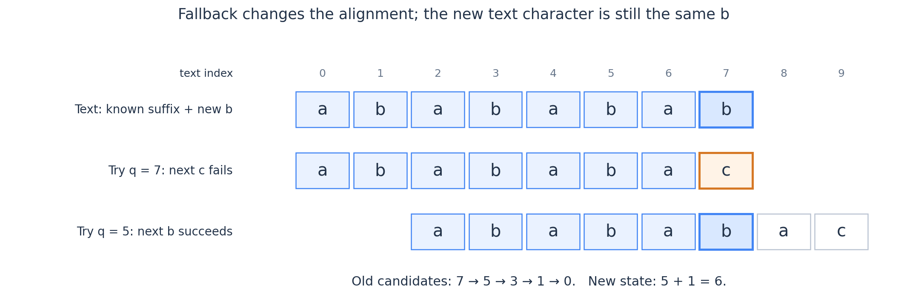
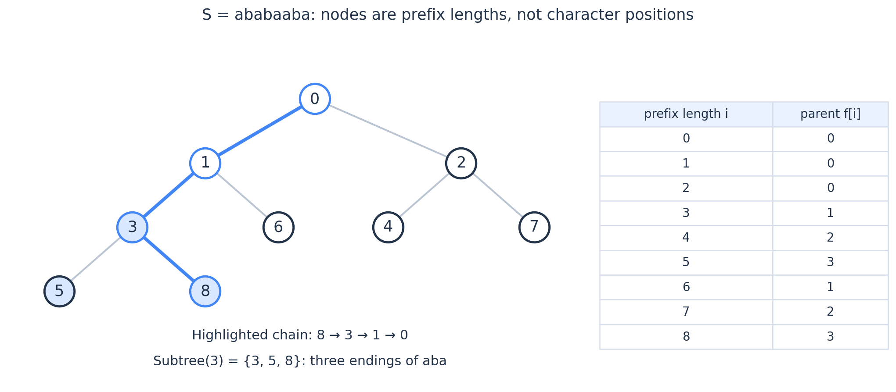
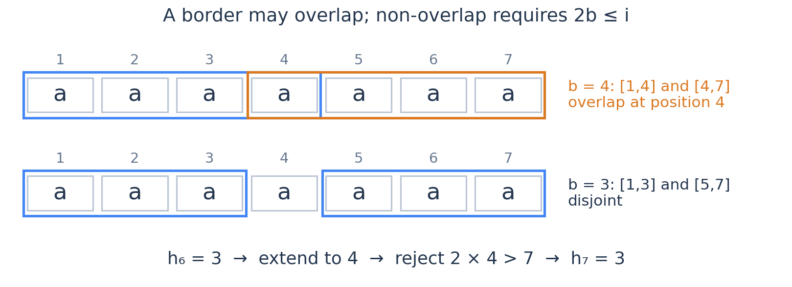
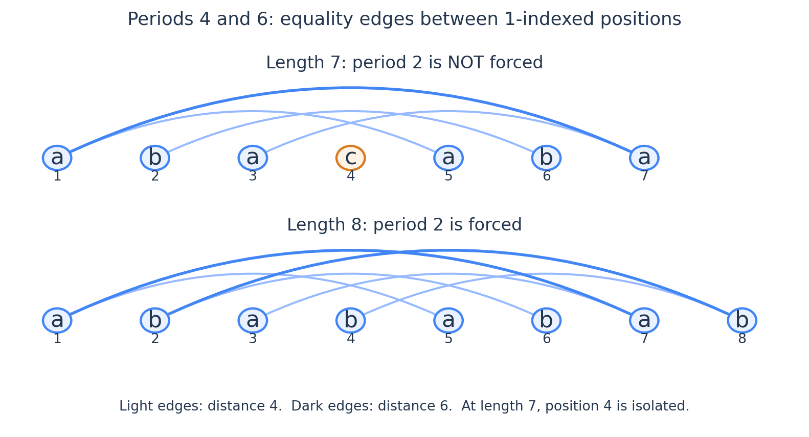

# KMP 与 Border 理论：从候选链到失配树，再到周期结构

你已经写过不少 KMP 题，下面不再以一份模板为中心。我们先回答一个更基本的问题：**已经匹配的内容，究竟替我们保存了哪些信息？**

整篇沿着一条主线展开：一个前缀的全部 Border 为什么能串成链；这条链为什么足以描述 KMP 的候选状态；把所有链放在一起后，为什么出现一棵树；最后，再从 Border 的重叠中看见周期与等差数列。

动物园放在失配树的查询应用之后。它用到的性质会先讲清楚，不需要靠这道题来组织整篇内容。

统一使用从 $0$ 开始的字符下标，以及左闭右开的区间。记

$$
S_i=S[0:i),\qquad f[i]=S_i\text{ 的最长真 Border 的长度}.
$$

一个长度为 $b$ 的非空真 Border 满足 $0<b<i$ 且 $S[0:b)=S[i-b:i)$。前后两次出现**允许重叠**。另外把长度 $0$ 的空串作为辅助候选，规定 $f[0]=f[1]=0$。文中的节点编号和 KMP 状态均表示**长度**；若使用常见的字符下标版前缀函数 $\pi$，两者关系是 $f[i]=\pi[i-1]$。

## 1. 最长 Border 保存了全部 Border，而不只是一个最优值

设 $b$ 是 $S_i$ 的一个 Border，另取 $0<a<b$。有一个比“Border 的 Border 还是 Border”更完整的结论：

$$
\boxed{a\text{ 是 }S_i\text{ 的 Border}
\iff a\text{ 是 }S_b\text{ 的 Border}.}
$$

理由是 $S_i$ 的最后 $b$ 个字符就是 $S_b$。因此，$S_i$ 的最后 $a$ 个字符，恰好等于 $S_b$ 的最后 $a$ 个字符。两边拿来比较的前缀又都是 $S[0:a)$，所以两个判断完全相同。

这个等价关系同时回答了两个问题：

- 继续在 $S_b$ 里找 Border，不会引入原串没有的候选；
- 原串中所有小于 $b$ 的 Border，也一个都不会漏掉。

取 $b=f[i]$，再不断重复，就得到全部非空真 Border：

$$
f[i],\ f[f[i]],\ f[f[f[i]]],\ldots
$$

直到到达 $0$。这些长度严格递减，而且中间没有被跳过的合法 Border。

例如 $S=\texttt{ababaaba}$，完整长度为 $8$，其链是

$$
8\longrightarrow3\longrightarrow1\longrightarrow0.
$$

长度 $3$ 对应 $\texttt{aba}$，长度 $1$ 对应 $\texttt{a}$。长度 $2$ 并不是一个“更短所以应该也能用”的候选：前缀是 $\texttt{ab}$，后缀是 $\texttt{ba}$。

这就是为什么失配时不是把长度减一，而是去找下一个 Border。**长度小，不代表它仍然与已经读过的内容相符。**

## 2. KMP 维护的其实是一整组候选，只是用最大值代表它

现在固定一个非空模式串 $P$，长度为 $m$，在文本 $T$ 上从左到右扫描。读完 $T[0:i)$ 后，定义

$$
q_i=\max\{\ell\in[0,m]:P[0:\ell)\text{ 是 }T[0:i)\text{ 的后缀}\}.
$$

这里允许 $q_i=m$，表示刚刚出现一次完整匹配。问题是：只存最长的 $q_i$，为什么不会忘记其他有用的后缀？

设当前最长长度为 $q$。对于 $0\le\ell<q$，因为文本的最后 $q$ 个字符就是 $P[0:q)$，所以

$$
P[0:\ell)\text{ 是当前文本的后缀}
\iff \ell\text{ 是 }P[0:q)\text{ 的 Border}.
$$

结合上一节，当前所有合法长度恰好是

$$
\boxed{q,\ f[q],\ f[f[q]],\ldots,0.}
$$

所以 KMP 没有假定“小的候选都不重要”，也没有只留下一个未经证明的贪心选择。它把整组候选压成了一个链头；其余候选能通过 $f$ 完整恢复。

### 来了一个字符以后，为什么只需沿这条链找？

设新字符为 $c$。若新状态为 $k>0$，去掉最后的 $c$ 后，$P[0:k-1)$ 必须是旧文本的后缀。因此，$k-1$ 必须在旧候选链上。

反过来，旧链上的候选 $j$ 若满足 $j<m$ 且 $P[j]=c$，就能延伸成新候选 $j+1$。两边合起来说明：**新候选与旧候选中能够接上 $c$ 的部分一一对应。**

链从大到小排列，所以找到第一个能够延伸的长度，就找到了最长的新候选。若当前 $P[q]\ne c$，排除的仅仅是候选 $q$；下一个需要尝试的就是 $f[q]$，而不是重新读取文本。

图中模式串为 $P=\texttt{abababac}$，已匹配 $7$ 个字符 $\texttt{abababa}$，新字符是 $\texttt{b}$。候选 $7$ 下一位需要 $\texttt{c}$，因此失败；退到 $5$ 后，下一位需要 $\texttt{b}$，可以延伸，得到新状态 $6$。长度 $6$ 本来不是旧文本的合法后缀长度，却可以成为**读入新字符之后**的状态，不要把这两个时刻混在一起。

### 为什么计算 $f$ 也用同一套过程？

计算 $f[i]$ 时，旧串是 $P[0:i-1)$，但必须排除整个旧串作为候选，否则再接一个字符会得到长度 $i$，把新串自己当成真 Border。

因此对 $i\ge2$，从旧串的最长真 Border $f[i-1]$ 出发，沿候选链尝试接上 $P[i-1]$。任何新真 Border 去掉最后一个字符后，都落在这条链中，所以仍然不漏候选。$f[1]=0$ 单独作为初值。

这也解释了两种操作的联系：模式匹配是在另一条文本上运行这套状态变化；求前缀函数，则是在模式串自己身上运行，并额外排除“整个前缀匹配自己”。

### 线性复杂度来自指针的连续性

一次字符处理可以退很多次，未必是 $O(1)$。但沿着一条连续文本扫描时，状态每读入一个字符至多增加 $1$；每次失配回退都严格减少状态，而状态不小于 $0$。所以全部回退次数不超过全部增长量，扫描总计 $O(|T|)$，连同 $f$ 的预处理为 $O(m+|T|)$。

证明用的是“这根指针从头到尾连续变化”，不是“每次回退都能减半”。$P=\texttt{aaaa\ldots a}$ 时，$f[j]=j-1$，链完全可能有线性长度。

## 3. 失配链接不是字符边：把隐式转移补全，才是 KMP 自动机

定义 $\delta(q,c)$ 为状态 $q$ 读入字符 $c$ 后的新状态。按上一节的推导，有

$$
\delta(q,c)=
\begin{cases}
q+1,&q<m\text{ 且 }P[q]=c,\\
0,&q=0\text{ 且 }P[0]\ne c,\\
\delta(f[q],c),&\text{其他情况}.
\end{cases}
$$

最后一行也包含 $q=m$：模式串后面没有 $P[m]$ 可读，先退到真 Border，再尝试同一个新字符。**走失配链接不消耗字符，走完整的 $\delta$ 转移才消耗一个字符。**

例如 $P=\texttt{aba}$、$T=\texttt{ababa}$，读完第三个字符到达状态 $3$，记录一次匹配。下一字符 $\texttt{b}$ 到来后，从 $f[3]=1$ 尝试延伸，得到状态 $2$；再读 $\texttt{a}$，又到达状态 $3$。若匹配后直接清零，就会漏掉这次重叠出现。

实现时可以保留状态 $m$，在下一次转移前回退；也可以记录匹配后立即退到 $f[m]$。两种写法都可以，但后者保存的是为后续扫描准备的状态，不能再把它当成“当前文本的最长匹配长度”用于统计。尤其在第 5 节的做法中，应先记录完整状态，再处理回退。

### 为什么自动机状态足以接 DP？

只要当前 $q$ 相同，候选链就相同，因此接任何下一个字符都会到达同一状态。对未来的匹配而言，过去的文本可以用 $q$ 代替；已发生多少次匹配、是否曾经匹配过，则属于额外的计数或标记，不是 $q$ 自己保存的信息。

例如，统计长度为 $N$、不包含 $P$ 的字符串，可以令 $\mathrm{dp}[i][q]$ 为已经生成 $i$ 个字符且未出现完整匹配、当前状态为 $q$ 的方案数。枚举新字符，通过 $\delta$ 转移，丢弃到达 $m$ 的转移即可。状态大小只有 $m$，不需要保留生成出的整个字符串。

字符集大小为 $\sigma$ 时，可以按 $q$ 递增的顺序，预处理所有 $\delta(q,c)$。失配时依赖的行号 $f[q]$ 小于 $q$，所以每格只需查一次已算好的结果，总时间、空间均为 $O(m\sigma)$。上述计数 DP 的时间为 $O(Nm\sigma)$，滚动数组空间为 $O(m)$，另加转移表。

### 为什么把 KMP 搬上树，不一定还是线性？

设模式为 $\texttt{a}^k\texttt{b}$。在一棵文本树上，先有一条含 $k$ 个 $\texttt{a}$ 的长链，末端再接 $k$ 个标为 $\texttt{c}$ 的叶子。访问每个叶子时，都从状态 $k$ 开始，沿 $f$ 退 $k$ 次，才发现接不上 $\texttt{c}$。

树只有 $O(k)$ 个节点，逐边现跑回退却用了 $\Theta(k^2)$ 时间。原因是不同分支反复拿到了同一个高状态，回退消耗的“增长量”没有在全局上付出多次。

对许多独立查询、DP 分支也一样：**单条扫描的均摊界，不能直接乘到任意状态调用上。** 若需要大量重复转移，应预处理或记忆化转移；小字符集时，完整转移表通常最直接。

> **练习（独立估算 CF 难度）**：[CF1721 E — Prefix Function Queries](https://codeforces.com/problemset/problem/1721/E)（约 2300；2022）。重点是很多次短查询复用同一个长串；不要将每次重新开始的回退误算成一次扫描。

> **练习**：[CF1163 D — Mysterious Code](https://codeforces.com/problemset/problem/1163/D)（约 2300；2019；额外前置：DP）。用它检查自己是否已经能把匹配过程当作一个可组合的状态，而不只是一段扫描模板。

## 4. 失配树的祖先关系，准确地对应什么？

为固定字符串 $S$ 建立节点 $0,1,\ldots,n$，每个 $i>0$ 的父亲是 $f[i]$，根为 $0$。因为父亲编号严格小于儿子，所有点最终都会到达 $0$，这些边组成一棵树，称为失配树。

树中节点 $i$ 表示固定前缀 $S_i$，不是字符 $S[i]$，也不是任意一个长度为 $i$ 的子串。

根据第 1 节，对 $0<u<v$，有

$$
\boxed{u\text{ 是 }v\text{ 的祖先}
\iff S_u\text{ 是 }S_v\text{ 的 Border}.}
$$

若允许 $u=v$，右边要改成“$S_u$ 是 $S_v$ 的一个前缀兼后缀，允许取整个串”。根 $0$ 则代表空串。只有把这些边界分清，树上的公式才不会平白多一个或少一个。

图取 $S=\texttt{ababaaba}$。节点 $8$ 的祖先链为 $8,3,1,0$；节点 $3$ 的子树则包含 $3,5,8$。从这两个方向看同一棵树：

- 向上走，是枚举当前前缀有哪些 Border；
- 看节点 $u$ 的子树，是找哪些更长前缀以 $S_u$ 结尾。

第二种解释往往比第一种更适合计数题。

### 深度、LCA、长度门限分别解决什么问题？

令根的树深度 $\operatorname{dep}(0)=0$。正节点 $i$ 的链上有 $\operatorname{dep}(i)$ 个非空节点，其中包含 $i$ 自己，所以非空真 Border 个数为

$$
\boxed{\operatorname{dep}(i)-1.}
$$

这里树深度数的是 Border 层数，不是字符串长度。树上的节点编号沿根到叶严格增加，但增长量可以很不一样。

两个节点 $x,y$ 的 LCA，表示同时作为 $S_x,S_y$ 后缀的最长固定前缀，允许它等于某个输入前缀。若要求同时是二者的**真** Border，应取

$$
\operatorname{lca}(f[x],f[y]),
$$

而不是总取 $\operatorname{lca}(x,y)$。例如 $x=y$ 时，后一式返回整个前缀，显然不是真 Border。若结果为 $0$，表示没有非空公共候选。

若查询 $S_i$ 的最长真 Border，且长度不超过 $L$，则从 $f[i]$ 开始，沿祖先找第一个编号不超过 $L$ 的点。编号在链上严格递减，可用树上倍增做这种按长度查祖先的查询，预处理 $O(n\log n)$，每次 $O(\log n)$。找到的点为 $h$ 时，符合门限的非空 Border 个数正好是 $\operatorname{dep}(h)$，包括 $h$，排除根。

这给出一个非常通用的基准解：遇到带额外条件的 Border 题，先把它写成清楚的祖先查询，再判断是否有必要利用查询顺序进一步优化。

### 不同教材的 next，未必都是这里的父亲

有的 $\mathrm{next}$ 存最长 Border，有的存下一次比较的字符位置，有的使用 $-1$ 哨兵，还有的已经做过 nextval 优化。名字相同，语义却可能不同。

例如当前状态 $q$ 的下一字符已经与 $P[q]$ 失配，而某个较短候选 $j$ 满足 $P[j]=P[q]$，那么它面对同一个新字符必然也失败。nextval 可以利用这次失配的信息，跳过这种比较。

但被跳过的 $j$ 仍然可能是一个真实 Border。**为了这次字符匹配而安全跳过，不等于它可以从 Border 的计数结构中删除。** 建失配树、数 Border、做祖先查询时，父亲必须使用定义清楚的最长真 Border $f$，不能直接替换成加速比较后的链接。

## 5. 前缀出现次数，为什么等于失配树的子树和？

先在 $S$ 自己里面数固定前缀 $S_u$ 的出现次数，允许出现位置重叠，且 $u>0$。

以位置 $i-1$ 结尾的一次出现，等价于 $S_u$ 是 $S_i$ 的后缀，也就等价于节点 $i$ 在失配树的 $u$ 子树里。因此

$$
\boxed{S_u\text{ 在 }S\text{ 中的出现次数}
=u\text{ 的子树中节点 }1,\ldots,n\text{ 的数量}.}
$$

这不是先猜一个树上 DP，再验证能不能过样例；出现位置与子树中的节点之间已经建立了一一对应：每个节点 $i$ 就代表一个结束位置。

算法上，先给每个 $i=1,\ldots,n$ 放一个单位贡献，再按 $i=n,n-1,\ldots,1$ 将贡献加到 $f[i]$。因为父亲编号小于儿子，这个顺序会先汇总完整子树再向上交付，不必专门 DFS。总时间、空间均为 $O(n)$。

在上图中，前缀 $\texttt{aba}$ 的节点为 $3$，子树节点为 $3,5,8$，对应三次出现的结束位置 $2,4,7$，恰好三次。

若你做过 [CF432 D — Prefixes and Suffixes](https://codeforces.com/problemset/problem/432/D)（估算约 2000；2014），可以用这个解释重新看一次原解。它较经典，这里只作为“祖先链筛选前缀、子树和统计出现”的直接对照，不要求重复刷题。该题还输出整个串的长度，要将节点 $n$ 自己也包括进去。

### 模式串和文本不同，树仍然有用

为模式 $P$ 建失配树，在文本 $T$ 上跑 KMP。每读完一个位置 $i$，只给最长状态 $q_i$ 放一个单位贡献。

为什么只标记最长状态，不需要沿链逐个加一？因为某个前缀 $P_u$ 在这里出现，当且仅当 $u$ 是 $q_i$ 的祖先。把所有状态标记做一次子树和，就同时完成了所有祖先的计数。

扫描时间 $O(m+|T|)$，再按节点编号逆序汇总 $O(m)$，便能得到模式所有非空前缀在文本中的出现次数。完整匹配状态 $m$ 要先标记，再回退，否则会把完整模式的出现丢掉。

### 区间里的出现次数，也可以变成二维计数

假设询问前缀 $P_u$ 在文本区间 $T[L:R)$ 中出现几次。一次出现必须完整包含在区间里，所以它的结束前缀长度 $i$ 应满足

$$
L+u\le i\le R.
$$

同时，$q_i$ 应在失配树的 $u$ 子树里。给失配树求 DFS 序，把这个子树表示成区间 $[\operatorname{tin}(u),\operatorname{tout}(u))$，问题便变成

$$
i\in[L+u,R],\qquad
\operatorname{tin}(q_i)\in[\operatorname{tin}(u),\operatorname{tout}(u)).
$$

这是结束位置与树上 DFS 序的二维矩形计数。用离线扫描配合树状数组即可在 $O(m+(|T|+Q)\log(m+1))$ 时间处理 $Q$ 次查询；若 $R-L<u$，直接返回零。查询按结束位置的两个边界挂到扫描位置上即可，不必额外排序。这里重要的是把字符出现转成“某个状态属于某棵子树”，具体二维计数工具可以按题目需要替换。

> **练习**：[ABC257 G — Prefix Concatenation](https://atcoder.jp/contests/abc257/tasks/abc257_g)（估算约 2400；2022；额外前置：DP 与正确性证明）。它不只问有没有匹配，还要利用各个结束位置的匹配信息完成另一个优化问题。

## 6. 非重叠 Border：先看成祖先查询，再解释为什么能线性扫

对于长度为 $i$ 的前缀，一个长度为 $b$ 的 Border 对应前缀区间 $[0,b)$ 和后缀区间 $[i-b,i)$。它们不重叠，当且仅当

$$
\boxed{2b\le i.}
$$

所以“非重叠”没有改变 Border 的定义，只是在原来的候选链上加了一个长度门限。

令

$$
h_i=\max\bigl(\{0\}\cup\{b:b\text{ 是 }S_i\text{ 的非空真 Border},\ 2b\le i\}\bigr).
$$

由第 4 节，全部合格的非空 Border，就是 $h_i$ 及其非零祖先，数量为

$$
\boxed{\operatorname{dep}(h_i).}
$$

你提到的 [NOI2014 动物园](https://www.luogu.com.cn/problem/P2375)，要求的 $\mathrm{num}[i]$ 正是这个数量，最后输出 $\prod_i(\mathrm{num}[i]+1)$。乘积中的每一项，也正好是从 $h_i$ 到根的整条链的节点数：非空候选有 $\operatorname{dep}(h_i)$ 个，根再贡献一个空候选。

到这里已经有一个完整、容易证明的 $O(n\log n)$ 解：预处理 $f$、树深度和倍增，逐个查询 $h_i$。若想进一步到 $O(n)$，需要证明下面这一件事。

### 为什么从 $h_{i-1}$ 出发，不会丢掉将来能用的较长候选？

先别想指针怎么写。固定任意一个当前合格 Border $b>0$，它满足 $2b\le i$。去掉最后一个字符后，$b-1$ 是上一个前缀 $S_{i-1}$ 的前缀兼后缀，而且

$$
2(b-1)\le i-2\le i-1.
$$

因此，**任何当前合格的长度 $b$，都只能由上一步已经满足门限的长度 $b-1$ 延伸而来**。上一步因为太长被排除的候选，没有哪个能在只延伸一个字符后，突然变成当前合格的新候选。

上一步全部合格候选，又恰好是 $h_{i-1}$ 的祖先链。所以，可以从 $h_{i-1}$ 出发，按普通 KMP 的方式尝试接上新字符：失配就沿原始 $f$ 回退，能接上则长度加一。随后，若临时得到的长度 $j$ 仍满足 $2j>i$，再沿 $f$ 回退，直到 $2j\le i$。

第一次过程找到的是“上一步合格候选能够延伸出的最长长度”；第二次删掉其中当前仍太长的候选。刚才已经证明，所有真正的当前合格候选都在这个范围里，所以最终得到的正是 $h_i$。

例如连续的 $\texttt{a}$：处理完长度 $6$ 的前缀，$h_6=3$；再读一个 $\texttt{a}$，临时延伸到 $4$。但长度 $7$ 的两个长度 $4$ 区间会重叠，于是退到 $f[4]=3$，得到 $h_7=3$。长度 $1,2,3$ 全都保留在它的祖先链中。

### 为什么这次跳链是线性，而逐次从 $f[i]$ 跳不一定是？

沿着整个第二遍扫描，$j$ 每步至多增加一，失配回退和门限回退都只会减少它，因此两类回退合计仍为 $O(n)$。加上第一遍求 $f$ 和深度，总时间、空间均为 $O(n)$。

对比一个很容易误判的写法：每次都重新令 $j=f[i]$，然后跳到 $j\le i/2$。在 $S=\texttt{a}^n$ 上，$f[i]=i-1$，每次要退大约 $i/2$ 步，合计 $\Theta(n^2)$。问题不在“有没有使用 $f$ 跳转”，而在是否反复把指针放回一个没有支付代价的高位置。

还要注意，$h_i$ 与 $f[i]$ 是两种不同的信息。原始 $f$ 必须保留，不能把 $f[i]$ 改成满足门限后的 $h_i$。例如 $\texttt{aaaa}$ 的 $f[4]=3$，虽不满足非重叠门限，它仍是真实 Border，也仍然是其他失配与结构查询需要用到的父亲。

这套思路可以迁移到上界 $L_i$：如果 $0\le L_i<i$ 且 $L_i\le L_{i-1}+1$，那么合格的新候选 $b\le L_i$ 的前驱 $b-1\le L_{i-1}$，同样不会从之前排除的区域突然冒出来。若门限可以一次放宽很多，就没有这个保证。例如全是 $\texttt{a}$，上一步门限为零，下一步突然变成十，从旧指针零只延伸一次不可能恢复长度十。

## 7. Border 是重叠的边界，周期是同一事实的位移写法

对长度为 $\ell$ 的非空字符串 $X$，定义正整数 $p\in[1,\ell]$ 是它的周期，当且仅当

$$
X[j]=X[j+p]\qquad(0\le j<\ell-p).
$$

这只要求相隔 $p$ 的位置相同，不要求 $p$ 整除长度。$p=\ell$ 总是一个周期，因为没有需要比较的位置。

将等式整段写出，就是

$$
X[0:\ell-p)=X[p:\ell).
$$

因此

$$
\boxed{p\text{ 是周期}\iff \ell-p\text{ 是 Border 长度，允许为空}.}
$$

最长真 Border 对应最短正周期：

$$
\boxed{p_{\min}(S_i)=i-f[i].}
$$

回到 KMP：从候选长度 $j$ 退到 $f[j]$，如果用模式串的对齐起点来描述，就相当于右移 $j-f[j]$。这个位移正是已匹配前缀的最短周期。前面说“保留一个 Border”，这里说“沿一个周期重新对齐”，描述的是同一组相等关系。

### 周期不等于完整重复块

$X=\texttt{ababa}$ 的最短周期是 $2$，但它不是若干个 $\texttt{ab}$ 的完整拼接。如果题目要求 $X=U^k$ 且 $k\ge2$，除了最短周期 $p$ 以外，还要检查 $p<\ell$、$p\mid\ell$。

后一判定的必要性也可以证明。若某个长度 $d<\ell$ 的块完整重复得到 $X$，则 $d\mid\ell$、$d\le\ell/2$，且 $d$ 是周期。下一节的周期定理会推出最短周期 $p$ 必须整除这个 $d$，进而整除 $\ell$。充分性则直接来自周期等式：长度被 $p$ 整除后，各块逐位置相同。

一个已知周期 $p$ 的正整数倍，只要不超过 $\ell$，也一定是周期：沿着步长 $p$ 连续比较即可。但反过来，并非所有周期都必须是最短周期的倍数。例如 $\texttt{ababa}$ 的周期有 $2,4,5$，其中 $5$ 不是 $2$ 的倍数。长位移留下的重叠区域太短，约束可能不足。

> **练习**：[ABC135 F — Strings of Eternity](https://atcoder.jp/contests/abc135/tasks/abc135_f)（估算约 2400；2019；额外前置：简单图论）。这里的无限重复串需要同时处理局部匹配和全局可延伸性，适合检验你能否区分“一个位置匹配成功”与“可以无限接下去”。

## 8. 两个周期什么时候会被迫拥有更小的公共周期？

设长度为 $\ell$ 的字符串同时有周期 $p,q$，令 $d=\gcd(p,q)$。Fine–Wilf 定理说：

$$
\boxed{\ell\ge p+q-d\quad\Longrightarrow\quad d\text{ 也是周期}.}
$$

直观上，周期 $p,q$ 各自提供了一批“这两个位置相等”的约束；字符串足够长时，这些约束能在每个模 $d$ 的剩余类里连通起来。长度不足时，某些位置之间还没有足够的桥梁。

图取 $p=4,q=6,d=2$，门限为 $8$。长度 $7$ 时，$\texttt{abacaba}$ 具有周期 $4,6$，但不具有周期 $2$：奇数下标中的位置 $3$ 仍可独立取 $\texttt{c}$。长度 $8$ 时，图中周期约束将所有偶数位置连在一起，也将所有奇数位置连在一起，因此强制产生周期 $2$。两幅图展示各自长度的约束，不是说给左边的串随意追加一个字符就能保留两个周期。

### 一个沿欧几里得算法推进的证明

对 $p+q$ 归纳。若 $p=q$，结论直接成立；否则交换后设 $p<q$。

考虑前缀

$$
Y=X[0:\ell-p).
$$

它继承周期 $p$。另外它还有周期 $q-p$：对于 $0\le j<\ell-q$，由 $X$ 的两个周期，

$$
X[j]=X[j+q]=X[j+q-p].
$$

这正好覆盖 $Y$ 中判断 $q-p$ 为周期所需的全部位置。并且

$$
|Y|=\ell-p\ge q-d
=p+(q-p)-\gcd(p,q-p).
$$

新周期对是 $p,q-p$，和比原来小，因此归纳得到 $Y$ 具有周期 $d$。

最后还要把结论延伸回整个 $X$，不能在前缀处结束证明。因为 $q-p$ 是 $d$ 的正倍数，$q-d\ge p$，所以 $|Y|\ge p$，并且 $\ell\ge2p$。剩下的最后 $p$ 个字符，每个都能用原周期 $p$ 对应回 $Y$ 内的位置。

在 $Y$ 里，相同下标模 $d$ 的字符已经全部相等；又因为 $d\mid p$，往回移动 $p$ 不改变模 $d$ 的类别。因此整个 $X$ 的每个模 $d$ 类也全都相等，$d$ 就是 $X$ 的周期。

这里字符串的长度条件不是为了证明看起来方便，而是在保证“前缀中的周期关系足以控制剩余部分”。上面的长度 $7$ 反例说明，少了条件就真的可能失败。

## 9. Border 可以有线性多个，却能用 $O(\log n)$ 段等差数列表示

现在用刚才的定理，解释 Border 理论中一个很有用的结构：**一个字符串的全部 Border 长度，可以分成 $O(\log n)$ 个连续的等差段。**

这里的“连续”指按 Border 长度排序后相邻，不是说长度必须是连续整数。重点也不是压缩字符串字符，而是压缩那条可能很长的候选链。

### 先只看长度至少一半的 Border

设当前字符串长度为 $t$，最短周期为

$$
p=t-f[t].
$$

若 $b$ 是真 Border 且 $b\ge t/2$，对应周期 $q=t-b\le t/2$。由于 $p$ 最短，$p\le q$，所以 $t\ge p+q$，当然也满足 Fine–Wilf 的长度条件。

因此 $\gcd(p,q)$ 也是周期。它不可能小于最短周期 $p$，而又不大于 $p$，只能等于 $p$。于是

$$
p\mid q,\qquad b=t-kp.
$$

反过来，$p$ 的倍数 $kp$ 都是周期，所以只要 $kp\le t/2$，$t-kp$ 就确实是一个长度至少一半的 Border。两个方向合起来，我们不仅知道这些长 Border“碰巧等差”，还准确知道它们是

$$
\boxed{t-p,\ t-2p,\ldots,\ t-rp,
\qquad r=\left\lfloor\frac{t}{2p}\right\rfloor.}
$$

允许把完整串自己也包含进当前这一段，则再加上首项 $t$。如果 $p>t/2$，$r=0$，这段就只有 $t$ 自己。

### 剩下的为什么可以直接递归处理？

从原串的最长真 Border 长度 $t=f[n]$ 开始。第 1 节已经证明：原串中所有不超过 $t$ 的 Border，正好是 $S_t$ 自己及其全部 Border。

令当前等差段的最后一个长度为

$$
u=t-\left\lfloor\frac{t}{2p}\right\rfloor p.
$$

刚才列出的就是全部不小于 $t/2$ 的候选，因此下一条链边 $f[u]$ 必须严格小于 $t/2$。令新 $t=f[u]$，重复同样的过程即可。

每结束一段，尚未处理的最大长度至少减半，所以段数为 $O(\log n)$。而每段只需要计算 $p=t-f[t]$、首项、末项，再访问一次 $f[u]$；已有 $f$ 后，**一条前缀的全部真 Border 的压缩表示可以在 $O(\log n)$ 时间内直接构造**，不用先枚举完整链。

以 $S=\texttt{abababababa}$ 为例，它的真 Border 为 $9,7,5,3,1$。上面的过程给出

| 当前最大长度 $t$ | 当前前缀最短周期 $p$ | 本段包含的 Border 长度 | 下一个 $t$ |
| --- | --- | --- | --- |
| $9$ | $2$ | $9,7,5$ | $f[5]=3$ |
| $3$ | $2$ | $3$ | $f[3]=1$ |
| $1$ | $1$ | $1$ | $0$ |

这个分组不一定是段数最少的表示；例如这个例子其实可以把五个数合成一段。我们需要的是稳定保证 $O(\log n)$ 段，不需要再求最优压缩。

### 能压缩候选，不代表每个关于 Border 的问题都会自动变快

如果要统计一段中多少个长度落在区间里、求长度和，等差段可以直接计算，确实避免逐点枚举。若要对每个 Border 查询一个没有任何结构的外部权值，整段仍可能需要逐个访问，不能只凭“有 $O(\log n)$ 段”就宣称总时间变成 $O(\log n)$。

同样，$\texttt{a}^n$ 仍然有 $n-1$ 个非空真 Border，失配树深度仍为 $n$。**短的是压缩后的表示，不是原始祖先链。** 不论是按周期分组、树上倍增还是保持一根连续指针，都需要各自的证明，不能混用它们的复杂度依据。

## 参考与进一步阅读

- [Knuth、Morris、Pratt：Fast Pattern Matching in Strings，1977](https://www.cs.jhu.edu/~misha/Spring23/Knuth77.pdf)：原论文第 1、2 节解释对齐与预处理，第 2 节同时区分了普通前后缀链接与跳过必败比较后的链接。本篇将其改用“候选集合由链头代表”的顺序组织，不沿用原文的字符位置下标。
- [UBC CPSC 445：Introduction to String Matching](https://www.cs.ubc.ca/labs/algorithms/Courses/CPSC445-12/Handouts/kmp.pdf)：简短的大学讲义，适合核对线性匹配与前缀函数构造之间的关系。
- [Rankin：Fine-Wilf graphs and the generalized Fine-Wilf theorem](https://arxiv.org/abs/0906.1780)：周期定理及其位置相等约束图的研究资料；本篇只使用经典双周期结论，并在第 8 节给出完整归纳证明，不要求阅读推广部分。
- [Pissis：Optimal prefix-suffix queries with applications](https://arxiv.org/html/2411.03784v1)，Introduction 中的 Failure tree / Border tree 讨论：说明周期结构怎样压缩长 Border 链。部分论文用 Border tree 特指压缩后的结构，竞赛文章却也常用它指普通失配树，阅读时要以具体定义为准。
- [Codeforces：Border Theory](https://codeforces.com/blog/entry/149314)：可在读完第 9 节后比较不同的周期分组方式。本篇用 Fine–Wilf 推导长 Border 的准确形式，并采用按长度减半的分组；不依赖该帖较为压缩的反证步骤。
- 练习题解入口：[CF1721 E 官方题解](https://codeforces.com/blog/entry/106416)、[ABC257 G 官方解说](https://atcoder.jp/contests/abc257/editorial/4246)、[ABC135 F 官方解说 PDF](https://img.atcoder.jp/abc135/editorial.pdf)。其中 ABC257 G 官方采用 Z 相关路线，做完后可以比较“从起点描述匹配”和“从终点描述匹配”各保留了什么信息。
