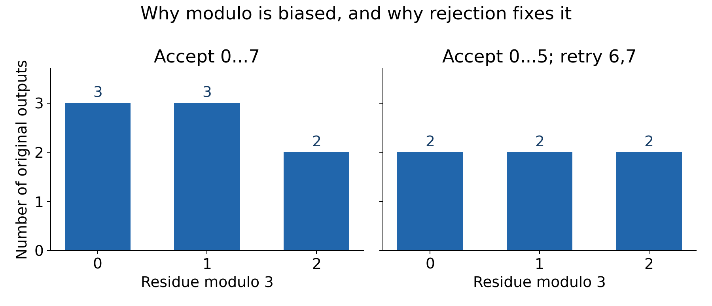
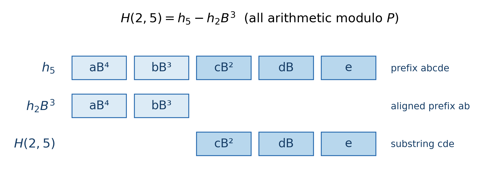

# Chapter 5 随机数与字符串哈希

假设有一个长字符串，需要回答很多次“这两段子串是否相同”。逐字符比较当然准确，但每次可能花费与子串长度成正比的时间。我们希望预处理以后，每次只看几个整数就能判断。

一个自然想法是，把字符串当成某种进制数，再对一个大数取模。这样每段子串都有一个很短的“指纹”。内容相同，指纹一定相同；内容不同，指纹却仍可能相同。接下来真正要解决的，就不是背下一个哈希模板，而是三个问题：怎样快速取出子串指纹；参数怎样选；整个算法误判的概率到底能压到多少。

参数需要随机选，先把随机数怎么取说清楚。过程中也会顺便区分两个常被放在一起的“碰撞”：哈希表的桶冲突通常影响时间，拿指纹代替原字符串时的碰撞则可能影响答案。

## 1. 在区间里随机选一个整数，为什么不直接取模

假设一个理想随机源能等概率给出 $0,\ldots,7$。我们想从 $0,1,2$ 中等概率选一个，于是写“随机数模 $3$”。看一遍映射就会发现：余数 $0$ 来自 $0,3,6$，余数 $1$ 来自 $1,4,7$，余数 $2$ 却只来自 $2,5$。

因此三种结果的概率为 $3/8,3/8,2/8$，并不均匀。

一般地，原输出均匀覆盖 $0,\ldots,R-1$，且 $R=qk+r$ 时，前 $r$ 个余数各有 $q+1$ 个来源，其余各有 $q$ 个。只有 $k\mid R$，直接模 $k$ 才严格均匀。如果目标区间比源输出范围还宽，问题更直接：有些目标值永远不可能出现。

怎么修？当 $1\le k\le R$ 时，令

$$
T=\left\lfloor\frac Rk\right\rfloor k.
$$

抽到 $X\ge T$ 就重抽，只在 $X<T$ 时返回 $X\bmod k$。剩下的区间包含整数个长度为 $k$ 的组，每个余数的来源一样多，所以在接受的条件下结果均匀。这就是拒绝采样。



这里特意写出 $k\le R$：若 $k>R$，上述 $T$ 等于零，每次都会拒绝。此时要组合多次源输出，再做合适的映射。C++ 标准分布会处理这些细节，我们在竞赛里通常直接使用它，不必手写一遍边界复杂的采样器。尤其不要试图把 $R=2^{64}$ 存进一个 64 位整数。

### 引擎和分布各做什么

`mt19937` 是伪随机引擎，每次输出一个 $[0,2^{32}-1]$ 中的整数；`mt19937_64` 的输出范围是 $[0,2^{64}-1]$。相同状态会产生相同后续序列，默认构造也不是每次自动换一套随机种子。

引擎负责提供这条序列，`uniform_int_distribution` 负责把输出映射到所需的闭区间。下面是 GNU C++17 下的短片段，放在已包含 `<bits/stdc++.h>`、使用 `using namespace std;` 的函数体中：

```cpp
uint64_t seed = chrono::steady_clock::now().time_since_epoch().count();
mt19937 rng((uint32_t) seed);

auto get = [&](int l, int r) {
    assert(l <= r);
    return uniform_int_distribution<int>(l, r)(rng);
};
```

只初始化一次，再反复调用 `get`。每次取数都重新播种，会反复从不同初始状态的开头取值，不能当作同一条正常推进的随机序列。

如果要选 61 位哈希参数，用 64 位引擎更方便：

```cpp
mt19937_64 rng64(seed);

auto get64 = [&](uint64_t l, uint64_t r) {
    assert(l <= r);
    return uniform_int_distribution<uint64_t>(l, r)(rng64);
};
```

两个端点都包含。标准分布也可以组合多次 32 位引擎输出，得到更宽区间中的值，因此不能说“用了 32 位引擎，就永远选不到 32 位以外的数”；真正覆盖不了的是只取一次 `rng()` 再直接取模的写法。

随机打乱数组则使用

```cpp
shuffle(a.begin(), a.end(), rng);
```

在每步独立均匀选位置的理想模型下，Fisher–Yates 思路会在剩余元素中等概率选一个，因此任意目标排列出现的概率都是 $1/n!$。不要在排序比较器里随机返回大小关系；排序要求比较器满足一致的严格弱序，随机比较会破坏这个前提。

## 2. 种子为什么重要，时间种子又保证了什么

固定种子在调试时很好用：发生错误后保留种子，就能重放随机测试。但如果对手知道程序始终使用同一个种子，也就可能预先重现程序的随机选择，再专门构造输入。默认种子、公开常量种子、容易枚举的秒级时间种子，都可能遇到这类问题。

普通非交互竞赛中，常用运行时的高精度时钟初始化，使预先准备的输入较难针对这次具体序列。不过时钟精度只是接口的粒度，不能直接当作种子有多少不可预测信息的证明。上面的 32 位初始化只留下了种子的低 32 位；引擎内部状态再大，也不会凭空增加种子携带的信息。

这可以分成三件事理解：引擎的统计性质好不好；初始化究竟有多少不确定性；对手在什么时间能观察到什么。Mersenne Twister 周期很长，说明整条状态轨道很久才重复，不等于相邻输出数学上独立，也不等于观察输出后无法预测。它不是密码学安全引擎。

`random_device` 也不提供跨平台的“必是真随机”承诺。标准允许在没有非确定性来源时用随机引擎代替，并允许初始化或取数失败。`seed_seq` 可以混合多个输入，但不能制造输入本来没有的熵。某篇旧博客在某个 OJ 上观察到的行为，也不能直接推广到所有平台。

本章后面的严格概率推导，会明确采用“从集合中独立、均匀选择参数”的数学模型。竞赛里的 PRNG 是实用实现；使用标准分布可以避免额外的区间映射偏差，却不能把有限种子、确定转移的引擎变成无限独立的真随机源。

对手模型同样不能省略：通常假设输入先固定，再产生本次随机参数。若是交互题，或底数公开以后还允许提交新字符串，就要重新检查推导。一个固定输入很难撞上随机底数，不代表看到底数以后再造输入也同样困难。

复现测试时还要记住：同种子引擎序列有标准定义，但分布、`shuffle` 的具体实现可能因标准库而异。因此种子和工具链信息最好一起保留。

## 3. 回到子串比较：前缀哈希为什么能相减

把字符编码为整数 $c_i$，例如字节编码为 $1,\ldots,256$。选模数 $P$ 和底数 $B$，先把字符串 $s$ 看成这个多项式在 $B$ 处的值：

$$
H(s)=c_0B^{n-1}+c_1B^{n-2}+\cdots+c_{n-1}\pmod P.
$$

这和按位读一个进制数类似：读到新字符，之前的值乘 $B$，再加新编码。于是定义长度为 $i$ 的前缀哈希 $h_i$，有

$$
h_0=0,\qquad h_{i+1}=(h_iB+c_i)\bmod P.
$$

如果要取半开区间 $[l,r)$，$h_r$ 已经包含这段内容，但也包含前面 $[0,l)$ 的字符。它们在 $h_r$ 中比在 $h_l$ 中多向左移了 $r-l$ 位，所以应减去 $h_lB^{r-l}$：

$$
\boxed{H(l,r)=h_r-h_lB^{r-l}\pmod P.}
$$



留下的最高次幂只由子串长度决定，和它原来处于哪个位置无关。因此不同位置的等长、同内容子串可以直接比较。公式也覆盖 $l=r$，空串哈希为 $0$。

预处理 $h_i$ 和 $\operatorname{pow}[i]=B^i\bmod P$ 后，每个子串指纹只需 $O(1)$ 次运算；一套预处理需要 $O(n)$ 时间和空间。同样的位移关系还给出拼接公式

$$
H(xy)=H(x)B^{|y|}+H(y)\pmod P.
$$

双哈希就是同时维护两套参数的值，渐近复杂度不变，只增加常数和存储。

### 在讨论碰撞概率前，先排除确定性错误

所有要比较的对象必须使用同一套参数和字符编码。不同底数算出的数，即使刚好相等也不能拿来说明原串关系。指纹相同时还应比较长度，尤其在把各种长度的串放进同一个集合时。

正编码有助于避免前导零歧义。如果允许零字符编码，空串和若干零字符就可能对任何底数都给出同一个值；这不是一次偶发的随机碰撞，而是表示方式先丢掉了信息。长度和编码约定需要先处理好。

哈希数值的大小也不表示字典序。常见做法是用相等性查询找最长公共前缀，再比较第一个不同字符；大小关系仍来自字符本身。

内容相同一定得到同指纹，因此指纹不同可以确定原串不同。反方向只能说“可能相同”。后面所有失败概率，讨论的都是不同字符串被错判成相同。

> **练习（估算 CF 难度）**：[ABCBAC](https://atcoder.jp/contests/abc284/tasks/abc284_f)（约 2000；也有确定性字符串解法）。

## 4. 随机底数为什么有用：碰撞是一条多项式方程

固定两个不同、等长的字符串 $s,t$，长度为 $L\ge1$。现在先固定它们，再随机选择底数。取素数 $P>256$，这样两个不同字节编码相减，不会在模 $P$ 后变成零。

将两串指纹相减，得到

$$
D(X)=\sum_{i=0}^{L-1}(c_i-d_i)X^{L-1-i}.
$$

至少有一处字符不同，所以这是素数域 $\mathbb F_P$ 上的非零多项式，次数至多 $L-1$。两个指纹相同，恰好等价于 $D(B)=0$。原先不好分析的“两个大数会不会一样”，就变成了“随机底数会不会落在这个多项式的根上”。

为什么次数能限制根数？若 $a$ 是根，可以写成 $D(X)=(X-a)Q(X)$。另一个不同根 $b$ 必须满足

$$
0=(b-a)Q(b).
$$

在域里，非零的 $b-a$ 有逆元，所以 $Q(b)=0$。去掉一个根，次数就下降一。归纳可知，次数为 $d$ 的非零多项式最多有 $d$ 个根。这里“非零”与“在域里”都是实质条件。

如果底数均匀取自 $S\subseteq\mathbb F_P$，那么最多 $L-1$ 个坏底数落在 $S$ 中，因此

$$
\boxed{\Pr(H(s)=H(t))\le\min\left(1,\frac{L-1}{|S|}\right).}
$$

随机的是底数，输入字符串可以完全不随机，甚至由对手特意构造。只要字符串先固定，这个根数结论仍适用。

注意分子里的长度不能无故删掉。$P$ 约为 $10^9$、$L$ 约为 $10^6$，支持集大小接近 $P$ 时，这个统一界约为 $10^{-3}$，不是 $10^{-9}$。很多具体输入的实际碰撞率可能更低，但“实际常常不错”不能代替这里的保证。反过来，$L=1$ 时次数为零，不同字符的指纹根本不会碰撞，公式也恰好给出零。

### 双哈希需要哪一种独立性

再独立选一套底数，让两套指纹都相同才判为相同。若分别独立均匀选择 $B_1\in S_1,B_2\in S_2$，对同一固定字符串对，两次碰撞分别只由各自参数决定，于是

$$
\Pr(\text{两套都碰撞})
\le\min\left(1,\frac{L-1}{|S_1|}\right)
\min\left(1,\frac{L-1}{|S_2|}\right).
$$

可以用相同素数配两个独立底数，也可以使用不同素数。关键是随机参数独立，不是模数名字不同。两套都使用同一个随机底数时，事件可能相关，不能直接把失败率相乘；把一套结果复制两遍则根本没有增加信息。

这里的结论仍属于前面说好的独立均匀抽样模型，不能仅凭代码中调用了两次 PRNG，就宣称得到不依赖种子模型的绝对概率保证。

## 5. 一次比较很可靠，整个程序还要再算一次

假设程序事先确定要比较 $Q$ 对字符串，每对长度最多为 $L$。只要其中一对误判，程序就可能出错。记第 $i$ 对碰撞事件为 $A_i$，有

$$
\Pr\left(\bigcup_i A_i\right)\le\sum_i\Pr(A_i).
$$

原因很朴素：一个结果如果包含多次碰撞，右边会重复计算它；包含至少一次碰撞的结果则至少被计算一次。因此无需各比较事件独立，这个并集界仍成立。

单哈希的总失败率至多

$$
\min\left(1,Q\frac{L-1}{|S|}\right),
$$

双哈希则可用

$$
\min\left(1,Q\frac{(L-1)^2}{|S_1||S_2|}\right).
$$

即使某个分式超过 $1$，式子仍是合法但没有信息量的上界。若不同对象长度差很多，逐对使用实际次数再求和，可以比统一代入最大长度更紧。

### 去重时，为什么不能只数插入次数

把 $N$ 个对象按指纹去重，虽然只有 $N$ 次插入，但任意一对不同对象碰撞都可能被合并。安全起见，候选碰撞对数应该按 $\binom N2$ 计算，而不是 $N$。

如果另外假设每个对象的指纹都是独立均匀的 $P$ 种结果，$N\le P$ 时无碰撞概率为：第一个随意；第二个避开前一个，概率 $1-1/P$；第三个避开前两个，概率 $1-2/P$；依次相乘。所以至少一次碰撞的概率是

$$
1-\prod_{i=0}^{N-1}\left(1-\frac iP\right),
$$

并可用 $\binom N2/P$ 上界。$N>P$ 时则必有碰撞。这就是生日效应中“对象对数增长很快”的来源。不过多项式哈希不会自动满足独立均匀指纹模型；对它作严格分析，仍应回到前面的多项式次数界。

用一组数体会预算。令 $P=2^{61}-1\approx2.306\times10^{18}$，底数支持集几乎覆盖整个域，$L\le10^6$：

| 要分析的范围 | 用单套随机底数得到的统一上界 |
| --- | --- |
| 一对字符串 | 约 $4.34\times10^{-13}$ |
| $10^6$ 对比较 | 约 $4.34\times10^{-7}$ |
| $N=2\times10^5$ 个对象任意两两碰撞 | 约 $8.67\times10^{-3}$ |

最后一种情形若使用两套独立的 61 位底数，先将每对的界相乘，再对对象对求和，总界约为 $3.76\times10^{-15}$。这些都是保守上界，不是预测实际错误频率；它们告诉我们，参数要和长度、比较数量一起选。

### 二分 LCP 的比较会变化，还能这样分析吗

二分下一次比较哪个长度，往往取决于前一次的相等判断。比较集合没有直接写死，似乎不符合前提。

如果算法分支只依赖“是否相等”，可以先想象每次都得到真实相等关系的理想执行。固定输入下，这条执行轨迹确定，与随机底数无关。在第一次误判发生之前，真实程序走的也正是这条轨迹。因此第一次错误一定来自理想轨迹上的某一次比较，对这些固定比较做并集界即可。

这个论证有明确边界：如果程序根据哈希数值的大小决定生成哪些新字符串，或者对手看到底数后才提供输入，理想轨迹本身就可能依赖参数。此时不能把实际运行中恰好发生的 $Q$ 对，直接当作预先固定的 $Q$ 对。需要对所有潜在候选对作界，或者另证这种自适应行为下的保证。

## 6. 一套实用的素数模方案，算术细节也要正确

可以取梅森素数

$$
P=2^{61}-1.
$$

字符用 $1,\ldots,256$ 编码，底数均匀选自

$$
S=\{257,258,\ldots,P-2\},\qquad |S|=P-258.
$$

这个集合排除了少数过小或退化底数，规模仍接近整个域。概率界分母用的是实际支持集大小：如果只在几个常量里抽一个底数，或者只用一次 32 位输出选择底数，就不能把分母写成约 $2^{61}$。

使用前面的 `get64`，可写

```cpp
constexpr uint64_t P = (uint64_t(1) << 61) - 1;
uint64_t B = get64(257, P - 2);
```

但两个小于 $P$ 的数相乘，结果可能接近 $2^{122}$，不能在 64 位里先乘完再取模。GNU C++17 下可用 `__uint128_t` 保存中间结果：

```cpp
auto mul = [&](uint64_t a, uint64_t b) -> uint64_t {
    __uint128_t x = (__uint128_t) a * b;
    uint64_t y = (uint64_t) (x >> 61) + (uint64_t) (x & P);
    if (y >= P) {
        y -= P;
    }
    return y;
};
```

前提是 $0\le a,b<P$。为什么高低位相加就行？将 $x$ 写成 $x=u2^{61}+v$，其中 $v$ 是低 $61$ 位。因为 $2^{61}\equiv1\pmod P$，$x$ 与 $u+v$ 模 $P$ 同余。又有 $x<P^2$，所以 $u+v<2P$，最多减一次 $P$ 即可，折叠结果本身也不会溢出 64 位。

前缀转移先算 `mul(h, B)`，再加字符编码并归一化；这时结果小于 $P+256$。一般加法若两项都小于 $P$，和小于 $2P<2^{62}$，同样可最多减一次 $P$。

子串减法则先计算

$$
h_r+P-\operatorname{mul}(h_l,\operatorname{pow}[r-l]),
$$

再按需要减去一次 $P$。直接在无符号数里执行 $h_r$ 减乘积，可能先下溢并按 $2^{64}$ 回绕；之后再模 $P$，通常已经不是原来想要的模减法。

双哈希可以从相同的大集合独立抽两个底数，维护两套前缀与幂，比较“长度、第一套值、第二套值”。理想独立抽样允许两个底数偶然相同；若强行修改相同的结果，抽样模型就变了，需要重新说明，而不是继续照搬独立乘积界。

> **练习（估算 CF 难度）**：[Palindrome Query](https://atcoder.jp/contests/abc331/tasks/abc331_f)（约 2100；另需线段树或树状数组）。

## 7. 为什么固定双模和自然溢出不能替代上述证明

先看固定参数。无论用了几组公开的固定底数、模数，最后都只是一个确定函数。它可能足以应付许多普通数据，但对一个固定输入，并没有“本次随机参数”这个概率空间。已有固定多模滚动哈希的专门碰撞构造工具，说明增加公开常量也可能保留可利用的代数结构。

运行时随机选择参数的作用，是先固定输入，再让输入面对大量可能的函数；根数界才有地方使用。随机化不是给一个固定模板多写几组常量。

### 模 $2^{64}$ 和素数域，差别在哪里

无符号整数自然溢出，等价于模 $2^{64}$。它实现方便，但这个模数不是素数，非零数不一定有逆元。前面根数证明的关键一步“$(b-a)Q(b)=0$ 且 $b-a\ne0$，所以 $Q(b)=0$”因而不再成立。

最小的例子：模 $8$ 时，非零一次多项式 $4X$ 在 $0,2,4,6$ 四处为零，根数已经超过次数。于是不能把素数域中的 $(L-1)/|S|$ 原样搬过来。

还可以造一个对所有奇底数都失败的字符串对。考虑

$$
D(X)=\prod_{j=0}^{10}(X^{2^j}-1).
$$

先看它的系数。选每个因子的第一项或第二项，对应选择一组不同的二次幂；不同子集的指数和不同，所以展开后从 $0$ 到 $2047$ 的每个次数恰好出现一次，系数都是 $+1$ 或 $-1$。

再看奇数底数 $B$。$B-1$ 至少有一个因子 $2$；奇数平方模 $8$ 为 $1$，所以 $B^2-1$ 至少有三个因子 $2$。之后每平方一次，

$$
B^{2^{j+1}}-1=(B^{2^j}-1)(B^{2^j}+1),
$$

后一个因子为偶数，因此至少再多一个因子 $2$。故对 $j\ge1$，$B^{2^j}-1$ 至少被 $2^{j+2}$ 整除。整项乘积至少被

$$
2^{\,1+\sum_{j=1}^{10}(j+2)}=2^{76}
$$

整除，自然也模 $2^{64}$ 为零。

因为 $D$ 的系数只有 $\pm1$，可以在系数为 $+1$ 的位置，让两串字符编码分别为 $2,1$；系数为 $-1$ 的位置则取 $1,2$。按高次到低次排列，便得到两个不同、长度 $2048$ 的字符串，它们的哈希差就是 $D(B)$。无论选择哪个奇底数，自然溢出哈希都碰撞。

偶底数也不是修复办法：它的高次幂最终会被 $2^{64}$ 整除，使较前面字符的贡献直接消失。这个反例说明的是这类滚动哈希的结构问题，而不是无符号算术本身有错。想用素数域的概率证明，就需要真的在素数域里计算。

## 8. 哈希表的桶冲突，和指纹误判是两件事

现在回到另一个常见场景：把很多整数或字符串放进 `unordered_map`。多个键落入同一个桶，会不会立刻被当成同一个键？如果容器保留完整键，答案是否定的：桶内还会做键相等比较。冲突使查找变慢，严重时多次操作的总时间可退化到接近二次，但不会仅因同桶就把两个不同完整键合并。

公开桶策略可以被预先构造的数据利用。仅给整数键统一加盐 $x+S$，不一定破坏这种结构：在模同一桶数意义下本来同余的两个数，加同一个值以后仍同余。简单异或或线性变换也可能保留可利用的部分结构。

实用竞赛方案常用运行时固定盐，配合 `splitmix64` 一类充分混合输入位的函数，再交给容器的桶映射。盐必须在容器使用期间固定，同一键每次调用哈希都应得到一致结果；不能每查一次重新随机。

但混合效果好，不等于已经证明一个通用哈希族，更不是任意自适应输入下的最坏 $O(1)$ 保证。`reserve` 和较低负载因子可以减少重哈希、控制平均桶长，也不能消除有意制造的集中冲突。需要确定性最坏复杂度时，应按问题选 `map`、排序处理或直接索引。

尤其要区分以下两种键：

| 容器存的键 | 碰撞后还有什么信息可核实 |
| --- | --- |
| `unordered_map<string, ...>` | 保存完整字符串，桶内可精确比较 |
| `unordered_map<uint64_t, ...>`，整数来自字符串指纹 | 只保存指纹，原串信息已经丢失 |

第二种情况下，不同字符串若指纹相同，它们在进入容器前就已经变成相同整数。容器正确处理桶冲突，也无法恢复丢掉的原串差异。

## 9. 根据任务选择需要的保证

随机化手段解决的问题各不相同，选择时先确定你要保住的是答案、时间，还是测试可复现性。

| 任务 | 合适的路线 | 还要检查什么 |
| --- | --- | --- |
| 区间随机整数 | 引擎配 `uniform_int_distribution` | 种子模型、区间端点和类型 |
| 本地随机测试 | 固定并记录种子 | 复现时的工具链 |
| 整数哈希表的实用抗退化 | 固定运行时盐与充分混合 | 仍没有普遍最坏时间保证 |
| 大量子串相等查询 | 大素数域、大支持集随机底数 | 按长度、候选对数选择单哈希或双哈希 |
| 要求精确的模式匹配 | KMP、Z 等结构 | 任务是否适合该匹配模型 |
| 要求精确的静态子串 LCP | 后缀数组、LCP、RMQ 等 | 具体实现的时间与空间 |
| 指纹筛选后能核实原对象 | 哈希后再精确比较 | 核实的总时间可能很大 |

最后一种方案可以消除误判，但不能顺手声称仍然线性。大量真正相等的长串同样会触发逐字符核实，验证成本也要单独算。

对子串哈希，我会依次问：表示里有没有保存长度；模数是否支持所用证明；底数到底从多少个值中取；整个算法可能比较多少对；输入是否在参数产生前固定。把这几件事写清楚后，“碰撞概率很低”才有明确含义。

## 参考资料

以下保留原稿中的主要参考及各自用途。正文的根数界、并集界、61 位乘法和模 $2^{64}$ 反例均已展开，不要求先读链接。

1. [neal：随机化方案怎样被针对（61675）](https://codeforces.com/blog/entry/61675)。可对照固定序列与易预测种子的案例，阅读时注意普通竞赛输入和更强对手的区别。
2. [neal：unordered_map 退化与混合（62393）](https://codeforces.com/blog/entry/62393)。用于理解桶策略、简单加盐和充分混合之间的差异；旧标准库的具体桶数不是通用常量。
3. [Sugar_fan：固定滚动哈希的碰撞工具（129538）](https://codeforces.com/blog/entry/129538?locale=en)。用于说明固定多模参数仍可能被专门构造；本章不要求掌握其攻击实现。
4. [dacin21：Rolling hashes 与 anti-hash tests（60442）](https://codeforces.com/blog/entry/60442)。可对照随机底数、次数界与非素数模数的限制。
5. [rng_58：Hashing and Probability of Collision](https://rng-58.blogspot.com/2017/02/hashing-and-probability-of-collision.html)。把不同对象之差写成非零多项式，再分析随机求值，是理解哈希概率的主要思路。
6. C++ 标准草案：[随机引擎](https://eel.is/c++draft/rand.eng.mers)、[均匀整数分布](https://eel.is/c++draft/rand.dist.uni.int)、[random_device](https://eel.is/c++draft/rand.device)。用于对照接口语义与实现允许的边界。
7. [Mersenne Twister 作者主页](https://math.sci.hiroshima-u.ac.jp/m-mat/MT/emt.html)。用于了解引擎的用途，以及它不提供密码学安全这一边界。
