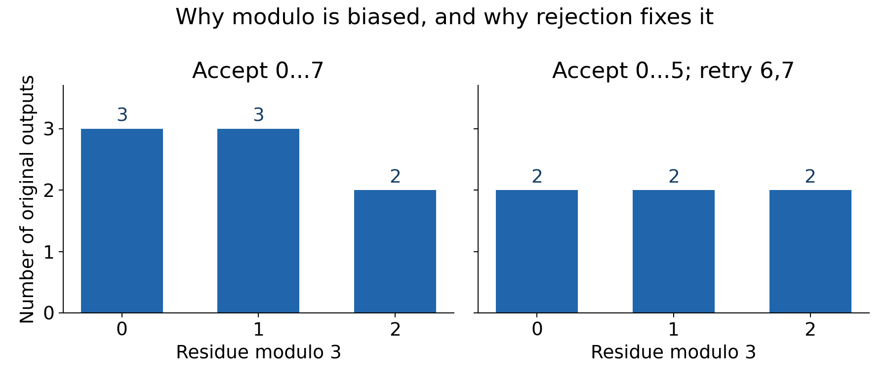
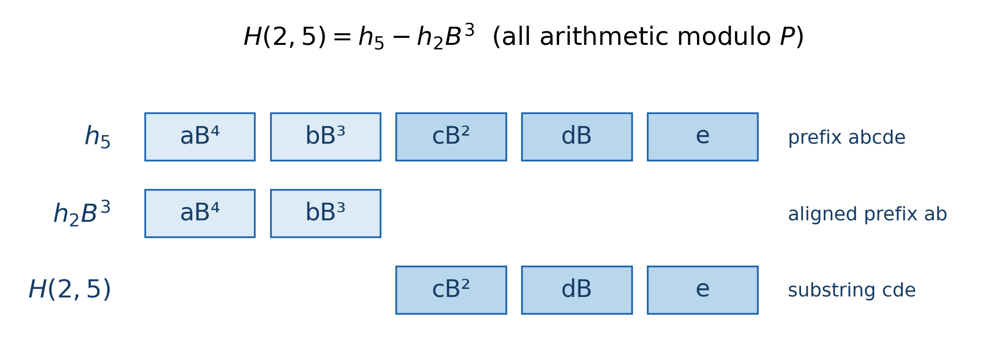

# Chapter 5 随机数与字符串哈希

假设有一个长字符串，需要回答很多次“这两段子串是否相同”。逐字符比较当然准确，但每次可能花费与子串长度成正比的时间。我们希望预处理以后，每次只看几个整数就能判断。

把字符串作进制数取模，得到短指纹：同内容必同值，不同内容可能碰撞。须解决子串提取、参数选择与整算法误判概率。

参数需要随机选，先把随机数怎么取说清楚。过程中也会顺便区分两个常被放在一起的“碰撞”：哈希表的桶冲突通常影响时间，拿指纹代替原字符串时的碰撞则可能影响答案。

## 1. 在区间里随机选一个整数，为什么不直接取模

均匀源 $0,\ldots,7$ 模 $3$：余数 $0$ 来自 $0,3,6$，$1$ 来自 $1,4,7$，$2$ 仅来自 $2,5$，并不均匀。

因此三种结果的概率为 $3/8,3/8,2/8$，并不均匀。

均匀源 $0,\ldots,R-1$ 中，$R=qk+r$ 时前 $r$ 个余数各有 $q+1$ 来源，其余 $q$ 个。仅 $k\mid R$ 时直接取模均匀；目标区间更宽时甚至有值无法出现。

怎么修？当 $1\le k\le R$ 时，令

$$
T=\left\lfloor\frac Rk\right\rfloor k.
$$

$X\ge T$ 重抽，否则返 $X\bmod k$。接受区间恰含整数个长度 $k$ 的组，各余数来源相同，故条件分布均匀，即拒绝采样。



须 $k\le R$，否则 $T=0$ 永远拒绝；更宽目标须组合多次源输出。竞赛可直接用标准分布处理边界。$R=2^{64}$ 本身不能存入 64 位整数。

### 引擎和分布各做什么

`mt19937` 输出范围 $[0,2^{32}-1]$，`mt19937_64` 为 $[0,2^{64}-1]$。状态相同则后续序列相同，默认构造不会自动换种子。

引擎负责提供这条序列，`uniform_int_distribution` 负责把输出映射到所需的闭区间。下面是 GNU C++17 下的短片段，放在已包含 `<bits/stdc++.h>`、使用 `using namespace std;` 的函数体中：

```cpp
uint64_t seed = chrono::steady_clock::now().time_since_epoch().count();
mt19937 rng((uint32_t) seed);

auto get = [&](int l, int r) {
    assert(l <= r);
    return uniform_int_distribution<int>(l, r)(rng);
};
```

只初始化一次，再反复调用 `get`。每次取数都重新播种，会反复从不同初始状态的开头取值，不能当作同一条正常推进的随机序列。

如果要选 61 位哈希参数，用 64 位引擎更方便：

```cpp
mt19937_64 rng64(seed);

auto get64 = [&](uint64_t l, uint64_t r) {
    assert(l <= r);
    return uniform_int_distribution<uint64_t>(l, r)(rng64);
};
```

分布包含两端，且可组合多次 32 位输出覆盖更宽区间；受单次位宽限制的是直接对一次 `rng()` 取模。

随机打乱数组则使用

```cpp
shuffle(a.begin(), a.end(), rng);
```

理想独立均匀选位下，Fisher–Yates 每次等概率选剩余元素，各排列概率 $1/n!$。排序比较器不能随机返回，它必须满足一致的严格弱序。

## 2. 种子为什么重要，时间种子又保证了什么

固定种子便于复现测试，也让已知种子的对手能预演选择并构造输入。默认、公开常量、易枚举的秒级时间种子均有此问题。

非交互竞赛常用高精度运行时钟，增加预制输入针对难度；时钟粒度不等于不可预测信息。32 位初始化仅留低 32 位，内部状态大不会增加种子熵。

区分统计性质、种子不确定性、对手观察时机。Mersenne Twister 长周期只说明状态轨道久不重复，不保证输出独立或不可预测，也不提供密码学安全。

`random_device` 不保证跨平台真随机：可退化为引擎，也可初始化或取数失败。`seed_seq` 只混合，不创造熵；某 OJ 的行为不能代表所有平台。

后文证明采用独立、均匀抽参数的数学模型。PRNG 是实用实现，标准分布只消除映射偏差，不能将有限种子引擎变成无限独立随机源。

通常假设先固定输入，再抽参数。交互输入或公开底数后才造串时须重证；固定输入的随机界不等于自适应输入的保证。

复现测试时还要记住：同种子引擎序列有标准定义，但分布、`shuffle` 的具体实现可能因标准库而异。因此种子和工具链信息最好一起保留。

## 3. 回到子串比较：前缀哈希为什么能相减

把字符编码为整数 $c_i$，例如字节编码为 $1,\ldots,256$。选模数 $P$ 和底数 $B$，先把字符串 $s$ 看成这个多项式在 $B$ 处的值：

$$
H(s)=c_0B^{n-1}+c_1B^{n-2}+\cdots+c_{n-1}\pmod P.
$$

这和按位读一个进制数类似：读到新字符，之前的值乘 $B$，再加新编码。于是定义长度为 $i$ 的前缀哈希 $h_i$，有

$$
h_0=0,\qquad h_{i+1}=(h_iB+c_i)\bmod P.
$$

取 $[l,r)$ 时，$h_r$ 中旧前缀 $[0,l)$ 比 $h_l$ 多左移 $r-l$ 位，应减 $h_lB^{r-l}$：

$$
\boxed{H(l,r)=h_r-h_lB^{r-l}\pmod P.}
$$



留下的最高次幂只由子串长度决定，和它原来处于哪个位置无关。因此不同位置的等长、同内容子串可以直接比较。公式也覆盖 $l=r$，空串哈希为 $0$。

预处理 $h_i$ 和 $\operatorname{pow}[i]=B^i\bmod P$ 后，每个子串指纹只需 $O(1)$ 次运算；一套预处理需要 $O(n)$ 时间和空间。同样的位移关系还给出拼接公式

$$
H(xy)=H(x)B^{|y|}+H(y)\pmod P.
$$

双哈希就是同时维护两套参数的值，渐近复杂度不变，只增加常数和存储。

### 在讨论碰撞概率前，先排除确定性错误

所有要比较的对象必须使用同一套参数和字符编码。不同底数算出的数，即使刚好相等也不能拿来说明原串关系。指纹相同时还应比较长度，尤其在把各种长度的串放进同一个集合时。

正编码有助于避免前导零歧义。如果允许零字符编码，空串和若干零字符就可能对任何底数都给出同一个值；这不是一次偶发的随机碰撞，而是表示方式先丢掉了信息。长度和编码约定需要先处理好。

哈希数值的大小也不表示字典序。常见做法是用相等性查询找最长公共前缀，再比较第一个不同字符；大小关系仍来自字符本身。

内容相同一定得到同指纹，因此指纹不同可以确定原串不同。反方向只能说“可能相同”。后面所有失败概率，讨论的都是不同字符串被错判成相同。

> **练习（估算 CF 难度）**：[ABCBAC](https://atcoder.jp/contests/abc284/tasks/abc284_f)（约 2000；也有确定性字符串解法）。

## 4. 随机底数为什么有用：碰撞是一条多项式方程

固定两个不同、等长的字符串 $s,t$，长度为 $L\ge1$。现在先固定它们，再随机选择底数。取素数 $P>256$，这样两个不同字节编码相减，不会在模 $P$ 后变成零。

将两串指纹相减，得到

$$
D(X)=\sum_{i=0}^{L-1}(c_i-d_i)X^{L-1-i}.
$$

有字符不同，故差是 $\mathbb F_P$ 上次数至多 $L-1$ 的非零多项式。碰撞恰为 $D(B)=0$，转为随机底数命中多项式根的概率。

为什么次数能限制根数？若 $a$ 是根，可以写成 $D(X)=(X-a)Q(X)$。另一个不同根 $b$ 必须满足

$$
0=(b-a)Q(b).
$$

域中 $b-a\ne0$ 可逆，故 $Q(b)=0$。每去一根降一次数，归纳得非零 $d$ 次多项式至多 $d$ 根；非零与域条件均必要。

如果底数均匀取自 $S\subseteq\mathbb F_P$，那么最多 $L-1$ 个坏底数落在 $S$ 中，因此

$$
\boxed{\Pr(H(s)=H(t))\le\min\left(1,\frac{L-1}{|S|}\right).}
$$

随机的是底数，输入字符串可以完全不随机，甚至由对手特意构造。只要字符串先固定，这个根数结论仍适用。

长度因子不可省：$P\approx10^9$、$L\approx10^6$ 且支持集近 $P$ 时，上界约 $10^{-3}$，不是 $10^{-9}$。实际率可能更低，却不能替代保证。$L=1$ 时次数零，不同字符不会碰撞。

### 双哈希需要哪一种独立性

再独立选一套底数，让两套指纹都相同才判为相同。若分别独立均匀选择 $B_1\in S_1,B_2\in S_2$，对同一固定字符串对，两次碰撞分别只由各自参数决定，于是

$$
\Pr(\text{两套都碰撞})
\le\min\left(1,\frac{L-1}{|S_1|}\right)
\min\left(1,\frac{L-1}{|S_2|}\right).
$$

可同素数配独立底数，或不同素数。关键是随机参数独立；共用随机底数的事件可能相关，不能直接相乘，复制一套值更无增益。

这里的结论仍属于前面说好的独立均匀抽样模型，不能仅凭代码中调用了两次 PRNG，就宣称得到不依赖种子模型的绝对概率保证。

## 5. 一次比较很可靠，整个程序还要再算一次

假设程序事先确定要比较 $Q$ 对字符串，每对长度最多为 $L$。只要其中一对误判，程序就可能出错。记第 $i$ 对碰撞事件为 $A_i$，有

$$
\Pr\left(\bigcup_i A_i\right)\le\sum_i\Pr(A_i).
$$

原因很朴素：一个结果如果包含多次碰撞，右边会重复计算它；包含至少一次碰撞的结果则至少被计算一次。因此无需各比较事件独立，这个并集界仍成立。

单哈希的总失败率至多

$$
\min\left(1,Q\frac{L-1}{|S|}\right),
$$

双哈希则可用

$$
\min\left(1,Q\frac{(L-1)^2}{|S_1||S_2|}\right).
$$

即使某个分式超过 $1$，式子仍是合法但没有信息量的上界。若不同对象长度差很多，逐对使用实际次数再求和，可以比统一代入最大长度更紧。

### 去重时，为什么不能只数插入次数

把 $N$ 个对象按指纹去重，虽然只有 $N$ 次插入，但任意一对不同对象碰撞都可能被合并。安全起见，候选碰撞对数应该按 $\binom N2$ 计算，而不是 $N$。

若另假设 $N\le P$ 个指纹独立均匀，依次避开已用结果的概率为 $1,1-1/P,1-2/P,\ldots$，相乘得无碰撞概率，故至少一次碰撞为

$$
1-\prod_{i=0}^{N-1}\left(1-\frac iP\right),
$$

并有上界 $\binom N2/P$；$N>P$ 必碰撞，即生日效应。多项式哈希不自动满足独立均匀指纹模型，严格界仍应按差多项式次数。

用一组数体会预算。令 $P=2^{61}-1\approx2.306\times10^{18}$，底数支持集几乎覆盖整个域，$L\le10^6$：

| 要分析的范围 | 用单套随机底数得到的统一上界 |
| --- | --- |
| 一对字符串 | 约 $4.34\times10^{-13}$ |
| $10^6$ 对比较 | 约 $4.34\times10^{-7}$ |
| $N=2\times10^5$ 个对象任意两两碰撞 | 约 $8.67\times10^{-3}$ |

最后情形用两套独立 61 位底数，先乘每对上界再对全体求和，约 $3.76\times10^{-15}$。这是保守界，非实际频率预测；须联合长度与比较量选参数。

### 二分 LCP 的比较会变化，还能这样分析吗

二分下一次比较哪个长度，往往取决于前一次的相等判断。比较集合没有直接写死，似乎不符合前提。

若分支仅依赖相等性，固定输入的真实相等关系确定一条与底数无关的理想轨迹。首次误判前程序沿该轨迹，故首次错误必来自其固定比较之一，可对它们取并集界。

若按哈希大小生成新串，或对手看参数后造输入，理想轨迹可能依赖参数。实际发生的 $Q$ 对不能当预先固定对，须覆盖全部潜在对或另证自适应保证。

## 6. 一套实用的素数模方案，算术细节也要正确

可以取梅森素数

$$
P=2^{61}-1.
$$

字符用 $1,\ldots,256$ 编码，底数均匀选自

$$
S=\{257,258,\ldots,P-2\},\qquad |S|=P-258.
$$

排除少数退化底数后，支持集仍近整个域。分母必须是实际支持集大小：只抽少数常量或只用一次 32 位输出，不能写成约 $2^{61}$。

使用前面的 `get64`，可写

```cpp
constexpr uint64_t P = (uint64_t(1) << 61) - 1;
uint64_t B = get64(257, P - 2);
```

但两个小于 $P$ 的数相乘，结果可能接近 $2^{122}$，不能在 64 位里先乘完再取模。GNU C++17 下可用 `__uint128_t` 保存中间结果：

```cpp
auto mul = [&](uint64_t a, uint64_t b) -> uint64_t {
    __uint128_t x = (__uint128_t) a * b;
    uint64_t y = (uint64_t) (x >> 61) + (uint64_t) (x & P);
    if (y >= P) {
        y -= P;
    }
    return y;
};
```

要求 $0\le a,b<P$。写 $x=u2^{61}+v$，由 $2^{61}\equiv1\pmod P$ 得 $x\equiv u+v$。又 $x<P^2$，故 $u+v<2P$，只须减至多一次 $P$，折叠也不溢出 64 位。

前缀转移先算 `mul(h, B)`，再加字符编码并归一化；这时结果小于 $P+256$。一般加法若两项都小于 $P$，和小于 $2P<2^{62}$，同样可最多减一次 $P$。

子串减法则先计算

$$
h_r+P-\operatorname{mul}(h_l,\operatorname{pow}[r-l]),
$$

再按需要减去一次 $P$。直接在无符号数里执行 $h_r$ 减乘积，可能先下溢并按 $2^{64}$ 回绕；之后再模 $P$，通常已经不是原来想要的模减法。

独立抽两底数，维护两套前缀幂，比较长度及双值。理想独立抽样可偶然同底数；强行修改相同结果会改变抽样模型，须另证，不能照套独立乘积界。

> **练习（估算 CF 难度）**：[Palindrome Query](https://atcoder.jp/contests/abc331/tasks/abc331_f)（约 2100；另需线段树或树状数组）。

## 7. 为什么固定双模和自然溢出不能替代上述证明

公开固定参数只定义确定函数，对固定输入没有本次随机参数的概率空间。固定多模也有专门碰撞构造，增加公开常量未必消除代数结构。

运行时随机选择参数的作用，是先固定输入，再让输入面对大量可能的函数；根数界才有地方使用。随机化不是给一个固定模板多写几组常量。

### 模 $2^{64}$ 和素数域，差别在哪里

自然溢出等价于模 $2^{64}$，不是素数域，非零元未必可逆。因此 $(b-a)Q(b)=0$、$b-a\ne0$ 不再推出 $Q(b)=0$，根数证明失效。

最小的例子：模 $8$ 时，非零一次多项式 $4X$ 在 $0,2,4,6$ 四处为零，根数已经超过次数。于是不能把素数域中的 $(L-1)/|S|$ 原样搬过来。

还可以造一个对所有奇底数都失败的字符串对。考虑

$$
D(X)=\prod_{j=0}^{10}(X^{2^j}-1).
$$

各因子选项对应不同二次幂子集，子集指数和互异，故展开后 $0$ 至 $2047$ 每次幂恰出现一次，系数均为 $+1$ 或 $-1$。

再看奇数底数 $B$。$B-1$ 至少有一个因子 $2$；奇数平方模 $8$ 为 $1$，所以 $B^2-1$ 至少有三个因子 $2$。之后每平方一次，

$$
B^{2^{j+1}}-1=(B^{2^j}-1)(B^{2^j}+1),
$$

后一个因子为偶数，因此至少再多一个因子 $2$。故对 $j\ge1$，$B^{2^j}-1$ 至少被 $2^{j+2}$ 整除。整项乘积至少被

$$
2^{\,1+\sum_{j=1}^{10}(j+2)}=2^{76}
$$

整除，自然也模 $2^{64}$ 为零。

系数为 $+1$ 处取两串编码 $2,1$，为 $-1$ 处取 $1,2$，按次数从高到低排列。得到两个不同长 $2048$ 的串，哈希差为 $D(B)$，对全部奇底数都碰撞。

偶底数高次幂最终被 $2^{64}$ 整除，前面字符贡献消失，也非修复。问题在滚动哈希结构，不是无符号算术；要用素数域证明就须在该域计算。

## 8. 哈希表的桶冲突，和指纹误判是两件事

`unordered_map` 保留完整键时，同桶后仍做相等比较，不会直接合并不同键。冲突影响速度，极端总操作时间可近二次。

公开桶策略可被针对。统一加盐 $x+S$ 保留模桶数的同余，未必打散冲突；简单 XOR 或线性变换也可能保留结构。

实用方案用运行时固定盐加 `splitmix64` 混合，再交桶映射。盐在容器生命周期内须固定，保证同键同哈希，不能每查重抽。

充分混合不等于通用哈希证明，也不保证自适应最坏 $O(1)$。`reserve`、低负载只改善重哈希和平均桶长，不能消除集中冲突。需确定性界时选 `map`、排序或直接索引。

尤其要区分以下两种键：

| 容器存的键 | 碰撞后还有什么信息可核实 |
| --- | --- |
| `unordered_map<string, ...>` | 保存完整字符串，桶内可精确比较 |
| `unordered_map<uint64_t, ...>`，整数来自字符串指纹 | 只保存指纹，原串信息已经丢失 |

第二种情况下，不同字符串若指纹相同，它们在进入容器前就已经变成相同整数。容器正确处理桶冲突，也无法恢复丢掉的原串差异。

## 9. 根据任务选择需要的保证

随机化手段解决的问题各不相同，选择时先确定你要保住的是答案、时间，还是测试可复现性。

| 任务 | 合适的路线 | 还要检查什么 |
| --- | --- | --- |
| 区间随机整数 | 引擎配 `uniform_int_distribution` | 种子模型、区间端点和类型 |
| 本地随机测试 | 固定并记录种子 | 复现时的工具链 |
| 整数哈希表的实用抗退化 | 固定运行时盐与充分混合 | 仍没有普遍最坏时间保证 |
| 大量子串相等查询 | 大素数域、大支持集随机底数 | 按长度、候选对数选择单哈希或双哈希 |
| 要求精确的模式匹配 | KMP、Z 等结构 | 任务是否适合该匹配模型 |
| 要求精确的静态子串 LCP | 后缀数组、LCP、RMQ 等 | 具体实现的时间与空间 |
| 指纹筛选后能核实原对象 | 哈希后再精确比较 | 核实的总时间可能很大 |

最后一种方案可以消除误判，但不能顺手声称仍然线性。大量真正相等的长串同样会触发逐字符核实，验证成本也要单独算。

检查长度、模数证明、底数支持集、总比较对数、输入与抽参顺序，才能给“低碰撞率”明确含义。

## 参考资料

以下保留原稿中的主要参考及各自用途。正文的根数界、并集界、61 位乘法和模 $2^{64}$ 反例均已展开，不要求先读链接。

1. [neal：随机化方案怎样被针对（61675）](https://codeforces.com/blog/entry/61675)。可对照固定序列与易预测种子的案例，阅读时注意普通竞赛输入和更强对手的区别。
2. [neal：unordered_map 退化与混合（62393）](https://codeforces.com/blog/entry/62393)。用于理解桶策略、简单加盐和充分混合之间的差异；旧标准库的具体桶数不是通用常量。
3. [Sugar_fan：固定滚动哈希的碰撞工具（129538）](https://codeforces.com/blog/entry/129538?locale=en)。用于说明固定多模参数仍可能被专门构造；本章不要求掌握其攻击实现。
4. [dacin21：Rolling hashes 与 anti-hash tests（60442）](https://codeforces.com/blog/entry/60442)。可对照随机底数、次数界与非素数模数的限制。
5. [rng_58：Hashing and Probability of Collision](https://rng-58.blogspot.com/2017/02/hashing-and-probability-of-collision.html)。把不同对象之差写成非零多项式，再分析随机求值，是理解哈希概率的主要思路。
6. C++ 标准草案：[随机引擎](https://eel.is/c++draft/rand.eng.mers)、[均匀整数分布](https://eel.is/c++draft/rand.dist.uni.int)、[random_device](https://eel.is/c++draft/rand.device)。用于对照接口语义与实现允许的边界。
7. [Mersenne Twister 作者主页](https://math.sci.hiroshima-u.ac.jp/m-mat/MT/emt.html)。用于了解引擎的用途，以及它不提供密码学安全这一边界。
